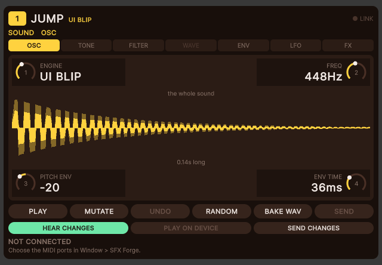
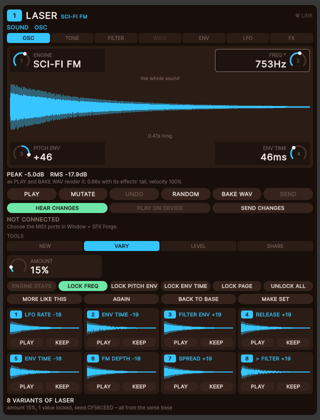

# SFX FORGE

Sound effects, instruments and adaptive music for games, on **VIBE FM** (and, later, the M-VAVE FM-1). Two kits of 16
synthesized sounds – SFX for the game's sound effects, MUSIC for the band its song plays – from five engines (one of
them a wavetable synth), with envelopes, an LFO, chorus, delay and reverb; a MUTATE button for instant variations; a
step sequencer with notes, velocity and length, a grid of 1/16, 1/32 or 1/64 for each pattern, a pattern that loops
while you play into it, undo, an arrangement, a page that shows the whole pattern as a grid,
automation for every knob, a mixer, and layers that follow the game's intensity; and a live MIDI/SysEx link to a game
engine. What you make on the device plays in the game with the same engine. In Unity the package also has tools for
designing sounds without the device: new sounds of a kind, variants, variation sets, batch baking, level matching, and
a sound as a line of text.

**[The manual](docs/MANUAL.md)** explains all of it: making sound effects, writing and mixing music, and getting both
into a game. In a hurry: **[the cheat sheet](docs/img/cheatsheet.png)** is every page and shortcut on one picture.

**[The Unity manual](docs/UNITY.md)** is its sibling for the game's side: the package, the three ways to play a sound,
adaptive music, the link to the device, recipes, and the showcase game as a worked example.

**[The videos](videos/README.md)** are in `videos/`: five of them, the current ones, made by scripts from the firmware
and the game themselves. Start with [the tour of the device](videos/sfx-forge-tour.mp4).

Everything is synthesized: there are no samples in it. Its strings, brass, choir and bells are synthesizer
instruments in that style, not recordings of an orchestra. The wavetables are computed from sums of harmonics in
`core/sfx_wavetable.h`; nothing is taken from another instrument.


Built with the VIBE FM SDK. Status: v1.0, firmware 1.7.0. The synth, the device UI and the device side of the link are
tested in the SDK's tools; the Unity package is tested in Unity 6.3 with the demo project's editor and Play mode tests.
Not tried yet: the hardware and the plugin. The link was run against the SDK's emulator over a virtual MIDI cable, last
with firmware 1.7.0 on 24 Nov 2026 (the six link tests, once; the recorded session once the day before, with the
1.7.0 build of that day, before the beat was added; PERFORM was not open in them).

**New in firmware 1.7.0: PERFORM.** A fourth page of K5: K5 now walks SEQ, SONG, AUTO, PERFORM and SEQ again. The
display shows the whole pattern as a grid, as a drum machine shows it: a row a sound, a cell a step, the playhead a
column that moves. F1 to F4 choose what the 16 pads are: STEPS of the selected sound, the kit's SOUNDS, MUTES, or
PATTERN and intensity. F5 is FILL and F6 is UNDO; with SHIFT the keys are LOOP or SONG, CLEAR, ALL ON, COPY and the
grid. The encoders are VOLUME, PAN, INTENSITY and LAYER.

**Also new in firmware 1.7.0: a beat and a time signature.** The bar's length was the song's already: encoder B on
SONG and PERFORM, 1 to 16 sixteenths. New is the beat: **SHIFT + B** on SEQ, SONG and PERFORM chooses an eighth,
three sixteenths, a quarter (as the device comes) or a dotted quarter. The metronome's click, the two shades of the
grids, the lines in the bar strip and FILL follow it, and the display names the bar by it: 12 sixteenths are
`BAR 3/4` with a quarter and `BAR 6/8` with a dotted quarter, 14 are `BAR 7/8`. The beat is the device's, not the
song's: it is not in the packed song, a game never gets it, and it changes no note. SAVE keeps it in a small file of
its own, `meter.bin`. With four quarters, as the device comes, nothing looks, sounds or is stored differently than
before. Still not there: a bar longer than 16 sixteenths (no 5/4, 6/4, 9/8 or 12/8), triplets, a length or a beat
for each pattern, and groupings like 2+2+3.

Nothing else changed: the song is format 6 and the patch format 2 as before, the messages of the link are the same,
and the identity says 1.7.0.

Both are tested by scripts only. `tests/check-perform.mjs` presses the page's keys on the built firmware and reads
the song and the sound (26 lines of `ok`). `tests/check-meter.mjs` does the same for the beat: what FILL writes,
where the click falls, that the song's bytes stay as they were, and what SAVE stores (21 lines of `ok`). The scripts
do not read the display: the second one sees only that the picture changes with the beat, not the words or the
shades. Nobody has played the page by hand, listened to it or to the click, and neither was run on the hardware or
in the plugin.

**New in firmware 1.6.0: a finer grid.** Each pattern has its own grid: 1/16, 1/32 or 1/64, which is 16, 32 or 64
steps for a full bar. SHIFT + F5 and SHIFT + F6 on SEQ and AUTO make it coarser or finer; finer changes nothing you
hear, coarser asks before it drops a step. The pads and the tiles show 16 steps of the bar at a time, and SHIFT +
LEFT / RIGHT move to the 16 before or after. A hit in a take lands on the nearest step of the pattern's own grid.
With it the song changed: format 6, which keeps only the rows that are used and has no fixed length (the factory
song is 2487 bytes; it was 7699), a new shape of the song message, a new file in the device's store (`song6.bin`),
and an identity that says song format 6 and 64 steps. Songs of the older formats are still read, and the song
message of before is still taken. In Unity the package plays, shows and reads the finer patterns
([the Unity manual](docs/UNITY.md#a-finer-grid)).

What that means for older versions: a firmware up to 1.5.0 drops the new song message without a word, so the Unity
package refuses in words before it sends a format-6 song to one; and a Unity package from before firmware 1.6.0 does not read
a format-6 song. Update both together.

All of it is tested by scripts against the built firmware (below, "Build"). Over MIDI against the emulator the six
link tests passed with 1.6.0, and again with 1.7.0 (last on 24 Nov 2026, with the build that has PERFORM and the beat), with
songs of sixteenths only: a pattern at 1/32 or 1/64 has not crossed a MIDI port.
It was not run on the hardware or in the plugin, and nobody has played or listened to it yet.

**New in firmware 1.5.0: the sequencer.** PLAY plays what the top line says, LOOP (the pattern repeats) or SONG (the
arrangement); REC switches to LOOP, so a pattern stays under your hands while you play into it; F2 is UNDO on the
song's pages; F4 held erases during a take; the keys that throw a whole song or arrangement away ask twice.

## Layout

| | |
|---|---|
| `core/sfx_core.h` | the sound engine: patch format, five engines, envelopes, LFO, mutate, SysEx packing. Portable C, no heap, no libc – shared by the Vibe, the native library and the future FM-1 firmware |
| `core/sfx_wavetable.h` | the six wavetables, computed at start |
| `core/sfx_song.h` | the player: 16 voices, chorus / delay / reverb, and the music – a song (8 patterns, each with its grid of 16, 32 or 64 steps, notes, chain, a layer threshold per sound), its packed form and its sequencer |
| `sfx-forge/` | the Vibe: pads, pages, display, storage, MIDI |
| `native/` | the same engine as a native library (Windows x64 so far), for game engines |
| `unity/com.catsplat.sfxforge/` | the Unity package: the link, presets, a player, telemetry, the tools for designing sounds (generators, variants, variation sets, batch bake, levels, a sound as text), and an editor UI drawn like the device's display (`Editor/UI` is its kit) |
| `unity/Demo/` | a Unity 6.3 project using the package: a hovercraft whose every sound is synthesized live |
| `tests/` | a scripted performance (`tour.json`) and its checks (`check.mjs`); more scripts of key presses, each with its check (`loop`, `modes`, `take`, `edit`, `undo`, `retake` for the sequencer, `grid`, `regrid`, `take64` for the finer grid, `song-export` for what SEND gives: the list is under "Build"); seven checks on a small host of their own, `host.mjs`, which hands the built firmware keys, SysEx and a store (`check-identity.mjs`, `check-grid-keys.mjs`, `check-perform.mjs`, `check-meter.mjs`, `check-atomic.mjs`, `check-wire.mjs`, `check-store.mjs`); `stress-song-way.c`, two threads over the song's way from the controls to the audio; `make-grid-scenes.mjs` writes the three grid performances; `dotnet/` tests the Unity package's core without Unity |
| `tests/mix-report.mjs` | measures the demo song's mix: every instrument soloed in turn – its level, its peak, how much of it is high |
| `tests/unity-inspectors/` | a small Unity project that tests the package's editor UI (the sound inspector with its tools, the song inspector, the variation set's inspector, the SFX Forge window and the bake window; 169 EditMode tests) and writes pictures of it to `out/inspector-shots/`. The pictures are the Inspector's element tree and stylesheet rendered in a panel to a texture, not photographs of the Inspector. Its README has the command |
| `docs/` | the manual, and `figures.py`, which builds its pictures from the firmware's own screenshots |
| `docs/UNITY.md` | the Unity manual: the package and the showcase, with its own figures (`docs/img/unity-*.png`, built by `docs/unity_figures.py` from the song file and the recorded takes in `out/unity-video/`; its pictures of the editor UI, `unity-inspector-*.png`, are copied by the same script from `out/inspector-shots/`: `SFXFORGE_FIGURES=inspectors python docs/unity_figures.py` after the inspectors' tests ran) |
| `docs/MAINTAINING.md` | [the maintainer's guide](docs/MAINTAINING.md): the map of the code, how to build and test everything, what to read first, recipes for common changes, what must never break |
| `videos/` | the five finished videos, the current ones, committed (42 MB). Its [README](videos/README.md) says what each shows and how to make it again. The scripts that make them are in `docs/video/` |
| `docs/video/make_videos.py` | makes the two videos (a feature tour, and building the demo song piece by piece) from scripts of key presses: the firmware renders its own display and sound, ffmpeg joins them. Results: [`videos/sfx-forge-tour.mp4`](videos/sfx-forge-tour.mp4) and [`videos/sfx-forge-build-a-song.mp4`](videos/sfx-forge-build-a-song.mp4); what is made on the way stays in `out/video/` |
| `tests/emulator-link.mjs` | the device's end of the link without hands: opens the SDK's emulator in a Chrome of its own, allows it MIDI and presses its keys. With `Tests/LinkTakes.cs` and `Tests/LinkSession.cs` in the showcase it tests the link end to end |
| `docs/video/make_link_video.py` | makes [`videos/sfx-forge-unity-link.mp4`](videos/sfx-forge-unity-link.mp4) from one recorded session: the emulator and the game side by side, with what crossed the MIDI ports |
| `docs/video/make_unity_videos.py` | makes the two Unity videos: [`videos/sfx-forge-unity-showcase.mp4`](videos/sfx-forge-unity-showcase.mp4) (the showcase game, start to goal) and [`videos/sfx-forge-unity-how-it-works.mp4`](videos/sfx-forge-unity-how-it-works.mp4) (the three routes, the music, the event seam, with the code). It lays out the takes the showcase records of itself into `out/unity-video/` (the showcase's README, "Recording it"); `docs/video/check_unity_capture.py` checks those takes. Captions only; all sound is SFX FORGE in Unity |
| `build.sh` | build, `vibe-check`, render the performance to `out/` |

## Build

Needs the SDK in `.tools/vibe-fm-sdk`, Zig 0.13.0 (in `.tools/`, on PATH, or `ZIG=`), Node 18+, Python 3 (it takes the debug sections, which hold this machine's paths, out of the built `.wasm`). On Windows use Git Bash.

```sh
git clone https://github.com/Vibe-FM-SDK/vibe-fm-sdk.git .tools/vibe-fm-sdk
sh build.sh
```

Gives `build/sfx-forge.wasm` (drop it onto <https://play.thefirmwarehub.com/>) and `build/sfx-forge.zip` (drop it onto
the VIBE FM VST window), then runs `vibe-check` and the test performances: scripts of key presses played into the
built firmware by the SDK's `wasmtest`, each with a check of the sound that came out or of the song the device then
sent. Each writes into its own folder in `out/` and ends with a line `… PASSED`; the first that fails stops the build.

| Performance | Check | What it checks |
|---|---|---|
| `tour.json` | `check.mjs` | a walk through the pages: the song's kicks in time, a pad as a step, a cue on the bar line, SEND as 16 sounds and the song (format 6) in pieces of up to 240 bytes. Leaves `out/audio.wav`, screenshots and `out/midi.json` |
| `daw.json` | `check-daw.mjs` | the sequencer follows a DAW's tempo and position (`out/daw/`) |
| `guide.json` | `check-guide.mjs` | the tour (MENU) plays what its captions say (`out/guide/`) |
| `reset.json` | `check-reset.mjs` | the factory reset |
| `metronome.json` | `check-metronome.mjs` | the click on the beats while REC is on, and SHIFT + REC switching it off |
| `loop.json` | `check-loop.mjs` | REC + PLAY on SEQ: the pattern goes round and the arrangement does not walk on, a hit is recorded, F2 takes the take back and brings it again, F4 held erases it |
| `modes.json` | `check-modes.mjs` | LOOP holds a pattern bar after bar, a cued pattern starts on the bar line and stays, F1 while it plays goes on in the arrangement, and SONG plays the arrangement as before |
| `take.json` | `check-take.mjs` | a take over three bars lands in the pattern on the display; F4 erases only the steps that pass under it |
| `edit.json` | `check-edit.mjs` | nothing plays: NEW and SHIFT + pad 16 ask twice (once does nothing), COPY goes into the first empty pattern and leaves the chain alone, CLEAR, and F2 after each |
| `undo.json` | `check-undo.mjs` | what F2 takes back and what it leaves: bars added, a run of edits that ends with the page and the pattern, after a factory reset, after COPY, after a CLR PAT with nothing to clear |
| `retake.json` | `check-retake.mjs` | a knob turned in a take does not cut it in two, a pattern chosen before STOP is the one shown, a held pad ends though REC went off in between, a take in SONG goes along the arrangement, the click stays under full scale |
| `grid.json` | `check-grid.mjs` | a pattern's grid and the 16 steps the pads show of it: SHIFT + F6 to 32 and 64 steps, SHIFT + RIGHT to steps 17–32, the hat heard on those thirty-seconds, FILL every 1/4, 1/8, 1/16, 1/32 and none |
| `regrid.json` | `check-regrid.mjs` | a pattern put in a finer grid sounds alike on the device; a coarser one drops what stands between, asks first, and F2 brings it back |
| `take64.json` | `check-take64.mjs` | a take at 64 steps keeps the player's timing: hits 100, 290 and 1010 ms after the bar line land on their steps; a pad switches the step it shows; F4 held erases |
| – | `check-grid-keys.mjs` | the question before a step is dropped is asked again when the number it named is no longer true; SHIFT + LEFT / RIGHT go only through the 16s that hold a step of a short bar |
| – | `check-perform.mjs` | the PERFORM page (firmware 1.7.0): the pads as STEPS, SOUNDS, MUTES and PATTERN after F1 to F4; REC makes them the kit and a take is recorded; F5 FILL and F6 UNDO; with SHIFT: LOOP or SONG, CLEAR, ALL ON, COPY, the grid; the four encoders, A and B; K5 once more is SEQ again |
| – | `check-meter.mjs` | the beat and the time signature (firmware 1.7.0): SHIFT + B walks the four beats and stops at the ends on PERFORM, and is the beat on SEQ too (one click); FILL begins with the beat, also at 32 steps; in a bar of 12 sixteenths the click is a quarter apart (3/4) or a dotted quarter apart (6/8), with the bar line's click told apart; SHIFT + B changes no byte of the song, B only the bar's length; the display of that bar differs with the beat; SAVE keeps the beat in `meter.bin` (one byte) and removes the file with a quarter; a `meter.bin` with 2, 3 or 5; NEW leaves the beat, the factory reset puts the quarter back |
| – | `check-atomic.mjs` | a pattern or a song rewritten while it plays reaches the player whole: the grid changed, F2, COPY and a song over SysEx leave every sample as it was |
| – | `stress-song-way.sh` | two real threads over `sfx-forge/song_way.h`, built natively: the player never gets half a song. It prints no `ok` lines, only its last one |
| `song-export.json` | `check-song-export.mjs` | the factory sounds and song as SEND gives them are, byte for byte, the file the Unity demo's song was built from: 16 sounds, then 2487 bytes of format 6 in 11 pieces |
| – | `check-identity.mjs` | the identity and the other messages, sent into the firmware as SysEx; the version in the firmware and in `firmware.json` are the same |
| – | `check-wire.mjs` | the song on the wire: both shapes of the song message, pieces out of order and doubled, one song straight after another, the longest song |
| – | `check-store.mjs` | what the device stores: `song6.bin` is written, `song.bin` is read and never written, a `song.bin` saved later by an older firmware wins and F2 brings the other back, a full store is not called SAVED |

All 24 pass on firmware 1.7.0 (`vibe-check` and the 23 above): the output of `sh build.sh` has 24 lines that say
`PASSED`. The 22 checks that print `ok` lines print 239 of them, counted in the output of the last run (15, 1, 4, 1,
1, 7, 6, 8, 11, 7, 7, 7, 8, 7, 20, 26, 21, 23, 1, 27, 15 and 16, in the order of the table, which is the order they
run in); the stress test prints none and `vibe-check` prints marks of its own. They hear the output
and read the song the device sends. Seven checks have no performance and run the firmware on `tests/host.mjs`; some
of them also compare the display's pixels, to tell that it changed or that the LINK light is on. None of the 24
reads what a page or a toast says, and none sees how PERFORM's grid is drawn. Of the beat the checks see what FILL
writes, where the click falls, the song's bytes, the store, and that the display's picture changes with it. They do
not read the words (`BAR 6/8`, `BEAT 3/8: BAR 6/8`) or see the shades and the bar strip's lines, and they try
neither the click with swing, nor a bar that is not a whole number of beats, nor SHIFT + B on SONG, nor that DEMO,
a song from a game and UNDO leave the beat (NEW and the factory reset are tried). Not checked at all: the stage's buttons
(its REC button on PERFORM among them), the stage's GRID chip and the shades of its grids, solo on PERFORM, ERASE
across a change of pattern, a DAW's song position at a finer grid, and undo of RAMP and a song loaded from a game.
Undo of FILL is checked on PERFORM only (F6). Nobody has listened to the click or played any of it by hand, and
nothing was run on the hardware or in the plugin.

## Playing it

The short version; [the manual](docs/MANUAL.md) is the long one.

- **Two kits** – SFX (the game's sound effects, beside the song) and MUSIC (the instruments the song plays, through the
  mixer), 16 sounds each. SHIFT + ENTER changes kit; the song pages choose MUSIC by themselves. The top line says which.

- **MENU** – the tour: SFX FORGE plays and names what it can do, a caption at a time (about 40 s: the sounds, shaping
  one, MUTATE, notes, instruments, wavetables, the song, its layers, cued patterns, the link). Any touch ends it;
  everything it changed is put back. On the stage: the TOUR button.
- **The display** – on the sound pages it shows the selected sound itself: its whole shape from start to end, and its
  wave (10 ms of it) – or, on ENV, FILTER and LFO, the envelope, the filter and the LFO as their knobs set them. It
  redraws as the knobs turn. Values read in their units (Hz, ms, %). The top line always shows the selected sound and
  the song: playing or not, its pattern and tempo. **LEFT / RIGHT**: the sound page before / after.
- **Pads** – the kit's 16 sounds. **Keys** – the selected sound as an instrument, in tune, up to 16 notes. **DATA** selects a sound.
- **F1 PRESET** – the next named sound onto the selected pad (SHIFT: the one before): 16 sound effects in the SFX
  kit; in the MUSIC kit 23 instruments – KICK, SNARE, HI-HAT, FM BASS, FM KEYS, BRASS, STRINGS, CHOIR, BELLS, ORGAN, …
  **F2–F6** – MUTATE (±15 %) · UNDO · RANDOM · EXPORT (SysEx) · SAVE.
- **K1 SOUND** – press again for its next page; **encoders 1–4** are the four values shown (SHIFT: fast):
  1. ENGINE · FREQ · PITCH ENV · ENV TIME
  2. the engine's two own controls (FM RATIO / DEPTH, ARP STEP / SPEED, GRAIN RATE / AMT, wavetable POSITION / WARP) · NOISE · CRUSH
  3. CUTOFF · RESO · FILTER ENV · its time
  4. (wavetable only) TABLE · SPREAD
- **K2 ENV** – ATTACK · DECAY · SUSTAIN · RELEASE. SUSTAIN off: a one-shot that plays to its end. Above: held while the
  pad or key is. **K3 LFO** – RATE, and how far it moves PITCH, FILTER and TIMBRE. **K4 FX** – sends to CHORUS, DELAY
  and REVERB, and the sound's LEVEL.
- **PLAY / STOP** – the song, with a demo to start from. It follows the DAW's song position while the DAW plays, else
  its own tempo.
- **LOOP or SONG: what PLAY plays** (firmware 1.5.0). **LOOP**: the pattern repeats, and a pattern you choose takes
  over on the next bar line and repeats in its turn. **SONG**: the arrangement, or the chain if there is none. On the
  song's pages a pill in the top line says which, and **F1** changes it (it reads TO SONG or TO LOOP), also while it
  plays: to SONG, it goes on in the arrangement from the first bar that has the playing pattern. On PERFORM the key
  is SHIFT + F1. Opening SEQ, AUTO or PERFORM
  while it stands sets LOOP, opening SONG sets SONG; while it plays, or with REC lit, the pages leave it alone. PLAY
  itself never changes it. As it comes it is SONG: PLAY on a sound page plays the demo as arranged.
- **Choosing a pattern** – LEFT / RIGHT on SEQ, SONG, AUTO and PERFORM: the pattern before / after (on SONG also
  encoder 1 and pads 1–8; on PERFORM pads 1–8 after F4). While it stands: at once. While it plays: on the next bar line – until then the top line reads `A>C` and
  the title `EDIT C - PLAYS A`, and in the row of eight letters under the page the waiting one blinks. STOP before the
  bar line: the pattern you chose is the one shown, and the one the next PLAY starts.
- **REC** – lighting it sets LOOP. REC + PLAY: what you play goes into the pattern that plays, on the step of its own
  grid nearest to each hit and as hard as it was hit, round after round – on the SEQ page the pads are then the kit and the keys the
  notes, like on a groovebox (REC off: the pads are the steps again). On PERFORM, REC makes the pads SOUNDS, and F1
  makes them steps again with REC still lit. The display stays on the pattern that plays. A
  metronome clicks on every beat while REC is on, higher on the bar line (SHIFT + REC: off); the beat is a quarter
  unless SHIFT + B chose another. There is no count-in. **F4 held is ERASE** while a
  take runs: the selected sound's steps go as the bar passes them, a tap takes only the step under the playhead. With
  F1 at SONG the take goes along the arrangement, and each hit lands in the pattern of its bar. Only the MUSIC kit is
  recorded. ERASE is on SEQ only: PERFORM has none.
- **UNDO** – F2 on SEQ, SONG and AUTO, F6 on PERFORM, one step; the key again brings it back. A step is: the edits made in a row on one
  page and pattern (steps, notes, velocities, lengths, automation points); a whole take, from its first hit until STOP, PLAY or REC;
  the bars added and removed in a row; or one FILL, CLEAR, RAMP, COPY, CLR PAT, cleared arrangement, NEW, DEMO or
  song loaded from a game, or one change of a pattern's grid. It brings back notes, automation and the arrangement – after NEW, DEMO and a loaded song
  the whole song with its tempo and mix. Not the sounds (F3 on the sound pages is their undo), and not a turn of
  tempo, swing or a fader.
- **K5 SEQ** – the display shows 16 steps of the selected sound, big, each with its number and its note, and under them the eight
  patterns as a strip of letters (every sound's steps at once: the stage). The pads are those 16 steps (a step switched on is heard); SHIFT + pad hears and selects that
  pad's sound, DATA walks the sounds. A step may carry a note: hold its pad and play a key, or turn NOTE (it moves along
  the scale chosen with encoder B). Encoders: STEP · NOTE · VELOCITY (1–8: a step is drawn as high as it is hard) ·
  LENGTH (AUTO, or a number of steps up to one less than the grid: `>3` in the step's corner says it holds 3). A: the tempo, SHIFT + A: the swing. SHIFT + B: the beat. F1 LOOP or SONG ·
  F2 UNDO · F3 FILL: every beat (1/4 as the device comes), every 1/8, every 1/16, in a finer pattern also every 1/32, none · F4 CLEAR the sound's steps (ERASE while a take
  runs) · F5 COPY the pattern into the next empty one, and on to it: a variation to make · F6 SAVE. A sustained sound
  holds until it plays again or the bar ends.
- **The grid** (firmware 1.6.0) – each pattern has its own: 1/16, 1/32 or 1/64, so a full bar has 16, 32 or 64 steps.
  The title says it (`PATTERN A  1/16`). **SHIFT + F6** on SEQ, AUTO and PERFORM makes it finer, **SHIFT + F5** coarser, one
  level a press. Finer moves every step to the step that begins at the same moment: it sounds the same. Coarser with
  a step or a point between asks first (`AGAIN: H DROPS 3`) and drops them on the second press; F2 brings them back.
  At 1/32 and 1/64 the pads and the tiles are 16 steps of the bar, and **SHIFT + LEFT / RIGHT** move to the 16 before
  or after (`STEPS 17-32`); a strip in the footer shows the whole bar and which part is shown. The numbers of the
  steps that begin a sixteenth are brighter. COPY copies the grid, CLR PAT keeps it, NEW sets every pattern to 1/16.
  The song's bar is still counted in sixteenths, 1 to 16, and the click is on the beat whatever the grid is.
- **The bar and the beat** (firmware 1.7.0) – a time signature in two parts.

  | Control | What it sets | Whose it is |
  |---|---|---|
  | B on SONG and PERFORM | the bar's length, 1 to 16 sixteenths: 3/4 is 12, 6/8 is 12, 7/8 is 14, 5/8 is 10 | the song's: saved and sent with it |
  | SHIFT + B on SEQ, SONG and PERFORM | the beat: 1/8, 3/16, 1/4 (as the device comes) or 3/8. A click of B is one beat further; it stops at 1/8 and at 3/8 | the device's: SAVE keeps it in `meter.bin` |

  What follows the beat: the click (on every beat, higher on the bar line; a bar that is not a whole number of beats
  ends with a short one), the pulse of the red REC dot, the two shades of the empty cells on PERFORM and on the
  stage, the two shades of SEQ's and AUTO's tiles at 1/16 (at 1/32 and 1/64 they stay the rows of pads), the lines
  in the bar strip, and FILL. FILL's first press is every beat (`EVERY 3/8`, `EVERY 1/4`, `EVERY 3/16` or
  `EVERY 1/8`), then every eighth where the beat is made of eighths (a quarter, a dotted quarter), then every
  sixteenth, at 1/32 and 1/64 also every thirty-second, then `SOUND CLEARED`.

  The display names the bar. Turning B says `BAR: 12/16 = 3/4` (a bar counted in sixteenths anyway says only
  `BAR: 7/16`); SHIFT + B says `BEAT 3/8: BAR 6/8`. When the bar is not four quarters, the second line of SEQ, SONG,
  AUTO and PERFORM says it after the grid: `PATTERN A  1/16  BAR 6/8`, and with a beat of an eighth `BAR 6/8 IN 1/8`
  (left out when there is no room). A quarter beat counts quarters when the bar comes out whole (12 is 3/4), else
  eighths (14 is 7/8), else sixteenths (7 is 7/16). An eighth or a dotted quarter counts eighths (12 is 6/8), else
  sixteenths. Three sixteenths count sixteenths (12 is 12/16).

  The beat is not in the song. A game or Unity never gets it, F2 and F6 UNDO do not take it back, and NEW, DEMO and
  a song from a game leave it as it is; only the factory reset puts the quarter back. So a song of 12 sixteenths is
  3/4 on one device and 6/8 on another. In a game it sounds the same either way: the beat changes no note. With
  swing a beat of three sixteenths gives an uneven click: swing holds back every other sixteenth, and every second
  such beat is on one.

  What it does not do: a bar longer than 16 sixteenths (no 5/4, 6/4, 9/8, 12/8), triplets, a length or a beat for
  each pattern, and groupings like 2+2+3 (the beats are all the same length; only the last may be short).
- **K5 again: SONG** – what makes it game music. The display shows the eight patterns (what is in each, and the
  chain), and the layers: INTENSITY as a level that rises over each sound's mark.
  - **LAYER**: every sound has a threshold and plays only while **INTENSITY** is at or above it. Low intensity: the
    kick alone. High: bass, snare, strings, lead, effects.
  - **PATTERN** A–H (also pads 1–8): a chosen pattern takes over on the next bar line. **CHAIN**: walk patterns A…n by
    itself (not used while there is an arrangement). Pads 9–16 set the intensity. A: the tempo, SHIFT + A: the swing.
    Encoder B: the bar in sixteenths, 1–16, for every pattern (SHIFT + B: the beat). A pattern with a finer grid
    has a small `32` or `64` in the corner of its tile.
  - F1 LOOP or SONG · F2 UNDO · F3 CLR PAT: the shown pattern empty · F4 NEW: an empty song (SHIFT + F4: the DEMO
    song again) – both ask twice, leave the sounds as they are, and F2 brings the song back · F6 SAVE.
  - **SEND** (F5): the 16 sounds and the song to the game.
- **The arrangement** (SONG page) – up to 32 bars, a pattern each, played in order and again from the top (PLAY starts at the first bar
  that has the shown pattern; if none has it, that pattern once and then from the top): SHIFT + pad
  1–8 adds that pattern as a bar, SHIFT + pad 9–15 takes the last bar away, SHIFT + pad 16 all of them (it asks
  twice; then the chain plays again). In SONG a cued pattern that is in the arrangement goes on from its bar; one
  that is not – a boss, a menu – takes over and stays until the next cue. In LOOP every chosen pattern stays.
- **K5 a third time: AUTO** – automation, for any knob. A song has 24 lanes; each moves one knob of one sound – any
  of its own 25 values, its fader, its pan – or the master's delay time, feedback, room size, damping or drive. So a
  sound has as many lanes as it has knobs that should move. AUTO opens on the knob you turned last: turn it on its own
  page, go to AUTO, and its lane is there (TARGET, encoder 3, chooses another). A pad puts a point on its step (where
  the knob stands), VALUE (encoder 2) moves it; a point holds until the next one or the bar's end. F1 LOOP or SONG,
  F2 UNDO, F3 RAMP draws a straight line from point to point, F4 clears the lane, F5 COPY the pattern as on SEQ.
  Nothing is written into the sound or the mix: at every bar
  line each knob is back where you made it. In the engine it is one function (`sfx_auto` in `core/sfx_song.h`), asked
  wherever a knob's value is used – in the game as on the device.
- **K5 a fourth time: PERFORM** (firmware 1.7.0) – the whole pattern at once, to play with. The display is a grid as
  a drum machine shows it: 16 rows, one for each sound of the MUSIC kit, and a cell a step (16, 32 or 64 by the
  pattern's grid). A step is brighter the harder it plays, the playhead is a column that moves, and the selected
  sound's row is lit. A sound's name is grey when it is not heard (muted, another one solo, or its layer off), with an
  M or an S beside a muted or solo one. Under the grid: the four values in one line, the eight pattern letters, and a
  line that says what the pads are (`PADS: STEPS OF KICK`). K5 once more is SEQ again.

  | Key | The 16 pads are | |
  |---|---|---|
  | F1 STEPS | 16 steps of the selected sound, on and off, as on SEQ | as the page opens. A white frame in the grid marks them. SHIFT + pad hears and selects that pad's sound. A pad held + a key: the step gets the key's note. At 1/32 and 1/64 SHIFT + LEFT / RIGHT choose which 16 steps |
  | F2 SOUNDS | the kit: a pad plays and selects its sound | with REC lit while it plays, what is played is recorded into the pattern |
  | F3 MUTES | a pad mutes its sound, again lets it be heard | SHIFT + pad: solo. As on MIX |
  | F4 PATTERN | pads 1–8: pattern A–H. Pads 9–16: the intensity | a pattern is chosen at once while it stands, on the next bar line while it plays. As on SONG |

  The chosen key is drawn blue. The other keys and the encoders:

  | Control | What it does |
  |---|---|
  | F5 FILL | the selected sound: every beat (1/4 as the device comes), 1/8, 1/16 …, then none (F3 on SEQ) |
  | F6 UNDO | one step back; again: redo (F2 on SEQ) |
  | SHIFT + F1 | TO SONG / TO LOOP: what PLAY plays |
  | SHIFT + F2 CLEAR | the selected sound's steps in this pattern |
  | SHIFT + F3 ALL ON | no mute, no solo |
  | SHIFT + F4 COPY | the pattern into the next empty one |
  | SHIFT + F5 / F6 | the grid coarser / finer |
  | Encoders 1–4 | VOLUME and PAN of the selected sound (the mixer's), INTENSITY, the selected sound's LAYER |
  | A, B | the tempo (SHIFT + A: the swing); the bar's length in sixteenths (SHIFT + B: the beat) |
  | DATA | selects a sound |
  | LEFT / RIGHT | the pattern before / after |

  REC pressed on PERFORM makes the pads SOUNDS, and so does opening the page with REC lit; switching REC off leaves
  the pads as they are. Opened while the song stands and REC is off, the page sets LOOP. There is no SAVE key on
  PERFORM: SAVE is F6 on SEQ. What the page says names F6 for undo (`CLEARED - F6: UNDO`).
- **The display** is one of three kinds of page: the 16 pads as 16 tiles beside the four values (SEQ, SONG, AUTO, MIX),
  a picture of what the knobs shape with their values in its corners (the sound pages, MASTER), or the whole pattern
  as a grid with the four values in a line under it (PERFORM). The knob being
  turned is written large across the middle for a moment.
- **K4 again: MIX** – the mixer: a fader and a pan for every sound (encoders 1 and 2, for the selected one), DRIVE
  on the sum, the OUTPUT volume. The pads mute a sound, SHIFT + pad solos it; F1 MUTE, F2 SOLO, F3 RESET, F4 ALL ON,
  F5 PLAY.
- **K4 a third time: MASTER** – the effects every sound sends to: the delay's TIME (1/16 to 1/2) and FEEDBACK, the reverb's ROOM
  SIZE and DAMPING, drawn as the echoes and the fading they give.
  The mix belongs to the song: it is saved with it, sent with it, and is the mix in the game.
- **The demo song** – our own, played by the MUSIC kit: funk in E minor the way a 16-bit console's FM chip played it.
  Drums, an FM bass, FM keys, brass stabs, bells, strings and a choir; six patterns (two of the verse, two of the
  chorus, a breakdown, a turnaround) arranged over 16 bars, with the strings swelling and the bass opening its filter
  by automation. Only the kick plays at intensity 0.
- **K6 LINK** – the game engine's side (below).
- **The stage** (browser and plugin) – the whole instrument for the mouse, on one picture:
  - left: the 16 pads with their names; the selected sound's picture, its pages (OSC TONE FILTER WAVE ENV LFO FX, and MIX, MASTER and AUTO)
    and their four values – drag one, or turn the wheel over it (SHIFT: fast; UNDO takes a drag back); PRESET (SHIFT or
    the right button: the one before), MUTATE, UNDO, RANDOM, EXPORT, SAVE.
  - right: the pattern, a row a sound, the whole bar in 16, 32 or 64 cells; rows are dim while their layer is silent. The chip GRID under LINK says the pattern's grid: a click makes it finer, SHIFT or the right button coarser. Click a step
    to set it, the wheel gives it a note (SHIFT + wheel: its velocity, CTRL + wheel: its length), click a row's name to hear and select the sound (SHIFT or the right button: mute it). INTENSITY and the selected
    sound's LAYER are sliders; the marks over INTENSITY are where each sound comes in. FILL (RAMP on the AUTO tab),
    CLEAR, COPY, UNDO, DEMO (it asks twice).
  - the AUTO tab turns the rows into the sounds' automation lanes: choose a TARGET for the selected sound (drag the
    cell or turn the wheel over it), then click or drag in its row to draw points – the height is the value. SHIFT or
    the right button takes a point away; RAMP joins the points with straight lines. VALUE sets one point finely.
  - top: LOOP / SONG (what PLAY plays), PLAY, REC, the tempo (click its halves, or the wheel), the patterns A–H (a
    pattern that waits for the bar line blinks; SHIFT or right-click: one more bar of that pattern in the
    arrangement) with the arrangement under them (click a bar: its pattern; SHIFT or right-click: the arrangement
    ends before it – UNDO brings it back), TOUR.
- **HOME** – what every control does on the page open now.
- **SHIFT + MENU, twice** – factory reset: both kits and the song as they came, the beat a quarter again, and
  saved so.

## The link (device ⇄ game engine)

Plain MIDI, so it works over USB, the plugin's MIDI ports and Web MIDI. SysEx uses the non-commercial ID `7D`, then `56 42`.

| Direction | Message | Meaning |
|---|---|---|
| device → game | Note On/Off, ch 1, notes 36–51 | a pad was played |
| device → game | CC 20–25, ch 1 | encoders 1–4, A, B on the LINK page |
| device → game | `F0 7D 56 42 01 <slot> <28 patch bytes> F7` | EXPORT: one patch |
| game → device | Note On/Off, notes 36–51 | play a pad |
| game → device | CC 10–13, ch 2 | telemetry: pitch (0…+24 st), cutoff (64 = none, ±4 oct), timbre (FM depth, wavetable position), level |
| game → device | CC 14, ch 2 | music: intensity 0…127 (layers come in) |
| game → device | CC 15, ch 2 | music: pattern A…H (value / 16), from the next bar line |
| game → device | CC 16–17, ch 2 | shown on the LINK page, not mapped |
| game → device | `F0 7D 56 42 02 <slot> <28 patch bytes> F7` | load a patch into a pad. Slot 16–31 (firmware 1.3.1): pad 1–16 of the MUSIC kit whichever kit is shown – how a song's sounds are sent |
| game → device | `F0 7D 56 42 03 <ASCII, ≤ 24> F7` | text for the top line |
| game → device | `F0 7D 56 42 04 <slot> F7` | request a dump of a pad |
| both ways | `F0 7D 56 42 05 <piece lo> <piece hi> <format> <pieces lo> <pieces hi> <1–240 bytes> F7` | the song with its mix (`sfx_song_pack`), from firmware 1.6.0 on: the piece's number and the count of pieces in 14 bits each, the song's format in every piece, at most 251 bytes a message and 160 pieces. Every piece but the last has 240 bytes. The factory song, 2487 bytes of format 6, is 11 pieces. A receiver puts each piece where it belongs and takes the song when all are there: in any order, twins ignored. It forgets a transfer that stops for two seconds; a *different* song of as many pieces sent sooner than that after one that broke off can be mixed with it. A second whole song sent straight after the first is taken when any of its pieces differs; the same song again loads nothing. A first piece that does not begin with the format it names is ignored |
| both ways up to firmware 1.5.0, then game → device | `F0 7D 56 42 05 <piece> 39 <200 bytes, the last 99> F7` | the song message up to firmware 1.5.0, which sends it and takes it: a format-5 song of 7699 bytes in 39 pieces. Firmware 1.6.0 still takes it and no longer sends it; the Unity package takes it from an older device. A firmware up to 1.5.0 knows this one only, and drops the message above without a word |
| game → device | `F0 7D 56 42 06 F7` | request the 16 sounds and the song (as SEND does) |
| game → device | `F0 7D 56 42 07 F7` | request the identity (firmware 1.4.0 on). Exactly these 6 bytes; with any other length it is ignored |
| device → game | `F0 7D 56 42 08 <18 bytes> F7` | the identity: which hardware, which firmware, what it holds (below). A device that receives one ignores it |

`<slot>` is 0–15, a pad of the kit the device shows. SEND and the request `06` always give the MUSIC kit: the song's
sounds. A game plays sound effects beside the song with slots 16–31 of the player (`sfx_player_note_on`). Telemetry also arrives as the DAW parameters Mod Pitch / Cutoff / FM / Level and Intensity.

**Patch bytes** (28, each 0–127): `version(2) engine(0–4)`, then 25 parameters, then `checksum` = the sum of the
first 27 bytes `& 0x7F`. The parameters, in order: `base_freq pitch_env_amt pitch_env_time a b noise_mix filter_cutoff
filter_res decay bitcrush attack sustain release filter_env filter_env_time lfo_rate lfo_pitch lfo_filter lfo_timbre
spread chorus delay reverb level table`. `pitch_env_amt` and `filter_env`: 64 = none. `sustain` 0 = a one-shot.
`level` 100 = as designed. `a` / `b` are the engine's own two controls (FM ratio / depth, arpeggio step / speed, grain
rate / amount, wavetable position / warp). Engines: 0 IMPACT, 1 UI BLIP, 2 SCI-FI FM, 3 FOLEY, 4 WAVETABLE.

### The identity, and what is reserved for later

SFX FORGE 1.x runs on one hardware, and from firmware 1.6.0 on both sides hold the same things. A firmware up to 1.5.0
already holds less (below), and it will go further: the Unity side can grow
past what a device holds, and firmwares for other hardware will hold less or other things. So that neither breaks a
project made today, a game can ask a device what it is before it sends anything, and every format says which
version wrote it. Nothing about the sound or the messages above changes.

**Identity bytes** (18, each 0–127), the answer to `07`:

| Byte | | Today |
|---|---|---|
| 0 | hardware: 0 unknown, 1 VIBE FM (the SDK's host – emulator, plugin, VIBE Box; the firmware cannot tell them apart) | 1 |
| 1 2 3 | firmware version: major, minor, patch | 1 7 0 |
| 4 | profile: 1 = what SFX FORGE 1.x offers on VIBE FM | 1 |
| 5 | patch format (`SFX_PATCH_VERSION`) | 2 |
| 6 | song format (`SFX_SONG_VERSION`) | 6 (firmware 1.4 and 1.5: 5) |
| 7 8 | sounds in a kit, kits | 16, 2 |
| 9 10 | patterns, the most steps a pattern holds | 8, 64 (firmware 1.4 and 1.5: 16) |
| 11 12 | automation lanes, bars in an arrangement | 24, 32 |
| 13 14 15 | voices, engines, wavetables | 16, 5, 6 |
| 16 | values in a patch (`SFX_P_COUNT`) | 25 |
| 17 | flags: bit 0 has pads, bit 1 has encoders for the game (LINK page), bit 2 takes a song's sounds (`02` with slot 16–31), bit 3 takes telemetry (CC 10–17, ch 2) | 15 |

The whole answer today, 24 bytes: `F0 7D 56 42 08 01 01 07 00 01 02 06 10 02 08 40 18 20 10 05 06 19 0F F7`.

- **Fields are only ever added at the end.** A reader takes the first 18 bytes and ignores what follows. A message
  with fewer than 18, or with a byte above 127, is not an identity.
- **No answer has a meaning.** A firmware before 1.4.0 ignores `07` and never answers: that is a VIBE FM with a
  firmware before 1.4 and profile 1 as it was then: song format 5, 16 steps a pattern.
- **A profile is a description of limits** – the numbers above. The profile's number is still 1; what changed with
  firmware 1.6.0 is in bytes 6 and 10. So not every song fits every device any more: a song with a pattern of 32 or
  64 steps, and any song in format 6, is not for a firmware up to 1.5.0. The Unity side asks before it sends, and
  says in words why it does not (`SfxLink.Refusal`): to a device that said song format 5, or said nothing, it sends
  a format-5 song only, in the message of before.
- **Requests and answers may come twice.** The emulator hands a device's own output back to it and delivers every
  message twice. A device ignores an identity that comes in, and answering a request twice is harmless. The host
  takes one SysEx a block, so a second answer, or one asked for while a song goes out, follows a moment later.
  A pad's dump that is asked for (`04`, or EXPORT on the device) waits in the same way: asked for right after the
  identity it follows it, and asked for while the sounds and the song go out it comes after them.
- **Patches and songs carry their format** in their first byte (2 and 6 today). A higher number was written by a
  newer SFX FORGE: it is newer, not broken. This firmware does not take it and keeps what it has. A newer patch
  of 28 bytes shows BAD PATCH, and one of another length is ignored without a word. A newer song shows
  `NEWER SONG: UPDATE` and nothing of it is kept. A song of a format the firmware knows with a value out of range
  shows `BAD SONG`. The Unity side does not take it either and says that it is newer: the link raises
  `NewerReceived` for a patch or a song that arrives in a higher format, the SFX Forge window writes it to the
  Console, a song asset that holds one says A NEWER SONG, and the music player warns instead of staying silent
  without a word. A game that got an identity knows the formats a device takes (bytes 5 and 6) before it sends.
- **What the device stores** (`kits.bin`, `song6.bin`, `meter.bin`) has no format number of its own: the kits are 32
  patches, each with its format byte and checksum, and the song is a packed song with its format byte. A stored
  patch of another format keeps its pad's factory sound, and the next SAVE writes this firmware's format over it.
  `meter.bin` (firmware 1.7.0) is one byte, the beat in sixteenths: 2, 3 or 6. It is there only while the beat is
  not a quarter: SAVE with a quarter removes it, and any other byte in it leaves the quarter. It is the device's
  and never crosses the link.
- **Two song files.** From firmware 1.6.0 on the song is saved to `song6.bin`: the format-6 song and two check bytes of the
  `song.bin` beside it. `song.bin`, the file of the firmwares up to 1.5.0, is read and never written, so an older
  firmware put back on the device still finds its song. If that older firmware then saves, its `song.bin` is the
  later one: the next start of a firmware from 1.6.0 on loads it, says `OLDER FIRMWARE'S SONG` on the top line, and F2 on SEQ, SONG or
  AUTO brings the `song6.bin` song back. SAVE says `SAVED`, or `NOT SAVED: STORE FULL` when a write failed. The
  factory reset deletes `song.bin` and saves.

`tests/check-identity.mjs`, `check-wire.mjs` and `check-store.mjs` (run by `build.sh`) send these messages into the
built firmware, read what it sends and look at what it stores; `check-meter.mjs` looks at `meter.bin`. A firmware up to 1.5.0 was not run against any of
this: what is said of it is read from its code.

## Unity

The short version; [the Unity manual](docs/UNITY.md) is the long one.

Add the package from disk: **Window > Package Manager > + > Add package from disk…** and pick
`unity/com.catsplat.sfxforge/package.json` (it says Unity 2022.3 or newer; only Unity 6.3, 6000.3.8f1, was ever run).

The Inspectors of a sound and of a song, and the window, are drawn as the device draws its display: the same pages
of four values, knobs, units and soft keys.



*The Inspector of a preset, page OSC. The picture is the Inspector's element tree and stylesheet rendered in a panel
to a texture by the tests in `tests/unity-inspectors`; it is not a photograph of the Inspector, which nobody has
opened yet. [The manual](docs/UNITY.md#the-inspectors-look-like-the-device) has the song and the window.*

| | |
|---|---|
| **Window > SFX Forge** | the device's LINK page in Unity: choose the MIDI ports, CONNECT, see what the device's knobs send, play its 16 pads or fetch their patches, write a text on its top line. EXPORT on the device arrives here as a tile with the sound's waveform and is saved as a preset asset |
| `SfxPreset` | a patch as an asset (Create > SFX Forge > Preset). Its Inspector has the device's pages OSC TONE FILTER WAVE ENV LFO FX, each with up to four knobs and the values in the device's units, the sound's waveform, and the soft keys PLAY, MUTATE, UNDO, RANDOM, BAKE WAV (stereo, with its effects), SEND to a pad |
| `SfxPlayer` | plays a preset in the game with the device's own engine and effects, live – its Pitch / Cutoff / Timbre / Level move the sound as telemetry does on the device. No device needed |
| `SfxSong` | a song and its 16 sounds as an asset: SEND on the device's SONG page (or FETCH SONG in the window) creates one. Its Inspector shows the song: patterns, each in its own grid of 16, 32 or 64 steps, arrangement, mix, master, automation. TEMPO, SWING and a sound's LAYER, VOLUME and PAN can be changed there; everything else only shows and is made on the device |
| `SfxMusicPlayer` | plays a song in the game with the device's own player: `intensity` brings its layers in and out, `CuePattern` changes pattern on the next bar line, `loopPattern` makes the playing pattern repeat until the next cue (the device's LOOP; off: the arrangement or the chain), `SetTrackVolume` / `SetTrackPan` / `SetTrackMute` and `SetMaster` move the mix. `Step` is the sixteenth that plays, `GridStep` the step in the pattern's own grid. No device needed |
| `SfxTelemetrySender` | a Rigidbody's speed, an Animator float or your own value → CC 10–17 to the device, and to local `SfxPlayer`s and `SfxMusicPlayer`s |
| `SfxForgeLink` | the link in Play mode: pad and encoder events from the device |
| `SfxEncoderBinding` | a device encoder (LINK page) → an exposed AudioMixer parameter or an event |

### The tools for designing sounds

Six tools that need no device. Four are tabs under TOOLS in the Inspector of a preset (NEW, VARY, LEVEL, SHARE); the
other two are an asset and a window. A change they make to a sound is one undo step in Unity.

| | |
|---|---|
| **NEW** | a new sound of a kind from nothing, onto the selected preset: CLICK, CHIME, LEAP, RISE, ZAP, THUD, BLAST, DOOR, ALARM, HUM. Every click is another one; the note under the keys says its seed and the line of code that gives it again (`SfxGenerator.Make(SfxCategory.Zap, seed)`) |
| **VARY** | AMOUNT (1–100 %, 15 as it comes) says how far MUTATE goes, and a LOCK key for each of the page's four values (or the whole page) keeps them as they are. MORE LIKE THIS shows eight variants of the sound, each with its picture, the value that moved most, PLAY and KEEP; AGAIN gives eight others, BACK TO BASE the sound they came from. MAKE SET saves them as a variation set next to the sound |
| `SfxVariationSet` | an asset (Create > SFX Forge > Variation Set): one preset played as several variants, so that a footstep or a hit is not the same sound every time. COUNT (1–16), AMOUNT, the pages and values the variants keep, a random PITCH (± cents) and VOLUME (dB) for every play, NO REPEAT (not one of the last n again), a SEED. BAKE writes its clips as WAV files next to it, so it plays on every platform; not baked, it plays only where the native library is. Its Inspector says NOT BAKED, or OUT OF DATE when the preset or the set changed since. `SfxVariationPlayer` (a component beside an AudioSource) plays it: `Play()` |
| **Window > SFX Forge Bake** | many presets and variation sets to WAV in one go (also Assets > SFX Forge > Bake to WAV..., for the selection): RATE (22050–48000 Hz: the same sound, resampled), STEREO or MONO, PITCH in semitones or a NOTE, VELOCITY, TRIM of the quiet end, NORMALISE; next to each asset or into one folder. It lists what it wrote with each file's length, peak and RMS, and says which of them clip, which were cut at 12 s and which are silent. From code: `SfxBake.Render`, `SfxBatchBake.Run` |
| **LEVEL** | under the sound's picture stand its PEAK and RMS as PLAY and BAKE WAV render it (CLIPS in orange when it goes over full scale). With 2 to 32 presets selected, MATCH RMS and MATCH PEAK write their LEVEL (FX page) so that they read the same; nothing else changes. LEVEL has 127 steps, so matched sounds can end a fraction of a dB apart, and the note says the range when they do |
| **SHARE** | the sound as one line of text, 62 characters beginning `SFXF1:`, to paste into a chat, a commit or a comment: COPY and PASTE. PASTE finds it inside a sentence and says what is wrong with a text it does not take. EXPORT .SYX writes the message that loads the sound into a pad, for any SysEx tool; IMPORT .SYX reads one. From code: `SfxPatchText` |



*VARY after MORE LIKE THIS, with FREQ locked. Like the picture above it is the panel rendered to a texture by the
tests, not a photograph.*

Tested: the core of all six without Unity (`tests/dotnet`, with the other tests there), and their panels, the
variation set's Inspector and the bake window by the EditMode tests in `tests/unity-inspectors`, which also drew the
pictures. As with the Inspectors above, the tests show the panels a model and press their keys by code: nobody has
opened the real Inspector or window, and nobody has listened to a generated sound, a variant or a resampled bake.
Only Unity 6000.3.8f1 compiled them. Baking, the variants' pictures and the levels need the native library (Windows
x64); clips that were baked play anywhere.

The loop flag behind `loopPattern` is tested in `tests/dotnet` against the native library, which the package
contains with it: a pattern stays, bar after bar, until the next cue. Inside Unity one Play mode test of the showcase
runs `loopPattern` itself, headless and muted: on, the demo song stays on its pattern for more than three bars; off,
the arrangement goes on. Nobody has listened to it.

The finer grid in Unity (firmware 1.6.0, song format 6): `SfxSong`'s older step accessors count sixteenths, and
`GridStepOn` and its siblings read every step; `SfxPackedSong` reads a packed song of any format from bare bytes,
and `IsPlayable` says whether the player and the device take it; `SfxNative.SongConvert` and `SongRegrid` give an
older song as format 6 and a pattern in another grid. The package only shows and reads the grid: it is chosen on the
device. Tested in `tests/dotnet` (a format-5 song renders bit for bit as before; formats 1 to 5 as format 6 play the
same samples; both shapes of the song message) and by eight EditMode tests of the song's Inspector. Nobody has
listened to a finer pattern in Unity, and the demo song and the showcase use sixteenths only.

The numbers, as last run, all with firmware 1.7.0 as it is now (with PERFORM and the beat) on 24 Nov 2026:
`sh build.sh` 24 lines `PASSED`, none failing;
`tests/dotnet` 205 checks, all passing with the
package's own `sfxforge.dll`; `tests/unity-inspectors` 169 of 169 EditMode tests; the demo project, headless on a
copy, the showcase's 32 editor checks and 41 Play mode tests, of which 26 passed and 15 were skipped (the takes that
need a device or the emulator or that record, and only run when asked for by name). The showcase's standalone build
and its probe were last run before the tools, `loopPattern` and the firmwares 1.5, 1.6 and 1.7, and not again.

The link is tested end to end against the SDK's emulator over a virtual MIDI cable, last with firmware 1.7.0 on
24 Nov 2026: the six link tests passed, in one run, with the build that has PERFORM and the beat (on 23 Nov they
passed with the 1.7.0 build of that day, before the beat; with 1.6.0 on 22 Nov). Firmware 1.7.0 changed
no message but the version in the identity. What was run: a patch and the song from the device, the identity, a song
and its sounds to the device, the game's messages leaving for the device. Every pattern in those songs has 16 steps: a song with
a pattern at 1/32 or 1/64 was only handed to the built firmware and to the package's receiver by tests, not sent
through a MIDI port. The recorded session, with SEND and EXPORT pressed on the device, was run once, on 23 Nov 2026,
and passed; nobody heard it. It was recorded with the 1.7.0 build of 23 Nov 2026, before the beat was added; with
four quarters the display is the same, and it was not run again. PERFORM was not open in any of these runs, and the
beat was a quarter.
Not tested: the hardware, the plugin,
pads and encoders coming from the device, and the window's and the Inspectors' keys against a device (their tests
show them a model, not a link; nobody has opened the real window or Inspector). See
[section 6 of the Unity manual](docs/UNITY.md#6-from-the-device-to-the-game). The demo's song came in as a file.

**The demo** – open `unity/Demo` with Unity 6.3 and the scene `Assets/SfxDemo/SfxDemo.unity`: W/S thrust, A/D turn,
SPACE fires. The engine hum follows the speed, and so does the music: at rest only the kick, flat out every layer. The
same values go to the device if one is connected. The song is the firmware's own demo song, as it sent it
(`tests/make-demo-song.mjs`). The scene is
generated by `SFX Forge > Rebuild Demo Scene` (`Assets/SfxDemo/Editor/SfxDemoBuilder.cs`). Its tests, headless:

```sh
Unity -batchmode -projectPath unity/Demo -executeMethod SfxDemo.Editor.SfxDemoBuilder.SelfTest
```

```sh
Unity -batchmode -projectPath unity/Demo -runTests -testPlatform PlayMode -testResults out/unity-playmode.xml
```

**The showcase** – the same project, scene `Assets/Showcase/Showcase.unity`: *Brio: First Harmonic*, an original
one-level 2D momentum platformer (running builds speed, slopes and loops carry it, a roll, a charged dash, springs,
pickups, a few hazards, a goal) in which every sound is SFX FORGE at runtime – 19 effects written as patches in code
and the demo song, played in its own arrangement, its layers following the player's speed. No audio file, texture or model: the art is generated
meshes and the scene is generated by an editor script. It is written to be read and copied: `Scripts/Audio` shows the
three ways to use the package in a game (one-shots baked or live, held sounds bent while they play, adaptive music)
behind one seam of C# events, and the guide to all of it, with the headless check and test commands, is
[`unity/Demo/Assets/Showcase/README.md`](unity/Demo/Assets/Showcase/README.md). The same PlayMode run as above
includes its tests.


From code: `SfxLink.Shared` (`SendPatch`, `SendSong`, `SendTelemetry`, `SendIntensity`, `CuePattern`, `SendText`,
`PlayPad`, events), `SfxNative.Bake`, and `SfxPatch.Create(engine, values…)` for a patch in code (a bare
`new SfxPatch()` has level 0 and is silent).

MIDI is implemented for Windows (winmm) only; presets, `SfxPlayer` and baking need the native library, built for
Windows x64 (`sh native/build.sh`). **Without the hardware** the device is the Playground in the browser or the plugin,
so Unity needs a virtual MIDI cable to reach it (for example loopMIDI, two ports: one each way).

```sh
dotnet run -c Release --project tests/dotnet -- .
```

runs the package's core without Unity (after `sh build.sh`): the protocol against what the firmware really sent, and
the native library against the Vibe's own rendering.

## Licence

MIT. The VIBE FM SDK is Apache-2.0 (Sven Trogus / zvenson); "VIBE FM" is its owner's trademark.
