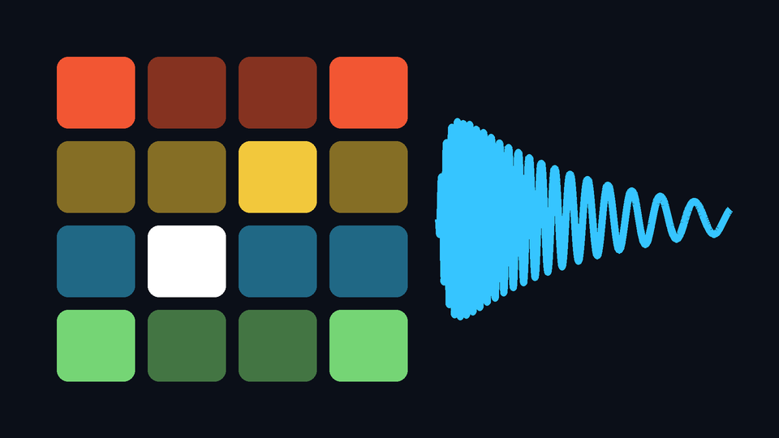

# SFX FORGE

Sound effects, instruments and adaptive music for games, on **VIBE FM** (and, later, the M-VAVE FM-1): 16 synthesized
sounds on 16 pads from five engines (one of them a wavetable synth), with envelopes, an LFO, chorus, delay and reverb;
a MUTATE button for instant variations; a pattern sequencer whose layers follow the game's intensity; and a live
MIDI/SysEx link to a game engine. What you make on the device plays in the game with the same engine.

Everything is synthesized: there are no samples in it. Its strings, brass, choir and bells are synthesizer
instruments in that style, not recordings of an orchestra. The wavetables are computed from sums of harmonics in
`core/sfx_wavetable.h`; nothing is taken from another instrument.



Built with the VIBE FM SDK. Status: foundation (v0.1). The synth, the device UI and the device side of the link are
tested in the SDK's tools; the Unity package is tested in Unity 6.3 with the demo project's editor and Play mode tests.
Not tried yet: receiving MIDI against a real port (it needs a loopback port or a device).

## Layout

| | |
|---|---|
| `core/sfx_core.h` | the sound engine: patch format, five engines, envelopes, LFO, mutate, SysEx packing. Portable C, no heap, no libc – shared by the Vibe, the native library and the future FM-1 firmware |
| `core/sfx_wavetable.h` | the six wavetables, computed at start |
| `core/sfx_song.h` | the player: 16 voices, chorus / delay / reverb, and the music – a song (8 patterns, notes, chain, a layer threshold per sound) and its sequencer |
| `sfx-forge/` | the Vibe: pads, pages, display, storage, MIDI |
| `native/` | the same engine as a native library (Windows x64 so far), for game engines |
| `unity/com.catsplat.sfxforge/` | the Unity package: the link, presets, a player, telemetry, editor tools |
| `unity/Demo/` | a Unity 6.3 project using the package: a hovercraft whose every sound is synthesized live |
| `tests/` | a scripted performance (`tour.json`) and its checks (`check.mjs`); `dotnet/` tests the Unity package's core without Unity |
| `build.sh` | build, `vibe-check`, render the performance to `out/` |

## Build

Needs the SDK in `.tools/vibe-fm-sdk`, Zig 0.13.0 (in `.tools/`, on PATH, or `ZIG=`), Node 18+. On Windows use Git Bash.

```sh
git clone https://github.com/Vibe-FM-SDK/vibe-fm-sdk.git .tools/vibe-fm-sdk
sh build.sh
```

Gives `build/sfx-forge.wasm` (drop it onto <https://play.thefirmwarehub.com/>) and `build/sfx-forge.zip` (drop it onto
the VIBE FM VST window), then runs `vibe-check` and two test performances: `out/audio.wav`, screenshots,
`out/midi.json`, `out/daw/` (the sequencer following a DAW) and `out/guide/` (the tour).

## Playing it

- **MENU** – the tour: SFX FORGE plays and names what it can do, a caption at a time (about 40 s: the sounds, shaping
  one, MUTATE, notes, instruments, wavetables, the song, its layers, cued patterns, the link). Any touch ends it;
  everything it changed is put back. On the stage: the TOUR button.
- **The display** – on the sound pages it shows the selected sound itself: its whole shape from start to end, and its
  wave (10 ms of it) – or, on ENV, FILTER and LFO, the envelope, the filter and the LFO as their knobs set them. It
  redraws as the knobs turn. Values read in their units (Hz, ms, %). The top line always shows the selected sound and
  the song: playing or not, its pattern and tempo. **LEFT / RIGHT**: the sound page before / after.
- **Pads** – 16 sounds. **Keys** – the selected sound as an instrument, in tune, up to 16 notes. **DATA** selects a sound.
- **F1 PRESET** – the next of 32 named sounds onto the selected pad (SHIFT: the one before): the sound effects, and
  STRINGS, BRASS, CHOIR, PIZZICATO, HARP, TIMPANI, BELLS, CELESTA, FLUTE, ORGAN, PAD, wavetable sweeps and basses.
  **F2–F6** – MUTATE (±15 %) · UNDO · RANDOM · EXPORT (SysEx) · SAVE.
- **K1 SOUND** – press again for its next page; **encoders 1–4** are the four values shown (SHIFT: fast):
  1. ENGINE · FREQ · PITCH ENV · ENV TIME
  2. the engine's two own controls (FM RATIO / DEPTH, ARP STEP / SPEED, GRAIN RATE / AMT, wavetable POSITION / WARP) · NOISE · CRUSH
  3. CUTOFF · RESO · FILTER ENV · its time
  4. (wavetable only) TABLE · SPREAD
- **K2 ENV** – ATTACK · DECAY · SUSTAIN · RELEASE. SUSTAIN off: a one-shot that plays to its end. Above: held while the
  pad or key is. **K3 LFO** – RATE, and how far it moves PITCH, FILTER and TIMBRE. **K4 FX** – sends to CHORUS, DELAY
  and REVERB, and the sound's LEVEL.
- **PLAY / STOP** – the song, with a demo to start from. It follows the DAW's song position while the DAW plays, else
  its own tempo. **REC**: pads and keys you play go into the pattern.
- **K5 SEQ** – the display shows the selected sound's 16 steps, big, each with its note, and under them the whole
  pattern: a row a sound. The pads are those 16 steps (a step switched on is heard); SHIFT + pad hears and selects that
  pad's sound, DATA walks the rows. A step may carry a note: hold its pad and play a key, or turn NOTE (it moves along
  the scale chosen with encoder B). Encoders: STEP · NOTE · TEMPO · SWING. F1 / F2 (and LEFT / RIGHT): the pattern
  before / after. F3 FILL: every 4th step, every 2nd, every one, none. F4 CLEAR the sound's steps. F5 COPY the pattern
  to the next one. A sustained sound holds until it plays again or the bar ends.
- **K5 again: SONG** – what makes it game music. The display shows the eight patterns (what is in each, and the
  chain), and the layers: INTENSITY as a level that rises over each sound's mark.
  - **LAYER**: every sound has a threshold and plays only while **INTENSITY** is at or above it. Low intensity: the
    kick alone. High: bass, snare, strings, lead, effects.
  - **PATTERN** A–H (also pads 1–8): a cued pattern takes over on the next bar line. **CHAIN**: walk patterns A…n by
    itself. Pads 9–16 set the intensity. Encoder B: steps in a pattern. F2 COPY makes the next pattern a variation.
  - **SEND** (F5): the 16 sounds and the song to the game.
- **K5 a third time: MIX** – the mixer: a fader and a pan for every sound (encoders 1 and 2, for the selected one), DRIVE
  on the sum, the OUTPUT volume. The pads mute a sound, SHIFT + pad solos it; F1 MUTE, F2 SOLO, F3 RESET, F4 ALL ON.
- **K4 again: MASTER** – the effects every sound sends to: the delay's TIME (1/16 to 1/2) and FEEDBACK, the reverb's ROOM
  SIZE and DAMPING, drawn as the echoes and the fading they give.
  The mix belongs to the song: it is saved with it, sent with it, and is the mix in the game.
- **The demo song** – our own: funk in E minor the way a 16-bit console's FM chip played it, four patterns in a chain
  (the groove, its answer, a breakdown, a turnaround). Only the kick plays at intensity 0.
- **K6 LINK** – the game engine's side (below).
- **The stage** (browser and plugin) – the whole instrument for the mouse, on one picture:
  - left: the 16 pads with their names; the selected sound's picture, its pages (OSC TONE FILTER WAVE ENV LFO FX, and MIX and MASTER)
    and their four values – drag one, or turn the wheel over it (SHIFT: fast; UNDO takes a drag back); PRESET (SHIFT or
    the right button: the one before), MUTATE, UNDO, RANDOM, EXPORT, SAVE.
  - right: the pattern, a row a sound, every step with its note; rows are dim while their layer is silent. Click a step
    to set it, the wheel gives it a note, click a row's name to hear and select the sound (SHIFT or the right button: mute it). INTENSITY and the selected
    sound's LAYER are sliders; the marks over INTENSITY are where each sound comes in. FILL, CLEAR, COPY, DEMO.
  - top: PLAY, REC, the tempo (click its halves, or the wheel), the patterns A–H (SHIFT + click: the chain ends there),
    TOUR.
- **HOME** – what every control does on the page open now.

## The link (device ⇄ game engine)

Plain MIDI, so it works over USB, the plugin's MIDI ports and Web MIDI. SysEx uses the non-commercial ID `7D`, then `56 42`.

| Direction | Message | Meaning |
|---|---|---|
| device → game | Note On/Off, ch 1, notes 36–51 | a pad was played |
| device → game | CC 20–25, ch 1 | encoders 1–4, A, B on the LINK page |
| device → game | `F0 7D 56 42 01 <slot> <28 patch bytes> F7` | EXPORT: one patch |
| game → device | Note On/Off, notes 36–51 | play a pad |
| game → device | CC 10–13, ch 2 | telemetry: pitch (0…+24 st), cutoff (64 = none, ±4 oct), timbre (FM depth, wavetable position), level |
| game → device | CC 14, ch 2 | music: intensity 0…127 (layers come in) |
| game → device | CC 15, ch 2 | music: pattern A…H (value / 16), from the next bar line |
| game → device | CC 16–17, ch 2 | shown on the LINK page, not mapped |
| game → device | `F0 7D 56 42 02 <slot> <28 patch bytes> F7` | load a patch into a pad |
| game → device | `F0 7D 56 42 03 <ASCII, ≤ 24> F7` | text for the top line |
| game → device | `F0 7D 56 42 04 <slot> F7` | request a dump of a pad |
| both ways | `F0 7D 56 42 05 <piece> <pieces> <≤ 200 bytes> F7` | the song with its mix, in 13 pieces (2498 bytes, `sfx_song_pack`; a 2455-byte song from before the mixer is still taken) |
| game → device | `F0 7D 56 42 06 F7` | request the 16 sounds and the song (as SEND does) |

`<slot>` is 0–15. Telemetry also arrives as the DAW parameters Mod Pitch / Cutoff / FM / Level and Intensity.

**Patch bytes** (28, each 0–127): `version(2) engine(0–4)`, then 25 parameters, then `checksum` = the sum of the
first 27 bytes `& 0x7F`. The parameters, in order: `base_freq pitch_env_amt pitch_env_time a b noise_mix filter_cutoff
filter_res decay bitcrush attack sustain release filter_env filter_env_time lfo_rate lfo_pitch lfo_filter lfo_timbre
spread chorus delay reverb level table`. `pitch_env_amt` and `filter_env`: 64 = none. `sustain` 0 = a one-shot.
`level` 100 = as designed. `a` / `b` are the engine's own two controls (FM ratio / depth, arpeggio step / speed, grain
rate / amount, wavetable position / warp). Engines: 0 IMPACT, 1 UI BLIP, 2 SCI-FI FM, 3 FOLEY, 4 WAVETABLE.

## Unity

Add the package from disk: **Window > Package Manager > + > Add package from disk…** and pick
`unity/com.catsplat.sfxforge/package.json` (Unity 2021.3 or newer; developed against Unity 6).

| | |
|---|---|
| **Window > SFX Forge** | choose the MIDI ports, play the device's pads, fetch their patches. EXPORT on the device arrives here and is saved as a preset asset |
| `SfxPreset` | a patch as an asset (Create > SFX Forge > Preset): sliders, Play, Mutate, Bake WAV (stereo, with its effects), send to a pad |
| `SfxPlayer` | plays a preset in the game with the device's own engine and effects, live – its Pitch / Cutoff / Timbre / Level move the sound as telemetry does on the device. No device needed |
| `SfxSong` | a song and its 16 sounds as an asset: SEND on the device's SONG page (or "Fetch the song" in the window) creates one |
| `SfxMusicPlayer` | plays a song in the game with the device's own player: `intensity` brings its layers in and out, `CuePattern` changes pattern on the next bar line, `SetTrackVolume` / `SetTrackPan` / `SetTrackMute` and `SetMaster` move the mix. No device needed |
| `SfxTelemetrySender` | a Rigidbody's speed, an Animator float or your own value → CC 10–17 to the device, and to local `SfxPlayer`s and `SfxMusicPlayer`s |
| `SfxForgeLink` | the link in Play mode: pad and encoder events from the device |
| `SfxEncoderBinding` | a device encoder (LINK page) → an exposed AudioMixer parameter or an event |

**The demo** – open `unity/Demo` with Unity 6.3 and the scene `Assets/SfxDemo/SfxDemo.unity`: W/S thrust, A/D turn,
SPACE fires. The engine hum follows the speed, and so does the music: at rest only the kick, flat out every layer. The
same values go to the device if one is connected. The song is the firmware's own demo song, as it sent it
(`tests/make-demo-song.mjs`). The scene is
generated by `SFX Forge > Rebuild Demo Scene` (`Assets/SfxDemo/Editor/SfxDemoBuilder.cs`). Its tests, headless:

```sh
Unity -batchmode -projectPath unity/Demo -executeMethod SfxDemo.Editor.SfxDemoBuilder.SelfTest
```

```sh
Unity -batchmode -projectPath unity/Demo -runTests -testPlatform PlayMode -testResults out/unity-playmode.xml
```

From code: `SfxLink.Shared` (`SendPatch`, `SendSong`, `SendTelemetry`, `SendIntensity`, `CuePattern`, `SendText`,
`PlayPad`, events), `SfxNative.Bake`, and `SfxPatch.Create(engine, values…)` for a patch in code (a bare
`new SfxPatch()` has level 0 and is silent).

MIDI is implemented for Windows (winmm) only; presets, `SfxPlayer` and baking need the native library, built for
Windows x64 (`sh native/build.sh`). **Without the hardware** the device is the Playground in the browser or the plugin,
so Unity needs a virtual MIDI cable to reach it (for example loopMIDI, two ports: one each way).

```sh
dotnet run -c Release --project tests/dotnet -- .
```

runs the package's core without Unity (after `sh build.sh`): the protocol against what the firmware really sent, and
the native library against the Vibe's own rendering.

## Licence

MIT. The VIBE FM SDK is Apache-2.0 (Sven Trogus / zvenson); "VIBE FM" is its owner's trademark.
