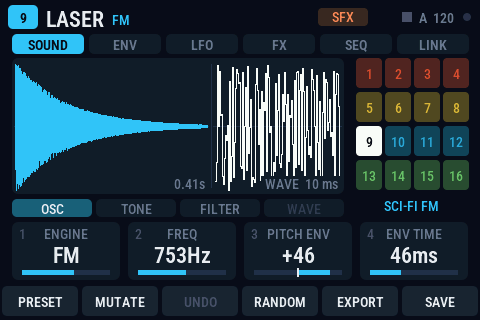
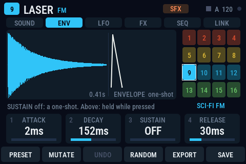
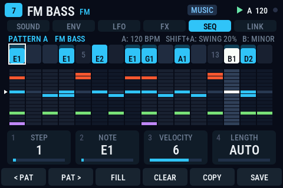
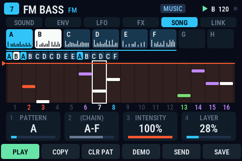
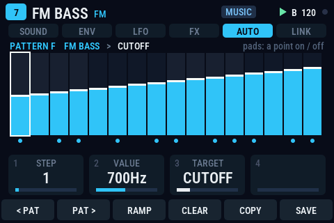
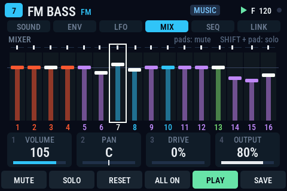
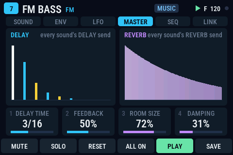
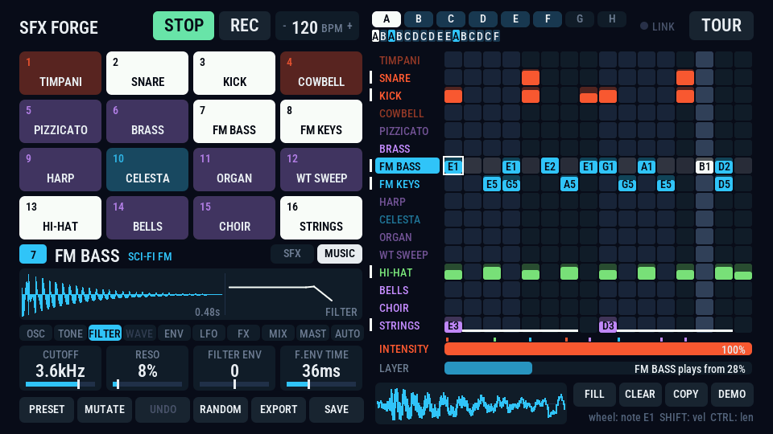
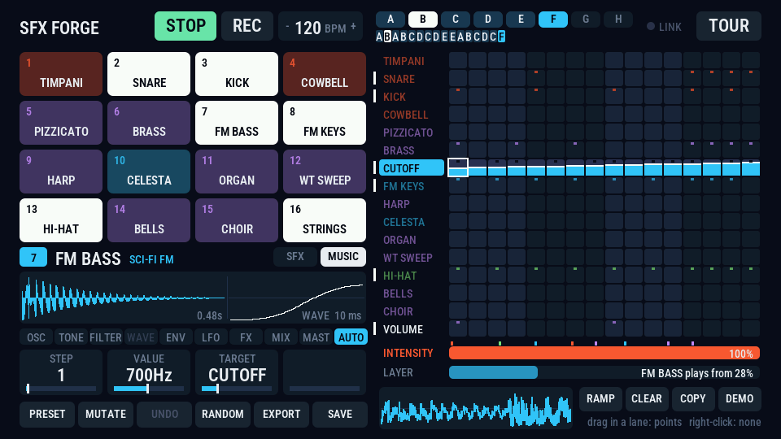

# SFX FORGE – the manual

SFX FORGE is a synthesizer for game audio. You design sound effects and instruments on it, write music with them, mix
it, and the game plays the result with the same engine – so what you hear on the device is what the player hears.

Everything is synthesized. There are no samples and no recordings in it.

- [1. A first five minutes](#1-a-first-five-minutes)
- [2. The device at a glance](#2-the-device-at-a-glance)
- [3. Two kits: SFX and MUSIC](#3-two-kits-sfx-and-music)
- [4. Making a sound effect](#4-making-a-sound-effect)
- [5. The five engines](#5-the-five-engines)
- [6. Every value of a sound](#6-every-value-of-a-sound)
- [7. Instruments](#7-instruments)
- [8. Writing music: the sequencer](#8-writing-music-the-sequencer)
- [9. The song: patterns, arrangement, layers](#9-the-song-patterns-arrangement-layers)
- [10. Automation](#10-automation)
- [11. The mixer and the master effects](#11-the-mixer-and-the-master-effects)
- [12. The stage: all of it with a mouse](#12-the-stage-all-of-it-with-a-mouse)
- [13. Into the game](#13-into-the-game)
- [14. Saving, and older songs](#14-saving-and-older-songs)
- [15. Recipes](#15-recipes)
- [16. What it does not do](#16-what-it-does-not-do)
- [17. Every control, page by page](#17-every-control-page-by-page)

---

## 1. A first five minutes

1. **Load it.** Drop `sfx-forge.wasm` onto the Playground (<https://play.thefirmwarehub.com/>), or `sfx-forge.zip`
   onto the VIBE FM plugin's window.
2. **Press MENU.** The tour plays and names what SFX FORGE does, a caption at a time (about 40 seconds). Any key ends
   it, and everything it changed is put back.
3. **Hit the pads.** They are the 16 sound effects of the SFX kit. The display shows the sound you hit last: its whole
   shape on the left, its wave on the right.
4. **Press F2 MUTATE** a few times. Each press is a new variation of that sound. F3 UNDO takes the last one back.
5. **Press PLAY.** The demo song starts. Press K5 twice for the SONG page and turn encoder 3, INTENSITY: the band comes
   in instrument by instrument. That is what a game does with it.
6. **Press HOME** on any page: it lists what every control does on that page.

---

## 2. The device at a glance

**The top line** always shows the selected sound (its pad number and name), the kit it belongs to (SFX or MUSIC), and
on the right the song: playing or stopped, its pattern, its tempo, and a dot that is green while a game is linked.

**The six K keys are the pages.** Pressing a K key again walks through its pages:

| Key | Pages | What they are for |
|---|---|---|
| K1 SOUND | OSC, TONE, FILTER, (WAVE) | the selected sound's source and filter |
| K2 ENV | ENV | how it starts, holds and ends |
| K3 LFO | LFO | a slow wave that moves it |
| K4 FX | FX, MIX, MASTER | its effect sends · the mixer · the effects themselves |
| K5 SEQ | SEQ, SONG, AUTO | the steps · the song · automation |
| K6 LINK | LINK | the game's side |

**Encoders 1–4** are the four values the page shows. Hold SHIFT to turn them fast. **A** is the output volume (on SEQ
and AUTO: the tempo). **DATA** selects a sound.

**F1–F6** are the six soft keys along the bottom of the display; they change with the page.

**LEFT / RIGHT** step to the sound page before or after. On SEQ, SONG and AUTO they change the pattern.

**PLAY / STOP / REC** run the song. **MENU** is the tour. **HOME** shows the controls of the page you are on.

---

## 3. Two kits: SFX and MUSIC

SFX FORGE holds two sets of 16 sounds:

| Kit | What is in it | How it sounds |
|---|---|---|
| **SFX** | the game's sound effects: explosion, coin, laser, footstep … | straight to the output, beside the song |
| **MUSIC** | the band the song plays: drums, bass, keys, brass, strings … | through the mixer: its fader, pan and mute |

The pads, the keys and the sound pages always work on the kit shown in the top line.

- **SHIFT + K1** changes kit.
- Going to a song page (SEQ, SONG, AUTO, MIX, MASTER) chooses MUSIC by itself, because the song plays the MUSIC kit.
- **F1 PRESET** offers sound effects in the SFX kit and instruments in the MUSIC kit.

Nothing stops you from putting a laser in the MUSIC kit and sequencing it, or playing a sound effect on the keys.
The kits only keep the two jobs apart.

---

## 4. Making a sound effect

The quickest way is to start from a sound that is close and change it.

1. **Choose the SFX kit** (SHIFT + K1 if the top line says MUSIC) and **hit a pad**.
2. **F1 PRESET** puts the next named sound effect on that pad (SHIFT + F1: the one before). There are 16.
3. **F2 MUTATE** moves every value by up to 15 %. It keeps the kind of sound: the engine, whether it is held, its
   wavetable. Press it until something is close. **F3 UNDO** takes one step back.
4. **F4 RANDOM** is a completely new sound, if you would rather be surprised.
5. **Shape it by hand.** K1 walks through OSC, TONE and FILTER; K2, K3 and K4 are the envelope, the LFO and the
   effects. Each page is four knobs. The display redraws the sound as you turn, so you see what each knob does:

   | Page | The picture on the right |
   |---|---|
   | OSC, TONE, FX | the wave: 10 ms of it, where it is loudest |
   | ENV | the envelope, as its four values set it |
   | FILTER | the filter's curve |
   | LFO | the LFO's wave |

   

6. **F6 SAVE** keeps both kits and the song on the device.
7. **F5 EXPORT** sends the sound to the game (section 13).

Values read in their units – Hz, ms, % – wherever they have one.

---

## 5. The five engines

A sound is made by one of five engines. ENGINE is the first knob of the OSC page. Two knobs on the TONE page change
meaning with the engine; they are called A and B below.

| Engine | What it is | A | B | Good for |
|---|---|---|---|---|
| **IMPACT** | a sine whose pitch falls, with FM and noise, driven hard | FM RATIO | FM DEPTH | hits, kicks, explosions, drums |
| **UI BLIP** | a square wave that can step upwards | ARP STEP: 0–24 semitones a step | ARP SPEED: 2–64 steps a second | coins, menus, chiptune leads and basses |
| **SCI-FI FM** | two sines, one bending the other, with feedback | FM RATIO | FM DEPTH | lasers, zaps, engines, FM bass and keys |
| **FOLEY** | noise through a band-pass filter, in grains | GRAIN RATE: 2–256 a second | GRAIN AMT | steps, wind, fire, hi-hats |
| **WAVETABLE** | a wave that morphs through a table | POSITION in the table | WARP: squeezes the cycle | pads, strings, brass, organs, sweeps |

Things worth knowing about each:

- **IMPACT.** PITCH ENV and ENV TIME are the fall of the hit: a large fall over a short time is a kick, a small one
  over a long time is a tom. NOISE adds the crack.
- **UI BLIP.** With ARP STEP at 0 it is a plain square wave. With a step, the note climbs three times and stays: a
  step of 7 (a fifth) at a high speed is the classic coin.
- **SCI-FI FM.** FM RATIO sets the colour: around 42 the two sines are at the same pitch (round, like a bass or an
  electric piano), higher values are more bell-like and metallic. The brightness falls over ENV TIME even with PITCH
  ENV at 0 – that falling brightness is the pluck of FM BASS and FM KEYS.
- **FOLEY.** CUTOFF is called BAND here: it is where the noise sits. PITCH ENV sweeps the band, not a pitch – that is
  a whoosh. Turn NOISE down and a sine tone appears under it. GRAIN AMT chops the noise into random grains: crackle,
  gravel, rain.
- **WAVETABLE.** TABLE chooses one of six tables: SAW-SQ, PULSE, PEAK, VOWEL, ORGAN, GLASS. POSITION moves through the
  table's eight waves, smoothly. SPREAD adds two detuned copies for width. The LFO page's `> TIMBRE` moves the
  position by itself. The WAVE page (TABLE and SPREAD) is only there for a wavetable sound.

---

## 6. Every value of a sound

A sound is 25 values and its engine. Each is stored as a number from 0 to 127; the display shows it in its unit.

| Page | Value | What it does | Range |
|---|---|---|---|
| OSC | FREQ | the pitch (overridden when the sound is played as a note) | 20 Hz – 14.5 kHz |
| OSC | PITCH ENV | how far the pitch starts above (+) or below (−) and falls back | ±4 octaves; 0 = none |
| OSC | ENV TIME | how long that takes | 5 ms – 2.6 s |
| TONE | A | the engine's first own control (section 5) | |
| TONE | B | the engine's second own control | |
| TONE | NOISE | how much of the source is noise | 0 – 100 % |
| TONE | CRUSH | fewer bits and fewer samples: grit | OFF – 100 % |
| FILTER | CUTOFF | where the low-pass filter closes (FOLEY: where the band sits) | 40 Hz – 15.5 kHz |
| FILTER | RESO | a peak at the cutoff | 0 – 100 % |
| FILTER | FILTER ENV | how far the cutoff starts above or below and returns | ±5 octaves; 0 = none |
| FILTER | F.ENV TIME | how long that takes | 5 ms – 2.6 s |
| WAVE | TABLE | which wavetable | six tables |
| WAVE | SPREAD | two detuned copies | up to 30 cents either way |
| ENV | ATTACK | how long it takes to reach full level | 1.5 ms – 4 s |
| ENV | DECAY | how fast it falls after that | 10 ms – 3.9 s |
| ENV | SUSTAIN | the level it holds at | OFF, or up to 100 % |
| ENV | RELEASE | how long it rings after the pad is let go | 5 ms – 3.9 s |
| LFO | LFO RATE | the speed of the slow wave | 0.1 – 29 Hz |
| LFO | > PITCH | how far it moves the pitch (vibrato) | up to an octave |
| LFO | > FILTER | how far it moves the cutoff (wah) | up to 3 octaves |
| LFO | > TIMBRE | how far it moves FM depth or wavetable position | |
| FX | CHORUS | send to the chorus | 0 – 100 % |
| FX | DELAY | send to the delay | 0 – 100 % |
| FX | REVERB | send to the reverb | 0 – 100 % |
| FX | LEVEL | the sound's own loudness | 100 = as designed |

**SUSTAIN decides what kind of sound it is.**

- **OFF: a one-shot.** It plays to its end however short the pad was hit. Drums, coins, explosions.
- **Above OFF: a held sound.** It holds at that level as long as the pad or key is down, then rings out over RELEASE.
  Strings, organs, an engine hum.

---

## 7. Instruments

**Any sound is an instrument.** The keys play the selected sound in tune (A4 = 440 Hz), up to 16 notes at once. FREQ
no longer matters then: the key sets the pitch.

The MUSIC kit starts with a band on its 16 pads:

| Pad | Sound | Pad | Sound | Pad | Sound | Pad | Sound |
|---|---|---|---|---|---|---|---|
| 1 | TIMPANI | 5 | PIZZICATO | 9 | HARP | 13 | HI-HAT |
| 2 | SNARE | 6 | BRASS | 10 | CELESTA | 14 | BELLS |
| 3 | KICK | 7 | FM BASS | 11 | ORGAN | 15 | CHOIR |
| 4 | COWBELL | 8 | FM KEYS | 12 | WT SWEEP | 16 | STRINGS |

F1 PRESET in the MUSIC kit also offers OPEN HAT, FLUTE, WT VOWEL, WT BASS, PAD, SQ BASS and SQ LEAD.

These are synthesizer instruments in the style of their names. STRINGS is a slow, detuned wavetable with chorus and
reverb, not a recording of a string section.

---

## 8. Writing music: the sequencer

Press **K5** for the SEQ page. A **pattern** is one bar of 16 steps for all 16 sounds of the MUSIC kit.

The display shows two things:

- **On top, big:** the 16 steps of the *selected* sound. A step that is on shows its note; its height is how hard it
  plays; a white line under it shows how long it holds.
- **Below:** the whole pattern, one row for each sound. The arrow marks the selected one. Rows are dim while their
  layer is silent (section 9).

### Putting steps in

| To do this | Do this |
|---|---|
| switch a step on or off | hit its pad (pads 1–16 are steps 1–16) |
| choose another sound | turn DATA, or SHIFT + its pad (you hear it) |
| move the frame to a step | hit its pad, or turn encoder 1 STEP |
| give a step a note | hold its pad and play a key – or turn encoder 2 NOTE |
| set how hard it plays | encoder 3 VELOCITY, 1–8 |
| set how long it holds | encoder 4 LENGTH: AUTO, or 1–15 steps |
| fill a row quickly | F3 FILL: every 4th step, then every 2nd, every step, none |
| empty the selected row | F4 CLEAR |

A step without a note plays the sound as it was designed: right for drums and effects. A step with a note plays the
sound at that pitch, in tune with everything else.

**NOTE moves along a scale.** Encoder B chooses it: CHROMATIC, MAJOR, MINOR or PENTATONIC (in C). Notes played on the
keys are taken as played.

**LENGTH AUTO** holds a note until the sound plays again or the bar ends. A number lets it go after that many steps:
1 or 2 for a stab, 7 for a chord that breathes before the next one. LENGTH is for held sounds (SUSTAIN above OFF); a
one-shot always plays to its own end.

### Recording

Press **REC**, then **PLAY**. Whatever you play on the pads and keys in the MUSIC kit lands on the nearest step of the
pattern that is playing, with the note you played and as hard as you hit it.

### Tempo and swing

On the SEQ and AUTO pages **A is the tempo** (40–240 BPM) and **SHIFT + A is the swing**. Both are shown above the
steps. Swing delays every second step; 0 % is straight.

### Patterns

There are eight patterns, A to H. **F1 / F2** (or LEFT / RIGHT) go to the one before or after. **F5 COPY** copies the
pattern into the next one and goes there – the way to make a variation.

---

## 9. The song: patterns, arrangement, layers

Press **K5 again** for the SONG page.

### Which pattern plays

- **Pads 1–8** choose pattern A–H. While the song plays, the change waits for the next bar line.
- **CHAIN** (encoder 2): with a chain of A–D, patterns A, B, C, D play one after another, a bar each, and again.
- **The arrangement** replaces the chain when you want an order of your own, such as A B A B C D C D. It is up to 32
  bars, shown as a row of letters under the patterns:

  | To do this | Do this |
  |---|---|
  | add a bar | SHIFT + pad 1–8 (that pattern) |
  | remove the last bar | SHIFT + any of pads 9–15 |
  | remove all bars (the chain plays again) | SHIFT + pad 16 |

- **Encoder B** sets how many steps a bar has, 1–16, for odd metres.

### Layers: music that follows the game

This is what makes it game music. Every sound has a **LAYER** mark, and the song has one **INTENSITY**.

**A sound plays only while INTENSITY is at or above its mark.**

The lower half of the SONG page shows it: INTENSITY is the orange level that rises from the bottom, and each column
is a sound with its mark. A sound whose mark is under the level plays.

- **Encoder 3** is INTENSITY. Pads 9–16 set it in eight steps. A game sends it (section 13).
- **Encoder 4** is the selected sound's LAYER mark.

So one song is many: at 0 % only the sounds with a mark at 0 play (in the demo, the kick). As the game heats up, hat,
bass, snare, strings, keys, brass and bells join in that order.

### F keys on the SONG page

F1 PLAY · F2 COPY the pattern to the next · F3 CLR PAT empties the pattern · F4 DEMO brings the demo song back ·
F5 SEND sends the MUSIC kit and the song to the game · F6 SAVE.

---

## 10. Automation

Press **K5 a third time** for the AUTO page. Automation moves a knob by itself while the pattern plays.

**Every sound has one lane in each pattern, and the lane can move any knob:**

- any of the sound's own 25 values (CUTOFF, FM DEPTH, POSITION, a send, …),
- its fader or its pan in the mixer,
- the master's DELAY TIME, FEEDBACK, ROOM SIZE, DAMPING or DRIVE.

### Drawing a lane

1. Select the sound (DATA).
2. Turn **encoder 3 TARGET** to the knob you want to move. One target for each sound, the same in every pattern.
3. **Hit a pad** to put a point on that step. It starts where the knob stands now. Hit it again to remove it.
4. Turn **encoder 2 VALUE** to move the point. It is shown in the knob's own unit.
5. **F3 RAMP** joins the points with straight lines: put a point on step 1 and one on step 16, press RAMP, and you
   have a sweep. **F4 CLEAR** empties the lane.

### How it behaves

- **A point holds until the next point**, or until the bar ends. The dim bars in the picture are a held value.
- **At every bar line the knob is back where you set it by hand.** Automation never writes into the sound or the mix.
- The dots under the lane show where the sound plays, so you can line points up with notes.
- Values move in steps of a 16th note. A filter sweep with a point on every step sounds smooth enough at most
  tempos; a slow sweep over two points is audibly stepped – use RAMP.

Master targets can sit on any sound's lane. A sound that is not used in the song is a good place for them.

---

## 11. The mixer and the master effects

### MIX (K4, twice)

A fader for each sound of the MUSIC kit, with its pan as a mark above it. The faint line across is 100: the sound as
it was designed.

| Control | What it does |
|---|---|
| encoder 1 VOLUME | the selected sound's fader, 0–127 |
| encoder 2 PAN | left … C … right |
| encoder 3 DRIVE | saturation on the whole mix |
| encoder 4 OUTPUT | the output volume (the same as A) |
| a pad | mute that sound (an M appears) |
| SHIFT + a pad | solo it (an S appears): only soloed sounds play |
| F1 MUTE · F2 SOLO | the same for the selected sound |
| F3 RESET | the selected fader back to 100 and the middle |
| F4 ALL ON | no mutes, no solos |

Sound effects from the SFX kit do not go through the mixer. A muted bass never mutes an explosion.

### MASTER (K4, three times)

Every sound has its own sends on its FX page. This page sets what those sends go into.

| Control | What it does |
|---|---|
| encoder 1 DELAY TIME | the echo after a 16th, an 8th, a dotted 8th, a quarter, a dotted quarter or a half note – it follows the tempo |
| encoder 2 FEEDBACK | how much of each echo comes again |
| encoder 3 ROOM SIZE | how long the reverb rings |
| encoder 4 DAMPING | how fast its highs fade: low is a bright hall, high is a dark room |

The left picture is the echoes you will get (left and right in turn); the right picture is the reverb fading.

**The mix belongs to the song.** Faders, pans, mutes and the master effects are saved with it and sent to the game
with it.

---

## 12. The stage: all of it with a mouse

In the Playground and the plugin, **Stage** opens a larger picture of the whole instrument. Everything above can be
done there without the device's keys.

**Left: the sounds**

- **The 16 pads** of the kit, with their names. Click to play and select.
- **SFX / MUSIC** chooses the kit.
- **Ten tabs:** OSC, TONE, FILTER, WAVE, ENV, LFO, FX, MIX, MAST, AUTO. Each has four values. **Drag a value**, or
  turn the wheel over it (SHIFT: bigger steps). UNDO takes a drag back.
- **PRESET** (SHIFT or right-click: the one before), **MUTATE, UNDO, RANDOM, EXPORT, SAVE.**

**Right: the song**

- **The pattern:** a row for each sound of the MUSIC kit, every step with its note.

  | To do this | Do this |
  |---|---|
  | switch a step on or off | click it |
  | give it a note | turn the wheel |
  | set its velocity | SHIFT + wheel |
  | set its length | CTRL + wheel |
  | hear and select a sound | click its name |
  | mute a sound | SHIFT-click or right-click its name |

- **INTENSITY** and **LAYER** are sliders. The small marks above INTENSITY are where each sound comes in.
- **FILL, CLEAR, COPY, DEMO** for the pattern.

**Top:** PLAY, REC, the tempo (click its left or right half, or the wheel), the patterns A–H, and under them the
arrangement.

| To do this | Do this |
|---|---|
| go to a pattern | click it |
| add a bar of a pattern to the arrangement | SHIFT-click or right-click the pattern |
| end the arrangement before a bar | SHIFT-click or right-click that bar |

**Automation on the stage.** The AUTO tab turns the 16 rows into the sounds' lanes, all at once.

- Choose the TARGET for the selected sound: drag the cell or turn the wheel over it.
- **Click or drag in that sound's row to draw points.** The height in the row is the value; dragging across paints a
  curve in one stroke.
- SHIFT-click or right-click removes a point. FILL becomes **RAMP**.
- A row is 20 pixels tall, so drawing gives about 20 levels. For an exact value drag the VALUE cell.

---

## 13. Into the game

What you make reaches the game in two ways: as data the game plays itself, or live over MIDI.

### What the game plays

The engine is plain C (`core/`), built as a native library the game loads. It is the same code the device runs.

| You made | Send it with | In Unity it becomes |
|---|---|---|
| a sound effect | F5 EXPORT on a sound page | an `SfxPreset` asset |
| the song, its 16 instruments and its mix | F5 SEND on the SONG page | an `SfxSong` asset |

In Unity (the package is in `unity/com.catsplat.sfxforge`):

- **`SfxPlayer`** plays a preset – live, so its pitch, cutoff, timbre and level can follow the game (an engine hum
  that rises with speed), or baked to an ordinary WAV if you prefer.
- **`SfxMusicPlayer`** plays a song:

  | The game does | With |
  |---|---|
  | brings the band in and out | `intensity` (0–1) |
  | changes pattern on the next bar line | `CuePattern(0…7)` |
  | plays one of the song's sounds by hand | `PlaySound(sound, velocity, note)` |
  | moves the mix | `SetTrackVolume`, `SetTrackPan`, `SetTrackMute`, `SetMaster` |

**Cues and the arrangement.** Cueing a pattern that is in the arrangement carries on from its bar. Cueing one that is
*not* in it – keep a pattern aside for the boss or the menu – takes over on the bar line and stays until the next cue.

### Live, over MIDI

Connected to the device (or to the Playground or plugin through a virtual MIDI cable), the game can drive it while
you listen and tune:

| The game sends | The device does |
|---|---|
| CC 10–13 on channel 2 | pitch, cutoff, timbre and level of what sounds |
| CC 14 on channel 2 | INTENSITY |
| CC 15 on channel 2 | cue a pattern (value ÷ 16) |
| notes 36–51 | play the pads |
| a patch as SysEx | load it into a pad of the kit shown |

The **LINK page** (K6) shows what comes in, and its encoders send CC 20–25 to the game, to tune a game value from
the device. The full protocol, byte by byte, is in the [README](../README.md#the-link-device--game-engine).

---

## 14. Saving, and older songs

- **F6 SAVE** keeps both kits and the song (patterns, arrangement, layers, mix, automation) on the device. A DAW
  project or preset keeps them too.
- **F4 DEMO** on the SONG page brings the demo song back. It replaces your song, not your sounds.
- The game and the device take songs from every earlier version of the format. A song or kit *stored on the device*
  by an earlier version is not read: the demo and the factory kits appear instead.

---

## 15. Recipes

**A laser in ten seconds.** SFX kit, any pad, F1 until LASER. F2 MUTATE until you like it.

**A footstep that is never the same twice.** Start from FOOTSTEP. In the game, play it with a slightly different
pitch each time (`SfxPlayer`'s pitch), or EXPORT four mutations and pick one at random.

**An engine that follows speed.** Start from ENGINE HUM (a held sound). In Unity give it an `SfxPlayer` and an
`SfxTelemetrySender` that feeds speed to pitch and cutoff.

**A beat in two minutes.** K5. DATA to KICK, F3 FILL once (every 4th step). DATA to SNARE, pads 5 and 13. DATA to
HI-HAT, F3 FILL twice (every 2nd step). PLAY.

**A bass line.** DATA to FM BASS. Hold pad 1 and play a low key; hold pad 4 and play another. Or switch steps on and
turn NOTE, which stays in the scale.

**A chord that swells.** DATA to STRINGS. One step with a note, LENGTH 12. K5 twice more for AUTO, TARGET to VOLUME,
a point on step 1 turned down, a point on step 12 turned up, F3 RAMP.

**A filter sweep into the drop.** AUTO page, select the bass, TARGET to CUTOFF, points on steps 1 and 16, RAMP.

**Music that reacts to danger.** Give the calm instruments low LAYER marks and the tense ones high marks. The game
sets `intensity` from how close the enemy is.

**A boss theme.** Write it in pattern H and leave H out of the arrangement. The game calls `CuePattern(7)` when the
boss appears and cues pattern A again when it is over.

**Dub echoes on the snare only.** SNARE's FX page: DELAY up. MASTER page: DELAY TIME 3/16, FEEDBACK to taste.

---

## 16. What it does not do

- **No samples.** It cannot play recorded audio: no voice lines, no recorded foley, no real orchestra.
- **A bar is 16 steps.** There are no triplets inside a bar and no notes between steps; swing is the only timing
  change. Eight patterns, 32 bars of arrangement.
- **16 voices.** With long reverberant sounds and busy patterns the oldest note is cut to make room.
- **One automation lane for each sound**, and its values move in steps, not glides.
- **One note per step for each sound.** A chord needs several sounds, or the keys.
- **Unity on Windows x64 only** so far (the native library and MIDI). Receiving MIDI in Unity has not been tested
  against a real port.
- **The swing has no control on the stage**; it is SHIFT + A on the device.

---

## 17. Every control, page by page

**Everywhere:** PADS play · KEYS play the selected sound in tune · DATA selects a sound · SHIFT + K1 the other kit ·
PLAY STOP REC the song · MENU the tour · HOME this page's controls · A the output volume.

| Page | Pads | Encoders 1 – 4 | F1 – F6 |
|---|---|---|---|
| OSC | play | ENGINE · FREQ · PITCH ENV · ENV TIME | PRESET · MUTATE · UNDO · RANDOM · EXPORT · SAVE |
| TONE | play | A · B · NOISE · CRUSH | the same |
| FILTER | play | CUTOFF · RESO · FILTER ENV · F.ENV TIME | the same |
| WAVE | play | TABLE · SPREAD | the same |
| ENV | play | ATTACK · DECAY · SUSTAIN · RELEASE | the same |
| LFO | play | LFO RATE · > PITCH · > FILTER · > TIMBRE | the same |
| FX | play | CHORUS · DELAY · REVERB · LEVEL | the same |
| MIX | mute (SHIFT: solo) | VOLUME · PAN · DRIVE · OUTPUT | MUTE · SOLO · RESET · ALL ON · PLAY · SAVE |
| MASTER | play | DELAY TIME · FEEDBACK · ROOM SIZE · DAMPING | the same as MIX |
| SEQ | steps (SHIFT: select a sound) | STEP · NOTE · VELOCITY · LENGTH | < PAT · PAT > · FILL · CLEAR · COPY · SAVE |
| SONG | 1–8 pattern, 9–16 intensity (SHIFT: arrangement) | PATTERN · CHAIN · INTENSITY · LAYER | PLAY · COPY · CLR PAT · DEMO · SEND · SAVE |
| AUTO | a point on / off (SHIFT: select a sound) | STEP · VALUE · TARGET | < PAT · PAT > · RAMP · CLEAR · COPY · SAVE |
| LINK | play | send CC 20–23 (A, B: CC 24, 25) | as the sound pages |

Other encoders: on SEQ and AUTO, A is the tempo (SHIFT: swing). On SEQ, B is the scale. On SONG, B is the number of
steps in a bar.
