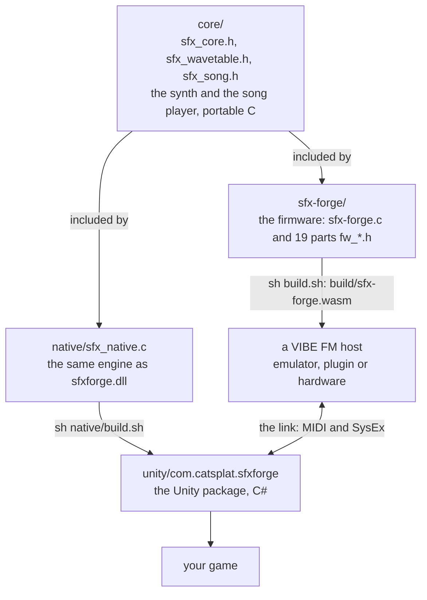
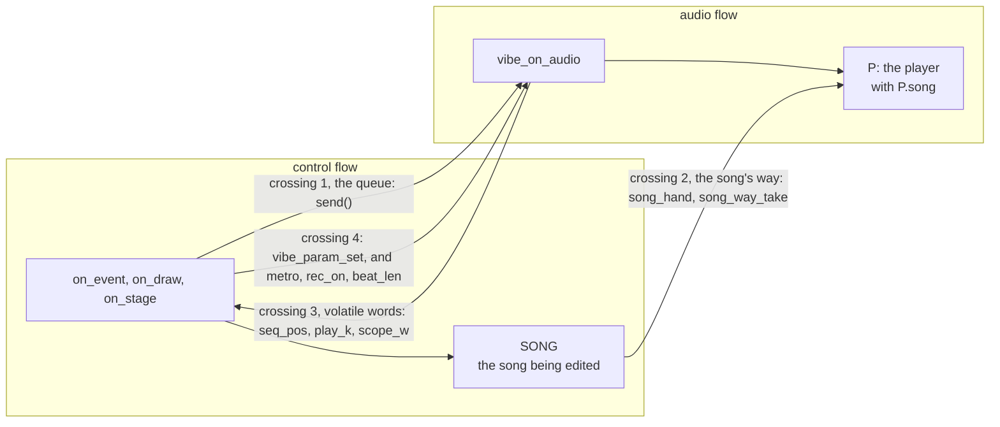

# Architecture Overview

This page shows how SFX FORGE is put together: which code makes the sound, where it runs, and how the device and a
game talk. Read it before any other internals page.

## The whole thing in one picture

Three things follow from this picture.

- **One engine, two homes.** `core/` has no heap and calls no library. The firmware compiles it to WebAssembly; the
  native library compiles it to a Windows DLL. So a sound or a song plays in the game with the same code that played
  it on the device.
- **The link carries data, not audio.** The device and the game exchange patches (sounds), the song, and a few
  controller values over MIDI. Each side makes its own sound. See [Link Protocol](Link-Protocol).
- **Two things are written twice, by hand.** The protocol's numbers (`fw_protocol.h` and `SfxProtocol.cs`), and the
  layouts of a patch and a packed song (C in `core/`, C# in `SfxPatch.cs` and `SfxPackedSong.cs`, JavaScript in
  `tests/song-read.mjs`). No compiler checks that they agree. The tests do: they hand one side's bytes to the other.

| Term | Meaning |
|---|---|
| patch | one sound: an engine and 25 values, 28 bytes ([Patch Format](Patch-Format)) |
| song | 8 patterns over 16 sounds, with a mixer, automation and an arrangement ([Song Format](Song-Format)) |
| host | whatever runs the firmware: the hardware, the plugin, the emulator, or a test tool |
| player | `sfx_player` in `core/sfx_song.h`: 16 voices, the effects and the sequencer |
| block | the run of samples the host asks for in one call |
| SDK | the VIBE FM SDK: what the firmware is built with. Its emulator and test tools are hosts |

More words: [Glossary](Glossary#code-and-files).

## The firmware's two flows

The host runs the firmware in two flows at once (`VIBE_PARALLEL_AUDIO` in `sfx-forge.c`). On the hardware they are
two real threads.

| Flow | Entry points | Owns |
|---|---|---|
| **audio** | `vibe_on_audio` (`fw_audio.h`), once for every block of samples | the player `P` with its song `P.song`, the telemetry glide, the click, the scope |
| **controls** | `vibe_on_event`, `vibe_on_draw`, `vibe_on_stage`, `vibe_on_init` | everything else: the song being edited (`SONG`), both kits, the pages, undo, the link, the store |

Three variables carry most of what follows: `P` is the player, `SONG` is the song as the pages edit it, and `WAY`
holds a song on its way from the one to the other.

**The one rule: a variable is written by one flow only.** The two flows meet in four places and nowhere else.

| # | Crossing | Direction | How it works |
|---|---|---|---|
| 1 | **the queue** | controls to audio | `send()` in `fw_audio.h` is the only way the controls make the player do anything: a note, an edited patch, PLAY, STOP, a cue, LOOP or SONG. A ring of 64 messages (`QN`), one writer, one reader. A full queue drops the message |
| 2 | **the song's way** | controls to audio | after every event and every draw, `song_hand()` copies what differs in `SONG` into a third song inside `WAY`. At the start of a block `song_way_take` copies it on into `P.song`. The player has the song before an edit or after it, never half of one |
| 3 | **single values** | audio to controls | a few 32-bit values that only the audio writes, marked `volatile` in `fw_state.h`: `seq_pos`, `seq_pattern`, `seq_arr`, `play_k`, `scope_w`. `seq_pos` packs the step, the grid and the fraction into one word, so they are read together |
| 4 | **single values** | controls to audio | the host's parameters (`vibe_param_set` in the controls, `vibe_param_get` in the audio: volume, telemetry, intensity; these are six of the host's 71 parameters), and three values the controls write and the audio only reads: `metro`, `rec_on`, `beat_len` |

The host has 71 parameters. Six are the single values of crossing 4. The other 65 are the song's mixer, reported
to the host so that a mixer controller or a DAW can work it (from firmware 1.7.1). They are not a crossing of their
own: `mix_from_host` writes a value from the host into `SONG`, `mix_report` tells the host what changed in it, both
run in the control flow, and the mix reaches the audio with the song, by crossing 2.
[Firmware Internals](Firmware-Internals#the-mixer-as-the-hosts-parameters) has the table.

A message that starts or changes what plays (START, STOP, CUE, LOOP) must find the song as it was when the message
was sent. `send()` asks `song_way_need` for a number, the message carries it, and the audio leaves the message in
the queue until `song_way_has` says that song has arrived. [Firmware Internals](Firmware-Internals) follows one key
press along this path.

What this means when you write firmware code:

- In the control flow, never touch `P`. To change what plays, call `send()`. To change the song, change `SONG`.
- In `vibe_on_audio`, never touch `SONG`, the kits, a page variable, the store or the display. Do not wait, do not
  allocate.

## The same split in Unity

`OnAudioFilterRead` in `SfxPlayer.cs` and `SfxMusicPlayer.cs` runs on Unity's audio thread and calls the DLL through
`SfxNative`. The fields your game sets on the main thread are read there. [Unity Architecture](Unity-Architecture)
has the package's side of this.

## Next

- [Repository Map](Repository-Map): where each file is.
- [Sound Engine](Sound-Engine): how one voice makes its sound.
- [Firmware Internals](Firmware-Internals): how a key press and a frame travel through the firmware.
- [Link Protocol](Link-Protocol): every message between the device and a game.

## Reference

- [The maintainer's guide, 1. The map](../docs/MAINTAINING.md#1-the-map) and
  [4. The two flows](../docs/MAINTAINING.md#4-the-two-flows)
- [sfx-forge.c](../sfx-forge/sfx-forge.c): the header comment is the map of the firmware
- [song_way.h](../sfx-forge/song_way.h), [fw_audio.h](../sfx-forge/fw_audio.h),
  [fw_state.h](../sfx-forge/fw_state.h)
- [core/sfx_core.h](../core/sfx_core.h), [core/sfx_song.h](../core/sfx_song.h),
  [native/sfx_native.c](../native/sfx_native.c)
- What was run on two real threads and what was not: [What Is Tested](What-Is-Tested)
