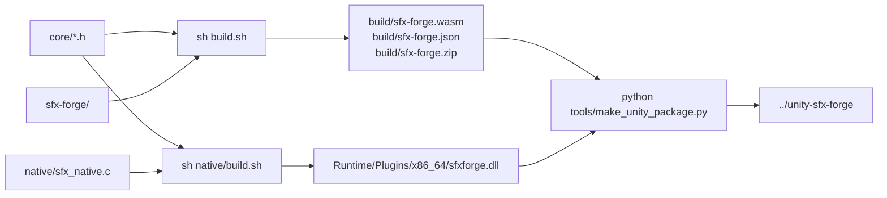

# Building From Source

This page gets you from a fresh clone to a built firmware, a built native library and a generated Unity package.
It lists the tools you need and, for each build command, what it produces and what you see.

All commands run from the repository's root. On Windows use Git Bash for every `sh` command.

## What must be installed

| Tool | Version used here | Needed for |
|---|---|---|
| Git Bash | any | every `sh` command (on Windows) |
| VIBE FM SDK | a clone in `.tools/vibe-fm-sdk` | builds the firmware; its `wasmtest` and `vibe-check` run the checks |
| Zig | 0.13.0, in `.tools/zig-*`, on the PATH, or named in `ZIG=` | the C compiler: the firmware, the DLL, the two-thread tests |
| Node | 18 or later (22.14 here) | the checks, `docs/shots.mjs` |
| Python | 3 (3.13 here) | strips the `.wasm`; with Pillow: the figures |
| .NET SDK | one that builds `net9.0` (10.0 here) | `tests/dotnet`; `tests/midi-torture` (built for `net8.0`) |
| Unity | 6000.3.8f1, the only version ever run | the two Unity test projects |
| ffmpeg, numpy | on the PATH | only the videos and the package script |

You do not need all of it at once:

| You want to | You need |
|---|---|
| build the firmware and run its checks | Git Bash, the SDK, Zig, Node, Python |
| build the DLL | Git Bash, Zig |
| run the .NET tests | the two rows above, and the .NET SDK |
| run the Unity tests | Unity |

Get the SDK once:

```sh
git clone https://github.com/Vibe-FM-SDK/vibe-fm-sdk.git .tools/vibe-fm-sdk
```

Zig is one folder with no installer. Take 0.13.0 from <https://ziglang.org/download/> and unpack it into `.tools/`,
so that there is `.tools/zig-<its name>/zig.exe` (or `zig` without `.exe`). Both build scripts look there first.

`.tools/` is git-ignored and not ours: never edit it. New words (SDK, host, Zig, `wasmtest`, `vibe-check`):
[Glossary](Glossary#code-and-files).

## What builds what



## 1. The firmware

```sh
sh build.sh            # build + all checks. About 30 seconds
sh build.sh quick      # build only
```

What `build.sh` does, in order:

1. It finds the SDK (`.tools/vibe-fm-sdk`, or `VIBE_SDK=/path/to/sdk`) and Zig.
2. It copies `sfx-forge/` and `core/` into the SDK, builds there with the SDK's `tools/build.sh`, and takes the
   copies out again.
3. It copies `sfx-forge.wasm`, `sfx-forge.json` and `sfx-forge.zip` into `build/`.
4. It runs `tools/strip_wasm_debug.py` on the `.wasm` and the zip. The SDK's build leaves debug sections with this
   machine's full paths in them; the script takes them out. The code is untouched.
5. With `quick` it stops here. Otherwise it runs `vibe-check` and every check
   ([Running The Tests](Running-The-Tests)).

**What you see when it is right:** exit code 0, and 26 lines of the output say `PASSED`.

**What you get:** `build/sfx-forge.wasm`, which you drop onto the SDK's emulator in a browser
(<https://play.thefirmwarehub.com/>), and `build/sfx-forge.zip`, which you drop onto the VIBE FM plugin's window.
What was tried on which host: [What Is Tested](What-Is-Tested).

To build against another checkout of the SDK:

```sh
VIBE_SDK=/path/to/sdk sh build.sh
```

## 2. The native library

```sh
sh native/build.sh
```

It compiles `native/sfx_native.c` (which includes `core/`) with `zig cc` for Windows x64 and writes
`unity/com.catsplat.sfxforge/Runtime/Plugins/x86_64/sfxforge.dll`. It prints the DLL's `ls -l` line.

The same source gives the same DLL but for the build time in its header. So the file shows as changed in git after
every build. Commit it only when `core/` or `native/` changed; otherwise `git checkout` it.

Rebuild it after any change in `core/` or `native/`, **before** you run `tests/dotnet`: those tests load the
committed DLL, and an old one passes tests it should fail.

## 3. The Unity package repository

```sh
python tools/make_unity_package.py [target folder]     # default: ../unity-sfx-forge
```

It writes the standalone package repository from nothing: `Runtime`, `Editor`, the showcase as `Samples~/Showcase`,
the manuals, the videos with previews, the built firmware, the front page and every `.meta`. It builds in a folder
beside the target and replaces the target only when every check passed. It never starts Unity.

It stops with a named error when something it needs is missing. The usual ones:

| It needs | Get it with |
|---|---|
| `build/sfx-forge.zip`, with the version the script expects | `sh build.sh` |
| ffmpeg and ffprobe on the PATH; the SDK and Zig in `.tools` | install them |
| the five videos in `videos/`, each as long as the script's `VIDEOS` table says (within 2 seconds) | they are committed |
| exact lines of the manuals and READMEs that it rewrites | after editing a manual, update the script's copy of the line it names |

The full list: [the maintainer's guide](../docs/MAINTAINING.md#regenerate-the-package).

## 4. The pictures of the manuals

```sh
node docs/shots.mjs          # the firmware's screenshots into out/doc (after sh build.sh)
python docs/figures.py       # the manual's pictures into docs/img (needs Pillow)
```

Run both; `git diff --stat docs/img` is empty when nothing visible changed. The wiki's own pictures are made by the
scripts in `wiki/figures/`: [Editing This Wiki](Editing-This-Wiki).

## Is my build the same as before?

`sha256sum build/sfx-forge.wasm` gives the same hash before and after a change that only moves text. A hash belongs
to one state of the source: any change to the code gives another, and another SDK or another Zig may give another
hash for the same source. So compare a hash only with one you took yourself, just before your change.

## Trouble

| You see | Cause |
|---|---|
| `VIBE FM SDK not found at ...` | no clone in `.tools/vibe-fm-sdk`, and `VIBE_SDK` is not set |
| folders `sfx-forge/` and `core/` inside the SDK | a build was killed. The next run removes them first |
| `sfxforge.dll` shows as modified in git though you changed nothing | the build time in its header. `git checkout` it |
| `tests/dotnet` prints `FAIL  out/midi.json missing: run sh build.sh first` | do that: `sh build.sh` writes the file |

## Next

- [Running The Tests](Running-The-Tests): every suite and what a pass looks like.
- [Repository Map](Repository-Map): what the folders are.
- [Release Checklist](Release-Checklist): the steps of a new firmware version.
- [Unity Porting The Native Library](Unity-Porting-The-Native-Library): the DLL on another platform.

## Reference

- [build.sh](../build.sh), [native/build.sh](../native/build.sh),
  [tools/strip_wasm_debug.py](../tools/strip_wasm_debug.py),
  [tools/make_unity_package.py](../tools/make_unity_package.py)
- [The maintainer's guide, 2. Build and test](../docs/MAINTAINING.md#2-build-and-test):
  [What must be installed](../docs/MAINTAINING.md#what-must-be-installed),
  [The firmware and its checks](../docs/MAINTAINING.md#the-firmware-and-its-checks),
  [The native library](../docs/MAINTAINING.md#the-native-library),
  [Regenerate the package](../docs/MAINTAINING.md#regenerate-the-package),
  [The formatters](../docs/MAINTAINING.md#the-formatters)
- [README, Build](../README.md#build)
