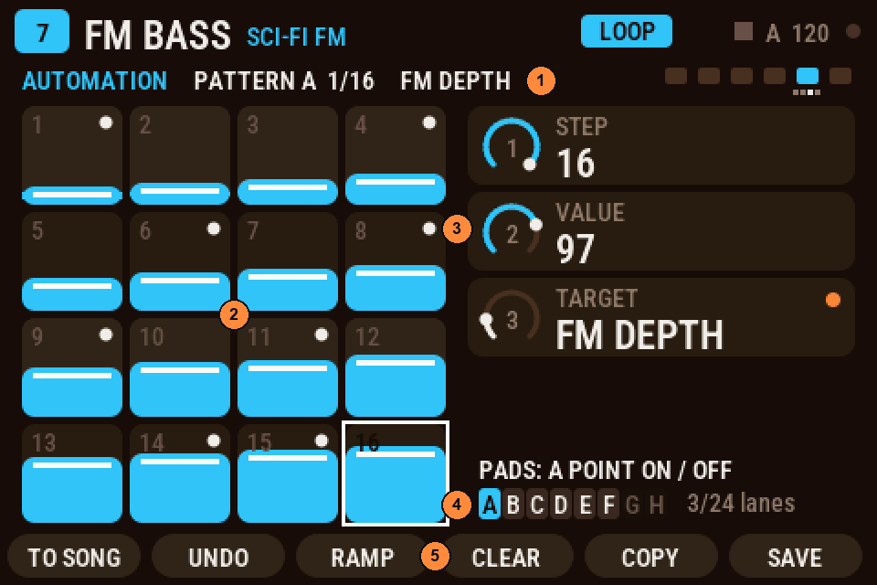
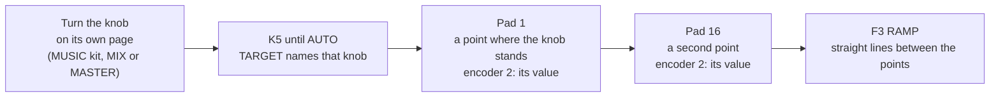
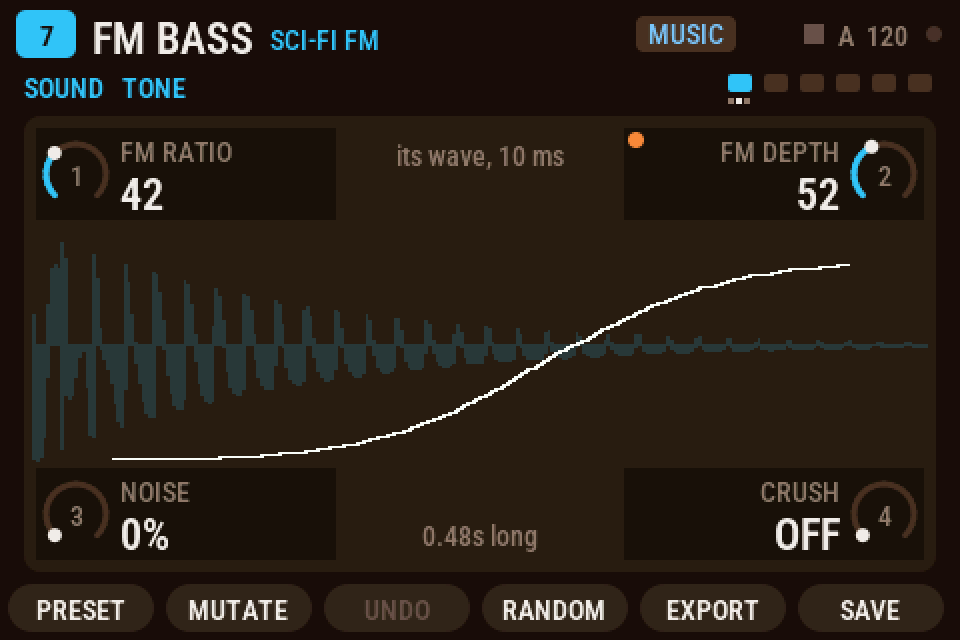

# Device Automation

Make a knob move by itself while the pattern plays: a filter that opens through the bar, a chord that swells. You
draw the movement as points on the steps of a **lane**.

Press **K5** until the second line says `AUTOMATION`: three times from a sound page. As on SEQ, PLAY repeats the
pattern here, so you can draw a lane while it goes round. Automation is the song's: it moves the MUSIC kit.

| | What it is |
|---|---|
| **1** | the pattern, its grid, and the knob this lane moves: here FM DEPTH of the FM BASS |
| **2** | the lane, as the 16 pads: a bar for each step, its height the value. Bright with a white edge: a point. Dim: the value still held from the last point. The dot in a corner: the sound plays on that step |
| **3** | STEP · VALUE (in the knob's own unit; `--` where the step has no point) · TARGET (which knob; `OFF`: none chosen). The orange dot says this knob has a lane |
| **4** | the eight patterns, and how many of the song's 24 lanes are in use: `3/24 lanes` |
| **5** | TO SONG (or TO LOOP) · UNDO · RAMP · CLEAR · COPY · SAVE |

## The quick way: turn the knob, then press K5

**AUTO opens on the knob you turned last.**

| | Do this | You see |
|---|---|---|
| **1** | select a sound of the MUSIC kit and turn the knob you want to move: CUTOFF on the FILTER page, VOLUME on MIX, ROOM SIZE on MASTER | the knob's value |
| **2** | press **K5** until AUTO, with the same sound selected | TARGET already names that knob. Or turn **encoder 3** to choose another |
| **3** | hit **pad 1**, then turn **encoder 2** down | a point on step 1, where the knob stood; then lower |
| **4** | hit **pad 16**, then turn encoder 2 up | a point on step 16 |
| **5** | press **F3 RAMP** | every step between gets a value on the straight line from one point to the next: the picture above. The top line says `RAMP` |
| **6** | press **PLAY** | the knob moves, round after round |

For a second lane on the same sound, turn TARGET to another knob and put points on it. Both play.

On the sound's own page an orange dot beside a value says a lane moves that knob. Here FM DEPTH of the FM BASS:

## What a lane can move

| | Targets |
|---|---|
| **the sound's own** | any of its 25 values: CUTOFF, FM DEPTH, POSITION, a send ... Not its ENGINE |
| **its place in the mix** | VOLUME, PAN |
| **the master** | DELAY TIME, FEEDBACK, ROOM SIZE, DAMPING, DRIVE. Not OUTPUT |

## The controls of the AUTO page

| Control | What it does | The top line says |
|---|---|---|
| **a pad** | a point on that step, on (where the knob stands) or off | without a target: `TURN TARGET FIRST` |
| **SHIFT + a pad** | hear that pad's sound and select it | |
| **DATA** | select a sound: it has its own lanes | |
| **encoder 1** | STEP: the step in the frame | |
| **encoder 2** | VALUE of the point on that step. Where there is no point, the first click makes one where the knob stands | without a target: `TURN TARGET FIRST` |
| **encoder 3** | TARGET: which knob the lane moves. `OFF`, then the 32 knobs, round and round | |
| **F2 UNDO** | takes back points, a RAMP or a CLEAR. Again: redo | `UNDO: EDITS`, `UNDO: RAMP`, `UNDO: CLEAR` |
| **F3 RAMP** | joins the points with straight lines | `RAMP`, or `SET TWO POINTS FIRST` |
| **F4 CLEAR** | empties the lane in this pattern | `LANE CLEARED`, or `NOTHING TO CLEAR` |
| **F5 COPY** | copies the pattern, with its points, into the next empty one, and goes there | `COPIED A > G` |
| **LEFT · RIGHT** | the pattern before / after | |
| **A** | the tempo. SHIFT + A: the swing | |

The grid's keys work here too: SHIFT + F5 and F6 change the pattern's grid, SHIFT + LEFT and RIGHT move the 16 steps
the pads show ([Device Finer Grids](Device-Finer-Grids)). B has no job on AUTO.

## Four rules

| | |
|---|---|
| **A point holds** | until the next point, or the end of the bar |
| **Nothing is written** | a lane never changes the sound or the mix you saved: at every bar line each knob is back where you set it by hand |
| **It moves in steps** | a step at a time: a 16th note, or a 32nd or a 64th in a pattern with a finer grid. RAMP makes a sweep sound smooth |
| **24 lanes a song** | the first point of a knob takes a lane, for all eight patterns; clearing its last point gives it back. With none left: `ALL 24 LANES IN USE` |

## Two recipes

| I want | Do this |
|---|---|
| **a chord that swells** | STRINGS: a note on step 1, LENGTH 12 (on SEQ). AUTO: TARGET VOLUME, a low point on step 1, a high one on step 12, RAMP |
| **a filter sweep into the drop** | AUTO, the bass, TARGET CUTOFF, points on steps 1 and 16, RAMP |

The demo song has two lanes of its own: the bass's CUTOFF opens through pattern F, and the strings' VOLUME swells
through pattern E.

## Next

- [Device The Stage](Device-The-Stage) - draw a lane with the mouse
- [Device Mixer And Effects](Device-Mixer-And-Effects) - the faders and master values a lane can move
- [Device Finer Grids](Device-Finer-Grids) - finer steps for a lane
- [Device Layers And Intensity](Device-Layers-And-Intensity) - the other way music changes by itself

## Reference

- [The manual, section 12: Automation](../docs/MANUAL.md#12-automation): [what a lane can move](../docs/MANUAL.md#what-a-lane-can-move), [the quick way](../docs/MANUAL.md#the-quick-way-turn-the-knob-then-press-k5), [four rules](../docs/MANUAL.md#four-rules)
- [fw_sequencer.h](../sfx-forge/fw_sequencer.h) - `aut_put`, `auto_turn`, `auto_toggle`, `auto_ramp`
- [fw_softkeys.h](../sfx-forge/fw_softkeys.h) - `soft_auto`
- [fw_pages.h](../sfx-forge/fw_pages.h) - `set_page`: AUTO opens on the knob turned last
- [sfx_song.h](../core/sfx_song.h) - `SFX_AT_*`: what a lane can move; `SFX_LANES`
