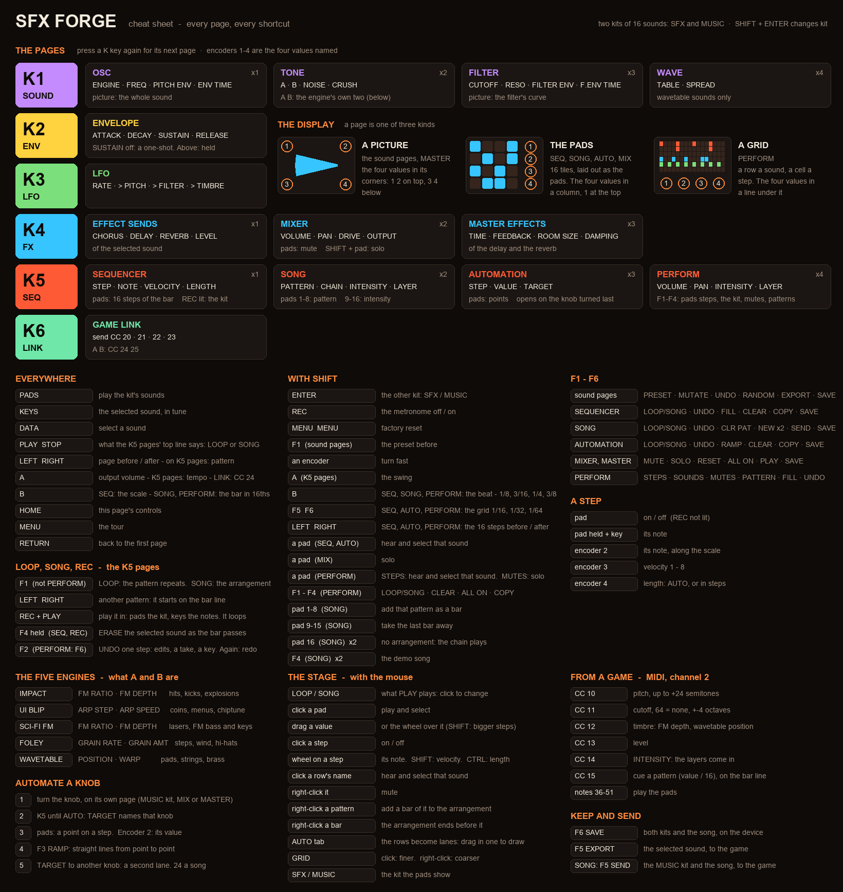

# Device Cheat Sheet

Every page and every shortcut: first on one picture, then as one small table for each page. For those who know
their way around and want to look something up.

On the device itself, **HOME** shows the controls of the page that is open.

"K5 ×2" below means: press K5 twice, coming from a page of another key. The first press opens the key's first
page; each press after that goes to its next page.

## Everywhere

| Control | What it does |
|---|---|
| **pads** | play the kit's sounds (on SEQ, SONG, AUTO, PERFORM and MIX they have another job: below) |
| **keys** | the selected sound, in tune |
| **DATA** | select a sound |
| **SHIFT + ENTER** | the other kit: SFX / MUSIC |
| **PLAY · STOP** | a pattern round and round (LOOP) or the song (SONG). PLAY again stops too |
| **REC** | lit: while it plays, what is played is recorded into the pattern. **SHIFT + REC**: the click on / off |
| **K1 - K6** | the pages. Again: the key's next page |
| **LEFT · RIGHT** | the sound page before / after. On SEQ, SONG, AUTO, PERFORM: the pattern before / after |
| **A** | the output volume. On SEQ, SONG, AUTO, PERFORM: the tempo (SHIFT: the swing). On LINK: CC 24 |
| **HOME · RETURN** | this page's controls · back to the first page |
| **MENU** | the tour. **SHIFT + MENU**, twice within three seconds: factory reset |
| **SHIFT + an encoder** | turn fast: eight times |

## The sound pages: OSC, TONE, FILTER, WAVE, ENV, LFO, FX

| Page | Key | Encoders 1 - 4 |
|---|---|---|
| **OSC** | K1 | ENGINE · FREQ · PITCH ENV · ENV TIME |
| **TONE** | K1 ×2 | A · B · NOISE · CRUSH |
| **FILTER** | K1 ×3 | CUTOFF · RESO · FILTER ENV · F.ENV TIME |
| **WAVE** | K1 ×4, wavetable sounds only | TABLE · SPREAD |
| **ENV** | K2 | ATTACK · DECAY · SUSTAIN · RELEASE |
| **LFO** | K3 | LFO RATE · > PITCH · > FILTER · > TIMBRE |
| **FX** | K4 | CHORUS · DELAY · REVERB · LEVEL |

**F1 - F6** on all of them: PRESET (SHIFT: the one before) · MUTATE · UNDO · RANDOM · EXPORT · SAVE.
More: [Device Make A Sound](Device-Make-A-Sound), [Device The Five Engines](Device-The-Five-Engines).

## SEQ: K5

| Control | What it does |
|---|---|
| **pads** | 16 steps of the bar, on / off. REC lit: they play the kit |
| **SHIFT + pad** | hear and select that pad's sound |
| **pad held + key** | the step plays the key's note |
| **encoders 1 - 4** | STEP · NOTE · VELOCITY (1 - 8) · LENGTH |
| **B** | the scale NOTE moves in. **SHIFT + B**: the beat |
| **F1 - F6** | TO SONG / TO LOOP · UNDO · FILL · CLEAR (REC playing: ERASE, held) · COPY · SAVE |
| **SHIFT + F5 · F6** | the pattern's grid coarser · finer |
| **SHIFT + LEFT · RIGHT** | at 1/32 and 1/64: the 16 steps before / after |

More: [Device Make A Beat](Device-Make-A-Beat), [Device Recording](Device-Recording),
[Device Finer Grids](Device-Finer-Grids).

## SONG: K5 ×2

| Control | What it does |
|---|---|
| **pads 1 - 8** | pattern A - H: at once while stopped, from the next bar line while it plays |
| **pads 9 - 16** | INTENSITY, 12 % to 100 % |
| **SHIFT + pad 1 - 8** | add that pattern to the arrangement as a bar |
| **SHIFT + pad 9 - 15** | take the last bar away |
| **SHIFT + pad 16**, twice | no arrangement |
| **encoders 1 - 4** | PATTERN · CHAIN · INTENSITY · LAYER of the selected sound |
| **B** | the bar's length in sixteenths, 1 - 16. **SHIFT + B**: the beat |
| **F1 - F6** | TO SONG / TO LOOP · UNDO · CLR PAT · NEW (SHIFT: DEMO), both twice · SEND · SAVE |

More: [Device Song And Arrangement](Device-Song-And-Arrangement),
[Device Layers And Intensity](Device-Layers-And-Intensity), [Device Time Signatures](Device-Time-Signatures).

## AUTO: K5 ×3

| Control | What it does |
|---|---|
| **pads** | a point on that step, on / off |
| **SHIFT + pad** | hear and select that pad's sound |
| **encoders 1 - 3** | STEP · VALUE · TARGET (the page opens on the knob turned last) |
| **A** | the tempo (SHIFT: the swing). B does nothing here |
| **F1 - F6** | TO SONG / TO LOOP · UNDO · RAMP · CLEAR · COPY · SAVE |
| **SHIFT + F5 · F6**, **SHIFT + LEFT · RIGHT** | the grid, and the steps shown, as on SEQ |

More: [Device Automation](Device-Automation).

## PERFORM: K5 ×4

| Control | What it does |
|---|---|
| **F1 STEPS** | pads: 16 steps of the selected sound. SHIFT + pad: hear and select a sound. Pad held + key: the step's note |
| **F2 SOUNDS** | pads: the kit. REC playing: recorded |
| **F3 MUTES** | pads: mute. SHIFT + pad: solo |
| **F4 PATTERN** | pads 1 - 8: pattern A - H · pads 9 - 16: INTENSITY |
| **F5 · F6** | FILL the selected sound · UNDO (again: redo). No SAVE here: F6 on SEQ |
| **SHIFT + F1 - F6** | TO SONG / TO LOOP · CLEAR · ALL ON · COPY · the grid coarser · finer |
| **encoders 1 - 4** | VOLUME · PAN · INTENSITY · LAYER |
| **B** | the bar's length. **SHIFT + B**: the beat |
| **REC** | lights REC, and makes the pads SOUNDS |
| **SHIFT + LEFT · RIGHT** | at 1/32 and 1/64: the 16 steps before / after |

More: [Device Perform](Device-Perform).

## MIX and MASTER: K4 ×2, K4 ×3

| Page | Pads | Encoders 1 - 4 | F1 - F6 |
|---|---|---|---|
| **MIX** | mute · SHIFT: solo | VOLUME · PAN · DRIVE · OUTPUT | MUTE · SOLO · RESET (the selected fader and pan) · ALL ON · PLAY · SAVE |
| **MASTER** | play | DELAY TIME · FEEDBACK · ROOM SIZE · DAMPING | the same; RESET: the master's values |

More: [Device Mixer And Effects](Device-Mixer-And-Effects).

## LINK: K6

| Control | What it does |
|---|---|
| **encoders 1 - 4, A, B** | send CC 20 - 25 to the game, on MIDI channel 1 |
| **pads** | play, and send notes 36 - 51 |
| **from the game**, MIDI channel 2 | CC 10 - 13: pitch, cutoff, timbre, level · CC 14: intensity · CC 15: pattern |
| **notes from the game** | 36 - 51 play the pads |
| **F1 - F6** | as the sound pages. F5 EXPORT: the selected sound as SysEx |

More: [Unity Device Link Setup](Unity-Device-Link-Setup), [Link Protocol](Link-Protocol).

## What the top line says

| It says | It means |
|---|---|
| `LOOP: PATTERN REPEATS` · `SONG: PLAYS IN ORDER` | F1 (on PERFORM SHIFT + F1): what PLAY plays now |
| `REC ON: PATTERN LOOPS` | REC changed SONG to LOOP |
| `CLICK ON` · `CLICK OFF` | SHIFT + REC |
| `ERASE: HOLD F4` | F4 while REC plays on SEQ: held, it erases the selected sound |
| `MUSIC KIT ONLY: K5 SEQ` | a hit of the SFX kit was not recorded |
| `UNDO: ...` · `REDO: ...` · `NOTHING TO UNDO` | F2 (on PERFORM F6) |
| `PRESS AGAIN: ...` · `AGAIN: ...` | a key that asks twice: press it again while this stands |
| `EVERY 1/4` · `EVERY 1/8` · `EVERY 1/16` · `EVERY 1/32` · `SOUND CLEARED` | FILL: where the sound stands now |
| `CLEARED - F2: UNDO` · `LANE CLEARED` · `PAT CLEARED - F2: UNDO` · `NOTHING TO CLEAR` | CLEAR on SEQ · on AUTO · CLR PAT on SONG |
| `COPIED A > G` · `NO EMPTY PATTERN` | COPY |
| `GRID 1/32` · `GRID 1/16 - F2: UNDO` · `AGAIN: G DROPS 4` · `FINEST: 1/64` · `COARSEST: 1/16` | SHIFT + F6 and SHIFT + F5: the grid |
| `STEPS 17-32` · `1/16: ALL STEPS SHOWN` · `BAR ENDS AT STEP 8` | SHIFT + LEFT or RIGHT |
| `BAR: 12/16 = 3/4` · `BEAT 3/8: BAR 6/8` | B · SHIFT + B |
| `BAR ADDED` · `BAR REMOVED` · `32 BARS: FULL` · `NO ARRANGEMENT` · `ARRANGEMENT IN USE` | the arrangement, and CHAIN while there is one |
| `MUTED` · `UNMUTED` · `SOLO` · `SOLO OFF` · `ALL ON` · `FADER RESET` · `MASTER RESET` | F1 - F4 on MIX and MASTER |
| `TURN TARGET FIRST` · `SET TWO POINTS FIRST` · `ALL 24 LANES IN USE` | AUTO |
| `SAVED` · `NOT SAVED: STORE FULL` | F6 SAVE |
| `FACTORY RESET` · `RESET - NOT SAVED` | the factory reset: done · done, but the store did not take it |
| `SFX KIT` · `MUSIC KIT` | SHIFT + ENTER |
| `EXPORTED` · `SENDING` · `SENDING - NO GAME SEEN` · `SONG SENT` | F5 EXPORT · F5 SEND on SONG |
| `SONG LOADED` · `BAD SONG` · `NEWER SONG: UPDATE` | a song came from a game: taken · damaged · from a later format |

## Next

- [Device Controls And Pages](Device-Controls-And-Pages) - the same, explained
- [Device Quick Start](Device-Quick-Start) - five minutes from nothing
- [FAQ](FAQ)
- [Glossary](Glossary)

## Reference

- [The manual, section 20: Every control, page by page](../docs/MANUAL.md#20-every-control-page-by-page)
- [The cheat sheet's picture in the repository](../docs/img/cheatsheet.png), drawn by [figures.py](../docs/figures.py)
- [fw_events.h](../sfx-forge/fw_events.h) - the HOME texts: `HELP_SOUND`, `HELP_SEQ`, `HELP_SONG`, `HELP_AUTO`, `HELP_PERFORM`, `HELP_LINK`, `HELP_MIX`
- [fw_state.h](../sfx-forge/fw_state.h) - `SOFT`: the captions of F1 - F6 on every page
- [fw_softkeys.h](../sfx-forge/fw_softkeys.h) - what each soft key does
