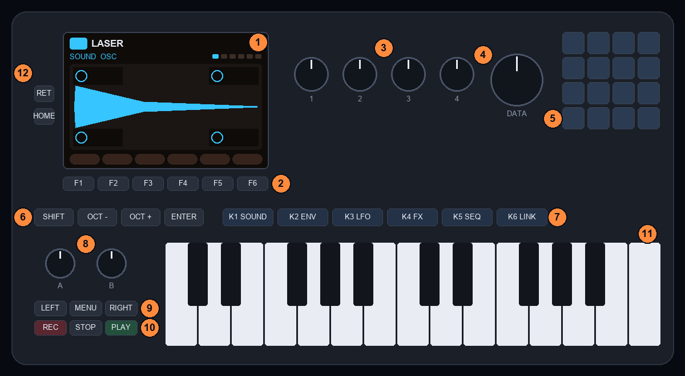
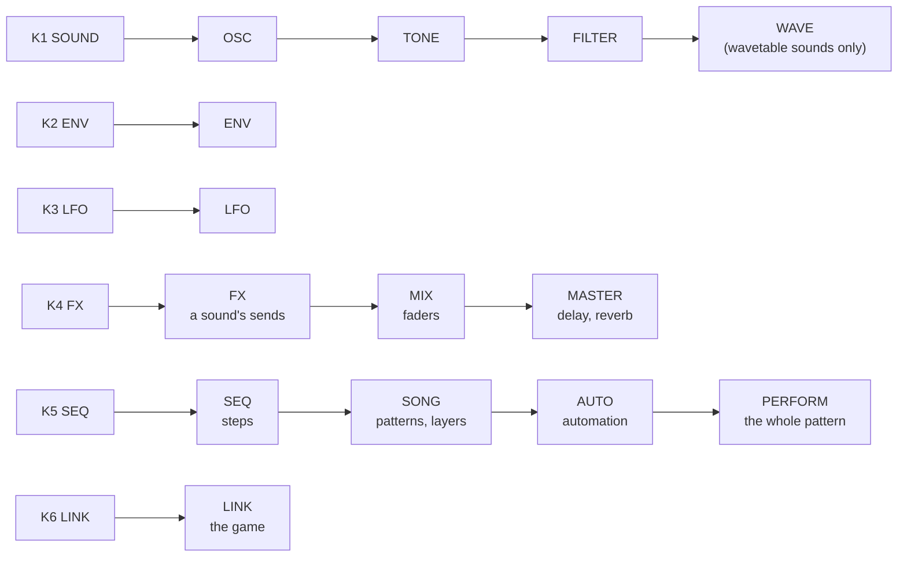
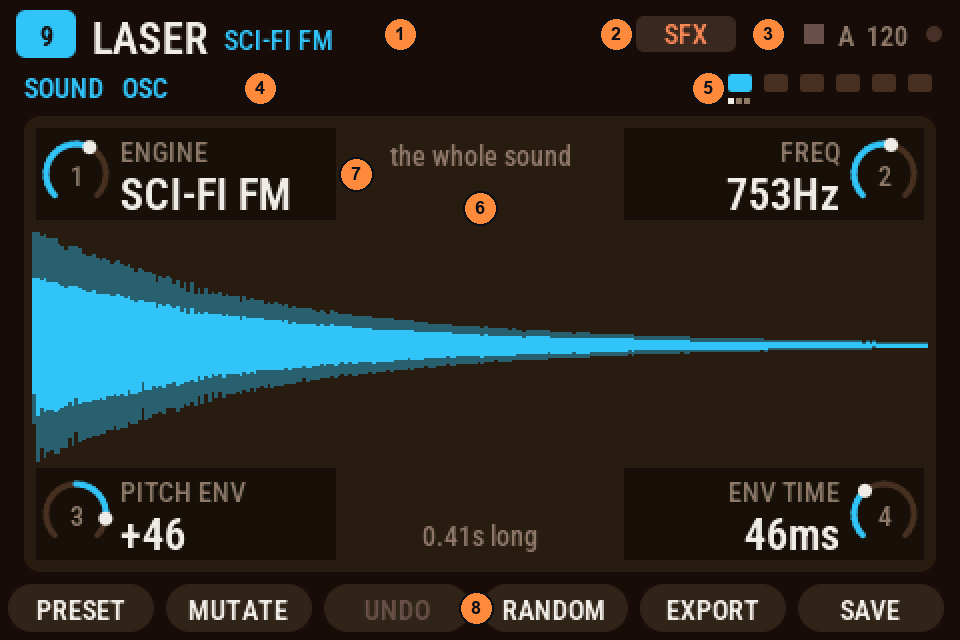
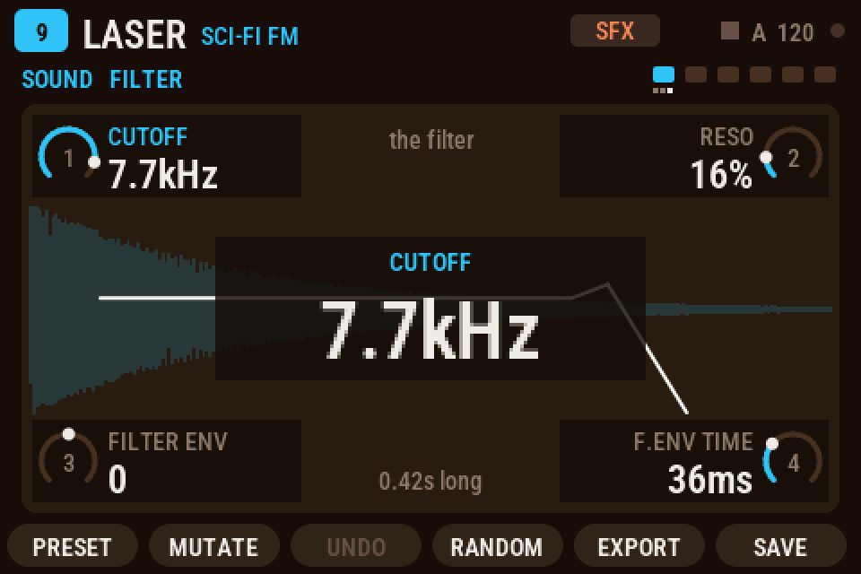

# Device Controls And Pages

What each control is, how the six K keys lead to fourteen pages, and which keys do the same thing everywhere.

| | Control | What it does |
|---|---|---|
| **1** | the display | the selected sound, the page, the four values, six soft keys |
| **2** | **F1 - F6** | the six soft keys along the bottom of the display. They change with the page |
| **3** | **encoders 1 - 4** | the four values the display shows. Hold SHIFT to turn fast |
| **4** | **DATA** | selects a sound, on every page |
| **5** | **the 16 pads** | play the kit's sounds. On SEQ, SONG, AUTO, PERFORM and MIX they are steps, patterns, points or mutes |
| **6** | **SHIFT** | the second meaning of a key, and fast encoders |
| **7** | **K1 - K6** | the pages. Press a K key again for its next page |
| **8** | **A · B** | two more encoders. What they turn depends on the page: the table below |
| **9** | **LEFT · MENU · RIGHT** | LEFT and RIGHT: the sound page before and after (on SEQ, SONG, AUTO and PERFORM: the pattern before and after). MENU: the tour |
| **10** | **REC · STOP · PLAY** | the transport: [Device Recording](Device-Recording) |
| **11** | **the keys** | play the selected sound as an instrument, in tune |
| **12** | **RETURN · HOME** | back to the first page · the controls of this page |

Encoders A and B, page by page:

| On | A | SHIFT + A | B | SHIFT + B |
|---|---|---|---|---|
| the sound pages, MIX, MASTER | the output volume | the same, faster | nothing | nothing |
| SEQ | the tempo, 40 - 240 | the swing | the scale | the beat |
| SONG, PERFORM | the tempo | the swing | the bar's length | the beat |
| AUTO | the tempo | the swing | nothing | nothing |
| LINK | sends CC 24 to the game | | sends CC 25 to the game | |

The bar's length and the beat make a time signature: [Device Time Signatures](Device-Time-Signatures).

Words this page uses: the **top line** is the first line of the display, with the selected sound's name; for about
two seconds it shows instead what a key just did (`MUTATED`, `SAVED`). The **second line** names the page. The
**transport** is REC, STOP and PLAY. More words: [Glossary](Glossary).

**ENTER** is the key right of OCT +. SFX FORGE gives it one job: **SHIFT + ENTER**, a short press, changes kit (see
below). DATA pressed counts as ENTER. ENTER held is FOCUS, which belongs to the VIBE: a frame that DATA moves from
control to control. The manual's [section 2](../docs/MANUAL.md#2-the-device) describes it.

## The page map

Six K keys, fourteen pages. The first press of a K key opens its first page. Pressing it again walks to its next
page, and after the last one to the first again.

| Pages | They are about | Where to read on |
|---|---|---|
| OSC, TONE, FILTER, WAVE, ENV, LFO, FX | **one sound**: the selected one | [Device Make A Sound](Device-Make-A-Sound), [Device The Five Engines](Device-The-Five-Engines) |
| SEQ, SONG, AUTO, PERFORM | **the song**: patterns, their order, automation | [Device Make A Beat](Device-Make-A-Beat), [Device Song And Arrangement](Device-Song-And-Arrangement), [Device Automation](Device-Automation), [Device Perform](Device-Perform) |
| MIX, MASTER | **the song's mix** | [Device Mixer And Effects](Device-Mixer-And-Effects) |
| LINK | **the game** at the other end of the MIDI cable | [Unity Device Link Setup](Unity-Device-Link-Setup) |

The display names the page in its second line: `SOUND   OSC` (and `SOUND   TONE`, `SOUND   FILTER`,
`SOUND   WAVE`), `ENVELOPE`, `LFO`, `EFFECT SENDS`, `SEQUENCER`, `SONG`, `AUTOMATION`, `PERFORM`, `MIXER`,
`MASTER EFFECTS`, `GAME LINK`.

## Three kinds of page

| Kind | Pages | What you see |
|---|---|---|
| **A picture** | the seven sound pages, MASTER | one picture of what the knobs shape, with the page's values in its corners |
| **The pads** | SEQ, SONG, AUTO, MIX | the 16 pads drawn as 16 tiles, with the page's values in a column beside them |
| **A grid** | PERFORM | the whole pattern: a row a sound, a cell a step, with the four values in one line under it |

LINK has a list where the others have a picture or tiles: what the game sends. WAVE has two values and AUTO three;
every other page has four.

A picture page, with its parts numbered:

| | What it is |
|---|---|
| **1** | the selected sound: its pad number, its name, its engine |
| **2** | the kit: SFX or MUSIC. On SEQ, SONG, AUTO, PERFORM, MIX and MASTER this place says **LOOP** or **SONG**: what PLAY plays |
| **3** | the song: stopped (a square) or playing (a green triangle), the pattern, the tempo, and a dot that turns green once something has come in from a game. While REC is lit the square or triangle is a red dot |
| **4** | the page's name |
| **5** | six marks for K1 - K6. The bright one is the key you are on; the dots under it are that key's pages |
| **6** | the picture |
| **7** | a value in each corner. The number in the ring is the encoder: on a sound page 1 top left, 2 top right, 3 bottom left, 4 bottom right |
| **8** | the soft keys: F1 - F6 |

Turn an encoder on a picture page and its value is written large across the middle for about a second:

## Two kits

SFX FORGE holds two sets of 16 sounds. **SHIFT + ENTER** changes between them: hold SHIFT, press ENTER shortly. The
top line says `SFX KIT` or `MUSIC KIT`. From a song page, MIX, MASTER or LINK it also goes to the first sound page.
As the device starts, the kit is SFX.

| | SFX kit | MUSIC kit |
|---|---|---|
| What is in it | the game's sound effects | the band the song plays |
| Where it goes | beside the song: past fader, pan and mute | through the mixer: fader, pan, mute |
| Layers | none: it always sounds | a LAYER mark for each sound ([Device Layers And Intensity](Device-Layers-And-Intensity)) |
| F1 PRESET offers | 16 sound effects | 23 instruments |

Going to a song page (SEQ, SONG, AUTO, PERFORM, MIX, MASTER) chooses MUSIC by itself. Do not turn DATA while SHIFT is
held: the manual's [section 2](../docs/MANUAL.md#2-the-device) says why.

## The same on every page

| Key | What it does |
|---|---|
| **PLAY · STOP** | PLAY starts what the top line of the song's pages says: one pattern round and round (LOOP) or the song (SONG). PLAY again, or STOP, stops it |
| **REC** | lights REC: while the song plays, what you play is recorded into the pattern. **SHIFT + REC**: the click on or off (`CLICK ON`, `CLICK OFF`) |
| **HOME** | the controls of the page that is open, up to eleven lines. HOME or RETURN closes it |
| **RETURN** | back to the first sound page (or, while HOME is open, closes it) |
| **MENU** | the tour. **SHIFT + MENU**, twice within three seconds: factory reset |
| **SHIFT + ENTER** | the other kit |
| **DATA** | selects a sound |
| **the keys** | play the selected sound in tune |

What the pads, the four encoders and F1 - F6 do depends on the page: [Device Cheat Sheet](Device-Cheat-Sheet) has
one row for each.

## Next

- [Device Make A Sound](Device-Make-A-Sound) - the sound pages in use
- [Device Make A Beat](Device-Make-A-Beat) - the SEQ page in use
- [Device Cheat Sheet](Device-Cheat-Sheet) - every page on one picture, and as tables
- [Glossary](Glossary) - the words used here

## Reference

- [The manual, section 2: The device](../docs/MANUAL.md#2-the-device), [section 3: The display](../docs/MANUAL.md#3-the-display), [section 4: Two kits](../docs/MANUAL.md#4-two-kits)
- [fw_state.h](../sfx-forge/fw_state.h) - the pages (`PG_...`), the K keys (`TAB_OF`, `TAB_NAME`), the soft keys' captions (`SOFT`)
- [fw_pages.h](../sfx-forge/fw_pages.h) - `tab_key`, `arrow`, `encoder`
- [fw_events.h](../sfx-forge/fw_events.h) - `on_event`: what every key does, in order
- [Firmware Add A Page Or Key](Firmware-Add-A-Page-Or-Key) - to add a page of your own
