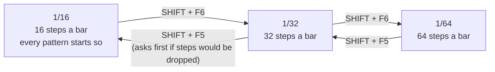
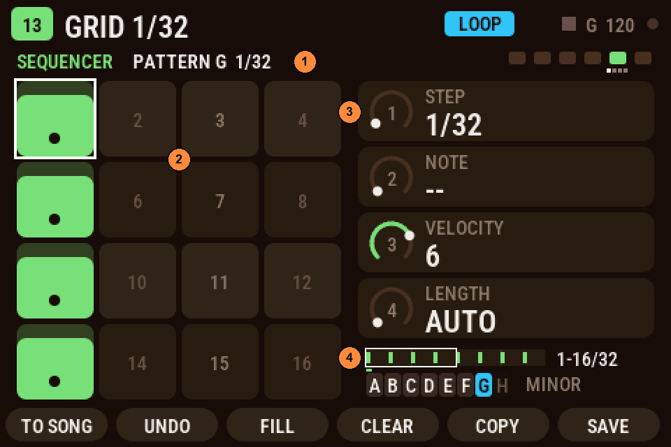
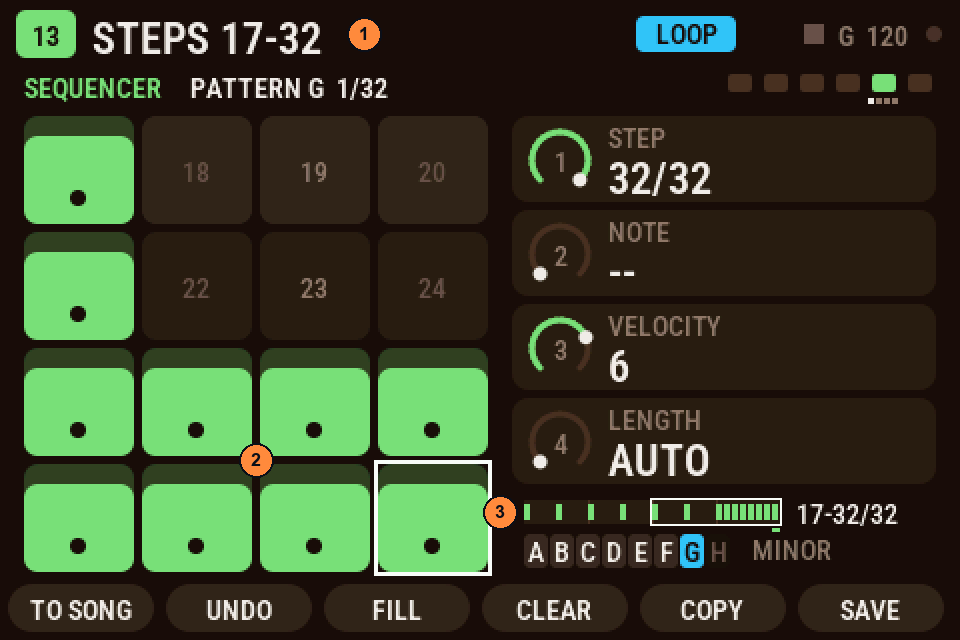
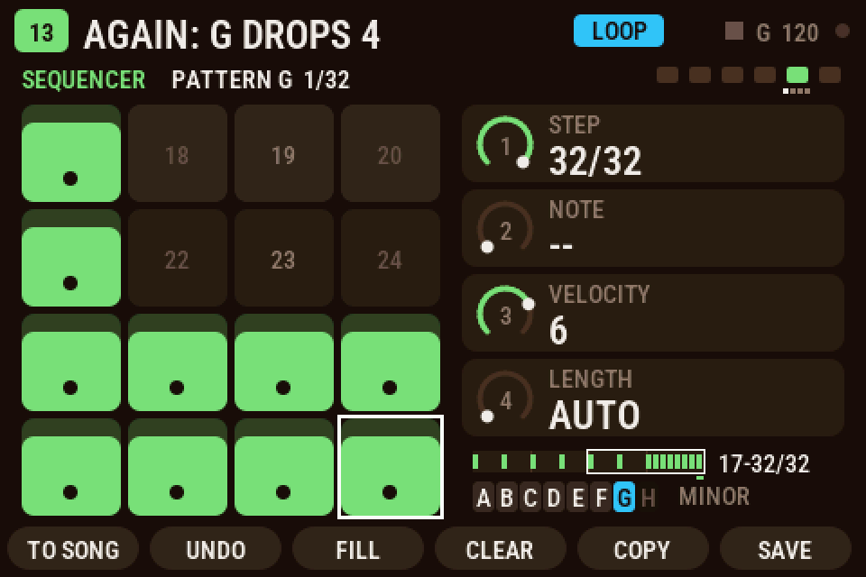

# Device Finer Grids

Notes faster than a sixteenth - a roll, a fill, a fast run - by giving one pattern a finer grid: 1/32 or 1/64.

**A bar stays a bar. A finer grid cuts each sixteenth in 2 or in 4.** Each pattern has its own grid; the tempo, the
swing, the click and the bar's length do not change with it. (From firmware 1.6.0.)

Going finer never changes what you hear: every step moves to the step that begins at the same moment. Going coarser
drops what stands between the steps that stay, so it asks first when there is something to drop.

## A hi-hat roll, step by step

**1. Kick and hats.** Press **K5**, and **RIGHT** until you are on an empty pattern: G in the demo song. DATA to
KICK, **F3 FILL** once. DATA to HI-HAT, F3 FILL twice: a hat on every eighth note.

**2. Press SHIFT + F6.** The top line says `GRID 1/32`. Nothing sounds different. The hats stood on steps 1, 3, 5 ...;
now they stand on 1, 5, 9 ... of 32.

| | What it is |
|---|---|
| **1** | the grid of the pattern you see: `PATTERN G  1/32` |
| **2** | the pads are 16 of the 32 steps now: here steps 1 - 16, the first half of the bar |
| **3** | STEP: the framed step, and how many the pattern has: `1/32` |
| **4** | **the bar strip**: the whole bar, a column a step, with a white frame round the 16 steps the pads show. Beside it: which they are, `1-16/32` |

**3. Press SHIFT + RIGHT.** `STEPS 17-32`: the pads are the second half of the bar. The hats are on pads 1, 5, 9
and 13. Hit **pads 10, 11, 12, 14, 15 and 16**: the last beat is full, eight notes where four sixteenths were.

| | What it is |
|---|---|
| **1** | what SHIFT + RIGHT said: the steps the pads show now |
| **2** | the roll: steps 25 - 32 |
| **3** | the frame in the bar strip has moved to the second half of the bar, and the roll stands in it |

**4. Press PLAY.** The bar is as long as it was; the roll is twice as fast as sixteenths.

**5. Back again: SHIFT + F5.** Four hits of the roll stand between the sixteenths, and a grid of sixteenths has no
place for them. The device asks first:

`AGAIN: G DROPS 4`. Press **SHIFT + F5 again** while the question stands, about two seconds, and it is done:
`GRID 1/16 - F2: UNDO`. Leave it, and nothing happens. **F2** brings the roll back (`UNDO: GRID`).

## The keys of the grid

They are the same on SEQ, AUTO and PERFORM. On PERFORM the key that takes a change back is F6, not F2, and the
message says so: `GRID 1/16 - F6: UNDO`.

| Key | What it does | The top line says |
|---|---|---|
| **SHIFT + F6** | the pattern's grid one level finer | `GRID 1/32`, `GRID 1/64`; at the end `FINEST: 1/64` |
| **SHIFT + F5** | one level coarser. It asks when something would be dropped | `GRID 1/32 - F2: UNDO`, `GRID 1/16 - F2: UNDO`, or `AGAIN: G DROPS 4`; at the end `COARSEST: 1/16` |
| **SHIFT held** | F5 and F6 on the display say what they will do | `TO 1/16`, `TO 1/32`, `TO 1/64`, or `IS 1/16`, `IS 1/64` at the two ends |
| **SHIFT + RIGHT · LEFT** | the 16 steps after and before, round and round | `STEPS 17-32`. At 1/16: `1/16: ALL STEPS SHOWN`. In a bar so short that it has only 16 steps or fewer: `BAR ENDS AT STEP 12` |
| **encoder 1 STEP** (SEQ and AUTO; on PERFORM encoder 1 is VOLUME) | goes through all 16, 32 or 64 steps one by one. The pads follow the frame | |
| **F2** (PERFORM: F6) | takes a change of grid back, with everything it dropped | `UNDO: GRID`. Again: `REDO: GRID` |

Plain LEFT and RIGHT still choose the pattern.

## What changes at a finer grid

| | At 1/16 | At 1/32 and 1/64 |
|---|---|---|
| the pads and tiles | all 16 steps | 16 of the 32 or 64; SHIFT + LEFT and RIGHT move them |
| under the values on SEQ | `PADS: THE 16 STEPS` | the bar strip (on AUTO too, once a target is chosen) |
| LENGTH (encoder 4) | AUTO, or 1 - 15 steps | AUTO, or up to 31 (1/32) or 63 (1/64) steps of this grid |
| F3 FILL | `EVERY 1/4`, `EVERY 1/8`, `EVERY 1/16`, `SOUND CLEARED` | one press more: `EVERY 1/32` before `SOUND CLEARED`. It never fills every 1/64 |
| a hit in a take | lands on the nearest sixteenth | lands on the nearest step of the finer grid |
| the SONG page | | a small `32` or `64` in the corner of the pattern's tile |
| PERFORM | 16 cells a row | 32 or 64 narrower cells a row: still the whole bar |

## Traps

- **A grid is a pattern's, not a sound's.** All 16 sounds of a pattern, and its automation, share it.
- **A coarser grid drops from every sound.** Steps of every sound in the pattern and points of every automation
  lane, not only what you see. The number in the question counts them all. A length is rounded up.
- **The question is strict.** The second press counts only while the question is in the top line, on the same
  pattern, towards the same grid, with the same number. Change a step in between and it asks again.
- **COPY keeps the grid; NEW resets it.** F5 COPY copies the pattern with its grid. F4 NEW on the SONG page sets
  every pattern to 1/16.
- **An older firmware does not take such a song.** A song saved or sent by firmware 1.6.0 or later is in a new
  format, whether a pattern has a finer grid or not: [Song Format](Song-Format).

## Next

- [Device Recording](Device-Recording) - play a roll in instead of setting it
- [Device Time Signatures](Device-Time-Signatures) - a shorter bar, another beat
- [Device Perform](Device-Perform) - the whole bar at 1/32 on one page
- [Device Automation](Device-Automation) - a lane moves in steps of the same grid

## Reference

- [The manual, "A finer grid: 1/32 and 1/64"](../docs/MANUAL.md#a-finer-grid-132-and-164): [the keys of the grid](../docs/MANUAL.md#the-keys-of-the-grid), [reading the page](../docs/MANUAL.md#reading-the-page-at-132-and-164), [a short bar](../docs/MANUAL.md#a-short-bar), [recording at a finer grid](../docs/MANUAL.md#recording-at-a-finer-grid)
- [fw_softkeys.h](../sfx-forge/fw_softkeys.h) - `grid_change`, `fill`
- [fw_pages.h](../sfx-forge/fw_pages.h) - `window_step`: SHIFT + LEFT and RIGHT
- [sfx_song.h](../core/sfx_song.h) - `sfx_pattern_regrid`, `sfx_pattern_regrid_loss`
