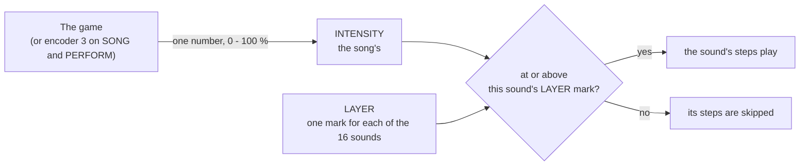
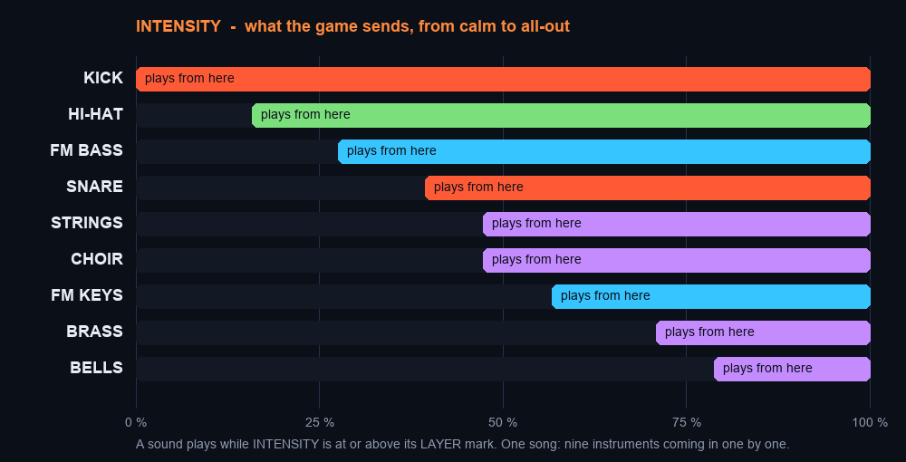
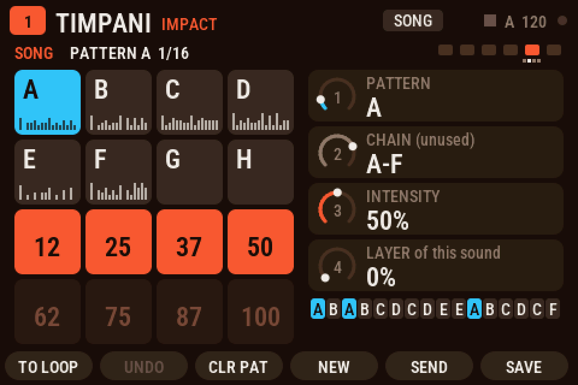
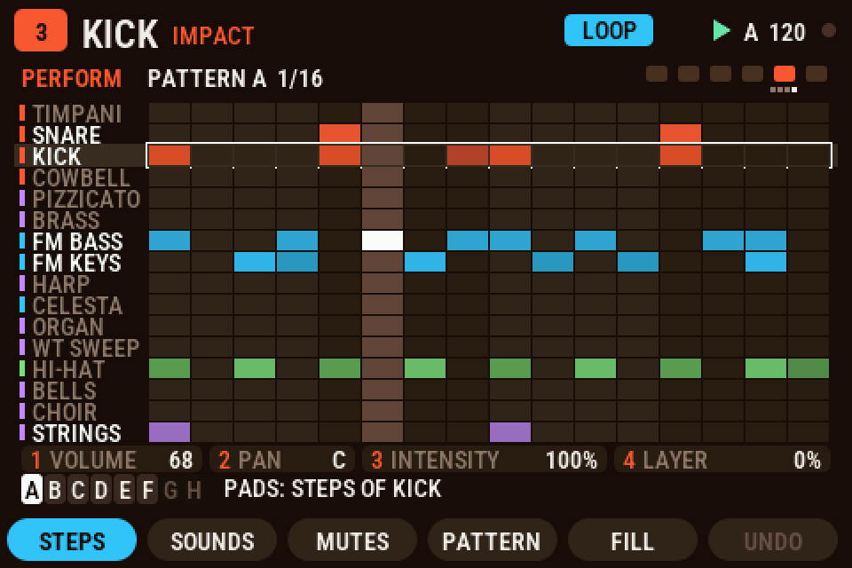
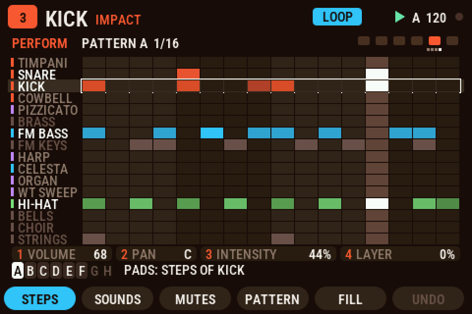

# Device Layers And Intensity

One song that is many: calm with only the kick, all-out with the whole band, and every stage between. This is how
the music follows the game.

> **Every sound has a LAYER mark. The song has one INTENSITY. A sound plays only while INTENSITY is at or above its
> mark.**

The demo song is set up this way. Each bar begins where its instrument comes in:

| Sound | Its LAYER mark in the demo song |
|---|---|
| KICK | 0 %: it always plays, as does every sound you have not given a mark |
| HI-HAT | 16 % |
| FM BASS | 28 % |
| SNARE | 39 % |
| STRINGS, CHOIR | 47 % |
| FM KEYS | 57 % |
| BRASS | 71 % |
| BELLS | 79 % |

## Hear it

1. Press **PLAY**. The demo song plays; INTENSITY is 100 % as the device comes.
2. Press **K5** twice, for the SONG page.
3. Turn **encoder 3** (INTENSITY) down, slowly, to 0 %. The instruments drop out in the order of the table, from the
   bottom up, until only the kick is left.
4. Turn it up again, or hit **pads 9 - 16**: eight levels, an eighth each, from 12 % to 100 %.

Here pad 12 was hit: INTENSITY is 50 %, and the tiles of pads 9 - 12 are lit, up to the current level. LAYER, under
it, is the mark of the selected sound: TIMPANI, 0 %.

## See it

PERFORM (K5 until `PERFORM`) shows which sounds are heard. Pattern A of the demo song at 100 %, and at 44 %:

| INTENSITY 100 % | INTENSITY 44 % |
|---|---|
|  |  |

At 44 % the kick, snare, FM bass and hi-hat still play. FM KEYS and STRINGS have their marks above 44 %: their
names and their steps are grey, and you do not hear them. BRASS, BELLS and CHOIR are grey too; they have no steps
in pattern A. (The picture is the first one with encoder 3 turned 28 clicks down.)

## Set it up for your own song

| You want | Do this |
|---|---|
| to set a sound's LAYER mark | select the sound (DATA), then turn **encoder 4** on SONG or PERFORM. SONG calls it `LAYER of this sound` |
| a sound that always plays | LAYER 0 % |
| to set INTENSITY by hand | **encoder 3** on SONG or PERFORM, or **pads 9 - 16** on SONG (on PERFORM after F4 PATTERN) |
| the game to set it | it sends one number: [Unity Adaptive Music](Unity-Adaptive-Music) |

A recipe: low LAYER marks for the calm instruments, high marks for the tense ones. The game then sets the intensity
from how close the enemy is.

## Traps

- **"I set steps and hear nothing."** The sound's layer is off at the current intensity. SEQ says
  `ITS LAYER IS OFF NOW` under the values (and `layer off` in its second line, where there is room). Turn INTENSITY
  up, or the sound's LAYER down.
- **LAYER is the song's, not the sound's.** It is one mark for each pad of the MUSIC kit, saved with the song, and
  the same in every pattern. F4 NEW sets every mark to 0.
- **The SFX kit has no layers.** Sound effects play beside the song, whatever the intensity is.
- **F2 UNDO does not take a layer or the intensity back.** Turn the knob back.
- **A note that sounds is not cut.** The intensity decides when a step starts; what already plays rings out.
- **INTENSITY is not saved with the song.** It is a value the game sends (CC 14 on MIDI channel 2), and a DAW can
  automate it. As the device starts it is 100 %.

## Next

- [Unity Adaptive Music](Unity-Adaptive-Music) - drive the intensity from a game
- [Device Song And Arrangement](Device-Song-And-Arrangement) - the rest of the SONG page
- [Device Perform](Device-Perform) - the page that greys what is not heard
- [Device Automation](Device-Automation) - move a knob by itself

## Reference

- [The manual, section 11: Layers: music that follows the game](../docs/MANUAL.md#11-layers-music-that-follows-the-game)
- [fw_factory.h](../sfx-forge/fw_factory.h) - `demo_song`: the demo song's layers (`SONG.level`)
- [fw_pages.h](../sfx-forge/fw_pages.h) - `encoder`: INTENSITY and LAYER on SONG and PERFORM
- [sfx_song.h](../core/sfx_song.h) - `level` in `sfx_song`: "the sound plays while intensity >= this"
- [The Unity manual, section 5: Music](../docs/UNITY.md#5-music)
