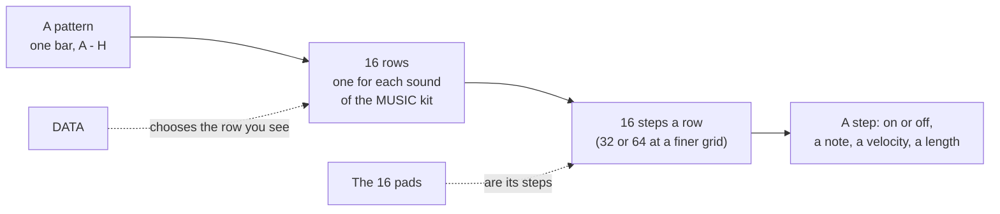
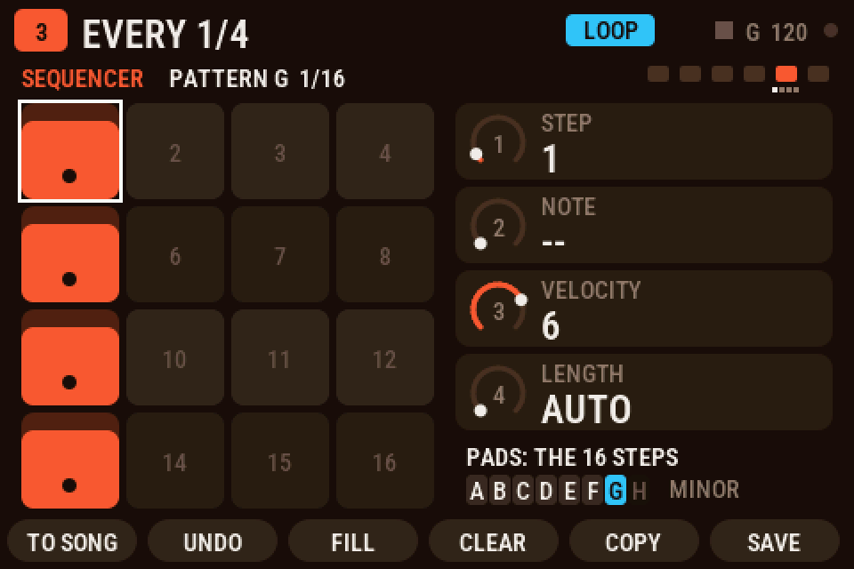
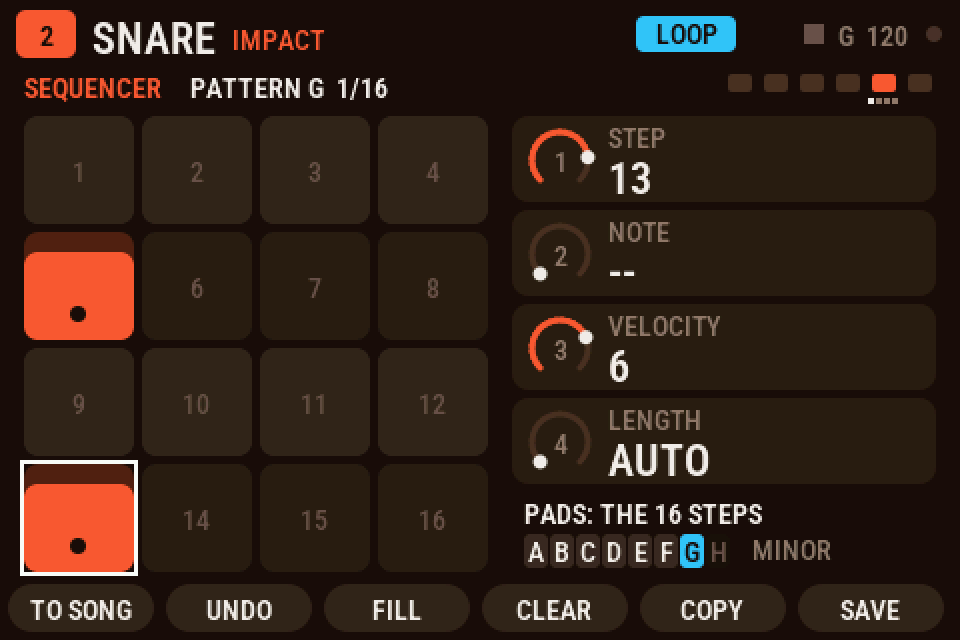
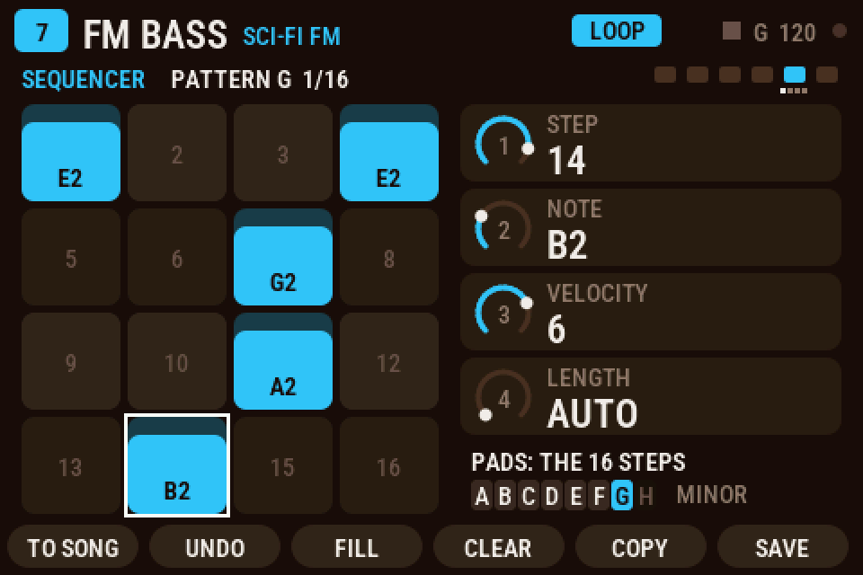
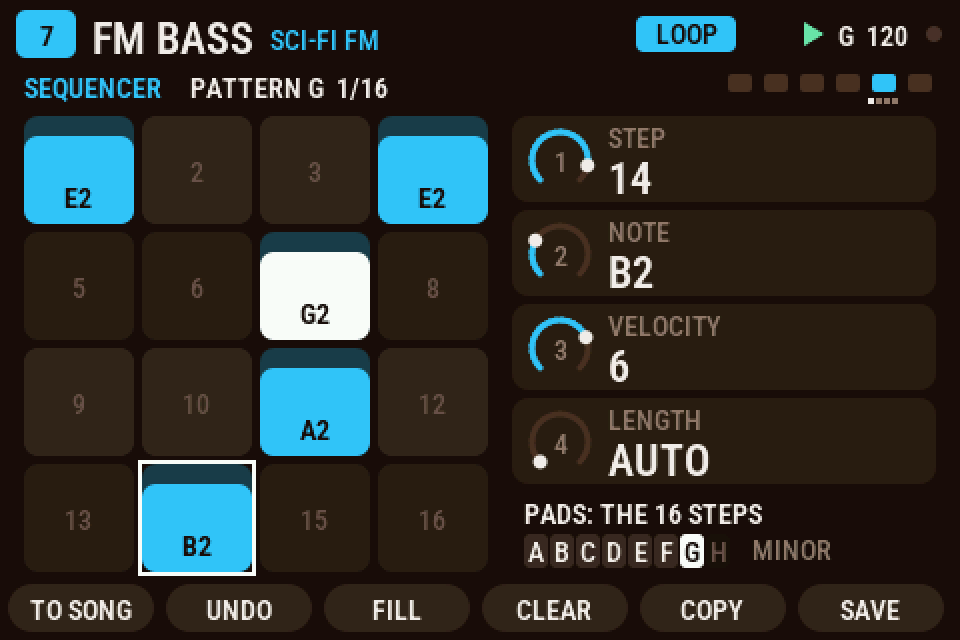
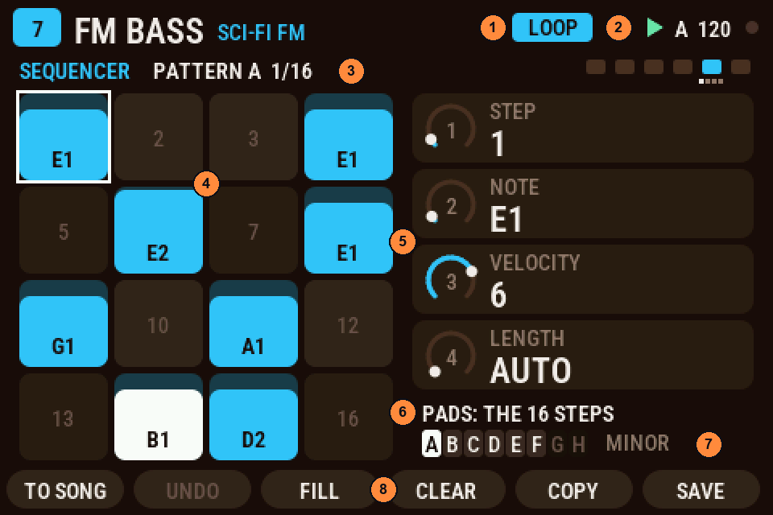
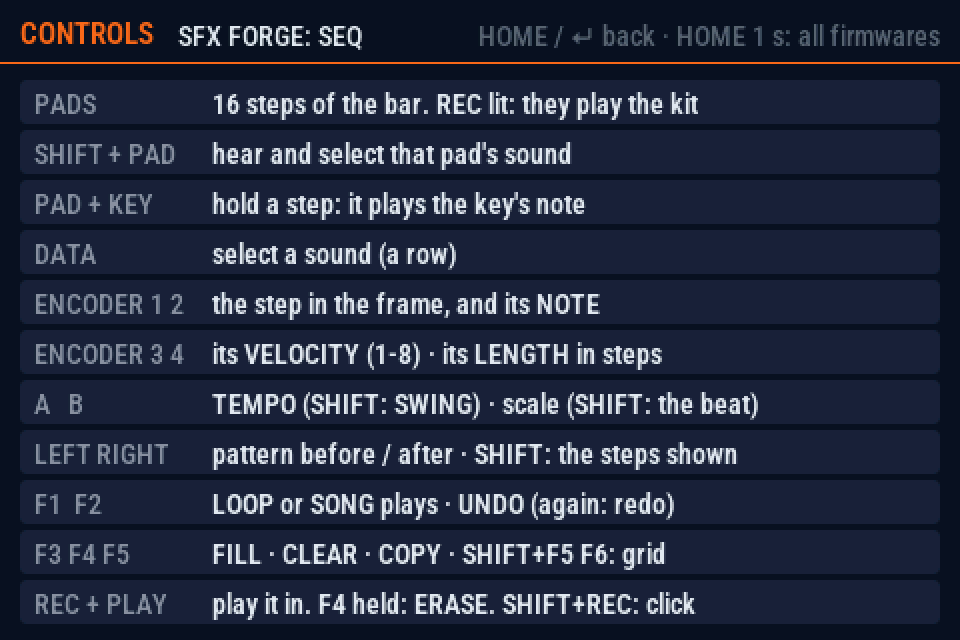

# Device Make A Beat

Write a pattern from nothing on the SEQ page: kick, snare, hi-hat and a bass line, step by step.

A **pattern** is one bar for each of the MUSIC kit's 16 sounds. As it comes, a bar has 16 **steps**: sixteenth
notes, four to a beat. The song has eight patterns, A - H. The SEQ page shows the steps of **one sound** of one
pattern, as the 16 pads.

## The steps

**Before you start**, three things:

1. Press **STOP**, and see that REC is not lit.
2. Press **K5**. The second line says `SEQUENCER`, and the top line **LOOP**: PLAY will repeat this pattern. K5 also
   chooses the MUSIC kit, so the pads' sounds are now the band's: TIMPANI, SNARE, KICK and so on.
3. Press **RIGHT** until you are on an empty pattern: in the row of eight letters under the values, an empty one is
   dim. In the demo song that is G (RIGHT six times, or LEFT twice).

**1. The kick.** Turn **DATA** until the top line says KICK, with a 3 in the square before it: pad 3. Press
**F3 FILL** once: a kick on every beat. The top line says `EVERY 1/4`.

The kick stands on steps 1, 5, 9 and 13: the first tile of each row. A row of tiles is a beat.

**2. The snare.** Turn DATA to SNARE (pad 2). Hit **pads 5 and 13**: the pads are the 16 steps. A step you switch
on sounds once, while the song is stopped.

**3. The hi-hat.** Turn DATA to HI-HAT (pad 13). Press **F3 FILL** twice: `EVERY 1/8`, a hat on every eighth note.

**4. A bass line.** Turn DATA to FM BASS (pad 7). **Hold a step's pad and play a key**: that step is on and plays
that note. The tile shows the note's name. In the picture: E2 on steps 1 and 4, G2 on 7, A2 on 11, B2 on 14.

**5. Press PLAY.** The pattern repeats. The lit tile is the step that plays now: white where the sound has a step.
Go on changing it while it plays.

**6. Wrong?** **F2 UNDO** takes back what you just did; pressed again it brings it back.

**7. Keep it.** **F6 SAVE**.

## Reading the SEQ page

| | What it is |
|---|---|
| **1** | what PLAY plays: **LOOP** (this pattern, round and round) or **SONG** (the song in its order) |
| **2** | playing (a green triangle) or stopped (a square), the pattern that plays, the tempo |
| **3** | the pattern you see and its grid: `PATTERN A  1/16` |
| **4** | the 16 steps of the selected sound. A step that is on shows its **note** (a dot: no note); its **height** is how hard it plays; `>3` in its corner is a length of 3 steps. The frame is the step the encoders edit; the white tile is the step playing now |
| **5** | STEP · NOTE · VELOCITY · LENGTH of the framed step |
| **6** | what the pads do: `PADS: THE 16 STEPS` |
| **7** | the eight patterns, and the scale NOTE moves in |
| **8** | TO SONG (or TO LOOP) · UNDO · FILL · CLEAR · COPY · SAVE |

The eight letters: **blue** is the pattern you see, **white** the one that plays, **blinking yellow** one that
waits for the bar line, **dim** an empty one.

## Everything a step can do

| To do this | Do this |
|---|---|
| switch a step on or off | hit its pad (REC not lit) |
| choose another sound | turn DATA, or SHIFT + its pad (you hear it) |
| give a step a note | hold its pad and play a key, or turn encoder 2 NOTE. The knob stays in the scale, and it switches the step on |
| choose the scale | encoder B: `CHROMATIC`, `MAJOR`, `MINOR`, `PENTATONIC`. A new song has MINOR |
| make it louder or softer | encoder 3 VELOCITY, 1 - 8: how hard the step plays |
| make a held note shorter | encoder 4 LENGTH: AUTO, or 1 - 15 steps |
| fill the row | F3 FILL, again and again: `EVERY 1/4`, `EVERY 1/8`, `EVERY 1/16`, `SOUND CLEARED` |
| take the sound out of the pattern | F4 CLEAR: `CLEARED - F2: UNDO` |
| try a variation | F5 COPY: the pattern is copied into the next empty one, and you are on the copy (`COPIED A > G`) |
| change the tempo | encoder A, 40 - 240. SHIFT + A is the swing, 0 - 100 % (`SWING 20%`) |
| another pattern | LEFT or RIGHT, round and round: at once while stopped, on the next [bar line](Glossary#music) while it plays |

A step **without a note** plays the sound as designed, which is right for drums. **LENGTH AUTO** holds a note until
the sound ends, plays again, or the bar ends. LENGTH matters for held sounds only: a one-shot always plays to its own end
([Device Make A Sound](Device-Make-A-Sound#one-shot-or-held-sustain-decides)).

HOME on this page lists the same in eleven lines:

## Traps

- **You hear nothing from the row you edit.** Its layer may be off at the current intensity. The page says
  `ITS LAYER IS OFF NOW` under the values, and `layer off` in the second line where there is room:
  [Device Layers And Intensity](Device-Layers-And-Intensity).
- **The pads play sounds and set no step.** REC is lit: the line under the values says `REC READY: PRESS PLAY`.
  Press REC again: [Device Recording](Device-Recording).
- **The SEQ page shows one sound.** For every sound's steps at once, press K5 three times more:
  [Device Perform](Device-Perform).

## Next

- [Device Recording](Device-Recording) - play the pattern in, live
- [Device Time Signatures](Device-Time-Signatures) - the same beat in 3/4, 6/8 or 7/8
- [Device Song And Arrangement](Device-Song-And-Arrangement#a-small-arrangement-step-by-step) - put this pattern and others in an order
- [Device Finer Grids](Device-Finer-Grids) - notes faster than a sixteenth

## Reference

- [The manual, section 9: Tutorial: a beat](../docs/MANUAL.md#9-tutorial-a-beat), [Step by step](../docs/MANUAL.md#step-by-step-a-beat-from-nothing), [Reading the SEQ page](../docs/MANUAL.md#reading-the-seq-page), [Everything a step can do](../docs/MANUAL.md#everything-a-step-can-do), [UNDO](../docs/MANUAL.md#undo)
- [fw_softkeys.h](../sfx-forge/fw_softkeys.h) - `soft_seq`, `fill`, `sound_clear`, `pattern_copy`
- [fw_sequencer.h](../sfx-forge/fw_sequencer.h) - the steps, the notes, the patterns
- [fw_events.h](../sfx-forge/fw_events.h) - `HELP_SEQ`, and what a pad does on SEQ
