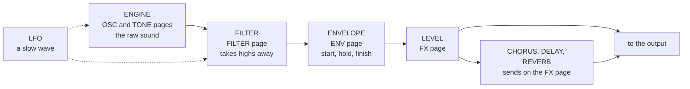
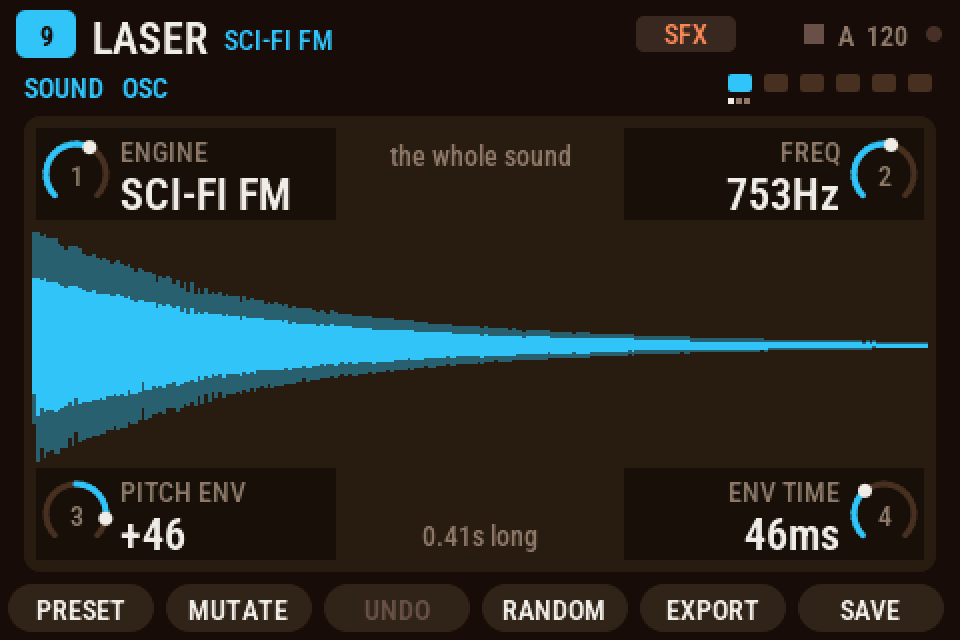
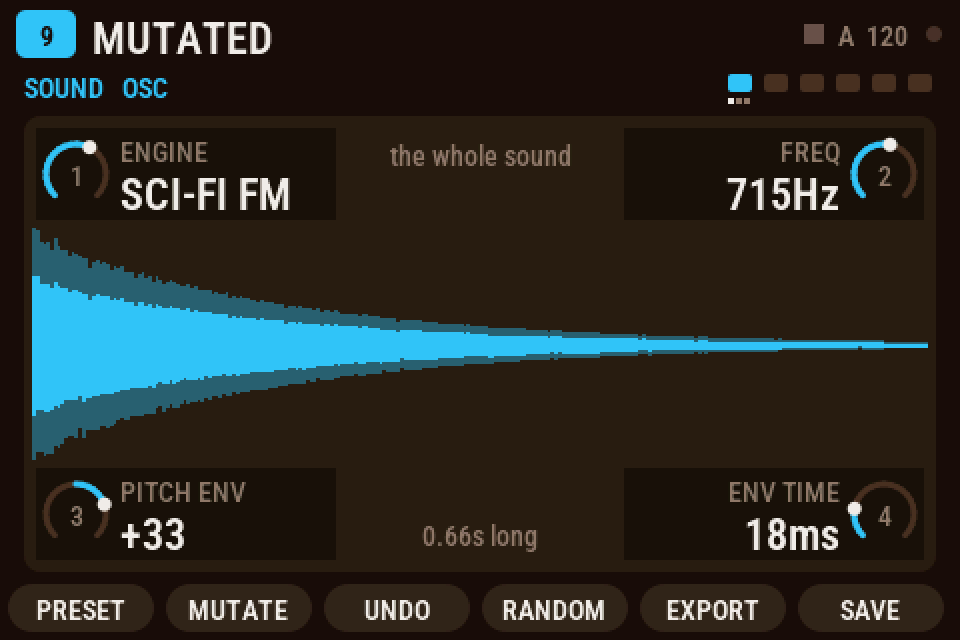
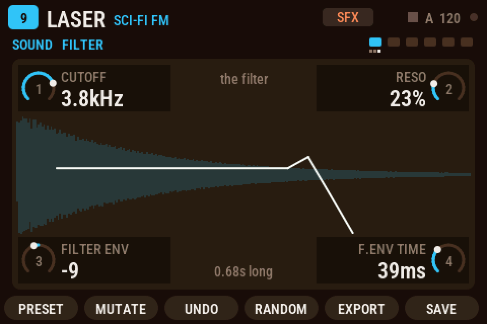
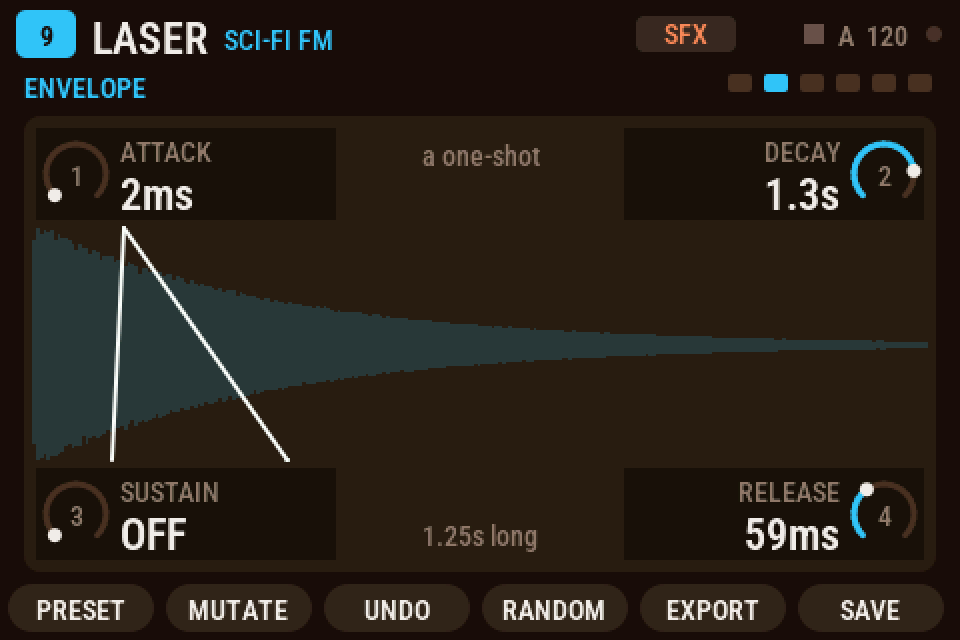

# Device Make A Sound

Make a sound effect of your own in five steps: pick a named sound, vary it, shape it by hand, keep it.

Every sound follows the same path. Each box is one page of four knobs.

NOISE and CRUSH are knobs of the TONE page: noise is mixed in before the filter, the crush works after it.
[Sound Engine](Sound-Engine) has the exact order.

## The steps

**1. Pick a sound close to what you want.** In the SFX kit (the top line says SFX; if it says MUSIC, hold SHIFT and
press ENTER), hit a pad. Press **F1 PRESET** until the name is close. Here: LASER, which is also on pad 9 as the
device comes.

The picture is the sound's whole shape from start to end. `0.41s long` under it is its length.

**2. Press F2 MUTATE.** Every value moves by up to 15 % of its range. What kind of sound it is stays: the engine,
the wavetable, its LEVEL, and whether it is a one-shot. You hear the result at once and the top line says `MUTATED`.
Press again for another one. **F3 UNDO** takes one back.

Here the mutation made it longer (0.66 s); on this page you see FREQ, PITCH ENV and ENV TIME moved.

**3. Shape it by hand.** Press **K1** until the second line says `SOUND   FILTER`. Turn **encoder 1**, CUTOFF. The
white line is the filter's curve; the sound's shape behind it gets duller as you turn down.

**4. Give it a tail.** Press **K2** for the envelope and turn **encoder 2**, DECAY, up.

The white line is the envelope. The words over it say `a one-shot`: SUSTAIN is OFF (see below).

**5. Keep it.** Press **F6 SAVE**: the top line says `SAVED`. It keeps both kits and the song on the device
([Device Saving And Reset](Device-Saving-And-Reset)).
**F5 EXPORT** sends this one sound to a game (`EXPORTED`):
[Hand it to the programmer](Device-Saving-And-Reset#hand-it-to-the-programmer).

> **Lost?** **F4 RANDOM** is a completely new sound: a one-shot of any engine. F3 UNDO takes that back too.

## One-shot or held: SUSTAIN decides

SUSTAIN is encoder 3 of the ENV page.

| SUSTAIN | The sound is | Use it for |
|---|---|---|
| **OFF** | a **one-shot**: it plays to its end however short you hit the pad | drums, coins, explosions |
| **above OFF** | **held**: it sounds while the pad or key is down, then rings out over RELEASE | strings, organs, an engine hum |

## The seven sound pages

| Page | Key | Encoders 1 - 4 |
|---|---|---|
| **OSC** | K1 | ENGINE · FREQ · PITCH ENV · ENV TIME |
| **TONE** | K1 again | A · B (the engine's own two) · NOISE · CRUSH |
| **FILTER** | K1 again | CUTOFF · RESO · FILTER ENV · F.ENV TIME |
| **WAVE** | K1 again, for a wavetable sound only | TABLE · SPREAD |
| **ENV** | K2 | ATTACK · DECAY · SUSTAIN · RELEASE |
| **LFO** | K3 | LFO RATE · > PITCH · > FILTER · > TIMBRE |
| **FX** | K4 | CHORUS · DELAY · REVERB · LEVEL |

LEFT and RIGHT also go to the sound page before and after. What every value does, with its range, is in the
manual's table [Every value](../docs/MANUAL.md#every-value). What A and B are depends on the engine:
[Device The Five Engines](Device-The-Five-Engines).

## The keys of the sound pages

| Key | It does | The top line says |
|---|---|---|
| **F1 PRESET** | the next named sound of this kit onto the selected pad. SHIFT + F1: the one before | the sound's name |
| **F2 MUTATE** | a variation: every value moves by up to 15 % of its range | `MUTATED` |
| **F3 UNDO** | the sound as it was before the last PRESET, MUTATE or RANDOM. Again: redo | `UNDO`, or `NOTHING TO UNDO` |
| **F4 RANDOM** | a completely new one-shot | `RANDOM` |
| **F5 EXPORT** | this sound to a game, as one MIDI message ([SysEx](Glossary#the-link)) | `EXPORTED` |
| **F6 SAVE** | both kits and the song, on the device | `SAVED` |
| **pads** | play a sound and select it | |
| **the keys** | play the selected sound in tune. The device has 16 voices for everything that sounds at once | |
| **DATA** | selects a sound without playing it | |

Each pad has its own UNDO, and it holds one step: the next F1, F2 or F4 replaces it. A knob you turned is not
taken back by UNDO: turn it back.

## Next

- [Device The Five Engines](Device-The-Five-Engines) - what ENGINE, A and B do
- [Device Make A Beat](Device-Make-A-Beat) - put the sound into a pattern
- [Device Saving And Reset](Device-Saving-And-Reset) - what SAVE keeps
- [Unity One Shots](Unity-One-Shots) - play the sound in a game

## Reference

- [The manual, section 5: Tutorial: a sound effect](../docs/MANUAL.md#5-tutorial-a-sound-effect), [section 6: How a sound is built](../docs/MANUAL.md#6-how-a-sound-is-built), [One-shot or held](../docs/MANUAL.md#one-shot-or-held-sustain-decides)
- [fw_softkeys.h](../sfx-forge/fw_softkeys.h) - `soft_sound`: F1 - F6 on the sound pages
- [fw_state.h](../sfx-forge/fw_state.h) - `PAGE_PARAMS`: which value each encoder turns on each sound page
- [fw_sounds.h](../sfx-forge/fw_sounds.h) - the named sounds (`PRESETS`)
- [Sound Engine](Sound-Engine) - how the engine computes a sound
