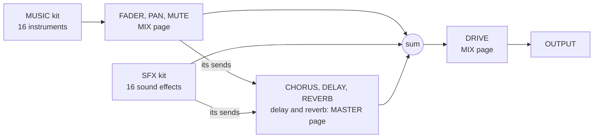

# Device Mixer And Effects

Balance the band: a fader, a pan and a mute for each instrument, and one delay and one reverb that every sound can
send to. The mix belongs to the song, and it is the mix the game plays.

Sound effects skip the faders: a muted bass never mutes an explosion. How much of a sound goes into chorus, delay and
reverb is set on that sound's own FX page (K4): CHORUS, DELAY, REVERB, and its LEVEL. An instrument's sends are taken
after its fader, so a muted instrument sends nothing.

## MIX: press K4 until `MIXER`

| | What it is |
|---|---|
| **1** | every sound of the MUSIC kit as a tile, where its pad is: its name, its fader (the small mark is 100, as designed), its pan under it. A red **M**: muted, here HARP. A yellow **S**: solo. The frame is the selected sound |
| **2** | VOLUME and PAN of the selected sound · DRIVE: saturation on the whole mix · OUTPUT volume |
| **3** | what the pads do here: `PADS: MUTE`, `SHIFT + pad: solo` |
| **4** | MUTE · SOLO · RESET · ALL ON · PLAY · SAVE |

| Control | What it does | The top line says |
|---|---|---|
| **a pad** | mutes its sound and selects it. Again: it is heard again. The pads do not play here | |
| **SHIFT + a pad** | solo: only soloed sounds play. Again: solo off | |
| **DATA** | selects a sound without muting it | |
| **encoder 1 · 2** | VOLUME (0 - 127; 100 is as designed) and PAN (`L64` - `C` - `R63`) of the selected sound | |
| **encoder 3 · 4** | DRIVE on the sum · the OUTPUT volume | |
| **F1 MUTE · F2 SOLO** | mute or solo the selected sound | `MUTED`, `UNMUTED` · `SOLO`, `SOLO OFF` |
| **F3 RESET** | the selected sound's fader to 100 and its pan to the middle | `FADER RESET` |
| **F4 ALL ON** | no mute, no solo | `ALL ON` |
| **F5 PLAY** | plays what the top line says, LOOP or SONG. Again: stops | |
| **F6 SAVE** | both kits and the song | `SAVED` |

The same faders and mutes are on PERFORM: encoders 1 and 2 there, and the pads after F3 MUTES
([Device Perform](Device-Perform)).

## MASTER: press K4 once more

| | What it is |
|---|---|
| **1** | the delay, drawn as its echoes: left and right in turn |
| **2** | the reverb, drawn as its fading |
| **3** | the delay's values: DELAY TIME (encoder 1) and FEEDBACK (encoder 2) |
| **4** | the reverb's: ROOM SIZE (encoder 3) and DAMPING (encoder 4). Low damping: a bright hall. High: a dark room |

DELAY TIME is a note length, so it follows the tempo: `1/16`, `1/8`, `3/16`, `1/4`, `3/8` or `1/2`.

The soft keys are those of MIX. **F3 RESET** on this page puts the delay, the reverb and the drive back as a new
song has them (3/16, 50 %, 72 %, 31 %, no drive) and leaves faders, pans, mutes and solos alone: `MASTER RESET`. The
pads play their sounds here.

## Echoes on the snare only

1. Press **RETURN** for the first sound page. If the top line says SFX, press **SHIFT + ENTER**: you want the
   MUSIC kit.
2. Hit the SNARE's pad (pad 2), press **K4**: the second line says `EFFECT SENDS`. (If it says `MIXER`, you were on a
   K4 page already: press K4 until `EFFECT SENDS`.)
3. Turn **encoder 2**, DELAY, up.
4. Press **K4** twice more for MASTER (`MASTER EFFECTS`). Turn **encoder 1** for the echo's time (`3/16` as the song comes) and
   **encoder 2**, FEEDBACK, to taste.
5. Press **F5 PLAY** to hear it in the song.

## Things to know

- **The mix is saved with the song** and sent with it: faders, pans, mutes and the master's values. **Solo is not
  kept**: it is for listening while you work.
- **F2 UNDO does not take the mixer back.** F3 RESET and F4 ALL ON are the ways back.
- **A fader, a pan or a master value can be automated.** Turn it, then go to AUTO:
  [Device Automation](Device-Automation).
- **OUTPUT is not the song's.** It is the device's output volume, the same value encoder A turns on the sound pages,
  MIX and MASTER. It is not saved with the song and cannot be automated.

## Next

- [Device Automation](Device-Automation) - move a fader or the room size by itself
- [Device Perform](Device-Perform) - mute and solo while you see the whole pattern
- [Device Saving And Reset](Device-Saving-And-Reset) - what SAVE keeps
- [Unity Music Mix And Notes](Unity-Music-Mix-And-Notes) - the same mixer from a game

## Reference

- [The manual, section 14: The mixer and the master effects](../docs/MANUAL.md#14-the-mixer-and-the-master-effects)
- [fw_softkeys.h](../sfx-forge/fw_softkeys.h) - `soft_mix`: F1 - F6 on MIX and MASTER
- [fw_pages.h](../sfx-forge/fw_pages.h) - `mix_value`: the byte behind each of the two pages' values
- [fw_events.h](../sfx-forge/fw_events.h) - `HELP_MIX`, and what a pad does on MIX
- [sfx_song.h](../core/sfx_song.h) - `vol`, `pan`, `mute`, `solo`, `fx` in `sfx_song`; `SFX_M_*`: the master's values
