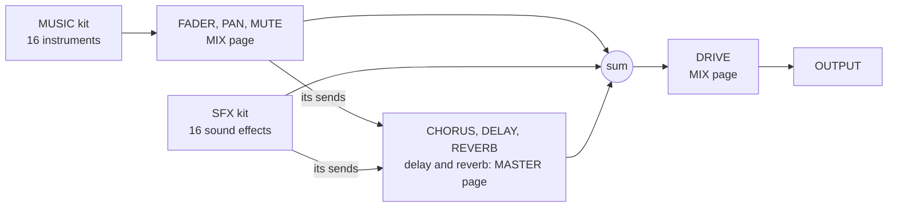
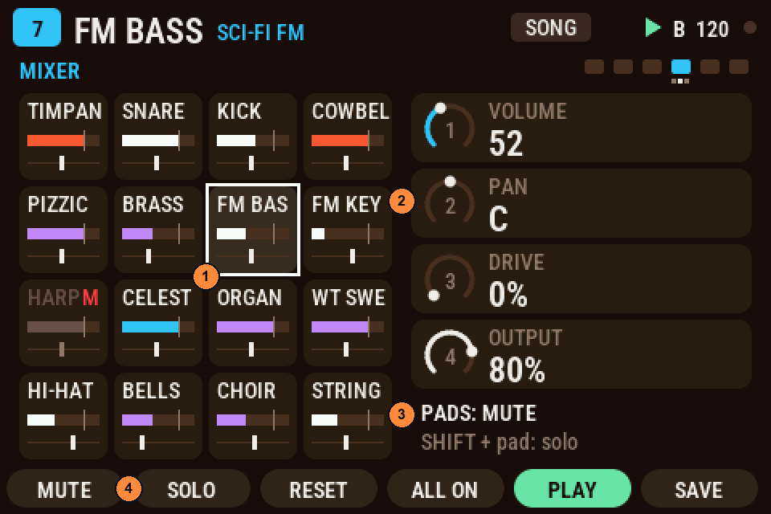
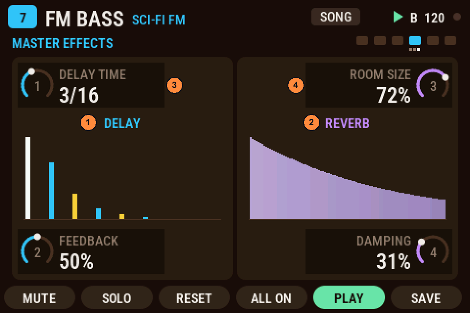

# Device Mixer And Effects

Balance the band: a fader, a pan and a mute for each instrument, and one delay and one reverb that every sound can
send to. The mix belongs to the song, and it is the mix the game plays.

Sound effects skip the faders: a muted bass never mutes an explosion. How much of a sound goes into chorus, delay and
reverb is set on that sound's own FX page (K4): CHORUS, DELAY, REVERB, and its LEVEL. An instrument's sends are taken
after its fader, so a muted instrument sends nothing.

## MIX: press K4 until `MIXER`

| | What it is |
|---|---|
| **1** | every sound of the MUSIC kit as a tile, where its pad is: its name, its fader (the small mark is 100, as designed), its pan under it. A red **M**: muted, here HARP. A yellow **S**: solo. The frame is the selected sound |
| **2** | VOLUME and PAN of the selected sound · DRIVE: saturation on the whole mix · OUTPUT volume |
| **3** | what the pads do here: `PADS: MUTE`, `SHIFT + pad: solo` |
| **4** | MUTE · SOLO · RESET · ALL ON · PLAY · SAVE |

| Control | What it does | The top line says |
|---|---|---|
| **a pad** | mutes its sound and selects it. Again: it is heard again. The pads do not play here | |
| **SHIFT + a pad** | solo: only soloed sounds play. Again: solo off | |
| **DATA** | selects a sound without muting it | |
| **encoder 1 · 2** | VOLUME (0 - 127; 100 is as designed) and PAN (`L64` - `C` - `R63`) of the selected sound | |
| **encoder 3 · 4** | DRIVE on the sum · the OUTPUT volume | |
| **F1 MUTE · F2 SOLO** | mute or solo the selected sound | `MUTED`, `UNMUTED` · `SOLO`, `SOLO OFF` |
| **F3 RESET** | the selected sound's fader to 100 and its pan to the middle | `FADER RESET` |
| **F4 ALL ON** | no mute, no solo | `ALL ON` |
| **F5 PLAY** | plays what the top line says, LOOP or SONG. Again: stops | |
| **F6 SAVE** | both kits and the song | `SAVED` |

The same faders and mutes are on PERFORM: encoders 1 and 2 there, and the pads after F3 MUTES
([Device Perform](Device-Perform)).

## MASTER: press K4 once more

| | What it is |
|---|---|
| **1** | the delay, drawn as its echoes: left and right in turn |
| **2** | the reverb, drawn as its fading |
| **3** | the delay's values: DELAY TIME (encoder 1) and FEEDBACK (encoder 2) |
| **4** | the reverb's: ROOM SIZE (encoder 3) and DAMPING (encoder 4). Low damping: a bright hall. High: a dark room |

DELAY TIME is a note length, so it follows the tempo: `1/16`, `1/8`, `3/16`, `1/4`, `3/8` or `1/2`.

The soft keys are those of MIX. **F3 RESET** on this page puts the delay, the reverb and the drive back as a new
song has them (3/16, 50 %, 72 %, 31 %, no drive) and leaves faders, pans, mutes and solos alone: `MASTER RESET`. The
pads play their sounds here.

## From a mixer controller or a DAW

From firmware 1.7.1 the device reports this mixer to its host as parameters, with the names the VIBE FM SDK's mixer
convention gives them. By the SDK's documents a mixer controller joined to the host then works the faders and keys,
and in the plugin a DAW does. There is nothing to set up on the device.

**Not tried.** A script sets and reads these parameters on the built firmware. Nobody has used a real mixer
controller, the VIBE FM plugin, a DAW or the Playground with them: [What Is Tested](What-Is-Tested).

| Parameter | Range | On the device |
|---|---|---|
| `mix_1_level` … `mix_16_level` | 0 to 1 | VOLUME of the sound on that pad: the fader's 0 - 127. 100, as designed, is about 0.79 |
| `mix_1_pan` … `mix_16_pan` | -1 to +1 | PAN: -1 is `L64`, 0 is `C`, +1 is `R63` |
| `mix_1_mute` … `mix_16_mute` | 0 or 1 | the red **M** |
| `mix_1_solo` … `mix_16_solo` | 0 or 1 | the yellow **S** |
| `mix_select` | 1 to 16 | the selected sound: the frame |

The host lists them in the groups `MIX 1` to `MIX 16` and `MIX`, after the six parameters the device had before
(`volume`, which is OUTPUT, the four telemetry values and `intensity`). That makes 71.

- **It goes both ways.** A value set from the host lands where MIX has it, and the next turn of an encoder goes on
  from there. What changes on the device is told to the host, whatever changed it: a fader or a pan turned, a pad
  that mutes, SOLO, RESET, ALL ON, DATA, a new song, a song from a game.
- **These are the song's own values.** Nothing else is stored. What the host sets is in the song, as if you had
  turned it here: SAVE keeps it and SEND sends it. Solo is not kept, as before.
- **Levels, pans, mutes and solos are always the song's sounds**, those of the MUSIC kit. `mix_select` is the
  selected pad's number in whichever kit is chosen. The MIX page works the same way.
- **A pad played selects its sound**, and so does a note 36 to 51 from outside. `mix_select` is then told to the
  host.
- **A value between two steps is rounded.** A level has 128 steps, a pan too. The rounded value is not said back,
  so the host and the device can differ by up to half a step.
- **A value that is no number is not taken.** The host is then told the value the device has.
- **While the tour runs, `mix_select` from the host is not taken**, and the sounds the tour selects are not told.
  When the tour is over the host is told the sound that is selected then.
- **In the plugin's Editor view** the mixer is 17 more groups, and mute and solo are plain values with two steps.
  Nobody has seen this on a screen.
- **No record arm for a sound.** The convention also has an arm key for each track. The device has none: REC is one
  key for the whole song.
- **F2 UNDO does not take back a value from the host**, as it does not take back a fader turned on MIX.
- **Automation is not reported.** While an automation lane moves a fader or a pan, the host keeps the value the
  fader itself has. This is read from the code, not tested.
- **DRIVE and the master effects are not among them.**

## Echoes on the snare only

1. Press **RETURN** for the first sound page. If the top line says SFX, press **SHIFT + ENTER**: you want the
   MUSIC kit.
2. Hit the SNARE's pad (pad 2), press **K4**: the second line says `EFFECT SENDS`. (If it says `MIXER`, you were on a
   K4 page already: press K4 until `EFFECT SENDS`.)
3. Turn **encoder 2**, DELAY, up.
4. Press **K4** twice more for MASTER (`MASTER EFFECTS`). Turn **encoder 1** for the echo's time (`3/16` as the song comes) and
   **encoder 2**, FEEDBACK, to taste.
5. Press **F5 PLAY** to hear it in the song.

## Things to know

- **The mix is saved with the song** and sent with it: faders, pans, mutes and the master's values. **Solo is not
  kept**: it is for listening while you work.
- **F2 UNDO does not take the mixer back.** F3 RESET and F4 ALL ON are the ways back.
- **A fader, a pan or a master value can be automated.** Turn it, then go to AUTO:
  [Device Automation](Device-Automation).
- **OUTPUT is not the song's.** It is the device's output volume, the same value encoder A turns on the sound pages,
  MIX and MASTER. It is not saved with the song and cannot be automated.

## Next

- [Device Automation](Device-Automation) - move a fader or the room size by itself
- [Device Perform](Device-Perform) - mute and solo while you see the whole pattern
- [Device Saving And Reset](Device-Saving-And-Reset) - what SAVE keeps
- [Unity Music Mix And Notes](Unity-Music-Mix-And-Notes) - the same mixer from a game

## Reference

- [The manual, section 14: The mixer and the master effects](../docs/MANUAL.md#14-the-mixer-and-the-master-effects)
- [fw_softkeys.h](../sfx-forge/fw_softkeys.h) - `soft_mix`: F1 - F6 on MIX and MASTER
- [fw_pages.h](../sfx-forge/fw_pages.h) - `mix_value`: the byte behind each of the two pages' values; `mix_report`
  and `mix_from_host`: the mixer to the host and from it
- [fw_sounds.h](../sfx-forge/fw_sounds.h) - `PARAMS`: the host's parameters, the mixer's from `P_MIX`
- [tests/check-mixer.mjs](../tests/check-mixer.mjs) - what a script checks of this
- [fw_events.h](../sfx-forge/fw_events.h) - `HELP_MIX`, and what a pad does on MIX
- [sfx_song.h](../core/sfx_song.h) - `vol`, `pan`, `mute`, `solo`, `fx` in `sfx_song`; `SFX_M_*`: the master's values
