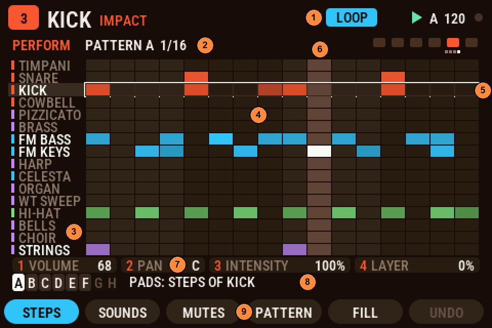
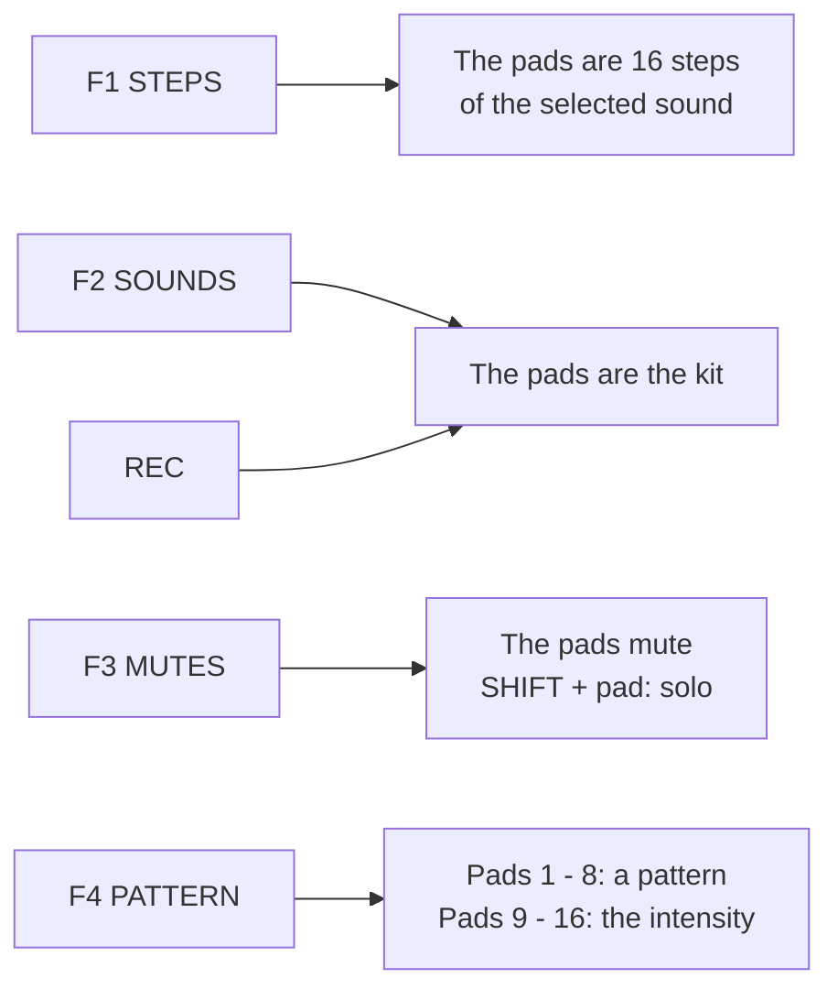
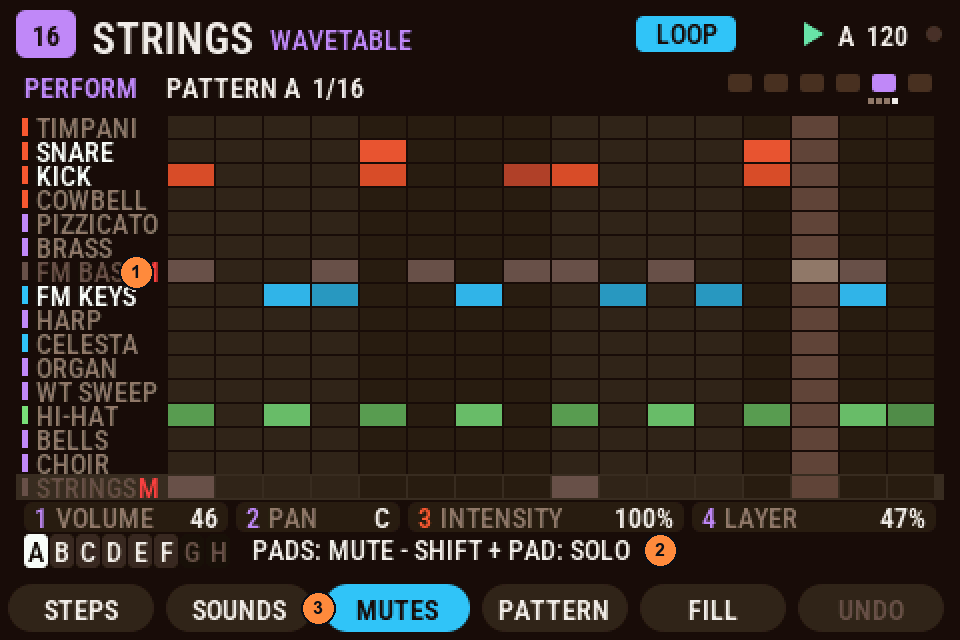
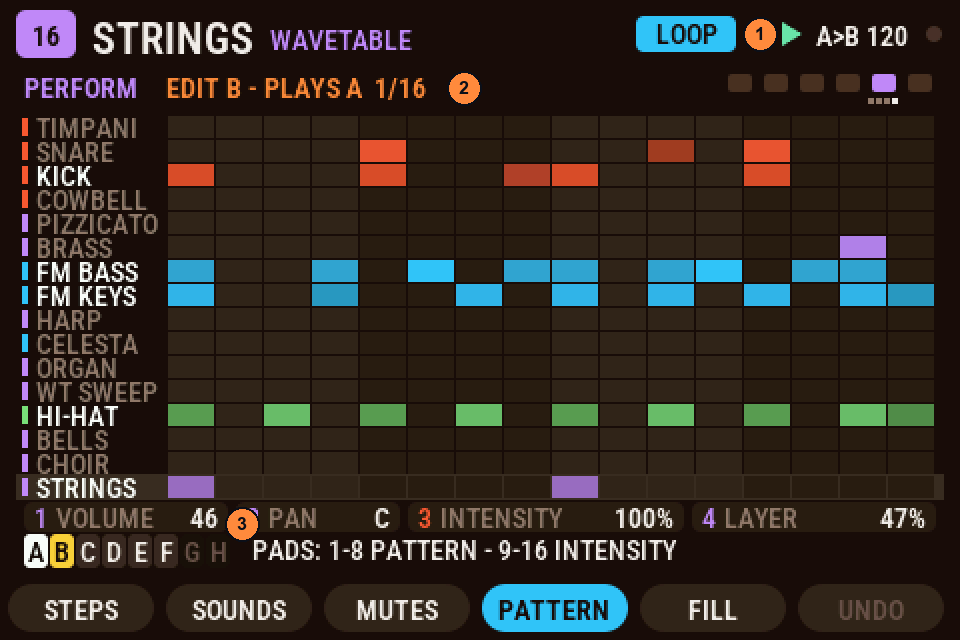
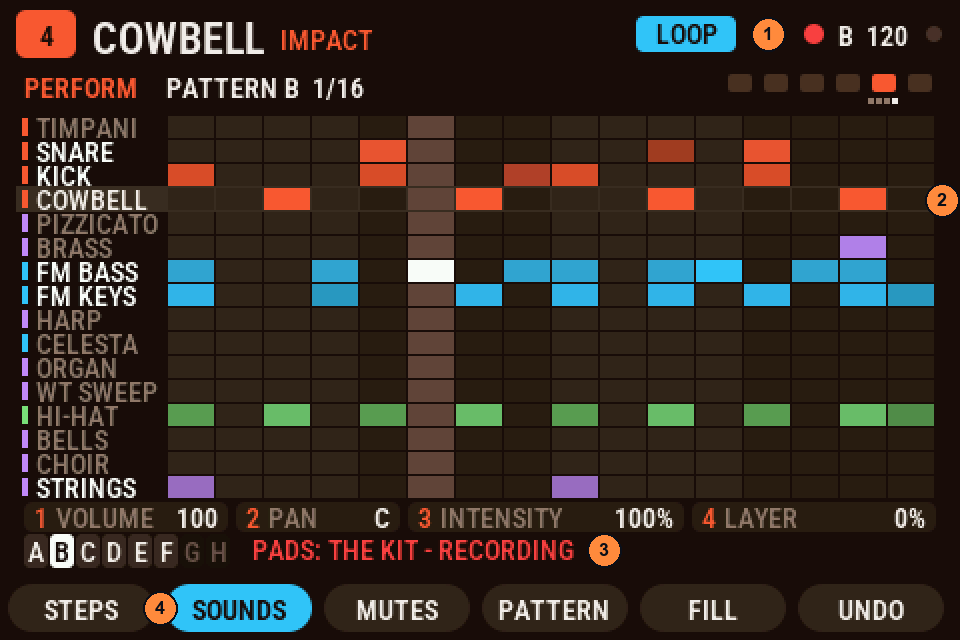
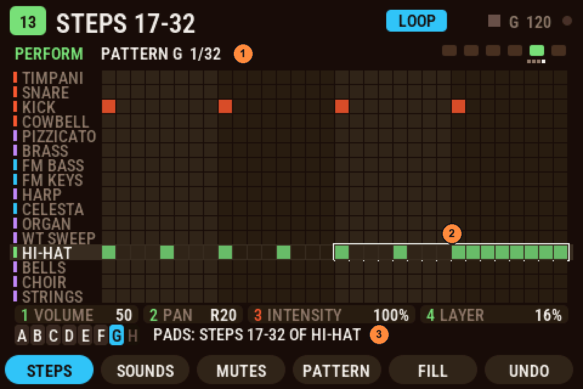

# Device Perform

One page to make a beat on and to play a set from. PERFORM shows the whole pattern at once, and four keys choose
what the 16 pads are: steps, the kit, mutes, or patterns.

Press **K5** until the second line says `PERFORM` (K5 walks SEQ, SONG, AUTO, PERFORM, and SEQ again). Opened while
the song is stopped and REC is off, the page sets LOOP: PLAY repeats the pattern. (From firmware 1.7.0.)

| | What it is |
|---|---|
| **1** | what PLAY plays: **LOOP** or **SONG**. SHIFT + F1 changes it |
| **2** | the pattern you see and its grid: `PATTERN A  1/16` |
| **3** | the 16 sounds of the MUSIC kit, a row each, pad 1 at the top. A name is **grey when the sound is not heard**: muted, another one solo, or its layer off at the current intensity. It is white while the sound plays |
| **4** | the pattern: **a row is a sound, a cell is a step**. A step that is on has the colour of its sound, brighter the harder it plays |
| **5** | the selected sound: its row is lit. While the pads are STEPS a white frame stands round the 16 steps they are |
| **6** | the playhead: the column that plays now. A step under it is white |
| **7** | encoders 1 - 4, in one line: VOLUME · PAN · INTENSITY · LAYER |
| **8** | the eight patterns, and a line that says what the pads are now |
| **9** | **F1 - F4: what the pads are.** The blue one is chosen. F5 FILL · F6 UNDO |

## The pads, four ways

Each of F1 - F4 goes straight to its mode. Lighting **REC** on this page makes the pads SOUNDS, whatever they were;
so does opening the page while REC is lit.

| Key | The pads are | A pad | SHIFT + a pad | The line under the grid |
|---|---|---|---|---|
| **F1 STEPS** | 16 steps of the selected sound, as on SEQ. The page starts so | the step, on or off. Held while a key is played: the step gets the key's note | hear that pad's sound and select it | `PADS: STEPS OF KICK` |
| **F2 SOUNDS** | the kit | plays its sound and selects it. With REC lit while it plays, the hit is recorded | the same | `PADS: PLAY THE KIT`. With REC lit: `PADS: THE KIT - REC READY: PLAY`, then `PADS: THE KIT - RECORDING` |
| **F3 MUTES** | the mixer's mutes | mutes its sound and selects it. Again: it is heard again | solo: only soloed sounds play. Again: solo off | `PADS: MUTE - SHIFT + PAD: SOLO` |
| **F4 PATTERN** | patterns and intensity, as on SONG | pads 1 - 8: pattern A - H, at once while stopped, on the next bar line while it plays. Pads 9 - 16: the intensity, in eight levels | the same | `PADS: 1-8 PATTERN - 9-16 INTENSITY` |

The page keeps the mode you chose when you leave it and come back, unless REC is lit then.

**F3 MUTES**, while pattern A plays. Pads 7 and 16 were hit:

| | What it is |
|---|---|
| **1** | a red **M**: FM BASS is muted. Its name and its steps are grey, as are those of STRINGS in the last row. A soloed sound has a yellow **S** |
| **2** | what the pads are |
| **3** | F3 is blue |

A mute stays when the pads become something else and when you leave the page: it is the mixer's own
([Device Mixer And Effects](Device-Mixer-And-Effects)). **SHIFT + F3 ALL ON** lifts every mute and every solo.

**F4 PATTERN**, while pattern A plays. Pad 2 was hit:

| | What it is |
|---|---|
| **1** | `A>B`: A plays, B comes on the bar line |
| **2** | `EDIT B - PLAYS A`: the grid shows B already |
| **3** | B blinks yellow until it starts. White is the pattern that plays |

**F2 SOUNDS with REC**, while pattern B plays. The cowbell was played in on pad 4, a round before:

| | What it is |
|---|---|
| **1** | the red dot: REC is lit |
| **2** | the hits, where they landed |
| **3** | in red, `PADS: THE KIT - RECORDING`: what the pads play now is recorded |
| **4** | F2 is blue. REC chose it |

## The other keys

While SHIFT is held, the six keys on the display show their second names.

| Key | What it does | The top line says |
|---|---|---|
| **F5 FILL** | the selected sound on every beat, every eighth, every sixteenth, then cleared. Each press goes one further | `EVERY 1/4`, `EVERY 1/8`, `EVERY 1/16`, `SOUND CLEARED` |
| **F6 UNDO** | takes back the last thing done to the song. Again: redo | `UNDO: ...`, `REDO: ...`, `NOTHING TO UNDO` |
| **SHIFT + F1** | TO SONG or TO LOOP: what PLAY plays | `SONG: PLAYS IN ORDER`, `LOOP: PATTERN REPEATS` |
| **SHIFT + F2 CLEAR** | takes the selected sound out of this pattern | `CLEARED - F6: UNDO`, or `NOTHING TO CLEAR` |
| **SHIFT + F3 ALL ON** | no mute, no solo | `ALL ON` |
| **SHIFT + F4 COPY** | copies the pattern into the next empty one, and you are on the copy | `COPIED A > G`, or `NO EMPTY PATTERN` |
| **SHIFT + F5 · F6** | the pattern's grid one level coarser · finer | [Device Finer Grids](Device-Finer-Grids) |
| **LEFT · RIGHT** | the pattern before / after, on the bar line while it plays | |
| **SHIFT + LEFT · RIGHT** | at 1/32 and 1/64: the 16 steps before / after | `STEPS 17-32` |
| **DATA** | selects a sound: its row is lit | |

| Encoder | Value | What it is |
|---|---|---|
| **1** | VOLUME | the selected sound's fader, the one on MIX: 0 - 127, 100 is as designed |
| **2** | PAN | its place between left and right |
| **3** | INTENSITY | which layers play: [Device Layers And Intensity](Device-Layers-And-Intensity) |
| **4** | LAYER | the selected sound's mark: the intensity from which it plays |
| **A** | | the tempo. SHIFT + A: the swing |
| **B** | | the bar's length. SHIFT + B: the beat ([Device Time Signatures](Device-Time-Signatures)) |

## At a finer grid

At 1/32 and 1/64 the grid still shows the whole bar, in narrower cells. The pads are 16 of its steps, and the frame
says which. SHIFT + RIGHT and SHIFT + LEFT move the frame.

Here the pattern is at 1/32 (**1**), the frame is round steps 17 - 32 with a hi-hat roll in the last beat (**2**),
and the line names them: `PADS: STEPS 17-32 OF HI-HAT` (**3**).

## Three things to know

- **No ERASE and no SAVE on this page.** F4 is PATTERN here. To take a take back use F6 UNDO, or go to SEQ, where F4
  held is ERASE while REC plays. SAVE is F6 on SEQ: K5 once more.
- **A step's note shows only on SEQ.** PERFORM shows that a step is on and how hard it plays. You can give a step a
  note here (F1 STEPS, hold its pad, play a key); velocity and length are encoders 3 and 4 of SEQ.
- **REC makes the pads the kit.** F1 makes them steps again, with REC still lit. Switching REC off leaves the pads
  as they are.

Nobody has played this page by hand or listened to it yet. A script presses its keys and checks what the song then
holds and plays; it does not look at the display: [What Is Tested](What-Is-Tested).

## Next

- [Device Make A Beat](Device-Make-A-Beat) - the same beat on SEQ, with notes
- [Device Recording](Device-Recording) - REC, the click and ERASE
- [Device Mixer And Effects](Device-Mixer-And-Effects) - mute and solo on their own page
- [Device Cheat Sheet](Device-Cheat-Sheet) - PERFORM in one row

## Reference

- [The manual, section 13: Perform](../docs/MANUAL.md#13-perform-the-whole-pattern-and-the-pads-four-ways): [the pads, four ways](../docs/MANUAL.md#the-pads-four-ways), [F5, F6 and the keys with SHIFT](../docs/MANUAL.md#f5-f6-and-the-keys-with-shift), [a beat from nothing, and playing it](../docs/MANUAL.md#a-beat-from-nothing-and-playing-it)
- [fw_softkeys.h](../sfx-forge/fw_softkeys.h) - `soft_perform`, `perform_mode`
- [fw_events.h](../sfx-forge/fw_events.h) - `perform_pad`: what a pad does in each of the four modes; `HELP_PERFORM`
- [fw_draw_pages.h](../sfx-forge/fw_draw_pages.h) - how the grid is drawn
- [check-perform.mjs](../tests/check-perform.mjs) - the script that checks the page
