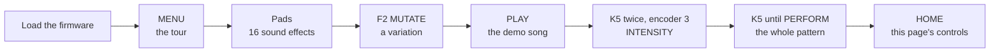
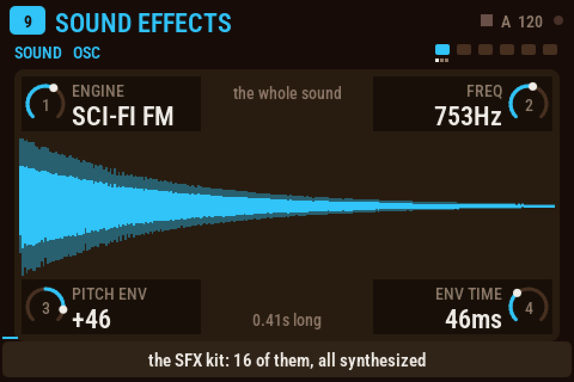
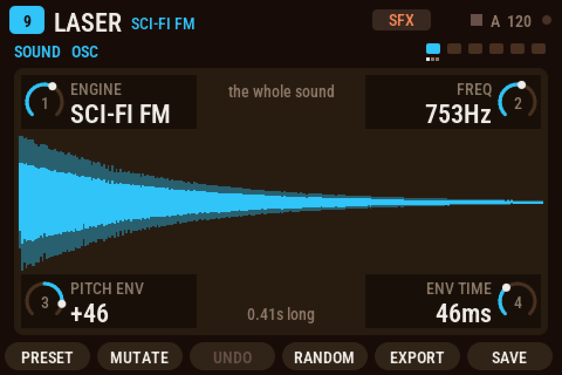
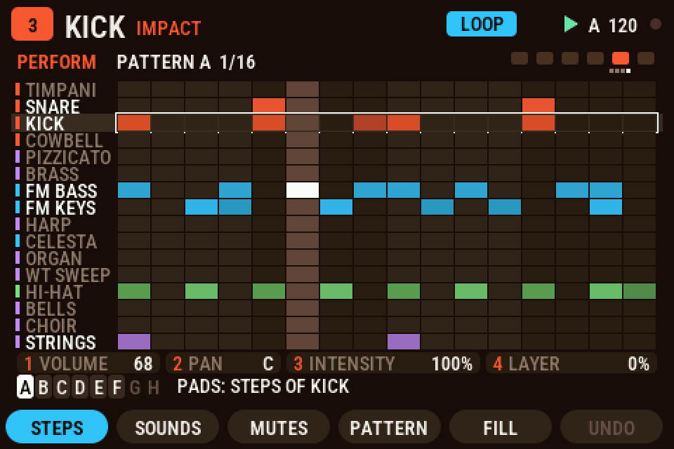
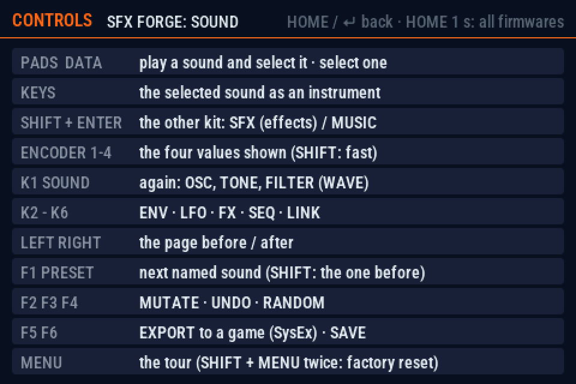

# Device Quick Start

Load SFX FORGE and hear what it does, in about five minutes. You need nothing but the firmware file and a browser.

"The device" in this wiki is the firmware as a player meets it: in the VIBE FM Playground (a web page), in the VIBE FM
plugin, or on the VIBE FM itself. What has been tried where is on [What Is Tested](What-Is-Tested).

## 1. Load it

| You have | Do this |
|---|---|
| a browser | drop `sfx-forge.wasm` onto the [Playground](https://play.thefirmwarehub.com/) |
| the VIBE FM plugin | drop `sfx-forge.zip` onto the plugin's window |

The repository does not hold these files: the build makes both, in `build/`. Ask whoever builds the project for
them, or see [Building From Source](Building-From-Source). The Unity package also carries
`sfx-forge.zip`, in its `Firmware~` folder.

SFX FORGE starts on the first sound page. The top line names the selected sound (pad 1, EXPLOSION) and the
[kit](Glossary#the-device) it belongs to: **SFX**, the set of 16 sound effects. The other kit, MUSIC, is the band
that plays the song.

## 2. Watch the tour

1. Press **MENU**.
2. The device plays by itself and names what it does, a caption at a time, for about 40 seconds.
3. Press any key (but SHIFT) or any pad to end it. That press does nothing else, and everything the tour changed
   is put back.

The picture is the tour about a second after MENU: the caption at the bottom says what you hear, the top line its
title. The line over the caption grows as the tour goes on.

## 3. Play the sound effects

1. Hit the **pads**. The SFX kit has 16 sound effects; the display shows the one you hit: its name, its engine and a
   picture of its whole shape.
2. Hit **pad 9**: LASER.
3. Press **F2 MUTATE** a few times. Each press moves the sound's values a little, and you hear the new sound at
   once. The top line says `MUTATED`.
4. Press **F3 UNDO** to take the last press back.

More: [Device Make A Sound](Device-Make-A-Sound).

## 4. Play the song

1. Press **PLAY**. The demo song plays, bar after bar: 16 bars, then from the top.
2. Press **K5** twice. The second line of the display says `SONG`: that is the page.
3. Turn **encoder 3** (INTENSITY) down. It starts at 100 %. The band thins out until, at 0 %, only the kick is
   left.
4. Turn it up again. The instruments come back one by one.
5. Press **STOP**.

That is what makes it game music: a game sends this one number. More:
[Device Layers And Intensity](Device-Layers-And-Intensity).

## 5. Loop a pattern and look at all of it

1. Press **K5** until the second line of the display says **PERFORM**. (K5 walks SEQ, SONG, AUTO, PERFORM and SEQ
   again.)
2. Press **PLAY**. The top line says **LOOP**: one pattern, here A, goes round and round.
3. Look at the grid: a row is a sound, a cell is a step, the lit column is the step that plays.
4. Press **F3 MUTES** and hit a pad to mute its sound: pad 7 is the FM BASS. Hit it again to bring it back.
5. Press **STOP**.

More: [Device Perform](Device-Perform).

## 6. When you are lost

| You want | Press |
|---|---|
| what every control does on the page that is open | **HOME** (HOME or RETURN closes it) |
| back to the first sound page | **RETURN** (while HOME is open it only closes HOME) |
| the tour again | **MENU** |
| everything as it came from the factory | **SHIFT + MENU**, twice within three seconds. It asks first: `AGAIN: FACTORY RESET`. What you saved is gone then |

## Next

- [Device Controls And Pages](Device-Controls-And-Pages) - every control, and the map of the fourteen pages
- [Device Make A Sound](Device-Make-A-Sound) - shape a sound effect of your own
- [Device Make A Beat](Device-Make-A-Beat) - write a pattern step by step
- [Unity Quick Start](Unity-Quick-Start) - the same five minutes on the game's side

## Reference

- [The manual, section 1: Five minutes](../docs/MANUAL.md#1-five-minutes)
- [The README, "Build"](../README.md#build) and ["Playing it"](../README.md#playing-it)
- [fw_tour.h](../sfx-forge/fw_tour.h) - the tour's script
- [fw_events.h](../sfx-forge/fw_events.h) - the HOME texts (`HELP_...`) and what every key does
