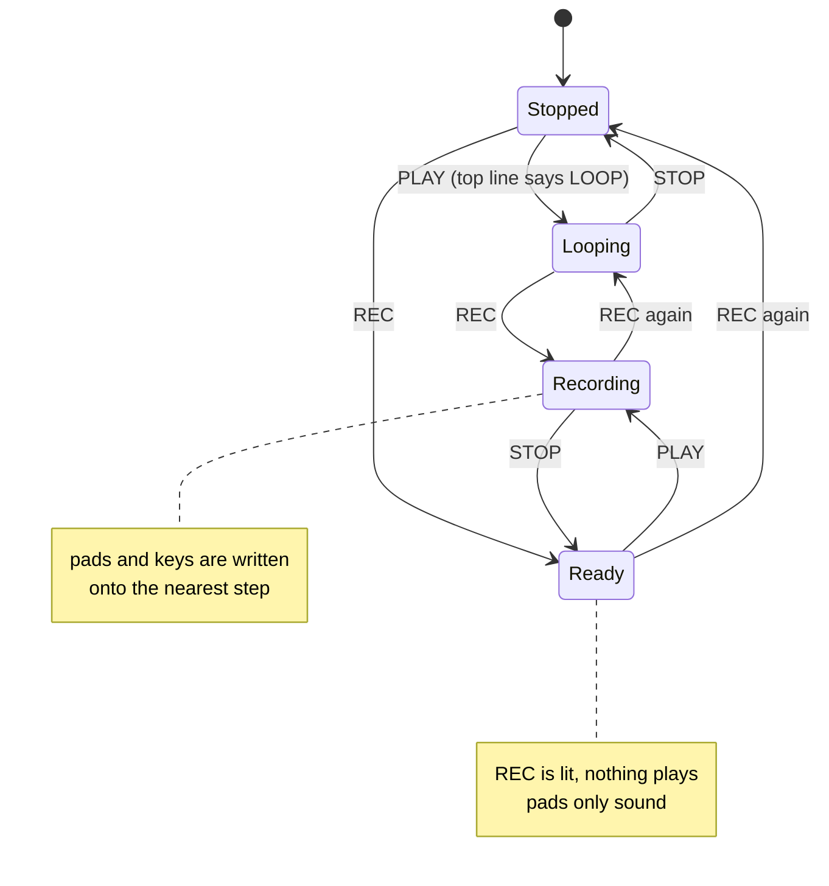
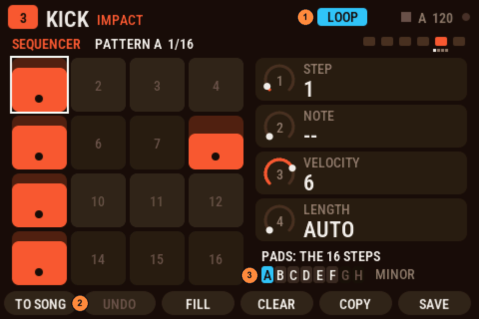
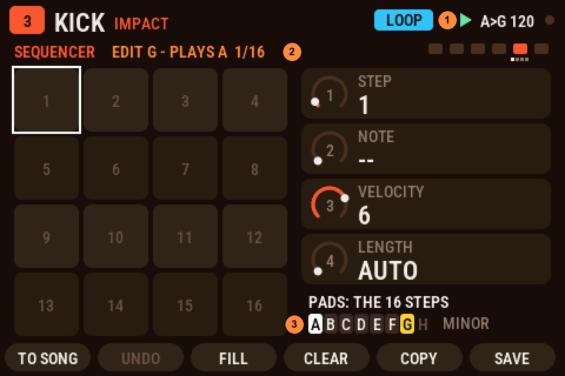
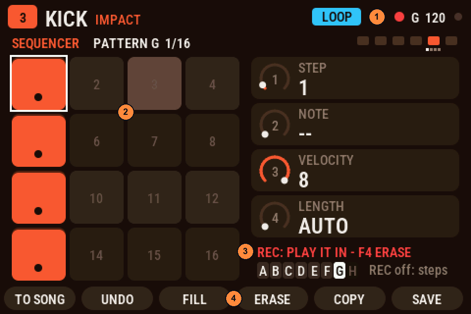
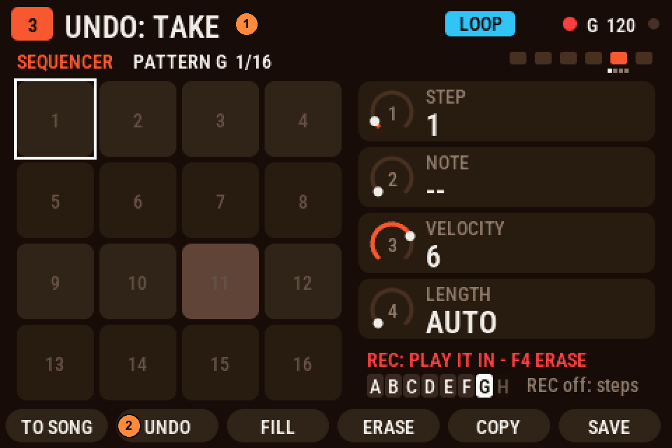

# Device Recording

Keep one pattern playing and play into it: the pads as a drum kit, the keys as notes, a click to keep time, and one
key to take a bad take back.

Two things decide what happens when you press PLAY and hit a pad: what PLAY plays (**LOOP** or **SONG**), and whether
**REC** is lit.

## The steps

**1. Press K5** while nothing plays. The page is SEQUENCER and the top line says **LOOP**. (If the song is playing,
press STOP first, or press F1.) Turn DATA to the sound you want to see: here KICK.

| | What it is |
|---|---|
| **1** | **LOOP**: PLAY will repeat the pattern. The other word here is SONG |
| **2** | **F1** changes between the two. It says what it will do: TO SONG |
| **3** | the eight patterns. The blue one is the one you see |

**2. Press PLAY.** Pattern A repeats until you press STOP.

**3. Choose an empty pattern: LEFT twice**, for G (or RIGHT six times). If G holds a beat of yours, take H:
LEFT once. The pattern does not cut in. It starts on the next
[bar line](Glossary#music), and then it is the one that repeats. Until then:

| | What it is |
|---|---|
| **1** | `A>G`: A plays, G comes next |
| **2** | `EDIT G - PLAYS A`, in orange: what you see is not yet what you hear |
| **3** | G blinks yellow until it starts. White is the pattern that plays |

**4. Press REC** once G plays. Now the pads are the drum kit and the keys are the notes. Play in time: every hit is
written onto the step nearest to it, as hard as you hit it, and you hear it again on the next round. A click keeps
time.

| | What it is |
|---|---|
| **1** | the red dot: REC is lit. It beats with the click |
| **2** | the hits, as they land. The tiles show the sound you played last |
| **3** | `REC: PLAY IT IN - F4 ERASE`, in red: what the pads do now |
| **4** | **F4** is **ERASE** while REC plays |

**5. A wrong note?** Two ways:

- Hold **F4 ERASE** (`ERASE: HOLD F4`; the key is red while you hold it): the selected sound's steps are erased as
  the bar passes them. A tap erases only the step under the playhead.
- Press **F2 UNDO**: everything you played since the first hit is gone in one press (`UNDO: TAKE`). F2 again brings
  it back.

**6. Press REC again.** The pads are the 16 steps once more, and the pattern goes on playing. STOP stops it. STOP
alone does not switch REC off: it stays lit until you press it again.

## While REC is lit

| | |
|---|---|
| **the pads are the kit** | a hit lands on the nearest step of the pattern's grid. Kick, snare and hat can be played in together |
| **the keys are the notes** | SHIFT + a pad (on SEQ) or DATA selects an instrument without recording it; then every key is recorded on its step, at its pitch |
| **the pattern repeats** | switching REC on sets LOOP. If it was SONG the top line says `REC ON: PATTERN LOOPS` |
| **a click keeps time** | on every beat, higher and louder on the bar line, while REC is lit and it plays. It is the device's own: it is not part of the song, and a game never hears it |
| **stopped, nothing is recorded** | the pads only sound. The line under the values says `REC READY: PRESS PLAY` |

## The keys

| Key | What it does |
|---|---|
| **REC** | lights REC, and sets LOOP. Again: off. STOP does not switch it off |
| **SHIFT + REC** | the click off and on: `CLICK OFF`, `CLICK ON` |
| **F1** | TO SONG / TO LOOP: what PLAY plays (`SONG: PLAYS IN ORDER`, `LOOP: PATTERN REPEATS`) |
| **F2 UNDO** | the whole take, from the first hit to STOP, PLAY or REC. Again: redo |
| **F4 ERASE** | on SEQ, while REC plays: held, erases the selected sound as the bar passes. Otherwise F4 is CLEAR |
| **LEFT · RIGHT** | another pattern, on the bar line. Until then the display stays on the pattern that plays |

## Traps

- **Only the MUSIC kit is recorded.** On a sound page with the SFX kit chosen, a hit while REC plays says
  `MUSIC KIT ONLY: K5 SEQ` and nothing is written.
- **There is no count-in.** The first round of the loop is one.
- **F1 TO SONG while REC plays** sends the take along the song: each hit lands in the pattern that plays in that
  bar.
- **A hit is moved to a step**, and past the middle of a step to the next one. For timing finer than a sixteenth,
  give the pattern a finer grid first:
  [Device Finer Grids](Device-Finer-Grids).
- **On PERFORM** REC makes the pads the kit too, but F4 is not ERASE there: [Device Perform](Device-Perform).

## Next

- [Device Finer Grids](Device-Finer-Grids) - a take at 1/32 or 1/64
- [Device Perform](Device-Perform) - record with the whole pattern in view
- [Device Song And Arrangement](Device-Song-And-Arrangement) - LOOP and SONG in full
- [Device Saving And Reset](Device-Saving-And-Reset) - keep what you played

## Reference

- [The manual, "Loop a pattern and play into it"](../docs/MANUAL.md#loop-a-pattern-and-play-into-it), ["Playing it in"](../docs/MANUAL.md#playing-it-in), [UNDO](../docs/MANUAL.md#undo), ["What PLAY plays: LOOP or SONG"](../docs/MANUAL.md#what-play-plays-loop-or-song)
- [fw_sequencer.h](../sfx-forge/fw_sequencer.h) - `seq_play`, `seq_rec`, `record`, the click
- [fw_events.h](../sfx-forge/fw_events.h) - REC, SHIFT + REC and F4 held in `on_event`
- [fw_edit.h](../sfx-forge/fw_edit.h) - the song's undo
