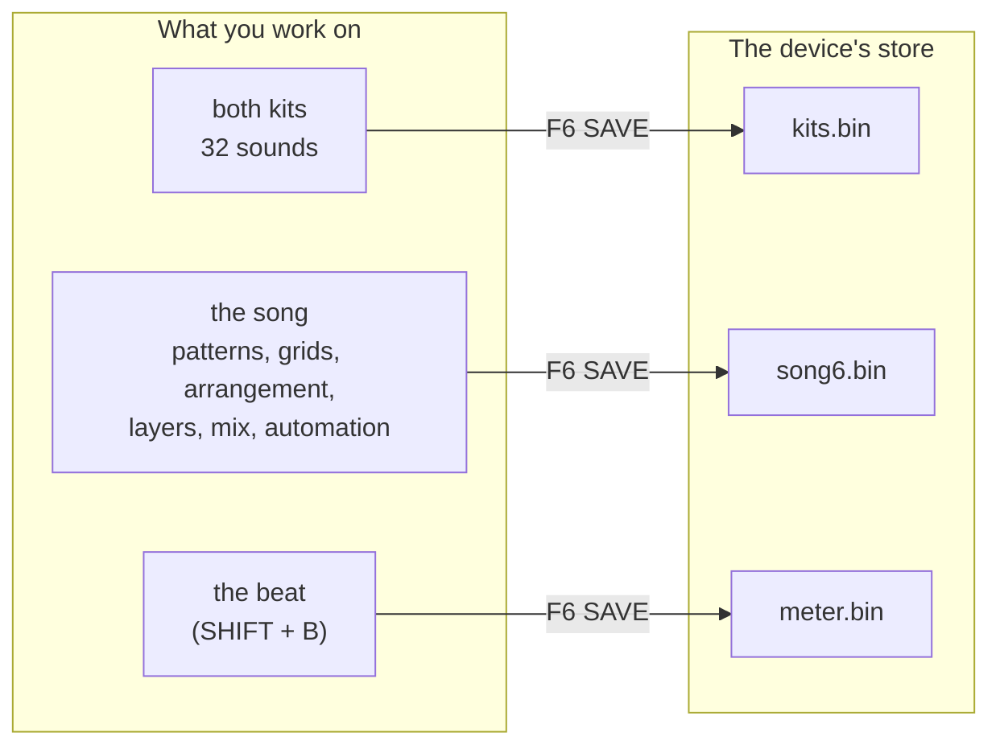
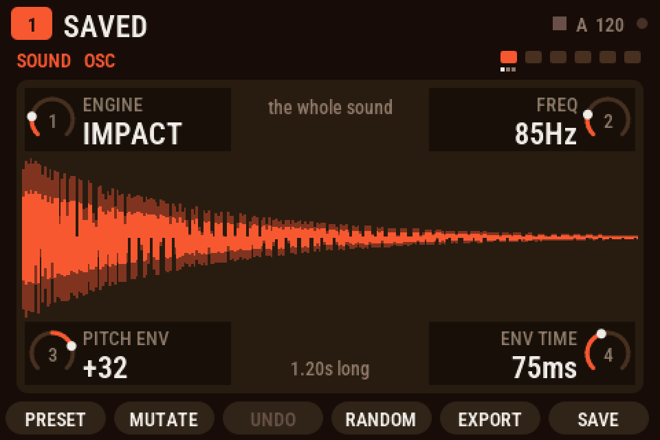
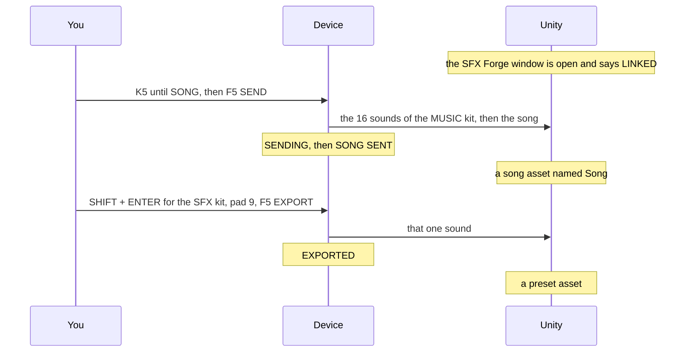
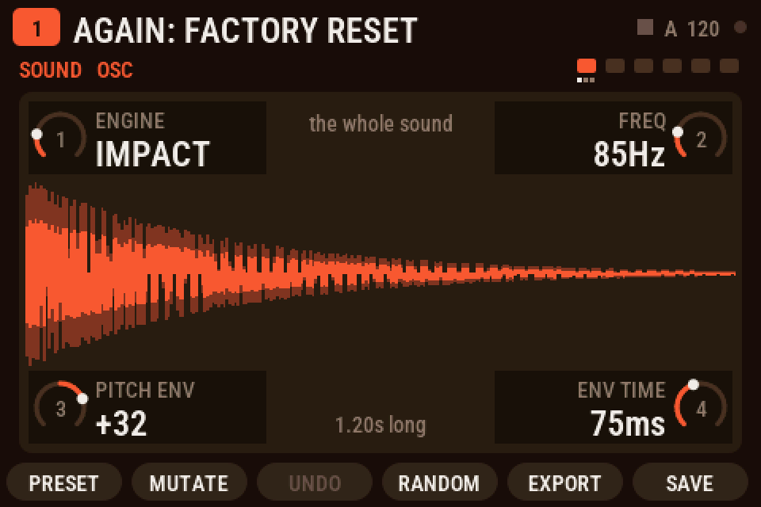

# Device Saving And Reset

What F6 SAVE keeps, how your work gets to the programmer's game, what switching off forgets, and the ways to start
over: an empty pattern, an empty song, the demo song, the factory reset.

The device does not save by itself. Until you press SAVE, switching off loses what you changed.

## Save

1. Press **F6 SAVE** on any page that has it: the sound pages, SEQ, SONG, AUTO, MIX, MASTER and LINK. PERFORM has
   no SAVE: press K5 once more for SEQ. On [the stage](Device-The-Stage), SAVE is the last button under the sound.
2. The top line says `SAVED`.

If it says `NOT SAVED: STORE FULL` instead, the device's store did not take it: do not count on it. The kits and the
song are two files, and the next start finds of each what was last written whole: it can be the new sounds with the
song from before. The manual says a DAW project keeps the kits and the song too.

| File | What is in it |
|---|---|
| `kits.bin` | both kits: 32 sounds, and which named sound each pad holds |
| `song6.bin` | the song, in format 6 |
| `meter.bin` | the beat: one byte. It is there only while the beat is not a quarter: SAVE with a quarter takes the file away |
| `song.bin` | the song of the firmwares up to 1.5.0: read, never written |

## Hand it to the programmer

SAVE keeps your work on the device. A game gets it over the [link](Glossary#the-link): the device and the Unity
editor joined by MIDI. The programmer sets that up once
([Unity Device Link Setup](Unity-Device-Link-Setup)); then you press one key for the song and one for each sound
effect.

| What | How it travels |
|---|---|
| the song, as in `song6.bin`: patterns, grids, arrangement, layers, mix, automation | **F5 SEND** on the SONG page |
| the 16 sounds of the MUSIC kit | with the same SEND |
| a sound of the SFX kit, like your laser | **F5 EXPORT** on a sound page or on LINK: the selected sound of the kit that is chosen, one sound a press |
| the beat (SHIFT + B) | never. The game does not need it: [Device Time Signatures](Device-Time-Signatures#the-beat-is-the-devices-not-the-songs) |
| INTENSITY | never. The game sets it: [Unity Adaptive Music](Unity-Adaptive-Music) |

Three things to know:

- **SEND and EXPORT send what you work on**, saved or not. Press F6 SAVE as well if the device should keep it.
- **Is a game there?** Press **K6**: the line at the bottom of the LINK page says `LINKED` once something has come
  in from a game, and `WAITING FOR A GAME` until then. SEND with no game seen says `SENDING - NO GAME SEEN` and
  sends all the same.
- **The link was tried with the SDK's emulator only**, a second way to run the firmware in a browser. It was not
  tried with the Playground of [Device Quick Start](Device-Quick-Start), nor with the hardware:
  [What Is Tested](What-Is-Tested#the-link).

What arrives in Unity and where it is saved: [Unity Send And Receive](Unity-Send-And-Receive).

## Start over

| You want | Do this | It replaces | The top line says |
|---|---|---|---|
| to empty the pattern you see | **F3 CLR PAT** on SONG | that pattern (its grid stays) | `PAT CLEARED - F2: UNDO` |
| an empty song | **F4 NEW** on SONG, twice | the song, not your sounds | `PRESS AGAIN: NEW SONG`, then `NEW SONG - F2: UNDO` |
| the demo song again | **SHIFT + F4** on SONG, twice | the song, not your sounds | `PRESS AGAIN: DEMO`, then `DEMO SONG - F2: UNDO` |
| everything as it came | **SHIFT + MENU**, twice within three seconds | both kits, the song and the beat, **and what was saved** | `AGAIN: FACTORY RESET`, then `FACTORY RESET` |

The first three change only what you work on: F2 UNDO brings the song back, and the store still holds what you saved
last. The factory reset saves at once, so there is no way back from it.

The first press of SHIFT + MENU only asks. Leave it for three seconds and nothing happens. The second press stops
what plays, puts both kits and the demo song back, forgets every undo and saves. If the store did not take the
reset, the top line says `RESET - NOT SAVED`.

## Undo, in one table

| Key | Where | It takes back |
|---|---|---|
| **F3 UNDO** | the sound pages | the last PRESET, MUTATE or RANDOM of the selected sound. Each pad has its own |
| **F2 UNDO** | SEQ, SONG, AUTO | the last thing done to the song: a run of edits, a take, bars added or removed, FILL, CLEAR, RAMP, COPY, a change of grid, CLR PAT, NEW, DEMO, a song a game sent |
| **F6 UNDO** | PERFORM | the same as F2 |

Each holds one step, and the same key again is redo. Neither is kept when the device is switched off. The song's
UNDO does not take back what a knob set: tempo, swing, the scale, CHAIN, the bar's length, the beat, layers and the
mixer. (After NEW, DEMO or a song from a game it brings the whole song back, with these - but never the beat.)

## What switching off forgets

| After switching on | |
|---|---|
| PLAY plays the song | SONG, not LOOP |
| the click is on | |
| REC is off | |
| the kit is SFX, the page the first sound page | |
| UNDO has nothing to take back | |
| the beat is the one of the last SAVE | a quarter, if you never saved another |

## Older and newer firmware

- **A song from an older format is read**, with every pattern at 1/16.
- **A sound or song from a newer format is not taken.** The device keeps what it has (a game's newer song:
  `NEWER SONG: UPDATE`); the next SAVE writes over a newer file in the store.
- **Going back to firmware 1.5.0 or older**: it finds its own `song.bin` from before the update, not the song you
  saved since. The sounds it does find. If it then saves and you come forward again, the top line says
  `OLDER FIRMWARE'S SONG` and F2 brings back the newer one.

The whole table of cases is in the manual: [The song and older firmware](../docs/MANUAL.md#the-song-and-older-firmware).

## Next

- [Device Song And Arrangement](Device-Song-And-Arrangement) - NEW, DEMO and the arrangement
- [Device Time Signatures](Device-Time-Signatures) - the beat and `meter.bin`
- [Unity Send And Receive](Unity-Send-And-Receive) - keep the song in the game's project instead: F5 SEND
- [Song Format](Song-Format) and [Patch Format](Patch-Format) - what the files hold, byte by byte

## Reference

- [The manual, section 17: Saving and resetting](../docs/MANUAL.md#17-saving-and-resetting): [the files](../docs/MANUAL.md#the-files), [the song and older firmware](../docs/MANUAL.md#the-song-and-older-firmware); [UNDO](../docs/MANUAL.md#undo)
- [fw_store.h](../sfx-forge/fw_store.h) - `bank_save`, `bank_load`, `save_say`
- [fw_events.h](../sfx-forge/fw_events.h) - `factory_reset`
- [fw_edit.h](../sfx-forge/fw_edit.h) - the song's undo, and `confirm`: a key that asks twice
- [check-store.mjs](../tests/check-store.mjs) and [check-reset.mjs](../tests/check-reset.mjs) - the scripts that check the store and the reset
