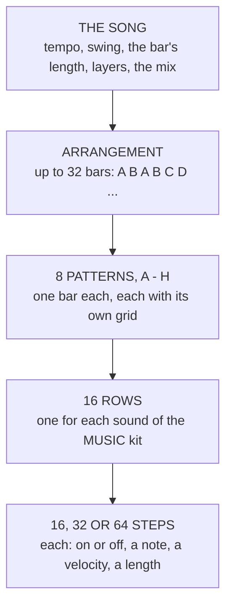
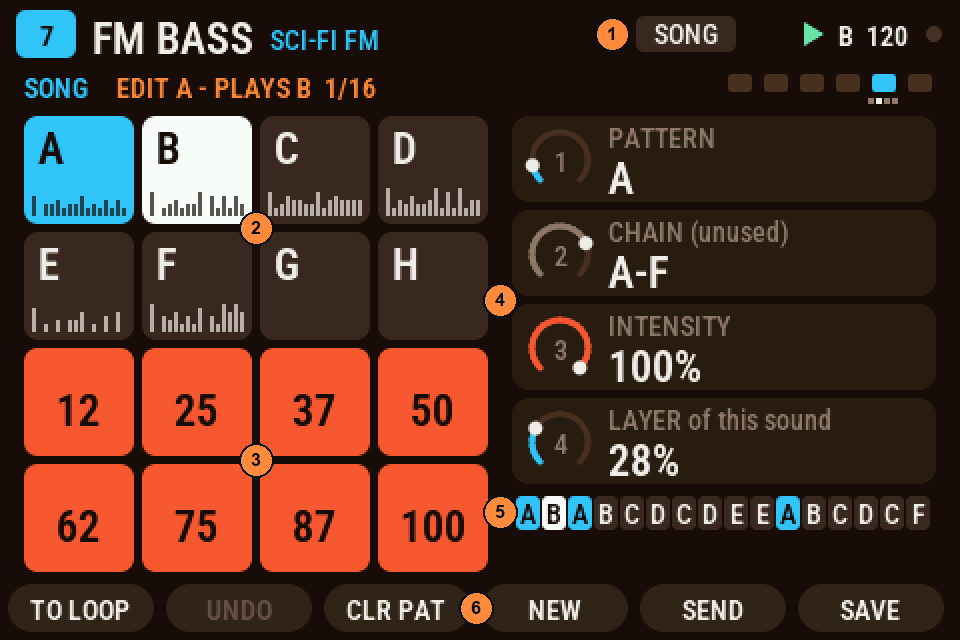
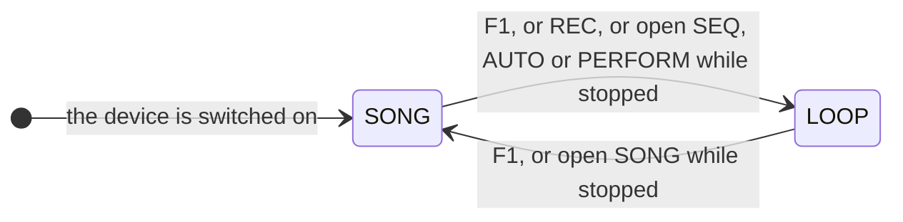
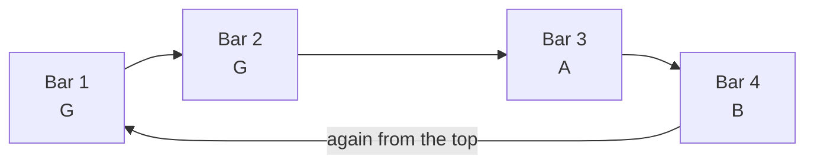

# Device Song And Arrangement

Put the patterns in an order, choose what PLAY plays, and start a new song. All of it is on the SONG page: press
**K5** twice.

| | What it is |
|---|---|
| **1** | what PLAY plays: **SONG** here, or LOOP. The line under it says `EDIT A - PLAYS B` while you look at one pattern and another plays |
| **2** | the eight patterns on pads 1 - 8, each with a sketch of what is in it. White: playing. Blue: the one you edit. Blinking yellow: waiting for the bar line |
| **3** | INTENSITY on pads 9 - 16, from 12 to 100 %: the tiles light up to the current level ([Device Layers And Intensity](Device-Layers-And-Intensity)) |
| **4** | PATTERN · CHAIN · INTENSITY · the selected sound's LAYER |
| **5** | the arrangement: a pattern for each bar, 16 bars a line. The white one is playing; blue are the bars of the pattern you edit. Without an arrangement this place says `NO ARRANGEMENT` |
| **6** | TO LOOP (or TO SONG) · UNDO · CLR PAT · NEW · SEND to the game · SAVE |

## What PLAY plays: LOOP or SONG

| The top line says | PLAY plays |
|---|---|
| **LOOP** | the pattern, round and round. A pattern you choose takes over on the next bar line, and then that one repeats |
| **SONG** | the arrangement, bar after bar, from the first bar that holds the pattern you see, then again from the top. Without an arrangement: the chain |

- **F1** on SEQ, SONG and AUTO changes it at any time, also while it plays. On PERFORM the key is **SHIFT + F1**.
  The key says what it will do: TO SONG, TO LOOP. The top line confirms: `SONG: PLAYS IN ORDER`,
  `LOOP: PATTERN REPEATS`.
- Opening a page changes it only while the song is stopped and REC is not lit.
- PLAY and STOP never change it.

## Choosing a pattern

| | |
|---|---|
| **with** | LEFT / RIGHT on SEQ, SONG, AUTO and PERFORM · pads 1 - 8 and encoder 1 on SONG · pads 1 - 8 on PERFORM after F4 PATTERN |
| **stopped** | it is there at once |
| **playing** | it starts on the next bar line. Until then its letter blinks yellow and the top line reads `A>C` |

In LOOP the chosen pattern repeats. In SONG it depends on the arrangement:

| The chosen pattern is ... | What happens |
|---|---|
| **in** the arrangement | the song carries on from its next bar with that pattern |
| **not in** it | it takes over on the bar line and stays until you choose another |
| (no arrangement) | the chain goes on from it. With CHAIN at A it stays |

A game chooses patterns the same way, with a cue: [Unity Cues And Patterns](Unity-Cues-And-Patterns).

## The order of the song

| You want | Do this | The top line says |
|---|---|---|
| your own order | **SHIFT + pad 1 - 8** adds that pattern as a bar | `BAR ADDED`; at the end `32 BARS: FULL` |
| to take the last bar away | SHIFT + any of pads 9 - 15 | `BAR REMOVED` |
| no arrangement (the chain plays again) | SHIFT + pad 16, **twice** | `PRESS AGAIN: CLEAR ARR`, then `ARR CLEARED - F2: UNDO`. With none: `NO ARRANGEMENT` |
| A, B, C, D in a row, a bar each, without an arrangement | CHAIN (encoder 2) at `A-D` | while there is an arrangement: `ARRANGEMENT IN USE` |
| a shorter bar | encoder B, 1 - 16 sixteenths | `BAR: 12/16 = 3/4` ([Device Time Signatures](Device-Time-Signatures)) |
| another tempo | encoder A, 40 - 240. SHIFT + A: the swing, 0 - 100 % | `SWING 20%` |

The demo song has an arrangement of 16 bars over six patterns, A - F: A B A B, C D C D, E E A B, C D C F. That is
why CHAIN reads `(unused)` in the picture above. G and H are empty: a place to try things.

## A small arrangement, step by step

Four bars of your own: G, G, A, B. Here G holds a beat you made ([Device Make A Beat](Device-Make-A-Beat)); any
patterns do.

1. With the song stopped and REC off, press **K5** until the second line says `SONG`. The top line says **SONG**.
2. Take the demo's order away: hold **SHIFT** and hit **pad 16**. The top line asks `PRESS AGAIN: CLEAR ARR`. Hit
   pad 16 again while it asks: `ARR CLEARED - F2: UNDO`. The place of the arrangement (**5** in the picture at the
   top) now reads `NO ARRANGEMENT`.
3. Still holding SHIFT, hit **pad 7** twice, then **pad 1**, then **pad 2**. Each hit says `BAR ADDED`, and the row
   reads G G A B.
4. One too many? SHIFT + any of **pads 9 - 15** takes the last bar away: `BAR REMOVED`.
5. Hit **pad 7** (no SHIFT) so that G is the pattern you see, and press **PLAY**. The four bars play in order, round
   and round; the white letter in the row is the bar that plays.
6. Press **F6 SAVE**.

Two things to know:

- **PLAY starts at the first bar that holds the pattern you see**, not always at bar 1. With A on the display the
  song above starts at its third bar. If no bar holds that pattern, it plays once and the arrangement follows from
  the top.
- **F2 UNDO takes back the bars you added in a row as one step** (`UNDO: BARS`). It holds one step only: once you
  have added a bar, it no longer brings back the arrangement you cleared before.

## Empty a pattern, start a new song

| You want | Do this | The top line says |
|---|---|---|
| to empty the pattern you see | **F3 CLR PAT**. It keeps its grid | `PAT CLEARED - F2: UNDO`, or `NOTHING TO CLEAR` |
| an empty song | **F4 NEW**, twice | `PRESS AGAIN: NEW SONG`, then `NEW SONG - F2: UNDO` |
| the demo song again | **SHIFT + F4**, twice | `PRESS AGAIN: DEMO`, then `DEMO SONG - F2: UNDO` |
| the song to a game | **F5 SEND**: the 16 sounds of the MUSIC kit and the song | `SENDING`, or `SENDING - NO GAME SEEN`; at the end `SONG SENT` |

NEW gives tempo 120, no swing, no arrangement, CHAIN at A, a bar of 16 sixteenths, the scale MINOR, every fader at
100, every layer at 0 and every pattern empty at 1/16. Your sounds stay. A key that asks twice counts the second
press while its question is in the top line, about two seconds.

**F2 UNDO** takes all of these back - bars added or removed in a row, the arrangement cleared, CLR PAT, NEW, DEMO -
but one step only: the next thing you do replaces what F2 holds. It does not take back what a knob set: tempo,
swing, CHAIN, the bar's length. (After NEW or DEMO, F2 brings the whole song back, with these.)

## Next

- [Device Layers And Intensity](Device-Layers-And-Intensity) - the other half of the SONG page
- [Device Mixer And Effects](Device-Mixer-And-Effects) - the song's mix
- [Device Saving And Reset](Device-Saving-And-Reset) - keep the song
- [Device Saving And Reset](Device-Saving-And-Reset#hand-it-to-the-programmer) - F5 SEND: the song to a game, from your side
- [Unity Send And Receive](Unity-Send-And-Receive) - what F5 SEND does on the game's side

## Reference

- [The manual, section 10: The song](../docs/MANUAL.md#10-the-song): [what PLAY plays](../docs/MANUAL.md#what-play-plays-loop-or-song), [choosing a pattern](../docs/MANUAL.md#choosing-a-pattern), [the order of the song](../docs/MANUAL.md#the-order-of-the-song), [UNDO](../docs/MANUAL.md#undo)
- [fw_softkeys.h](../sfx-forge/fw_softkeys.h) - `soft_song`, `arr_edit`, `song_new`, `song_demo`, `pattern_clear`
- [fw_sequencer.h](../sfx-forge/fw_sequencer.h) - `mode_set`, `pattern_pick`
- [fw_factory.h](../sfx-forge/fw_factory.h) - `demo_song`: the song a device starts with
- [Song Format](Song-Format) - how the song is packed
