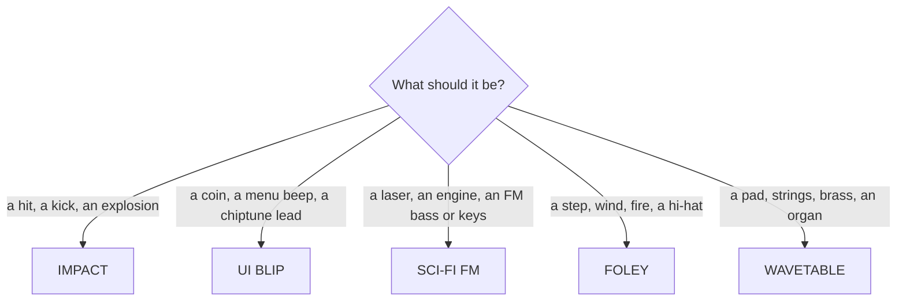
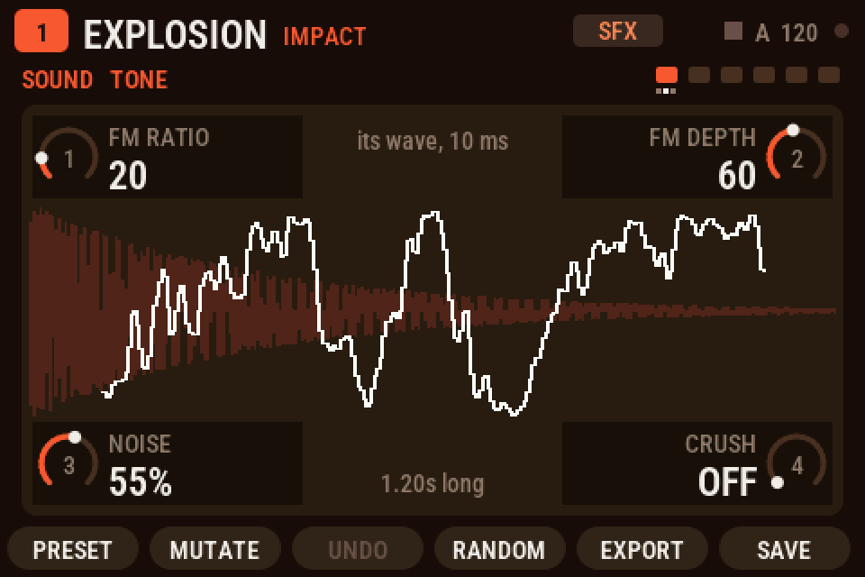
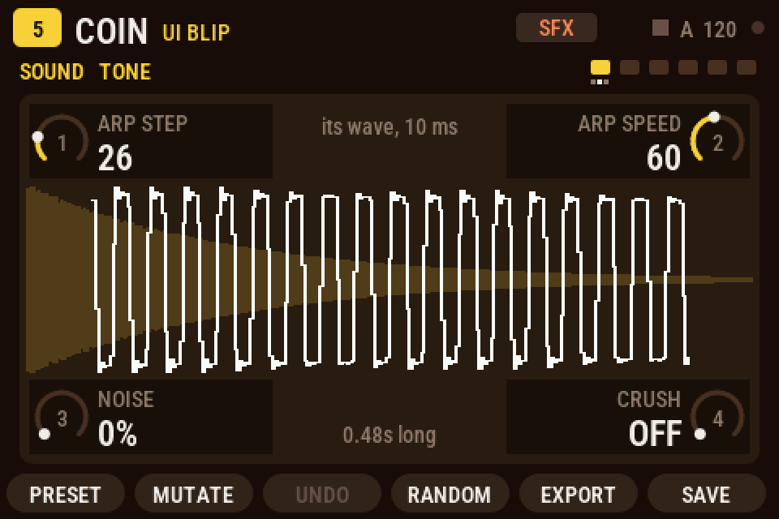
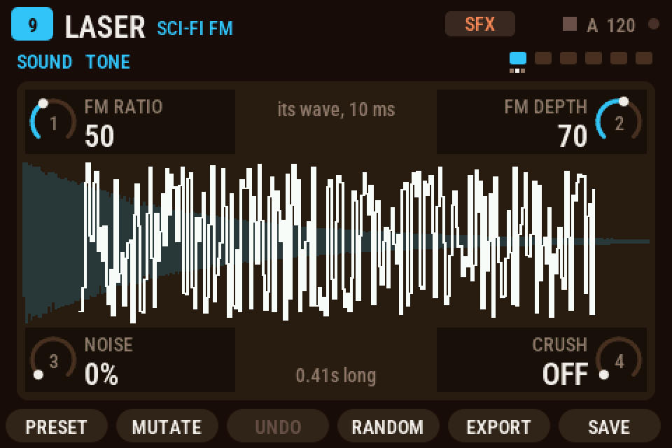
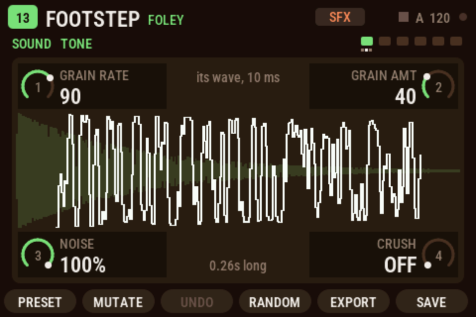
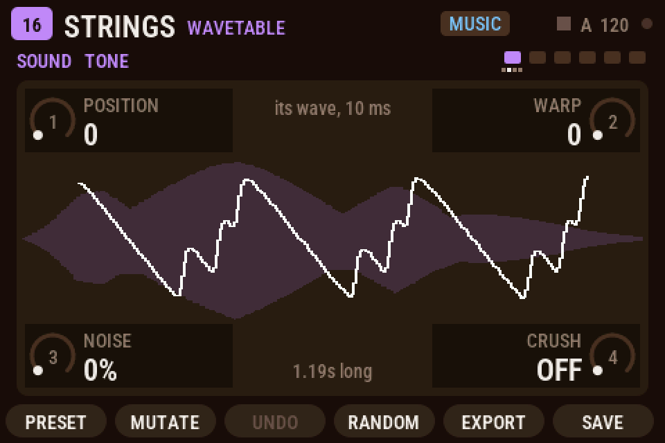
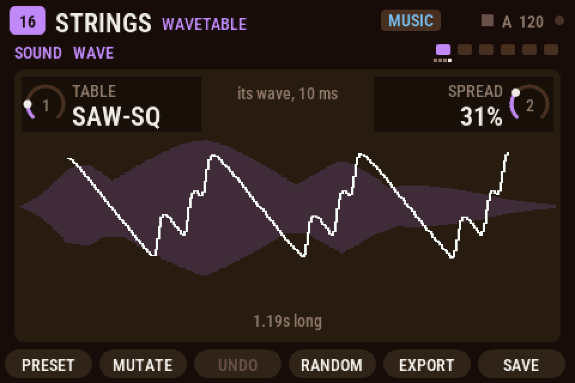

# Device The Five Engines

Every sound is made by one of five engines. This page says which engine to pick for what, and what its two own
knobs do.

**ENGINE** is encoder 1 of the OSC page (K1). The first two knobs of the TONE page (K1 again) are the engine's own:
the manual calls them **A** and **B**, and the display names them by what they do in the engine that is chosen.

## The five

| Engine | What it is | A | B |
|---|---|---|---|
| **IMPACT** | a sine with FM, driven hard | FM RATIO | FM DEPTH |
| **UI BLIP** | a square wave that can step upwards: three steps, then it stays | ARP STEP | ARP SPEED |
| **SCI-FI FM** | two sines, one bending the other, with feedback | FM RATIO | FM DEPTH |
| **FOLEY** | noise through a band, in grains | GRAIN RATE | GRAIN AMT |
| **WAVETABLE** | a wave that morphs through a table | POSITION | WARP |

The TONE page of one factory sound of each engine. The white line is 10 ms of the sound's wave; the shape behind it
is the whole sound.

| IMPACT: EXPLOSION | UI BLIP: COIN |
|---|---|
|  |  |

| SCI-FI FM: LASER | FOLEY: FOOTSTEP |
|---|---|
|  |  |

| WAVETABLE: STRINGS |
|---|
|  |

The first four are sounds of the SFX kit (pads 1, 5, 9 and 13). STRINGS is pad 16 of the MUSIC kit: press
SHIFT + ENTER for that kit.

## Try this

1. Hit a pad and press **K1** until the second line says `SOUND   TONE`: once from the OSC page, twice from any
   page of another key.
2. Turn **encoder 1** and **encoder 2** and hit the pad again after each turn. The white wave redraws as you turn.
3. Press **K1** until `SOUND   OSC` and turn **encoder 1**, ENGINE. The same knob positions, another engine: the
   names of A and B on the TONE page change with it.

| Engine | A tip |
|---|---|
| IMPACT | PITCH ENV high with a short ENV TIME is a kick. A small fall over a long time is a tom. NOISE adds the crack |
| UI BLIP | ARP STEP is how far each step jumps: the knob's 0 - 127 are 0 - 24 semitones, so about 37 is a fifth and 64 an octave. With a high ARP SPEED that is the classic coin. At 0 it is a plain square wave |
| SCI-FI FM | FM RATIO around 42 is round (a bass, an electric piano); higher is bells and metal. Its brightness falls over ENV TIME: that is the pluck |
| FOLEY | CUTOFF is called BAND here: it is where the noise sits. PITCH ENV sweeps the band, a whoosh. GRAIN AMT chops it: crackle, gravel, rain |
| WAVETABLE | turn POSITION and watch the wave morph. `> TIMBRE` on the LFO page moves it by itself |

## The WAVE page: a wavetable sound's fourth page

A sound of the WAVETABLE engine has one sound page more. Press **K1** until the second line says `SOUND   WAVE`.

| Encoder | Value | What it does |
|---|---|---|
| **1** | TABLE | which of the six wavetables: SAW-SQ, PULSE, PEAK, VOWEL, ORGAN or GLASS |
| **2** | SPREAD | above 0 %: two detuned copies beside the wave, for width |

The picture is STRINGS, pad 16 of the MUSIC kit, with the table SAW-SQ. With any other engine K1 walks OSC, TONE,
FILTER and back to OSC; the WAVE page is not there.

## The MUSIC kit's instruments

Any sound is an instrument: the keys play the selected sound in tune. The MUSIC kit starts with a band on its pads.

| | | | |
|---|---|---|---|
| **1** TIMPANI | **2** SNARE | **3** KICK | **4** COWBELL |
| **5** PIZZICATO | **6** BRASS | **7** FM BASS | **8** FM KEYS |
| **9** HARP | **10** CELESTA | **11** ORGAN | **12** WT SWEEP |
| **13** HI-HAT | **14** BELLS | **15** CHOIR | **16** STRINGS |

F1 PRESET in the MUSIC kit also offers OPEN HAT, FLUTE, WT VOWEL, WT BASS, PAD, SQ BASS and SQ LEAD. All of them are
synthesized in the style of their names; none is a recording.

## Next

- [Device Make A Sound](Device-Make-A-Sound) - the other sound pages: filter, envelope, LFO, sends
- [Device Make A Beat](Device-Make-A-Beat) - the band in a pattern
- [Sound Engine](Sound-Engine) - how the five engines are computed
- [Firmware Add An Engine](Firmware-Add-An-Engine) - a sixth one

## Reference

- [The manual, section 7: The five engines](../docs/MANUAL.md#7-the-five-engines) and [section 8: Instruments](../docs/MANUAL.md#8-instruments)
- [fw_sounds.h](../sfx-forge/fw_sounds.h) - `ENGINE_NAME` and the named sounds with their engines
- [sfx_core.h](../core/sfx_core.h) - the engines themselves
- [sfx_wavetable.h](../core/sfx_wavetable.h) - the six wavetables
- [dv_shots.mjs](../wiki/figures/dv_shots.mjs) - the script that took the five TONE-page pictures from the firmware
