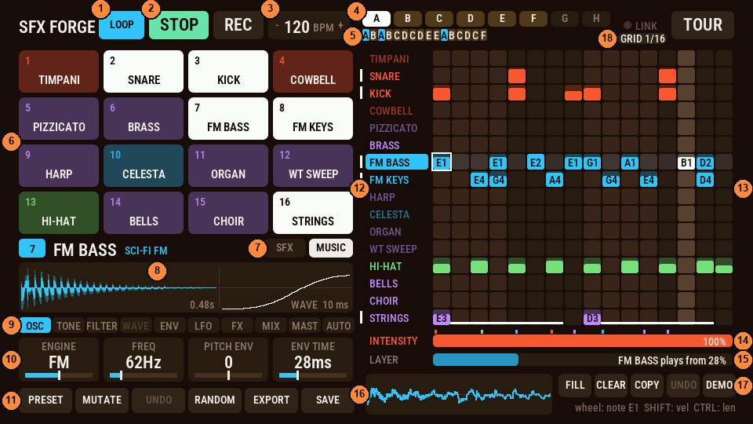
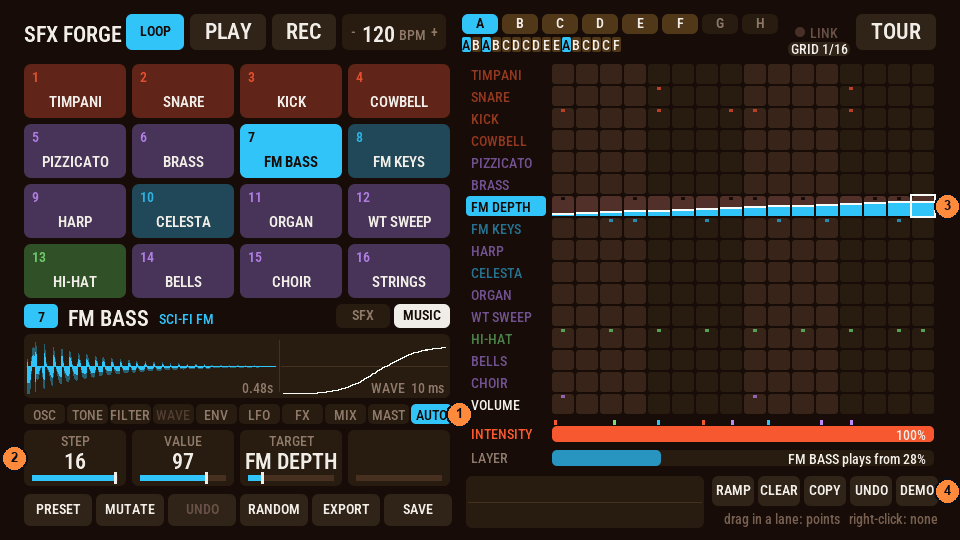
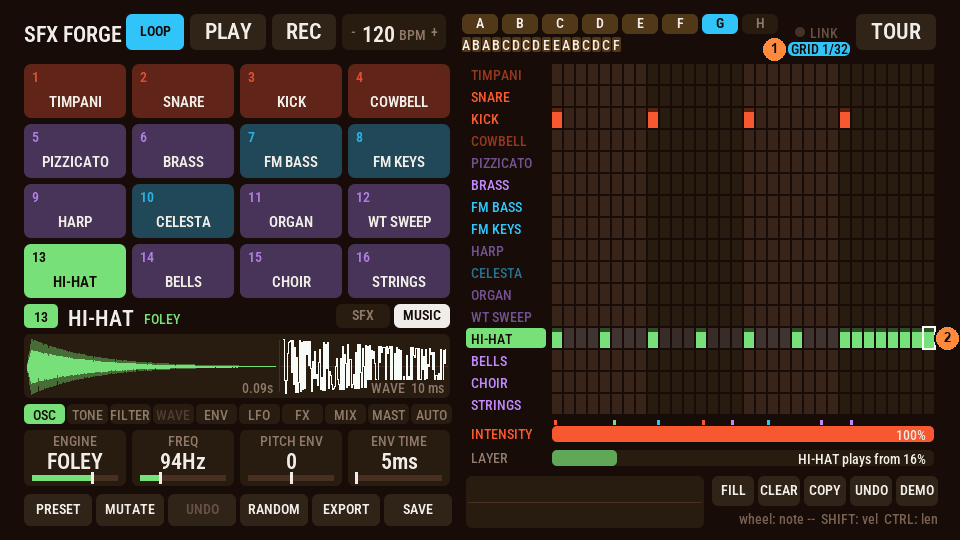
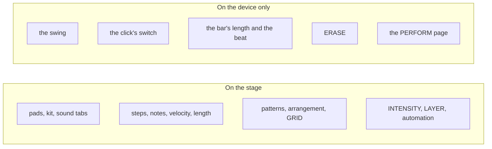

# Device The Stage

Work with the mouse. In the Playground and the plugin, **Stage** opens a bigger picture of the whole instrument:
the kit and the selected sound on the left, the pattern of every sound on the right.

The stage is the same device, not a second one: a click there calls the same functions the keys call. It works on
the song and the kits you have on the display.

The picture shows pattern A repeating: LOOP is lit, and the FM BASS is selected.

## The left half: the kit and the sound

| | What it is | With the mouse |
|---|---|---|
| **6** | the kit's 16 pads | click to play and select. White: it sounds now |
| **7** | SFX / MUSIC | choose the kit the pads show |
| **8** | the selected sound's picture | |
| **9** | the ten tabs: OSC, TONE, FILTER, WAVE, ENV, LFO, FX, MIX, MAST, AUTO | click. WAVE only for a wavetable sound |
| **10** | the tab's four values | **drag**, or the wheel (SHIFT + wheel: eight steps at a time) |
| **11** | PRESET · MUTATE · UNDO · RANDOM · EXPORT · SAVE | click. Right-click PRESET: the one before. UNDO also takes a drag of a sound's value back |

## The top: transport and patterns

| | What it is | With the mouse |
|---|---|---|
| **1** | LOOP / SONG: what PLAY plays | click: the other one |
| **2** | PLAY / STOP · REC | click |
| **3** | the tempo | click its left half (slower) or right half (faster), or the wheel |
| **4** | the patterns A - H. White: playing. Blue: the one shown | click: go there, on the bar line while it plays · **right-click: add a bar of it to the arrangement** |
| **5** | the arrangement | click a bar: its pattern · right-click: the arrangement ends before it (`BARS REMOVED`; UNDO brings it back) |
| **18** | GRID: the grid of the pattern shown | click: finer · right-click: coarser |

**TOUR**, top right, starts the tour, as MENU does; any click ends it. LINK beside it turns green once something
has come in from a game.

## The right half: the pattern

| | What it is | With the mouse |
|---|---|---|
| **12** | the rows' names | click: hear and select · right-click: mute, and again: heard |
| **13** | the pattern: every sound's steps over the whole bar, in 16, 32 or 64 cells | click a step: on or off, and it is the selected step · **wheel: the note** of the step clicked last · SHIFT + wheel: its velocity · CTRL + wheel: its length |
| **14** | INTENSITY, with each sound's mark above | drag, or the wheel |
| **15** | the selected sound's LAYER mark | drag, or the wheel |
| **16** | what sounds now, as a wave. Messages appear over it | |
| **17** | FILL · CLEAR · COPY · UNDO · DEMO | click. DEMO asks twice |

**SHIFT-click does the same as right-click everywhere.**

## Draw automation

| | Do this |
|---|---|
| **1** | click the **AUTO** tab: the 16 rows become the sounds' lanes |
| **2** | choose the **TARGET** (drag the cell, or the wheel). Drag **VALUE** to set one point exactly |
| **3** | **click or drag in a sound's row to draw**: the click selects that sound. The height is the value; drag across to paint a curve. Right-click removes a point |
| **4** | FILL has become **RAMP**, and CLEAR empties the lane |

If no target is chosen yet the stage says `CHOOSE A TARGET FIRST`. The rules of a lane are on
[Device Automation](Device-Automation).

## A finer grid

| | What it is | With the mouse |
|---|---|---|
| **1** | GRID: it is blue when the grid is finer than 1/16 | click: finer · right-click or SHIFT-click: coarser. It asks as SHIFT + F5 does: click it the same way again |
| **2** | a row is the whole bar, in 16, 32 or 64 cells. Here the hats with a roll at the end | click a cell: that step, on or off |

The stage always shows the whole bar, so it has nothing like SHIFT + LEFT and RIGHT.

## What the stage does not have

The stage has no tab for PERFORM: its right half already shows every sound's steps. NEW, SEND and CLR PAT are on the
device's SONG page; solo is on MIX and PERFORM.

The scripted checks press the device's keys; they do not click on the stage:
[What Is Tested](What-Is-Tested).

## Next

- [Device Automation](Device-Automation) - lanes, points and RAMP
- [Device Finer Grids](Device-Finer-Grids) - what GRID does to a pattern
- [Device Controls And Pages](Device-Controls-And-Pages) - the same instrument by its keys
- [Device Cheat Sheet](Device-Cheat-Sheet) - the stage in one column

## Reference

- [The manual, section 15: The stage](../docs/MANUAL.md#15-the-stage): [automation on the stage](../docs/MANUAL.md#automation-on-the-stage), [the grid on the stage](../docs/MANUAL.md#the-grid-on-the-stage)
- [fw_stage_input.h](../sfx-forge/fw_stage_input.h) - `stage_event`: every click, in the order of its rectangles
- [fw_stage_draw.h](../sfx-forge/fw_stage_draw.h) - how the stage is drawn
