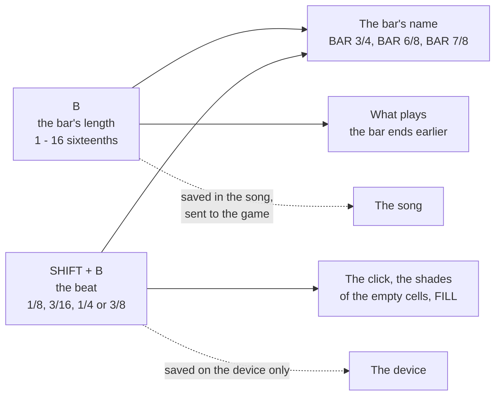
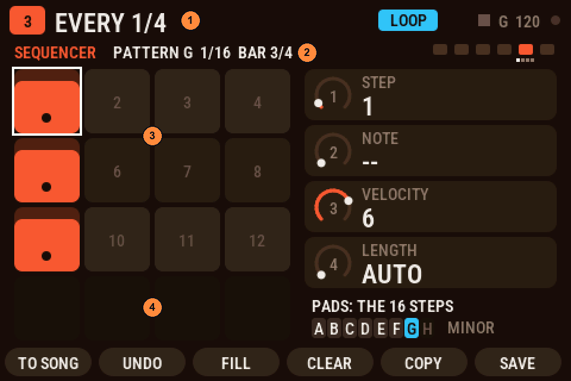
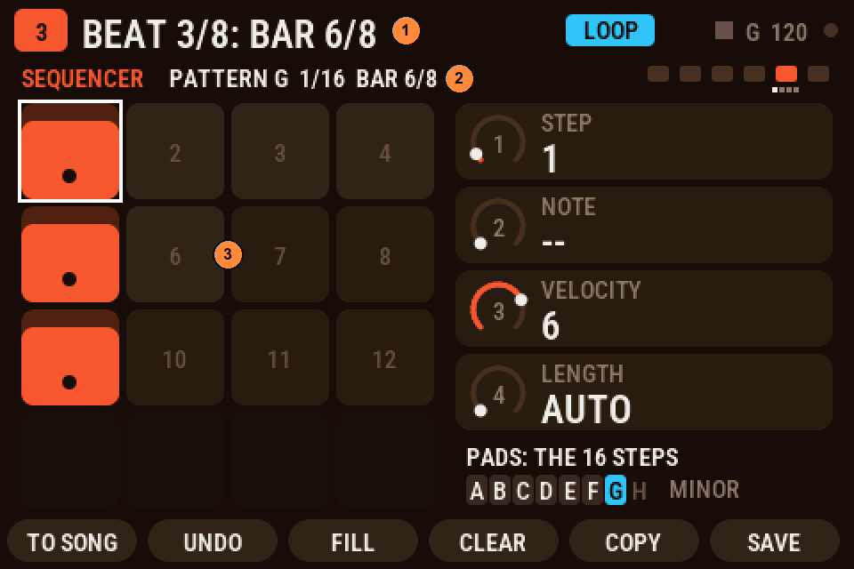
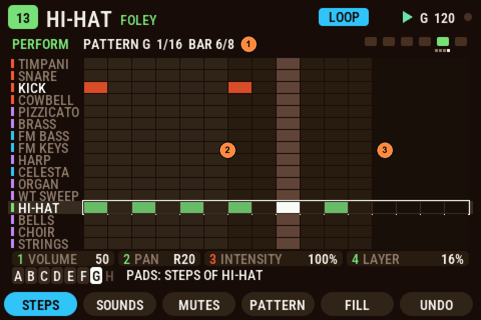
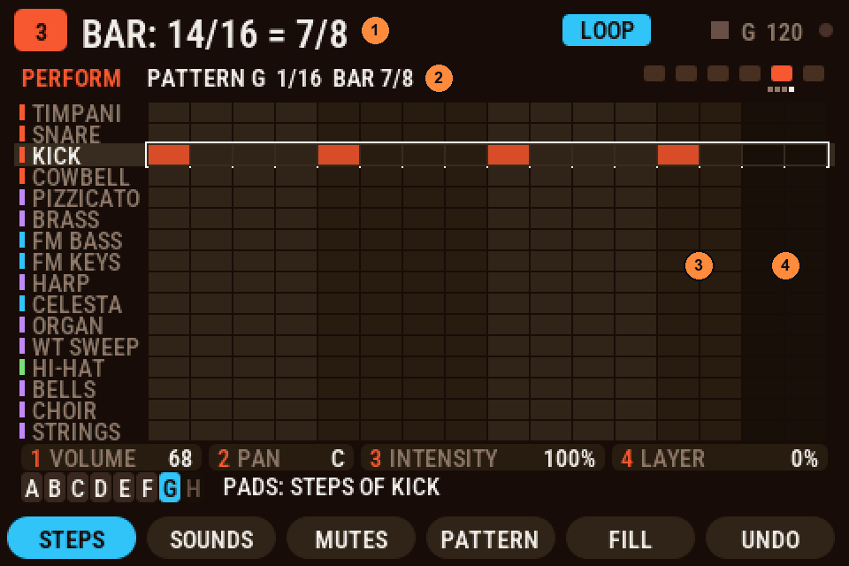

# Device Time Signatures

Write in 3/4, 6/8 or 7/8. Two knobs make a time signature: **B** is how long the bar is, **SHIFT + B** is what a
beat is.

| | Turn | On | It is | It belongs to |
|---|---|---|---|---|
| **the bar** | B | SONG, PERFORM | 1 - 16 sixteenths. As it comes: 16 | the song |
| **the beat** | SHIFT + B | SEQ, SONG, PERFORM | an eighth (1/8), three sixteenths (3/16), a quarter (1/4) or a dotted quarter (3/8). As it comes: a quarter | the device |

One click of B with SHIFT held is one beat further, in the order 1/8, 3/16, 1/4, 3/8. It stops at both ends. On SEQ,
B without SHIFT is the scale: for the bar's length go to SONG or PERFORM. The top line says what you set:
`BAR: 12/16 = 3/4`, `BEAT 3/8: BAR 6/8`.

## Common time signatures

"Up" is a click to the right, "down" a click to the left, starting from the device as it comes. The second line
of SEQ, SONG, AUTO and PERFORM names the bar after the pattern and its grid, where there is room for it.

| For | B | SHIFT + B | The click counts | The second line says |
|---|---|---|---|---|
| **4/4** | 16, as it comes | 1/4, as it comes | four quarters | nothing |
| **3/4** | 12 | 1/4 | three quarters | `BAR 3/4` |
| **2/4** | 8 | 1/4 | two quarters | `BAR 2/4` |
| **6/8** | 12 | one click up: 3/8 | two dotted quarters | `BAR 6/8` |
| **3/8** | 6 | 3/8 | one dotted quarter | `BAR 3/8` |
| **7/8** | 14 | 1/4 | three quarters and an eighth | `BAR 7/8` |
| **5/8** | 10 | 1/4 | two quarters and an eighth | `BAR 5/8` |
| **7/8, every eighth counted** | 14 | two clicks down: 1/8 | seven eighths | `BAR 7/8 IN 1/8` |
| **12/16** | 12 | one click down: 3/16 | four times three sixteenths | `BAR 12/16` |

## A bar of 3/4, and the same bar as 6/8

**1. Press K5 until the second line says `SONG`** (twice from a sound page), and turn **B** four clicks to the
left. The top line says `BAR: 12/16 = 3/4`: the bar has 12 sixteenths now.

**2. Press K5 three times more**, for SEQ, and **RIGHT** until you are on an empty pattern: G in the demo song (H,
if G holds a beat of yours). Turn **DATA** to KICK (pad 3) and press **F3 FILL** once.

| | What it is |
|---|---|
| **1** | what FILL said: a kick on every beat, and the beat is a quarter |
| **2** | the second line names the bar: `BAR 3/4` |
| **3** | the kick stands on steps 1, 5 and 9: the three beats |
| **4** | the fourth row lies beyond the bar: its tiles are dark, and nothing there plays |

**3. Hold SHIFT and turn B one click to the right.** The beat is a dotted quarter now, and the same 12 sixteenths
are two of them: 6/8.

| | What it is |
|---|---|
| **1** | what SHIFT + B said: `BEAT 3/8: BAR 6/8` |
| **2** | the second line: `BAR 6/8` |
| **3** | the second beat begins at step 7: the empty tiles 1 - 6 have one shade, 7 - 12 the other |

The kick still stands on steps 1, 5 and 9: **the beat changes no note.**

**4. Write the beat in 6/8.** FILL begins with the new beat:

1. KICK is still selected. Press **F3 FILL** once: `EVERY 3/8`, a kick on steps 1 and 7, the two beats.
2. Turn **DATA** to HI-HAT (pad 13). Press **F3 FILL** twice: `EVERY 3/8`, then `EVERY 1/8`, a hat on every
   eighth.
3. Press **K5** until the second line says `PERFORM` (three times), and **PLAY**.

PERFORM shows the whole bar on one page. Here it plays in 6/8:

| | What it is |
|---|---|
| **1** | the second line: `BAR 6/8` |
| **2** | where the second beat begins: the empty cells change their shade here, after six sixteenths |
| **3** | the bar ends after step 12. The cells beyond it are dark |

**5. A bar of 7/8.** Still on PERFORM, turn the beat back to a quarter (SHIFT + B one click to the left), and turn
B two clicks to the right, to 14.

| | What it is |
|---|---|
| **1** | what B said: `BAR: 14/16 = 7/8` |
| **2** | the second line: `BAR 7/8` |
| **3** | the fourth beat is a short one: two sixteenths, then the bar line |
| **4** | beyond the bar |

In this picture the kick was filled on every quarter while the bar was still whole: steps 1, 5, 9 and 13.

## What follows the beat

| | With a quarter, as it comes | With another beat |
|---|---|---|
| **the click** (REC lit, playing) | on every quarter, higher on the bar line | on every beat. A bar that is not a whole number of beats ends with a short beat |
| **the empty cells on PERFORM** | change their shade every quarter | every beat |
| **the empty tiles on SEQ and AUTO**, at 1/16 | row by row | beat by beat |
| **FILL** | `EVERY 1/4` first | the beat first: `EVERY 3/8`, `EVERY 3/16` or `EVERY 1/8` |
| **the bar's name** | `BAR 3/4`, `BAR 7/8` | `BAR 6/8`, `BAR 12/16` |

Nothing else follows it: no note, not the tempo, not the swing, not the song, not what a game plays.

## The beat is the device's, not the song's

| | The bar's length (B) | The beat (SHIFT + B) |
|---|---|---|
| is part of the song | yes | no |
| a game gets it | yes, with the song | never. It does not need it: the beat changes no note |
| F6 SAVE keeps it | with the song | in a file of its own, `meter.bin` |
| NEW, DEMO, a song from a game | replace it | leave it |
| F2 UNDO takes it back | no (only with a whole song that NEW, DEMO or a game replaced) | no. Turn the knob back |
| factory reset | 16 again | a quarter again |

So the same song can read `BAR 3/4` on one device and `BAR 6/8` on another. It plays the same on both; only the
click and the shades differ.

## What it does not do

- **Longer bars.** A bar is 16 sixteenths at most: no 5/4, 6/4, 9/8 or 12/8.
- **Triplets.** A step is a sixteenth, or a half or a quarter of one.
- **A bar or a beat for each pattern.** One bar's length for the whole song, one beat for the device. Only the grid
  is a pattern's own.
- **Groupings like 2+2+3.** The beats are all the same length; only the last of a bar may be short.

Nobody has listened to the click with another beat yet: [What Is Tested](What-Is-Tested).

## Next

- [Device Make A Beat](Device-Make-A-Beat) - FILL and the steps
- [Device Perform](Device-Perform) - the page that shows the whole bar
- [Device Saving And Reset](Device-Saving-And-Reset) - `meter.bin` and what SAVE keeps
- [Firmware Add A Setting](Firmware-Add-A-Setting) - how a setting that is the device's is built

## Reference

- [The manual, "The bar and the beat: 3/4, 6/8, 7/8"](../docs/MANUAL.md#the-bar-and-the-beat-34-68-78): [what follows the beat](../docs/MANUAL.md#what-follows-the-beat), [what the display says](../docs/MANUAL.md#what-the-display-says), [the beat is the device's](../docs/MANUAL.md#the-beat-is-the-devices-not-the-songs), [swing and a beat of 3/16](../docs/MANUAL.md#swing-and-a-beat-of-316)
- [fw_pages.h](../sfx-forge/fw_pages.h) - `bar_turn`: B and SHIFT + B
- [fw_state.h](../sfx-forge/fw_state.h) - `beat_len`, `meter_text`: how the bar gets its name
- [fw_softkeys.h](../sfx-forge/fw_softkeys.h) - `fill`: FILL begins with the beat
- [The maintainer's guide, "Add a setting that is the device's, not the song's"](../docs/MAINTAINING.md#add-a-setting-that-is-the-devices-not-the-songs)
