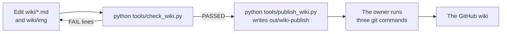

# Editing This Wiki

How these pages are written, checked and published. Read it before you add or change a page.

The pages are files in the folder `wiki/` of the repository. They are edited there, like code, and a script copies
them to the GitHub wiki. Do not edit a page in GitHub's wiki editor: the next publish overwrites it.



## What a wiki page is for

The reference documents are complete: [the manual](../docs/MANUAL.md), [the Unity manual](../docs/UNITY.md),
[the maintainer's guide](../docs/MAINTAINING.md) and [the README](../README.md). A wiki page does not replace
them. It teaches **one thing**, briefly, with a picture, and links to the exact section of the reference for the
rest. A new feature is documented in both: the reference first, then a wiki page or a section of one.

## The rules of the folder

| Thing | Rule |
|---|---|
| A page | a Markdown file directly in `wiki/`, no subfolders. The file name is the page name with hyphens: `Unity-Quick-Start.md` is the page "Unity Quick Start" |
| A link to a wiki page | `[text](Page-Name)` or `[text](Page-Name#anchor)`: the file name without `.md`, no path |
| A link into the repository | relative from the wiki folder: `[the manual, section 2](../docs/MANUAL.md#2-the-device)`. The publish script turns it into a web address |
| An anchor | the heading as GitHub makes it: lower case, spaces to hyphens, punctuation dropped. "## 5. Music" is `#5-music` |
| A picture | ``. Every picture is in `wiki/img` |
| A diagram | a `mermaid` code block. GitHub draws it |
| Special files | `_Sidebar.md` (the list of all pages), `_Footer.md` (one line), `Home.md` (the front page). `README.md` is about the folder and is not published |

## How a page reads

1. Start with one or two sentences: what this page gets the reader.
2. Then, where it helps, a picture or a diagram **before** the details.
3. Keep it short: 60 to 180 lines. One idea a page. If it grows, split it and link.
4. Number the steps. Say exactly what to press, click or type, and what the reader then sees or hears.
5. Use tables for controls and options. Mark code blocks `csharp`, `c` or `sh`, and keep samples small but
   complete enough to paste.
6. Write plain words, short sentences, "you". Explain a term the first time or link it to
   [Glossary](Glossary). No marketing words. No names or pictures of other products.
7. End with `## Next` (2 to 4 links to where the reader goes from here), then `## Reference` (the exact sections
   of the reference documents, and the source files the page is about). The checker wants these two as the last
   sections of every page except the hub pages (Home, Start Here, Glossary, FAQ, Videos, this page).

A page about **extending** something also has: the files you will change, a diagram of how the pieces call each
other, the steps, how to test it (which check to run and what it prints), and the traps.

## The truth rule

Every statement must be true of the code as it is.

- Take a fact from the code first, then from the reference documents. Open the source and read the function.
- Quote the display's words, method names, menu paths and file names exactly.
- A C# sample uses the real API: read the class before you call it.
- Never invent a method, a menu item, a setting or a number. If you do not know, find out or leave it out.
- Do not repeat on every page what is tested. Link to [What Is Tested](What-Is-Tested), and never claim more than
  it says.
- Open every picture you use and make sure the text beside it says what is really on it.
- No e-mail address and no absolute path of your machine in any file.

## Mermaid, without render errors

| Do | Because |
|---|---|
| quote every label that has punctuation or parentheses: `A["text (with parens)"]` | an unquoted parenthesis ends the label |
| use `<br/>` for a line break and no other HTML | other tags are not drawn |
| do not name a node `end`, `class` or `style` | they are words of the language |
| in a `sequenceDiagram`, give participants ids of letters only | other ids fail to parse |
| keep a diagram to about 5 to 12 nodes; split a bigger one | it must be readable at the page's width |
| do not begin a label with `1. `, `- ` or `# `: write `1 The tour` | GitHub reads it as Markdown and draws "Unsupported markdown: list" |
| use a table for a byte layout | `packet-beta` is not safe on GitHub |

Diagram types this wiki uses: `flowchart`, `sequenceDiagram`, `classDiagram`, `stateDiagram-v2`.

## Add a page

1. Create `wiki/Your-Page-Name.md`. Begin with `# Your Page Name` and follow "How a page reads".
2. Add it to `wiki/_Sidebar.md`, in its group, in reading order.
3. Link to it from at least one page that leads there (a `## Next`, or [Start Here](Start-Here)).
4. Add each new term to [Glossary](Glossary), in the table of its subject, with a link to your page.
5. Run the checker until it says `check_wiki PASSED`.

## Add a picture

**A picture the reference documents already have:** copy it under the same name.

```sh
cp docs/img/page-seq.png wiki/img/page-seq.png
```

When the original changes later, the checker calls the copy stale, and `--sync` copies it again:

```sh
python tools/check_wiki.py --sync
```

**A new picture:** write a small script in `wiki/figures/` that draws it into `wiki/img`. The script must run from
the repository's root, hold no absolute path, and write only into `wiki/img`. Give the script and its pictures a
short prefix of their own. The ones that exist:

| Script | Prefix | Makes |
|---|---|---|
| [dv_shots.mjs](../wiki/figures/dv_shots.mjs) | `dv-` | screenshots of the device, taken from the built firmware |
| [in_shots.mjs](../wiki/figures/in_shots.mjs), [in_figures.py](../wiki/figures/in_figures.py) | `in-` | the pictures of the internals pages |
| [us_figures.py](../wiki/figures/us_figures.py) | `us-` | the drawn pictures of the first Unity pages |
| [um_figures.py](../wiki/figures/um_figures.py) | `um-` | the drawn pictures of the Unity music pages |

The Python scripts need Pillow; the `.mjs` scripts need Node and the built firmware
([Building From Source](Building-From-Source)). Each script's first lines say how to run it.

Do not import `docs/unity_figures.py` into a script: importing it draws its own figures again. Copy the colours
you need, as the scripts above do.

Every file in `wiki/img` must be shown or linked by a page. Delete a picture that no page uses.

## The checker

```sh
python tools/check_wiki.py
```

Run it from the repository's root. It needs Python 3, and git for one check (without git that check is skipped
with a `WARN`). It prints one line for each problem and
ends with a summary; its exit code is 1 when anything failed.

```
wiki: 71 pages, 1639 links (1 more leave for the web), 95 pictures shown (85 files in wiki/img), 100 diagrams
check_wiki PASSED, 0 warning(s)
```

(The numbers change as pages are added.)

| It checks | A failure looks like |
|---|---|
| every link to a wiki page leads to a file, and its `#anchor` to a heading there | `link 'Glossary#beat': no heading gives the anchor '#beat' on that page` |
| every `../` link leads to a file in the repository, and its anchor to a heading | `link '../docs/MANUAL.md#2-device': no heading gives the anchor ...` |
| names are spelled with the capitals they have on the disk, and anchors as GitHub makes them (lower case) | `the file's name is spelled with other capitals` |
| a `#L12` anchor of a source file is a line the file has | `no heading gives the anchor '#L99999' in ...` |
| no `../` link leads to a file git ignores (`build/`, `out/`): such a file is not on GitHub | `git ignores build/sfx-forge.wasm, so it is not on GitHub` |
| links are written `[text](target)`: no reference-style link, no HTML `<a>` or `` (they would not be checked or rewritten) | `a reference-style link: ...` |
| no placeholder text left in a page | `placeholder text ('TODO')` |
| every picture is in `wiki/img`, and every file there is used | `no page shows this picture` |
| a picture with the same name as one in `docs/img` is the same file | `a stale copy: it differs from docs/img/...` |
| every page is in `_Sidebar.md` | `the page is not in wiki/_Sidebar.md` |
| every page but the hub pages ends with `## Next` and `## Reference` | `the page has no '## Next'` |
| every mermaid block: a known diagram type, balanced brackets and quotes, every `subgraph`, `loop` or `alt` closed by its `end`, no unquoted parentheses in a label, no HTML but `<br/>` | `mermaid: parentheses in a [] label that is not quoted` |
| no absolute path of a machine and no e-mail address, in pages and scripts | `an absolute path of a machine` |
| a page over 400 lines | a `WARN` line; it does not fail the check |

The mermaid checks are cheap: they catch the usual mistakes and do not draw the diagram. Look at a new diagram on
GitHub, or in an editor that renders Mermaid, before you trust it.

## The C# samples

A second tool compiles every `csharp` block of every page against the real package:

```sh
python tools/check_wiki_code.py              # writes each sample as a C# file into the test project and lists them
python tools/check_wiki_code.py --compile    # then Unity compiles them; an error is mapped back to its page and line
python tools/check_wiki_code.py --clean      # removes the generated folder again
```

`--compile` starts Unity in batch mode on `tests/unity-inspectors`: close that project in the editor first, and
never run two at once. A pass ends with `wiki code: every sample compiled`. Run `--clean` afterwards; the
generated folder is ignored by git.

| A block is | When | What the tool does |
|---|---|---|
| complete | it declares a class, struct, interface or enum at the left margin | compiles it as it stands |
| a fragment | anything else | wraps it into a `MonoBehaviour`. Name what it reads but does not declare in a comment line: `// in: SfxPlayer player, SfxPreset laser` |
| not compiled | its first line is `// not compiled: <why>` | counts and lists it. Use it only for lines quoted from a file that cannot stand alone |

It proves that a sample compiles, not that it does what the page says: nothing is run.

## Publish

Publishing is the owner's step. Nothing in the repository pushes anything.

1. Push the branch the links will point into (`main`), so that the links to the reference documents lead
   somewhere.
2. Once only: on GitHub, open the repository's **Wiki** tab and save a first page. That creates the wiki's own
   git repository, `<repo>.wiki.git`. Clone it into `out/wiki-publish`.
3. Make the folder:

   ```sh
   python tools/publish_wiki.py --repo-url https://github.com/OWNER/REPO
   ```

   It runs the checker first and writes nothing when the checker fails. Then it copies the pages and `wiki/img`
   into `out/wiki-publish` and rewrites every `../` link into an address of the repository: a file becomes
   `.../blob/main/...`, a folder `.../tree/main/...`, a picture or a video `.../raw/main/...`. Links between wiki
   pages stay as they are. A `.git` folder in `out/wiki-publish` is kept. `--branch` names another branch and
   `--out` another folder.
4. Run the three git commands the script prints: `add`, `commit`, `push`, all in `out/wiki-publish`.

`out/` is ignored by git, so the published copy never lands in the repository.

## Next

- [Home](Home): the front page, with the three doors.
- [What Is Tested](What-Is-Tested): the one page that states status.
- [Repository Map](Repository-Map): where the things you write about are.

## Reference

- [wiki/README.md](../wiki/README.md): the same in short, for someone who meets the folder
- [tools/check_wiki.py](../tools/check_wiki.py), [tools/publish_wiki.py](../tools/publish_wiki.py),
  [tools/check_wiki_code.py](../tools/check_wiki_code.py)
- [The maintainer's guide, The wiki](../docs/MAINTAINING.md#the-wiki)
- [The maintainer's guide, The figures and the videos](../docs/MAINTAINING.md#the-figures-and-the-videos): how the
  pictures of `docs/img` are made
