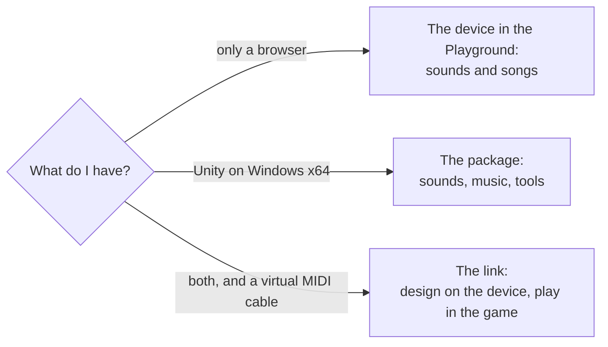

# FAQ

Short answers to the questions people ask first. Each one links to the page that has the detail.

## What I need

### Do I need the hardware?

No. The firmware runs in the VIBE FM Playground, a web page: [Device Quick Start](Device-Quick-Start). SFX FORGE
has in fact not been run on the hardware yet: [What Is Tested](What-Is-Tested).

### Can I use the Unity package without the device?

Yes. Presets, players, variation sets, baking, the sound design tools and the demo song all work on their own. You
need the device for one thing only: writing a song's notes. See [Unity Quick Start](Unity-Quick-Start).

### Can I use the device without Unity?

Yes. It is a complete instrument: two kits, a sequencer, a mixer. See [Device Quick Start](Device-Quick-Start).
A sound or a song leaves it over the link, as MIDI. The only game-side code that exists is the Unity package;
[Link Protocol](Link-Protocol) lists the messages for anyone who writes another.

### Which platforms does the Unity package run on?

Windows x64 only. The engine is a native library, `sfxforge.dll`, and that is the one build that exists. Elsewhere
the package is written to compile, but the players stay silent. Sounds you baked to `.wav` files in the editor are
ordinary audio files; that they play on another platform follows from that and was not tried. See
[Unity Install](Unity-Install#what-you-need) and
[Unity Porting The Native Library](Unity-Porting-The-Native-Library).

### Which Unity version?

It was developed and tested with Unity 6.3 (6000.3.8f1) and no other. See [Unity Install](Unity-Install).

### Where do I get the firmware file?

The build writes `build/sfx-forge.wasm` and `build/sfx-forge.zip`:
[Building From Source](Building-From-Source#1-the-firmware). The generated Unity package also carries the zip, in
its `Firmware~` folder.

## What it is

### Does it play samples?

No. Everything is synthesized from a patch: an engine and 25 values. There are no recordings in it, and it cannot
play one: no voice lines, no recorded instruments. See
[the manual, 19. What it does not do](../docs/MANUAL.md#19-what-it-does-not-do).

### Is the music an audio file?

No. A song is data: the 16 sounds of its band and the packed song (patterns, arrangement, layers, mix, automation).
In Unity it is an `SfxSong` asset, and `SfxMusicPlayer` synthesizes it while it plays. That is why the game can
bring instruments in and out and change pattern on the bar line. See
[Unity Music First Song](Unity-Music-First-Song) and [Song Format](Song-Format).

### How big is it?

| Thing | Size |
|---|---|
| a sound (a patch) | 28 bytes |
| the demo song, without its 16 sounds | 2487 bytes |
| the native library `sfxforge.dll` | about 63 KB |
| each `SfxPlayer` or `SfxMusicPlayer` while the game runs | about 0.6 MB of memory |

A baked clip is as big as its samples, like any audio clip. See
[Unity Choosing A Route](Unity-Choosing-A-Route#what-each-costs).

### Is a sound the same on the device and in the game?

Both run the same C code from `core/`, and a test compares the native library's output with the firmware's own
rendering. Nobody has compared the two by ear. See [Architecture Overview](Architecture-Overview) and
[What Is Tested](What-Is-Tested).

### Can I write a song in Unity?

No. A song's notes are written on the device. In Unity you play the song, look at it, and change five numbers in
its Inspector: TEMPO, SWING, and a sound's LAYER, VOLUME and PAN. See [Unity Song Inspector](Unity-Song-Inspector).

### Can I make sounds in Unity?

Yes. A preset's Inspector has the device's seven sound pages and four tools: NEW, VARY, LEVEL and SHARE. See
[Unity Sound Design Tools](Unity-Sound-Design-Tools).

### Which time signatures can it do?

Whatever fits in a bar of 16 sixteenths: 4/4, 3/4, 6/8, 7/8 and others. No longer bar, so no 5/4 and no 12/8, and
no triplets. See [Device Time Signatures](Device-Time-Signatures).

## Using it in a game

### How does the music follow my game?

Your game sets one number, the intensity, from 0 to 1. Each instrument has a LAYER mark and plays only while the
intensity is at or above it. Your game can also cue a pattern, which takes over on the next bar line. See
[Unity Adaptive Music](Unity-Adaptive-Music) and [Unity Cues And Patterns](Unity-Cues-And-Patterns).

### Can a sound be placed in 3D?

A baked clip can: it is an ordinary `AudioClip` on an ordinary `AudioSource`. A live or held `SfxPlayer` and the
music are not spatialized. See [Unity Choosing A Route](Unity-Choosing-A-Route).

### How do I get a sound from the device into my project?

Over the link: join the device (or its emulator) to the Unity editor by MIDI and press EXPORT on the device. The
sound arrives in the window **Window > SFX Forge**, which saves it as a preset asset. The link needs Windows.
See [Unity Device Link Setup](Unity-Device-Link-Setup) and [Unity Send And Receive](Unity-Send-And-Receive).

### Does the link need the hardware?

No. It was tested against the SDK's emulator in a browser, joined to Unity by two virtual MIDI ports, and never
against the hardware. See [Unity Device Link Setup](Unity-Device-Link-Setup).

### Does a control surface or a DAW work the mixer?

It is built to, and nobody has tried it. From firmware 1.7.1 the device reports each sound's level, pan, mute and
solo, and the selected sound, to its host as parameters with the names of the VIBE FM SDK's mixer convention. By
the SDK's documents a mixer controller and, in the plugin, a DAW then work them. A script checks the firmware's side
only. See [Device Mixer And Effects](Device-Mixer-And-Effects#from-a-mixer-controller-or-a-daw).

### It is silent. Why?

Start at the two charts on [Unity Troubleshooting](Unity-Troubleshooting).

## Shipping

### What is the licence?

The GNU General Public License, version 3 or any later version (`GPL-3.0-or-later`), for the firmware, the engine,
the Unity package, the showcase, the manuals and their pictures: [LICENSE](../LICENSE). Two additional permissions
go with it, one for the Unity engine and one for the hosts that load VIBE FM firmwares:
[ADDITIONAL-PERMISSIONS.md](../ADDITIONAL-PERMISSIONS.md). The VIBE FM SDK, which the firmware is built with, is
Apache-2.0; "VIBE FM" is its owner's trademark. See [README, Licence](../README.md#licence).

### Can I ship a game with it?

That depends on the game's own licence. This is a summary; the licence text decides.

- **A game that is itself offered under the GPL**, with its source: yes, at no cost. The additional permission for
  the Unity engine is what lets such a game be built with Unity at all; it covers the engine, not your own code or
  other libraries.
- **A game that is not offered under the GPL**, a closed-source game for one: not under this licence. It needs
  another licence from the copyright holder. Ask Cat Splat Studios through
  [the repository's issue tracker](https://github.com/Cat-Splat-Studios/sfx-forge/issues).

A game built with the package ships `sfxforge.dll`, and the compiler links start-up code of the mingw-w64 C runtime
into that file. The generated package names this, and everything else in it that comes from someone else, in its
`Third Party Notices.md`, with the licence texts beside it. Read that file before you ship. No source file of the
VIBE FM SDK is in the package, and its Unity code does not use the SDK.

### May I copy code from the showcase into my game?

Under the same licence, yes: the showcase is part of SFX FORGE, and what you copy from it stays under the GPL. For
a game that is not offered under the GPL, see the answer above.

### Can I change the firmware and pass it on?

Yes, under the same licence: whoever gets your version must be able to get its source. The second additional
permission lets it run in the hosts of VIBE FM firmwares. The names "SFX FORGE" and "Cat Splat Studios" are not
for a changed version that could be taken for the original
([ADDITIONAL-PERMISSIONS.md](../ADDITIONAL-PERMISSIONS.md), "Other terms"). This is a summary; the licence text
decides.

### How finished is it?

Version 1.0. The firmware in this repository is 1.7.1; the last one released is 1.7.0 (25 Nov 2026). The firmware
passes its scripted tests; the Unity suites and the link tests were last run with 1.7.0. It has not been run on the
hardware or in the VIBE FM plugin, and nobody has listened to the newest features. The whole list is on
[What Is Tested](What-Is-Tested).

### Do the device and the package have to be the same version?

Update both together. A firmware up to 1.5.0 drops a current song without a word, and a package from before
firmware 1.6.0 does not read one. See [Unity Send And Receive](Unity-Send-And-Receive#when-formats-differ).

## Next

- [Start Here](Start-Here): a reading list for your role.
- [Glossary](Glossary): the words.
- [What Is Tested](What-Is-Tested): what was tried and what was not.

## Reference

- [README](../README.md): everything in short, and [its Licence section](../README.md#licence)
- [The manual, 19. What it does not do](../docs/MANUAL.md#19-what-it-does-not-do)
- [The Unity manual, Limits](../docs/UNITY.md#limits)
- [LICENSE](../LICENSE) and [ADDITIONAL-PERMISSIONS.md](../ADDITIONAL-PERMISSIONS.md)
- [CONTRIBUTING.md](../CONTRIBUTING.md): the licence of a contribution
