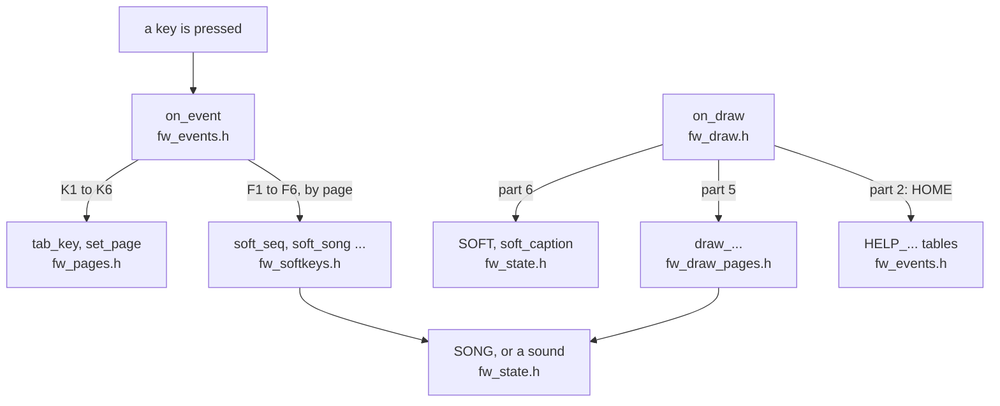

# Firmware Add A Page Or Key

This page is the recipe for giving the device a new soft key (F1 to F6) on a page that exists, or a whole new page.
It tells you which files to touch, in which order, how to test it, and the traps. The worked example in the code is
PERFORM, the page added in firmware 1.7.0.

New to the firmware? Read [Firmware Internals](Firmware-Internals) first.

## What you will change

| File | For a soft key | For a page |
|---|---|---|
| `sfx-forge/fw_state.h` | its caption in `SOFT` (and `soft_caption` if it changes with the state) | `PG_...` in the enum, `TAB_OF`, a row in `SOFT`, `soft_set` |
| `sfx-forge/fw_pages.h` | | `tab_key`, `set_page`, `arrow`, `encoder` |
| `sfx-forge/fw_softkeys.h` | its `case` in the page's `soft_...` function | a new `soft_...` function |
| `sfx-forge/fw_events.h` | its line in the page's `HELP_...` table | the pad branch and the F1 to F6 branch in `on_event`, a new `HELP_...` table |
| `sfx-forge/fw_draw_pages.h` | | a `draw_...` function |
| `sfx-forge/fw_draw.h` | | `on_draw`, parts 2 to 6 |
| `fw_stage_input.h`, `fw_stage_draw.h` | only if the stage should have the button | only if the stage should show it |
| `tests/`, `build.sh` | a scene and a check | a check on `tests/host.mjs` |
| `docs/MANUAL.md`, `README.md`, `docs/figures.py` | section 20, "Playing it", the cheat sheet | the same |

## How the pieces call each other



## A soft key on a page that exists

1. **The caption.** In `fw_state.h`, write it into the `SOFT` table. A caption has at most 7 characters. If it
   changes with the state, handle it in `soft_caption`.
2. **The case.** In `fw_softkeys.h`, add its `case` in `soft_sound`, `soft_seq`, `soft_song`, `soft_auto`,
   `soft_mix` or `soft_perform`. `f` is 0 for F1. SHIFT is the variable `shift`.
3. **What it does.** Use the helpers that exist:

   | The key ... | Do this |
   |---|---|
   | changes the song | change `SONG`. Call `undo_mark` (`fw_edit.h`) first if UNDO should take it back |
   | changes a sound | `keep_undo(slot)` before, `changed(slot)` after |
   | throws much away | ask twice with `confirm("...")` |
   | says something | `say("...")` |
   | does what a key of another page does | call that key's function, as `soft_perform` does |

4. **HOME.** In `fw_events.h`, add the line to the page's `HELP_...` table. A table has at most 11 rows.
5. **The stage**, if it should have the button: the hit test in `stage_event` and the drawing in `on_stage`. The
   same numbers stand in both files.
6. **A test** (below), and the documents.

## A page

A page hangs on one of the six K keys. There is no seventh key, so a new page is one more press of a key that
exists.

1. **`fw_state.h`.** Add `PG_...` to the enum. **The order of the list is used**: a sound page goes before
   `PG_SEQ` and gets a row in `PAGE_PARAMS`; `PG_SEQ` to `PG_MASTER` are the song's pages; a page that is neither
   goes after `PG_LINK`. Add its entry in `TAB_OF` (a missing one stops the build). Look at `mix_page`,
   `sound_page`, `song_keys` and `pattern_keys`: is the new page one of them?
2. **`fw_pages.h`.** `tab_key` (which press of which K key opens it), `set_page` (the K key's label, at most 7
   characters), `arrow` (LEFT / RIGHT) and `encoder` (what the four encoders turn).
3. **Soft keys.** A row in `SOFT` (raise the table's first size), its case in `soft_set`, a function `soft_...`,
   and the branch in `on_event` under "F1-F6: by page". Call `relabel()` when the captions change.
4. **Pads.** The page's branch in `on_event`'s pad case. A pad let go must end what it began, whatever the mode is
   by then.
5. **Display.** A `draw_...` function in `fw_draw_pages.h`. Then, in `on_draw`:
   - part 2: HOME, with a new `HELP_...` table;
   - part 3: `TITLE` and `FIRST` (a missing entry stops the build), and the `pages` line that counts the pages of
     each key;
   - part 4: the pads' lights, and the page's number in the lights' cache word `led`. Everything that decides a
     light must be in that word, and it must still fit;
   - part 5: `vibe_link_page` (the page's name for the host) and the page's branch;
   - part 6: which key is dimmed or lit.
6. **The stage**, if the page should have a tab there: `ST_PAGE` and `ST_N` in `fw_stage_input.h`, the names in
   `on_stage`.
7. **Update the comments** that list pages: the header of `sfx-forge.c` and of each part you touched.

## How to test it

A check drives the built firmware and reads the song it sends back. For a key with SHIFT, pads or SysEx, use the
small host `tests/host.mjs`. This complete check presses K5 (the SEQ page) and F3 (FILL) and looks at the song:

```js
// tests/check-mykey.mjs
import { load, SECOND, BUTTON } from './host.mjs';
import { stepList, same } from './song-read.mjs';

const device = load(process.argv[2] || 'build/sfx-forge.wasm');
const d = device(); // the factory state, nothing stored
d.run(SECOND);
d.button(BUTTON.K5); // the SEQ page
d.button(BUTTON.F3); // FILL: the selected sound on every beat
const song = d.song().bytes; // the packed song the device sends back
const good = same(stepList(song, 0, 0), [0, 4, 8, 12]); // pattern A, sound 1
console.log(good ? '  ok    F3 fills every beat' : '  FAIL  F3 fills every beat');
console.log(good ? 'mykey PASSED' : 'mykey FAILED');
process.exit(good ? 0 : 1);
```

1. Run `sh build.sh quick` to build the firmware.
2. Run `node tests/check-mykey.mjs build/sfx-forge.wasm`. You see one `ok` line and `mykey PASSED`.
3. Add its line to `build.sh`, beside `check-perform.mjs`. `tests/check-perform.mjs` is the model for a whole page.

A key that needs neither SHIFT nor SysEx can be a scene instead: `tests/<name>.json` played by the SDK's
`wasmtest`, and `tests/check-<name>.mjs`. Copy `edit.json` with `check-edit.mjs`. A scene needs three lines in
`build.sh`: `mkdir -p out/<name>`, the `wasmtest` line, and the check.

`vibe-check` (run by `build.sh`) also presses the buttons and looks whether the display changes, and whether HOME
shows something.

## The traps

- **Scripts that count K presses.** This is the lesson of PERFORM. A script that pressed K5 three times to come
  back from AUTO to SEQ landed on PERFORM, where F3 makes the pads mutes. Nothing stops the build for it: a check fails later with
  a wrong song, or a picture shows another page. Run `grep -n K5` over these and read every hit: `tests/*.json`,
  `tests/make-grid-scenes.mjs` (it writes `grid.json`, `regrid.json` and `take64.json`: change the script, not the
  files), `tests/check-atomic.mjs`, `tests/check-grid-keys.mjs`, `docs/shots.mjs`, `docs/video/make_videos.py`.
  In the scene files a button is a number: K5 is 14. The same holds for K1 and K4.
- **The binary's order.** The order of the parts, and of the definitions in `fw_state.h`, is the order of code and
  data in the built `.wasm`. Add at the end of a group; do not move things for tidiness.
- **Reserved keys.** Put no job on SHIFT + K1 to K6 or SHIFT + RETURN (on the VIBE those never reach a firmware),
  nor on SHIFT + DATA turned or ENTER held (the SDK's FOCUS uses them).
- **No format changes.** A page or a key changes no byte of a patch or a song. If yours needs a new field, that is
  another recipe: [Song Format](Song-Format).

## Next

- [Firmware Add A Setting](Firmware-Add-A-Setting): when the key sets something that must be remembered.
- [Running The Tests](Running-The-Tests): every suite and what a pass looks like.
- [Release Checklist](Release-Checklist): what to do before the change ships.
- [Device Controls And Pages](Device-Controls-And-Pages): the pages as a player sees them.

## Reference

- [The maintainer's guide, Add a page or a soft key](../docs/MAINTAINING.md#add-a-page-or-a-soft-key): every step
  in full, with what each meant for PERFORM
- [The maintainer's guide, 6. Invariants](../docs/MAINTAINING.md#6-invariants)
- [fw_state.h](../sfx-forge/fw_state.h), [fw_pages.h](../sfx-forge/fw_pages.h),
  [fw_softkeys.h](../sfx-forge/fw_softkeys.h), [fw_events.h](../sfx-forge/fw_events.h),
  [fw_draw.h](../sfx-forge/fw_draw.h), [fw_draw_pages.h](../sfx-forge/fw_draw_pages.h)
- [tests/host.mjs](../tests/host.mjs), [tests/check-perform.mjs](../tests/check-perform.mjs),
  [tests/check-edit.mjs](../tests/check-edit.mjs), [build.sh](../build.sh)
