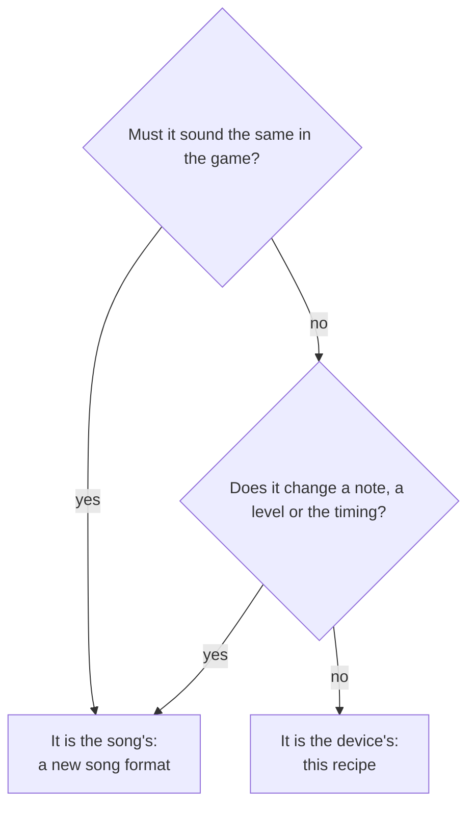
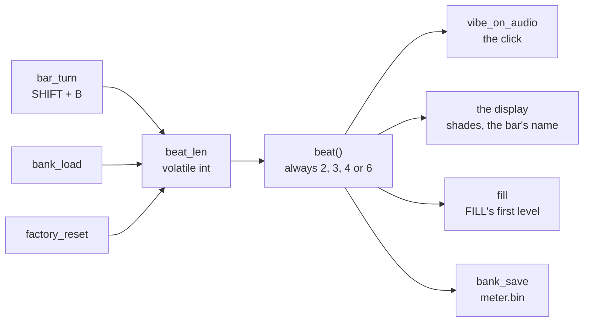

# Firmware Add A Setting

This page is the recipe for a setting that belongs to the device and not to the song: one the device remembers, but
that changes no note and never reaches a game. It tells you how to decide, the files to touch, the test to write and
the traps. The worked example in the code is **the beat** (`beat_len`, firmware 1.7.0, SHIFT + B).

## First decide: the device's, or the song's?



The beat moves only the metronome's click, the shades of the grids and FILL's first press. So it stayed out of the
song. Putting it in would have cost a new song format: format 6 has no spare byte, and `sfx_song_unpack` checks
every byte of the head. That means a new store file, another identity, new readers in C#, JavaScript and Python,
and a song that older firmwares and packages refuse. The song's recipe is in
[the maintainer's guide](../docs/MAINTAINING.md#add-a-field-to-the-song-a-new-song-format).

What a device setting costs instead. The documents must say this each time:

| It is ... | So ... |
|---|---|
| **not in undo** | F2 and F6 keep the song, and the setting is not in it |
| **not on the wire** | SEND, a game and Unity never get it. The same song can be 3/4 on one device and 6/8 on another |
| **left alone by NEW, DEMO and a song from a game** | only the factory reset puts the default back |

## What you will change

| File | What |
|---|---|
| `sfx-forge/fw_state.h` | the variable, and a reader that always returns a valid value |
| `sfx-forge/fw_pages.h` (or where your control is) | the control that sets it, with `say("...")` |
| `sfx-forge/fw_store.h` | a small file of its own in `bank_save` and `bank_load` |
| `sfx-forge/fw_events.h` | `factory_reset` puts the default back; the `HELP_...` tables name the control |
| `tests/check-<name>.mjs`, `build.sh` | a check on `tests/host.mjs`, and its line |
| README, `docs/MANUAL.md`, the cheat sheet | say whose the setting is |

**Leave alone:** `core/` (`sfx_song_pack`, `SFX_SONG_VERSION`), `fw_link.h`, `fw_protocol.h`, the identity, the
native library and the Unity package.

## How the pieces call each other

This is the beat. Your setting follows the same shape.



## The steps

1. **The variable.** In `fw_state.h`, add it at the end of its group. If the audio reads it, make it one
   `volatile int` beside `metro`, `rec_on` and `beat_len`, written by the controls only.
2. **A reader.** Give it a function that returns a valid value whatever the variable holds, and ask the reader
   everywhere, never the variable. The beat's reader:

   ```c
   static int beat(void) {
     int b = beat_len;
     return b == 2 || b == 3 || b == 6 ? b : 4;
   }
   ```

3. **The control.** Set it where the key or encoder is handled, and say what happened with `say("...")`. Do not
   call `undo_mark`: the setting is not in the song.
4. **The store.** In `fw_store.h`, give it a small file of its own (the beat's is `meter.bin`, one byte), and add
   a line to the header's list of files.
   - In `bank_save`: write the file only while the value is not the default, and remove it otherwise with
     `vibe_store_delete`. Then a device that never chose another value stores exactly what it stored before.
   - In `bank_load`: take only values you know. Anything else leaves the default.
5. **The reset.** In `fw_events.h`, `factory_reset` puts the default back before it saves. Name the control in the
   page's `HELP_...` table (HOME shows it; at most 11 rows).
6. **The check**, below. Then its line in `build.sh`.
7. **The documents.** README ("Playing it", the checks, "What the device stores"), `docs/MANUAL.md`, the cheat
   sheet. Say whose the setting is.

## How to test it

Write a check on the small host, as `tests/check-meter.mjs` is. The host can hand the firmware stored files and
read them back, which the SDK's `wasmtest` cannot. Prove these six things:

| # | What the check proves | How |
|---|---|---|
| 1 | the setting changes no byte of the song | `d.song().bytes` before and after are the same |
| 2 | SAVE writes the file, and removes it at the default | look into the `files` map you gave `device(files)` |
| 3 | switched on again, the setting is there | start a second device with the same `files` |
| 4 | a file with a wrong byte leaves the default | put the byte into `files` before the device starts |
| 5 | NEW leaves the setting | press it twice (it asks) and read the setting's effect |
| 6 | the factory reset puts the default back | SHIFT + MENU twice |

Run it alone, then in the whole run:

```sh
sh build.sh quick
node tests/check-meter.mjs build/sfx-forge.wasm     # ok lines, then: meter PASSED
sh build.sh                                         # every check; one more line says PASSED
```

## The traps

- **The old constant is everywhere.** Until 1.7.0 a beat was a quarter, and the code said `4`. Eleven places now
  follow `beat()`, and several others still say four **on purpose** (the tempo counts quarters; swing works on
  pairs of sixteenths; the pads are four a row). Before you make a constant a setting, find every use:
  `grep -n "% 4\|/ 4\|\* 4" sfx-forge/*.h`, and read every hit. The two lists are in
  [the maintainer's guide](../docs/MAINTAINING.md#where-a-beat-is-four-sixteenths-no-more).
- **The audio only reads.** A value the audio flow reads is written by the controls only, one `volatile` word, read
  once into a local. Never let the audio write it.
- **The binary's data order.** The order of the definitions in `fw_state.h` is the order of the data in the built
  `.wasm`. Add the variable at the end of its group; moving one changes the binary.
- **Do not grow `kits.bin` or `song6.bin`.** `bank_load` reads `kits.bin` only at exactly its size, and
  `song6.bin` is a packed song with two check bytes. A setting gets its own file.
- **No test reads the display.** The checks hear the output and read the song and the store. What the setting
  makes the display say is unchecked until someone looks: say so on [What Is Tested](What-Is-Tested).

## Next

- [Song Format](Song-Format): what a setting in the song would have to change.
- [Firmware Add A Page Or Key](Firmware-Add-A-Page-Or-Key): the control that sets it.
- [Device Time Signatures](Device-Time-Signatures): the beat from the player's side.
- [Device Saving And Reset](Device-Saving-And-Reset): what SAVE and the factory reset do.

## Reference

- [The maintainer's guide, Add a setting that is the device's, not the song's](../docs/MAINTAINING.md#add-a-setting-that-is-the-devices-not-the-songs)
  and [Where a beat is four sixteenths no more](../docs/MAINTAINING.md#where-a-beat-is-four-sixteenths-no-more)
- [fw_state.h](../sfx-forge/fw_state.h): `beat_len`, `beat`, `meter_text`.
  [fw_pages.h](../sfx-forge/fw_pages.h): `bar_turn`
- [fw_store.h](../sfx-forge/fw_store.h): `bank_save`, `bank_load`.
  [fw_events.h](../sfx-forge/fw_events.h): `factory_reset`
- [tests/check-meter.mjs](../tests/check-meter.mjs), [tests/host.mjs](../tests/host.mjs)
- [The manual, 17. Saving and resetting](../docs/MANUAL.md#17-saving-and-resetting)
