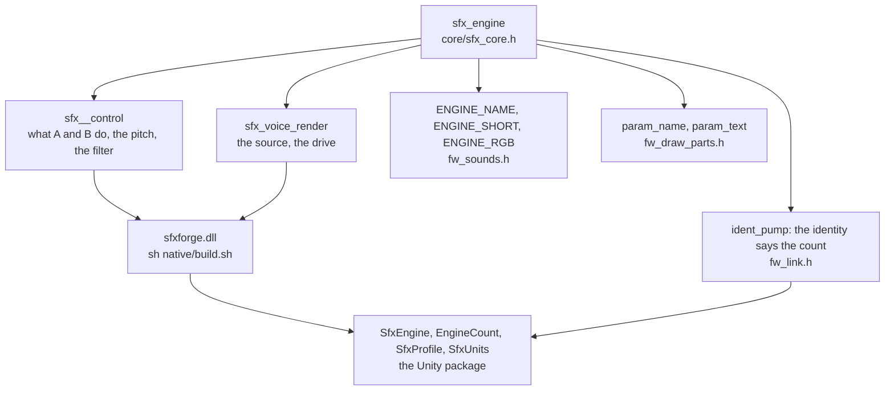

# Firmware Add An Engine

This page is the recipe for a sixth synth engine. It tells you where the engine's sound is made, every place that
names the engines, how to test it, and the traps.

An engine is the source of a voice's signal chain. Read [Sound Engine](Sound-Engine) first: it shows the chain and
what the five engines do with the knobs A and B. Words like carrier, modulator, FM index and control step are in the
[Glossary](Glossary#a-sound).

Before you start, get a clean run of every suite ([Running The Tests](Running-The-Tests#run-everything-in-order)):
then a failure later is yours.

## Know the cost first

- **No format changes.** The engine is one byte of the patch (byte 1), so a patch stays 28 bytes and the patch
  format stays 2.
- **But older devices refuse it.** `sfx_patch_unpack` refuses an engine number it does not know. A firmware up to
  1.7.2 refuses engine 5, so a sound that uses it cannot go to an older firmware.
- **The identity changes by itself.** Byte 14 of the identity's 18 bytes, counted from 0 as the table on
  [Link Protocol](Link-Protocol#ask-first-the-identity) counts them, is `SFX_ENGINE_COUNT` (`ident_pump` in
  `fw_link.h`). It will say 6, and the tests that hold the identity's bytes must follow. That byte is also how a game
  knows whether a device takes the new engine.

## What you will change

| Where | What |
|---|---|
| `core/sfx_core.h` | the entry in `sfx_engine`, its branch in `sfx__control`, its branch in `sfx_voice_render`, the comments that say "five" |
| `sfx-forge/fw_sounds.h` | `ENGINE_NAME`, `ENGINE_SHORT`, `ENGINE_RGB`, a factory sound that uses it |
| `sfx-forge/fw_draw_parts.h` | `param_name`, `param_text`: what A and B are called and how their values read |
| `sfx-forge/fw_draw_sound.h` | the picture of the sound |
| other parts that name `SFX_ENGINE_...` | `fw_pages.h`, `fw_softkeys.h`, `fw_draw.h`, `fw_events.h`, `fw_link.h`, `fw_stage_draw.h`, `fw_stage_input.h` |
| `native/` | nothing to write; rebuild the DLL |
| C#, `Runtime/Core` | `SfxPatch.cs` (`SfxEngine`, `EngineCount`, `EngineNames`, `Label`), `SfxGenerator.cs` (`Recipes`), `SfxProfile.cs` |
| C#, `Editor/UI` | `SfxUnits.cs` (`EngineNames`, `ParamName`), `SfxKit.cs` (`SfxColors.Engines`) |
| tests and documents | the identity's bytes; README, the manual, the cheat sheet |

## Where the engine number is used



## What a branch gets and what it must leave

The engine has two branches: one in the control step (every 16 samples), one in the sample loop (every sample).
Everything around them is shared by all engines and needs no change.

| Branch | It may read | It must leave | Done for you after it |
|---|---|---|---|
| in `sfx__control` | `p[SFX_P_FM_RATIO]` (A) and `p[SFX_P_FM_DEPTH]` (B), 0 to 127; `oct` (the pitch, octaves above 20 Hz), `sweep` (the pitch envelope now), `cut_oct` (the filter), `timbre` (telemetry and the LFO) | `v->idx` and `v->mdt`: 0 when there is no FM, as the three named branches set them. It may add to `oct` or `cut_oct` | `v->dt` (the phase step) from `oct + sweep`, the filter's coefficients, `v->lvl` |
| in `sfx_voice_render` | `v->phase`, 0 to 1, one cycle of the pitch | `x`: this sample of the source, about -1 to 1 | `v->phase` moves on by `v->dt`; noise, filter, drive, bitcrush, loudness |

The smallest engine that follows this, to show the form (a plain sine; `SFX_ENGINE_NEW` is your entry's name; this
sketch was not built):

```c
/* in sfx__control, before the last else */
} else if (eng == SFX_ENGINE_NEW) {
  /* A and B would become numbers here */
  v->idx = 0.0f;
  v->mdt = 0.0f;
} else {

/* in sfx_voice_render, before the last else */
} else if (eng == SFX_ENGINE_NEW) {
  x = SFX_SIN(v->phase); /* SFX_SIN takes turns: 1.0 is a full circle */
} else {
```

If the engine needs memory of its own (as `arp_t` is UI BLIP's and `gr_t` is FOLEY's): add the field to `sfx_voice`
(section 3), set it in `sfx_voice_trigger`, which fills every field of a voice, and work out anything that depends
only on the patch in `sfx_voice_set_patch` (as `v->unison` is). Nothing may allocate. A bigger `sfx_voice` needs no
other change: C# asks the DLL for the sizes (`sfxn_voice_size`, `sfxn_player_size`).

## The steps

1. **Name it.** In `core/sfx_core.h`, section 2, add the entry to `sfx_engine` **before** `SFX_ENGINE_COUNT`.
   Write what its knobs A and B do into the comment over the `SFX_P_*` list. `sfx_patch_init`, `sfx_patch_pack`,
   `sfx_patch_unpack` and `sfx_patch_random` follow `SFX_ENGINE_COUNT` by themselves.
2. **The control step.** In `sfx__control`, add a branch of its own in the chain of `if`s over the engines. This
   is where A and B become numbers the sample loop uses. Look also at the two lines under the chain: the carrier's
   frequency (FOLEY leaves the pitch envelope out of it) and the modulator's step (set for IMPACT and SCI-FI FM
   only).
3. **The sample loop.** In `sfx_voice_render`, add its branch in the chain that makes the source. Look at the
   `drive` line at the top and at the filter's output (FOLEY takes the band-pass, the others the low-pass).
4. **The prose that says "five".** The header of `sfx_core.h`, the comment over `sfx_engine`, and "0..4" in
   section 6.
5. **The firmware.** Run this and read every hit:

   ```sh
   grep -n SFX_ENGINE_ sfx-forge/*.h
   ```

   At the least: a sixth entry in each of `ENGINE_NAME`, `ENGINE_SHORT` and `ENGINE_RGB` in `fw_sounds.h` (the
   arrays have `SFX_ENGINE_COUNT` places, and a place left out is a null name), the names and texts of A and B in
   `fw_draw_parts.h`, and the picture in `fw_draw_sound.h`. Several hits ask "is this a WAVETABLE sound?" (the WAVE page is for a
   wavetable only): decide what each means for your engine.
6. **A factory sound.** Add a row at the end of `PRESETS` in `fw_sounds.h`. The rows after the first 16 are the
   MUSIC kit's named sounds, so you hear it with F1 PRESET while the MUSIC kit is chosen.
7. **The native library.** Run `sh native/build.sh`. You see the DLL's `ls -l` line.
8. **C#.** Nothing here follows the C by itself: the package has its own copy of the list.
   - `Runtime/Core/SfxPatch.cs`: the member of `SfxEngine`, `EngineCount` (6), `EngineNames`, and the names of A and
     B in `Label`.
   - `Runtime/Core/SfxProfile.cs`: `VibeFm1` takes its count from `EngineCount`; add a profile for the firmware
     before, with 5, as `VibeFm15` is one for 1.5.
   - `Runtime/Core/SfxGenerator.cs`: `Recipes`, if a kind of the NEW generator should use the engine.
   - `Editor/UI/SfxUnits.cs`: `EngineNames` and `ParamName`. `Editor/UI/SfxKit.cs`: a sixth colour in
     `SfxColors.Engines`.
9. **Documents.** README, `docs/MANUAL.md` (sections 6, 7 and 20), the cheat sheet (`docs/figures.py`).

## How to test it

| Step | Command | What you see |
|---|---|---|
| the firmware builds and nothing else broke | `sh build.sh` | lines that say `PASSED`; the identity check fails until you update its expected bytes |
| the identity's bytes | in `tests/check-identity.mjs`: the `5` after the `16` in `WANT`, and `05` in the hex string under it | `identity PASSED` |
| the identities in C# | `tests/dotnet/IdentityTests.cs` holds the answers of firmware 1.4.0 and 1.6.0 as bytes, with 5 engines (1.7.2 is made from the second). They stay as they are; give those devices the profile for the firmware before, and add the new firmware's answer | its `ok` lines about the identity |
| the engine through the DLL | `dotnet run -c Release --project tests/dotnet -- .` | the last line is `PASSED` |
| the inspectors | the EditMode tests of `tests/unity-inspectors` | all tests pass |

A new engine has no check of its own until you write one. The nearest models are the bakes in
`tests/dotnet/EngineTests.cs`: they render a patch through the DLL and read the samples. Commands and counts:
[Running The Tests](Running-The-Tests).

Then listen to it. No test hears a timbre.

## The traps

- **The silent fallback.** In both chains, `sfx__control` and `sfx_voice_render`, the last `else` is IMPACT and
  SCI-FI FM. An engine without a branch of its own lands there and becomes an FM engine without a word. The same
  holds for `drive`: an engine not named gets 1.3.
- **C# packs the engine modulo `EngineCount`.** `SfxPatch.Pack` writes `engine % EngineCount` and `TryUnpack`
  refuses a number at or above it. With the enum extended and `EngineCount` still 5, your engine is saved as
  IMPACT and a patch from the device is refused.
- **An old DLL passes tests it should fail.** `tests/dotnet` uses the committed `sfxforge.dll`. After a change in
  `core/`, rebuild it before the .NET run.
- **RANDOM will use it.** `sfx_patch_random` picks any engine below `SFX_ENGINE_COUNT`, with value ranges made for
  the five. Check that random patches of your engine stay audible.
- **The factory kits are compared.** The MUSIC kit's 16 pads hold rows 16 to 31 of `PRESETS` (`factory` in
  `fw_factory.h`). They are part of what SEND gives, and `check-song-export.mjs` compares that byte for byte with
  the Unity demo's song file. A row put before them moves them: add yours at the end, or regenerate the song files.
- **Give it its own knob meanings.** `SFX_P_TABLE` and `SFX_P_SPREAD` are read by WAVETABLE only. A new engine may
  read them, but check that no factory sound has a value there that now changes how it sounds.

## Next

- [Sound Engine](Sound-Engine): the chain your branch plugs into.
- [Patch Format](Patch-Format): why the patch itself does not change.
- [Running The Tests](Running-The-Tests) and [Release Checklist](Release-Checklist).
- [Unity Extending](Unity-Extending): the package's side of a change.

## Reference

- [The maintainer's guide, Add an engine](../docs/MAINTAINING.md#add-an-engine) and
  [Change the identity](../docs/MAINTAINING.md#change-the-identity)
- [core/sfx_core.h](../core/sfx_core.h): `sfx_engine`, `sfx__control`, `sfx_voice_render`
- [fw_sounds.h](../sfx-forge/fw_sounds.h), [fw_draw_parts.h](../sfx-forge/fw_draw_parts.h),
  [fw_draw_sound.h](../sfx-forge/fw_draw_sound.h), [fw_link.h](../sfx-forge/fw_link.h)
- [SfxPatch.cs](../unity/com.catsplat.sfxforge/Runtime/Core/SfxPatch.cs),
  [SfxProfile.cs](../unity/com.catsplat.sfxforge/Runtime/Core/SfxProfile.cs),
  [SfxGenerator.cs](../unity/com.catsplat.sfxforge/Runtime/Core/SfxGenerator.cs),
  [SfxUnits.cs](../unity/com.catsplat.sfxforge/Editor/UI/SfxUnits.cs),
  [SfxKit.cs](../unity/com.catsplat.sfxforge/Editor/UI/SfxKit.cs)
- [tests/check-identity.mjs](../tests/check-identity.mjs),
  [tests/dotnet/IdentityTests.cs](../tests/dotnet/IdentityTests.cs),
  [tests/dotnet/EngineTests.cs](../tests/dotnet/EngineTests.cs)
