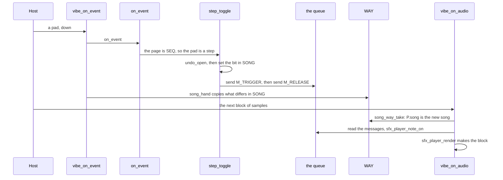
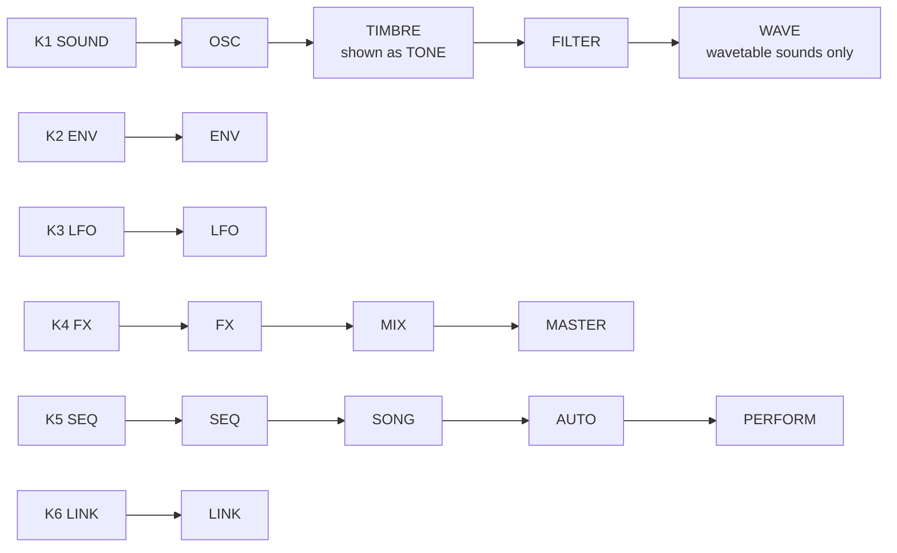
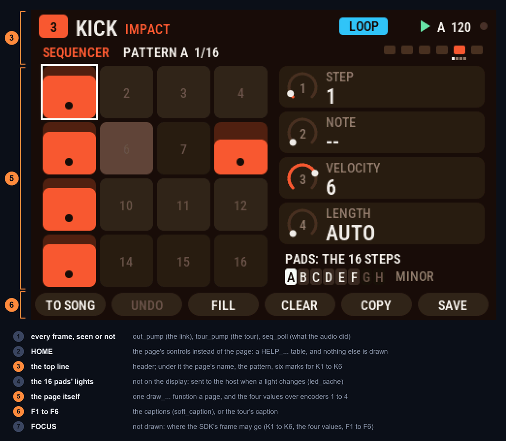
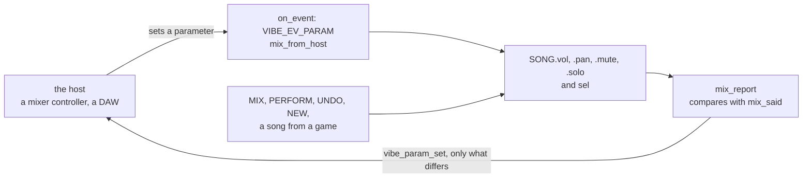

# Firmware Internals

This page shows how the firmware works from the inside: how a key press becomes sound, how a frame of the display
is drawn, and which of the 19 parts holds what. Read [Architecture Overview](Architecture-Overview) first for the
two flows.

The firmware is one compilation unit: the compiler is given the one file `sfx-forge/sfx-forge.c`. It includes 19
parts named `fw_*.h`, once, in a fixed order, plus `song_way.h`. Each part uses what the parts before it define.

The keys this page names (K1 to K6, F1 to F6, HOME, MENU, SHIFT) and the words FOCUS, stage and tour are in the
[Glossary](Glossary#the-device); `P`, `SONG`, `WAY` and the queue are on
[Architecture Overview](Architecture-Overview#the-firmwares-two-flows).

## How a key press travels

Take one press: pad 5 on the SEQ page while the song stands still, REC off and SHIFT not held. It switches step 5
of the selected sound on, and you hear the sound once.

The same in words:

1. The host calls `vibe_on_event` (end of `sfx-forge.c`), which calls `on_event` (`fw_events.h`), then
   `mix_report()` ([the mixer as the host's parameters](#the-mixer-as-the-hosts-parameters), below) and then
   `song_hand()`.
2. `on_event` decides nothing itself. It gives the event to FOCUS first (the SDK's frame for controllers without
   the keys), sends on what waits (`out_pump`), takes in what the audio did (`seq_poll`), and then has one `case`
   for each kind of event: a pad, a note, MIDI, SysEx, a parameter set by the host, an encoder, the stage, a
   button.
3. The pad case asks which page is open. On SEQ it calls `step_toggle` (`fw_sequencer.h`).
4. `step_toggle` calls `undo_open` so that F2 can take the edit back, flips the step's bit in `SONG`, and, because
   the song stands still, calls `send()` twice so you hear the step.
5. `song_hand()` copies the changed pattern into `WAY`. At the start of the next block the audio takes it and reads
   the queue.

To find what any key does, start in `on_event`: it names the function for every pad, key and message.

| Event | Goes to |
|---|---|
| a pad | by page: `step_toggle` (SEQ), `pattern_pick` or `intensity_set` (SONG), `auto_toggle` (AUTO), `perform_pad` (PERFORM), mute or solo (MIX), else `pad` (it plays its sound) |
| a note | notes 36 to 51 from outside are the pads; else a key plays the selected sound at that pitch |
| MIDI | the game's telemetry: CC 10 to 15 on channel 2 |
| SysEx | `sysex_in` (`fw_link.h`) |
| a parameter set by the host | `mix_from_host` (`fw_pages.h`): one of the mixer's goes into the song |
| an encoder | `encoder` (`fw_pages.h`) |
| the stage (the mouse) | `stage_event` (`fw_stage_input.h`) |
| F1 to F6 | by page: `soft_sound`, `soft_seq`, `soft_song`, `soft_auto`, `soft_mix`, `soft_perform` (`fw_softkeys.h`) |
| K1 to K6 | `tab_key` (`fw_pages.h`), which calls `set_page` |

## The pages and the six K keys

A page is what the display shows and what the encoders and F1 to F6 do. Each page hangs on one K key; pressing the
key again goes to its next page.

The order of the `PG_` enum in `fw_state.h` is used by the code: `page < PG_SEQ` is a sound page, and `PG_SEQ` to
`PG_MASTER` are the song's pages. See [Firmware Add A Page Or Key](Firmware-Add-A-Page-Or-Key).

## How a frame is drawn

The host calls `vibe_on_draw`, which calls `on_draw` (`fw_draw.h`), then `mix_report()` and then `song_hand()`.
`on_draw` has seven numbered parts.

| Part | What it does |
|---|---|
| 1 | what must go on whether or not anything is seen: `out_pump` (the link), `tour_pump` (the tour), `seq_poll` (the sequencer) |
| 2 | HOME: the page's controls instead of the page, from a `HELP_...` table. Nothing else is drawn |
| 3 | the top line (`header`), and under it the page's name, the pattern and six marks for K1 to K6 |
| 4 | the 16 pads' lights. A light is sent to the host only when it changes (`led_cache`) |
| 5 | the page itself: one function for each page (`scene`, `draw_seq`, `draw_song`, `draw_auto`, `draw_mix`, `draw_master`, `draw_link`, `draw_perform`) and the four values over encoders 1 to 4 |
| 6 | F1 to F6, or the tour's caption |
| 7 | FOCUS: where the SDK's frame may go |

`on_draw` is also the control flow's clock: part 1 runs every frame. But the firmware must play when the host does
not draw (the plugin with its window closed), so nothing the audio needs may hang on `on_draw`.

The display is 480 x 320 pixels. The stage, 960 x 540, is the whole instrument for the mouse: `on_stage`
(`fw_stage_draw.h`) draws it and `stage_event` (`fw_stage_input.h`) handles clicks at the same numbers.

## The parts

In include order. That order is also the order of the code in the built `.wasm`.

| Part | What it holds |
|---|---|
| `fw_protocol.h` | the numbers of the link: SysEx messages, the identity, CCs, notes |
| `fw_sounds.h` | the 71 parameters the host has (`PARAMS`: six of the device's own, then the mixer's 65); the 39 named sounds (`PRESETS`); the engines' names and colours |
| `fw_state.h` | every variable the parts share, and the smallest helpers |
| `fw_audio.h` | what looks at a value from the host (`is_number`, `number_in`, `param_in`), the queue from the controls to the audio (`send`), and `vibe_on_audio` |
| `fw_edit.h` | `say` (a word on the display), `changed`, the undo, `confirm` (keys that ask twice) |
| `fw_factory.h` | the sounds and the song a new device holds (`factory`, `demo_song`), and `step_set` |
| `fw_store.h` | what is kept on the device: `bank_save`, `bank_load` |
| `fw_link.h` | SysEx out and in: `out_pump`, `sysex_in`, `song_piece` |
| `fw_sequencer.h` | playing and recording, LOOP and SONG, patterns, steps, automation lanes |
| `fw_pages.h` | `set_page`, `tab_key`, `arrow`, the mixer as the host's parameters (`mix_report`, `mix_from_host`), and what the encoders turn on each page (`encoder`) |
| `fw_softkeys.h` | F1 to F6 on every page |
| `fw_tour.h` | the tour (MENU): its script and what runs it |
| `fw_stage_input.h` | the stage's layout and what the mouse does on it |
| `fw_events.h` | `vibe_on_init`, the HOME texts, `factory_reset`, `on_event` |
| `fw_draw_parts.h` | the colours, a value as text, and the pieces a page is drawn from (`dial`, `hud`, `row`) |
| `fw_draw_sound.h` | the picture of the selected sound |
| `fw_draw_pages.h` | the top line and the pages SEQ, SONG, AUTO, MIX, MASTER, LINK, PERFORM |
| `fw_draw.h` | `on_draw`: a whole frame of the display, the pads' lights, FOCUS |
| `fw_stage_draw.h` | `on_stage`: a whole frame of the stage |
| `song_way.h` | the song from the control flow to the audio flow. It stands alone, so a test can set two threads on it |

## The mixer as the host's parameters

From firmware 1.7.1 the firmware reports its mixer to the host, as the VIBE FM SDK's mixer convention asks of a
firmware with tracks (SDK 11; `CONTROLLERS.md` in the SDK, section 2). A mixer controller and a DAW are then the
host's business: the firmware has no controller code.

`PARAMS` in `fw_sounds.h` declares 71 parameters. The first six are those of before, in their order: `volume`,
`mod_pitch`, `mod_cutoff`, `mod_fm`, `mod_level`, `intensity`. The mixer's 65 follow from `P_MIX`.

| Parameter | Index | Range | The value behind it |
|---|---|---|---|
| `mix_<n>_level` | `P_MIX + 4 * (n - 1) + MIX_LEVEL` | 0 to 1 | `SONG.vol`, 0 to 127: the level is `vol / 127` |
| `mix_<n>_pan` | `... + MIX_PAN` | -1 to +1 | `SONG.pan`, 0 to 127 with 64 the middle: `(pan - 64) / 64` below it, `(pan - 64) / 63` above |
| `mix_<n>_mute` | `... + MIX_MUTE` | 0 or 1, `steps` 2 | bit n - 1 of `SONG.mute` |
| `mix_<n>_solo` | `... + MIX_SOLO` | 0 or 1, `steps` 2 | bit n - 1 of `SONG.solo` |
| `mix_select` | `P_MIX_SELECT` | 1 to 16, `steps` 16 | `sel + 1` |

n is 1 to 16. The groups (`GROUPS`) are `MIX 1` to `MIX 16`, and `MIX` for `mix_select`. Nothing new is stored: the
values are the song's and `sel`, as the MIX page shows them. Two functions in `fw_pages.h` do the work, both in the
control flow.

- **`mix_report`** compares each of the 65 values with what the host was told last (`mix_said`) and calls
  `vibe_param_set` for those that differ. It runs after every event and every draw (`vibe_on_event` and
  `vibe_on_draw` in `sfx-forge.c`) and in `vibe_on_init`, which clears `mix_known` first, so every init tells all
  65. It does not ask what changed the song, so a new way to change the mix needs no code here. The SDK's text
  says "compare once per audio block". It is done in the control flow instead: the song as the controls have it is
  not the audio's to read, and `vibe_param_set` would get a second writer. Every change comes through an event or a
  draw, so nothing is missed. The comment over `mix_report` says the same.
- **`mix_from_host`** is called from the `VIBE_EV_PARAM` case of `on_event`. It rounds the value to the song's whole
  number, writes it into `SONG` or `sel`, and notes it in `mix_said`, so `mix_report` does not say it back to the
  host. It makes no undo step, as the MIX page's own faders and mutes make none. `song_hand()` then takes the song
  to the audio as after any edit. The six parameters that are not the mixer's need nothing here: the audio reads
  them every block.
- **What is not taken.** A value that is no number (the bits of NaN or infinity: the SDK's clamp lets one through)
  and, while the tour runs, `mix_select`. `mix_from_host` notes both as not said, so `mix_report` tells the host the
  real value. The tour's own selections are not reported: `mix_report` skips `mix_select` while `tour_on`. When the
  tour is over the host is told the sound that is selected then.

The tour changes only the sound it selected itself (`T_PARAM` and `T_MUTATE` in `fw_tour.h` go back to `tour_kept`),
and puts it back. Before 1.7.1 it changed whichever sound was selected, and did not put that one back, if DATA had
selected another while it ran. The host is now a second way to select, so this was fixed with 1.7.1.

Four limits:

- **`mix_select` is `sel`**, the selected pad's number in whichever kit is chosen. Levels, pans, mutes and solos are
  always the song's sounds (the MUSIC kit). The MIX page works the same way.
- **A pad played, or a note 36 to 51 from outside, selects that sound**, so `mix_select` is told to the host with it.
- **A value from the host between two steps is rounded and not said back.** The host and the device can then differ
  by up to half a step of 127.
- **In the plugin's Editor view** the mixer is 17 more groups, and mute and solo are plain two-step values. Nobody
  has seen this on a screen.

Three things to keep:

- **The ids are the convention's.** They must stay as they are. The six old parameters stay first and in their
  order.
- **There is no `mix_<n>_arm`**, though the convention has one: REC is one key for the whole song.
- **An automation lane does not write `SONG.vol` or `SONG.pan`**: the player applies it. So a fader that a lane
  moves is not reported.

`mix_said` and `mix_known` (the host was told at all) are not in `fw_state.h`: they stand beside `mix_report`, which
alone uses them with `mix_from_host`.

`tests/check-mixer.mjs` checks this on `tests/host.mjs`, the tour and what is not taken included, but not the last
of the three points and not the four limits. No controller,
plugin or DAW was tried: [What Is Tested](What-Is-Tested#the-newest-features).

## What the host hands over

From firmware 1.7.2 the rule is: **a value from the host is looked at before it is used.** A host may hand over a
value that is no number (NaN) or an infinity. In the sound such a value stays until a restart, and as a song position
it reads past the song.

| What comes in | Where it is looked at | What is done |
|---|---|---|
| a host parameter (`volume`, the four `mod_...`, `intensity`) | `param_in` (`fw_audio.h`), for the audio and for the controls | kept within its range; one that is no number gives the parameter's start value |
| the host's tempo and song position | `vibe_on_audio`, part 3 (`int host = ...`) | followed only when both are numbers, the tempo is above 0 and at most 2000, and the position is within a thousand million beats. Else the player's own clock runs |
| a velocity | `send` (`fw_audio.h`) | kept within 0 to 1; one that is no number is 0.8 |
| the value of any event but a parameter or a SysEx | the top of `on_event` (`tamed`) | no number is 0; none is beyond a million; an encoder's turn is at most 100 detents. `encoder` (`fw_pages.h`) holds the turn to 100 again |
| a SysEx event's length | the `VIBE_EV_SYSEX` case of `on_event` | taken only from 2 to 4096 bytes, the SDK's buffer |
| one of the mixer's parameters | `mix_from_host` | [not taken](#the-mixer-as-the-hosts-parameters) when it is no number |

Three things to keep:

- **Read a host parameter with `param_in(i)`, not with `vibe_param_get`.** The SDK's own clamp lets NaN through.
  `param_in` is the one place that calls `vibe_param_get`.
- **`is_number` looks at the bits.** The SDK's build uses fast maths, which lets the compiler drop a test such as
  `v != v`.
- **The output is clamped to -1 to +1 on every frame**, at the end of `vibe_on_audio`. The limit before it rounds a
  hair over 1 for some inputs, also with a correct host.

What found this, and what is known and not fixed: [What Is Tested](What-Is-Tested#hard-and-wrong-use).

## The state groups

All shared state is in `fw_state.h`, in six groups.

| Group | Examples | Written by |
|---|---|---|
| 1. the audio flow's own | `P` (the player), `seq_pos`, `play_k`, the scope, the click | the audio (but `metro`, `rec_on`, `beat_len`: the controls) |
| 2. the song as the controls have it | `SONG`, `WAY` | the controls |
| 3. the pages | the `PG_` enum, `TAB_OF`, `PAGE_PARAMS` | constants |
| 4. the two kits | `kits`, `kit`, the macro `patches` | the controls |
| 5. the control flow's own | `sel`, `page`, `shift`, `rec`, the undo, the tour, the link's transfers, `perf_mode` | the controls |
| 6. F1 to F6 | `SOFT`, `soft_caption`, `relabel` | constants and helpers |

Two traps:

- **`patches` is a macro for `kits[kit]`**: the kit that is chosen. So are `pad_preset` and `sound_undo`. Code that
  must reach the other kit sets `kit` first and puts it back, as `factory_reset` and `sysex_in` do.
- **The order of the definitions is the order of the data in the `.wasm`.** A new variable goes at the end of its
  group.

## Next

- [Firmware Add A Page Or Key](Firmware-Add-A-Page-Or-Key), [Firmware Add An Engine](Firmware-Add-An-Engine),
  [Firmware Add A Setting](Firmware-Add-A-Setting): the three recipes.
- [Link Protocol](Link-Protocol): what `sysex_in` and `out_pump` speak.
- [Running The Tests](Running-The-Tests): how to check a change.

## Reference

- [sfx-forge.c](../sfx-forge/sfx-forge.c): the header comment (the map of the parts) and the three entry points
- [fw_events.h](../sfx-forge/fw_events.h) (`on_event`), [fw_draw.h](../sfx-forge/fw_draw.h) (`on_draw`),
  [fw_state.h](../sfx-forge/fw_state.h), [fw_audio.h](../sfx-forge/fw_audio.h),
  [fw_sequencer.h](../sfx-forge/fw_sequencer.h), [fw_pages.h](../sfx-forge/fw_pages.h),
  [fw_sounds.h](../sfx-forge/fw_sounds.h) (`PARAMS`), [tests/check-mixer.mjs](../tests/check-mixer.mjs)
- [The maintainer's guide, 3. Reading order](../docs/MAINTAINING.md#3-reading-order) and
  [4. The two flows](../docs/MAINTAINING.md#4-the-two-flows)
- [The manual, 20. Every control, page by page](../docs/MANUAL.md#20-every-control-page-by-page)
- The picture is made by [wiki/figures/in_shots.mjs](../wiki/figures/in_shots.mjs) and
  [wiki/figures/in_figures.py](../wiki/figures/in_figures.py) from
  [a screenshot of the SEQ page](img/in-shot-seq.png)
