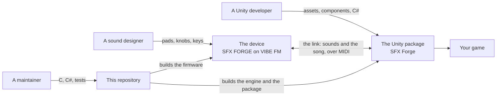
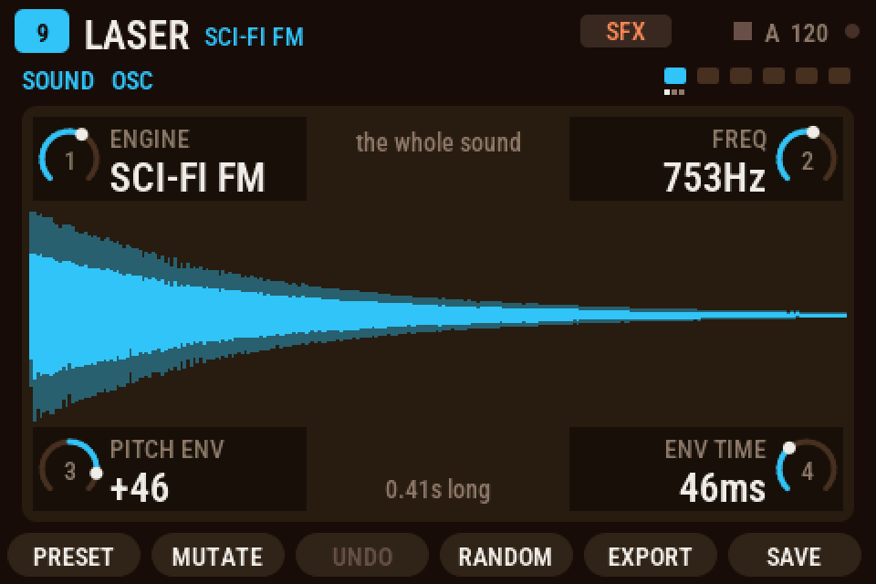

# SFX FORGE

SFX FORGE is an instrument for a game's sound: you make sound effects and adaptive music on a device, the VIBE FM,
and both play in the game with the same engine. Everything is synthesized. There are no samples and no audio
files. In Unity a package plays the sounds and the song, and has tools for designing sounds without the device.

This wiki teaches one thing a page. Every page ends with links to the full detail in the reference documents:
[the manual](../docs/MANUAL.md), [the Unity manual](../docs/UNITY.md) and
[the maintainer's guide](../docs/MAINTAINING.md).

The device and the package run the same sound engine, so a sound is the same in both places. The link between
them carries data (a sound is 28 bytes), never audio. You can use either side without the other.

New here? [Start Here](Start-Here) has a reading list for each of the three doors below.

## Door 1: I want to make sounds and music on the device

*The device's display on its first sound page: the LASER of the SFX kit.*

You need a browser and the firmware file. No hardware.

1. [Device Quick Start](Device-Quick-Start): load it and hear it, in five minutes.
2. [Device Controls And Pages](Device-Controls-And-Pages): what each control is and where the fourteen pages are.
3. [Device Make A Sound](Device-Make-A-Sound): a sound effect of your own.
4. [Device Make A Beat](Device-Make-A-Beat): a pattern from nothing.
5. [Device Layers And Intensity](Device-Layers-And-Intensity): music that follows the game.
6. [Device Cheat Sheet](Device-Cheat-Sheet): every shortcut, to look things up.

Done? [Hand it to the programmer](Device-Saving-And-Reset#hand-it-to-the-programmer): two keys send the song and a
sound to the game.

## Door 2: I want sound and adaptive music in my Unity game

*The showcase,* Brio: First Harmonic*: a small game whose every sound is SFX FORGE at runtime.*

You need Unity 6.3 on Windows x64. No device.

1. [Unity Install](Unity-Install): get the package into a project.
2. [Unity Quick Start](Unity-Quick-Start): a sound you trigger yourself, in five minutes.
3. [Unity Choosing A Route](Unity-Choosing-A-Route): baked, live, held or music: which fits your sound.
4. [Unity Music First Song](Unity-Music-First-Song): the demo song in your scene, no code.
5. [Unity Adaptive Music](Unity-Adaptive-Music): one number from your game drives the band.
6. [Unity Recipes](Unity-Recipes): thirteen small scripts to copy.

Footsteps, a pickup and music that follows danger in one evening:
[Start Here](Start-Here#path-2-unity) has that short path. Stuck? [Unity Troubleshooting](Unity-Troubleshooting).

## Door 3: I want to understand or change the code

1. [Architecture Overview](Architecture-Overview): one engine, two homes, and the link.
2. [Repository Map](Repository-Map): what each folder is.
3. [Building From Source](Building-From-Source): from a clone to a built firmware and package.
4. [Running The Tests](Running-The-Tests): every suite and what a pass looks like.
5. [Firmware Internals](Firmware-Internals) and [Unity Architecture](Unity-Architecture): how each side works.
6. [Sound Engine](Sound-Engine), [Patch Format](Patch-Format), [Song Format](Song-Format),
   [Link Protocol](Link-Protocol): the engine and the exact bytes.

Then the recipes, by what you add: [a page or a key](Firmware-Add-A-Page-Or-Key),
[an engine](Firmware-Add-An-Engine), [a setting](Firmware-Add-A-Setting),
[a Unity component, a generator kind, a link message or a test](Unity-Extending),
[another platform](Unity-Porting-The-Native-Library).

## Watch first

Five videos, made by scripts from the firmware and the game themselves: [Videos](Videos). The shortest way in is
[the tour of the device](../videos/sfx-forge-tour.mp4) (2:23).

## Status

Tested by scripts and against the SDK's emulator; not yet run on the hardware or in the VIBE FM plugin, and the
Unity package runs on Windows x64 only: [What Is Tested](What-Is-Tested) says exactly how far.

## More

- [Glossary](Glossary): every word this wiki uses.
- [FAQ](FAQ): short answers to first questions.
- [Editing This Wiki](Editing-This-Wiki): how these pages are written, checked and published.
