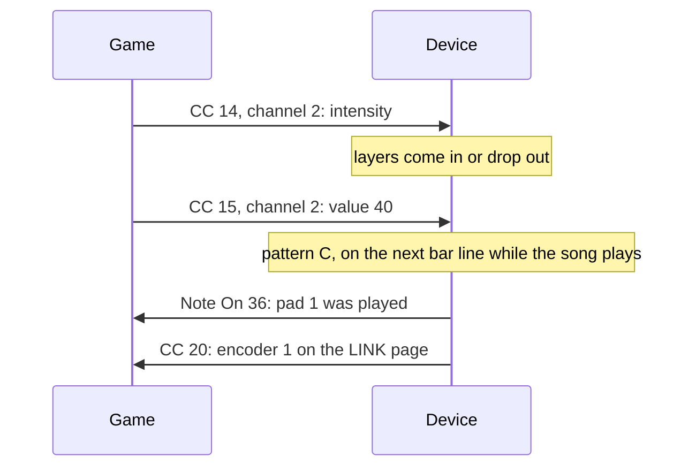
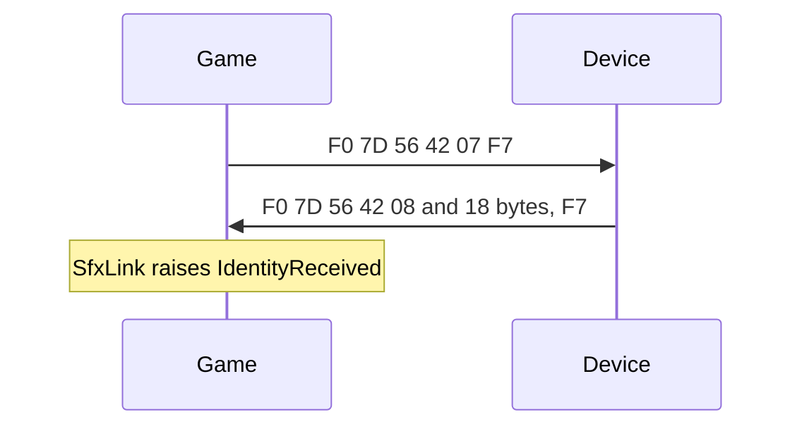
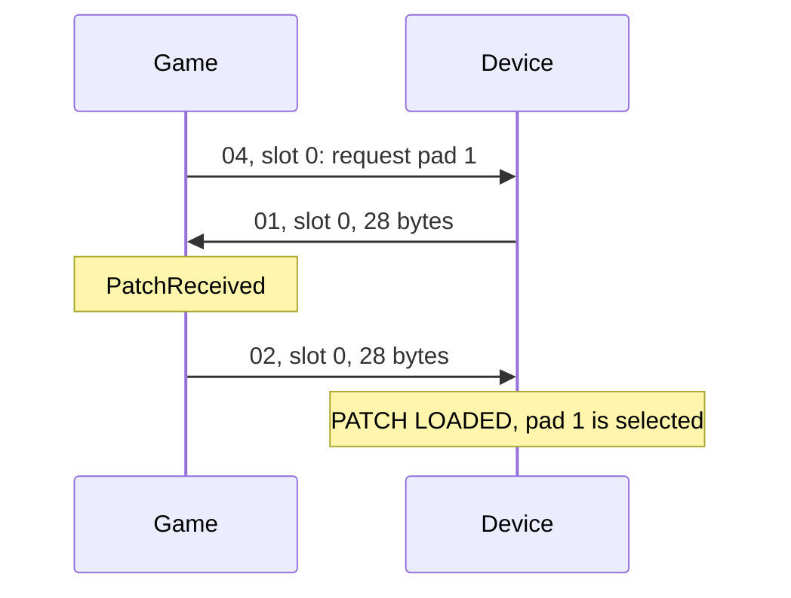
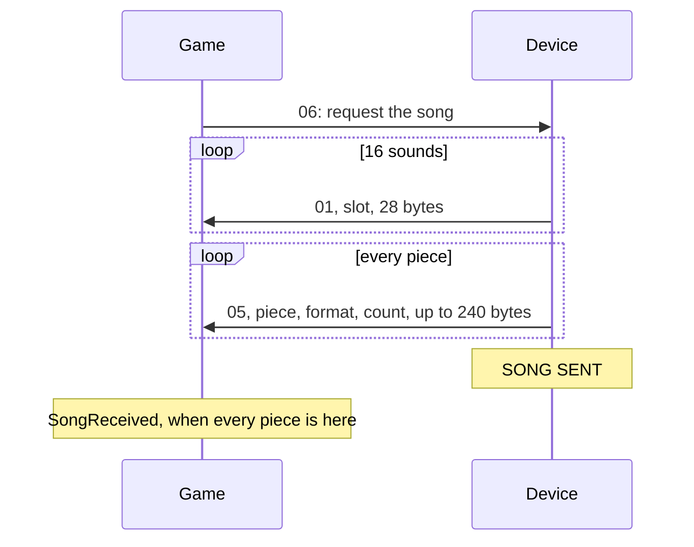

# Link Protocol

This page lists every message between the device and a game: the notes, the controllers and the eight SysEx
messages, with who sends what and when. Use it when you write the other end of the link, or change one of the two
ends that exist.

The link is plain MIDI, so it works over USB, the plugin's MIDI ports and Web MIDI. It carries data, never audio.
Both sides hold their own copy of the numbers: `sfx-forge/fw_protocol.h` in C and
`Runtime/Core/SfxProtocol.cs` in C#. **A number changed in one must change in the other.**

## Notes and controllers

| Direction | Message | Meaning |
|---|---|---|
| device to game | Note On / Off, channel 1, notes 36 to 51 | a pad was played (pad 1 = note 36) on a sound page, MASTER or LINK. On SEQ, SONG, AUTO, PERFORM and MIX the pads have other jobs and send no note |
| device to game | CC 20 to 25, channel 1 | encoders 1 to 4, A and B on the LINK page |
| game to device | Note On / Off, notes 36 to 51 | play a pad |
| game to device | CC 10, channel 2 | telemetry: pitch, 0 to +24 semitones |
| game to device | CC 11, channel 2 | telemetry: cutoff, 64 = none, 16 steps an octave, at most 4 octaves either way |
| game to device | CC 12, channel 2 | telemetry: timbre (FM index, wavetable position), 0 to 1 |
| game to device | CC 13, channel 2 | telemetry: level, 0 to 1 |
| game to device | CC 14, channel 2 | music: intensity, 0 to 1 (layers come in) |
| game to device | CC 15, channel 2 | music: cue a pattern, A to H = value / 16. A value that repeats is one cue |
| game to device | CC 16, 17, channel 2 | kept, do nothing yet; the link's light comes on |

Channel 2 control changes have the status byte `B1` (`SfxProtocol.TelemetryStatus`).



## The SysEx messages

Every message is `F0 7D 56 42 <message> ... F7`. `7D` is the ID for private use, `56 42` is "VB". Every byte between
`F0` and `F7` is 0 to 127.

| # | C name | C# name | Direction | Bytes after `F0 7D 56 42` | Meaning |
|---|---|---|---|---|---|
| `01` | `SX_DUMP` | `Dump` | device to game | `01 <slot> <28 patch bytes> F7` | one patch: EXPORT on the device, or the answer to `04`. Coming in, it is taken as a LOAD |
| `02` | `SX_LOAD` | `Load` | game to device | `02 <slot> <28 patch bytes> F7` | load a patch. Slot 0 to 15: that pad of the selected kit. Slot 16 to 31: pad 1 to 16 of the MUSIC kit, whatever is selected |
| `03` | `SX_TEXT` | `Text` | game to device | `03 <ASCII, up to 24> F7` | a text for the device to show |
| `04` | `SX_REQUEST` | `Request` | game to device | `04 <slot> F7` | ask for a dump of a pad |
| `05` | `SX_SONG` | `SongChunk` | both ways | `05 <piece lo> <piece hi> <format> <pieces lo> <pieces hi> <1 to 240 bytes> F7` | one piece of a packed song |
| `06` | `SX_REQ_SONG` | `RequestSong` | game to device | `06 F7` | ask for the 16 sounds and the song, as SEND gives them |
| `07` | `SX_REQ_IDENT` | `RequestIdentity` | game to device | `07 F7` | ask what the device is. Exactly these 6 bytes in all |
| `08` | `SX_IDENT` | `Identity` | device to game | `08 <18 bytes> F7` | the identity. A device that receives one ignores it |

The text of `03` is shown on the LINK page only, in the small line under `LINKED` (`draw_link` in
`fw_draw_pages.h`). A message the firmware does not know is ignored without a word. The patch bytes are on
[Patch Format](Patch-Format), the song bytes on [Song Format](Song-Format).

## Ask first: the identity

A game asks what a device is before it sends anything. A firmware before 1.4.0 never answers.



| Byte | What | Today |
|---|---|---|
| 0 | hardware: 0 unknown, 1 VIBE FM | 1 |
| 1, 2, 3 | firmware version: major, minor, patch | 1, 7, 0 |
| 4 | profile | 1 |
| 5 | patch format | 2 |
| 6 | song format | 6 |
| 7, 8 | sounds in a kit, kits | 16, 2 |
| 9, 10 | patterns, the most steps a pattern holds | 8, 64 |
| 11, 12 | automation lanes, bars in an arrangement | 24, 32 |
| 13, 14, 15 | voices, engines, wavetables | 16, 5, 6 |
| 16 | values in a patch | 25 |
| 17 | flags: bit 0 pads, bit 1 encoders for the game, bit 2 takes a song's sounds, bit 3 takes telemetry | 15 |

The whole answer today: `F0 7D 56 42 08 01 01 07 00 01 02 06 10 02 08 40 18 20 10 05 06 19 0F F7`. Fields are only
ever added at the end: a reader takes the first 18 bytes and ignores what follows.

## A patch



A patch that does not unpack shows `BAD PATCH`. A LOAD to slot 16 to 31 shows `SOUND LOADED` and leaves the
selected kit and pad alone.

## A song, in pieces

A song is the 16 sounds of the MUSIC kit, then the packed song cut into pieces of 240 bytes (the last piece holds
what is left). The piece number and the count of pieces are 14 bits each, low 7 bits first. Every piece names the
song's format. The factory song, 2487 bytes, is 11 pieces: 27 messages with its sounds.



The other way, `SfxLink.SendSong` sends 16 LOAD messages with slots 16 to 31, then the pieces. The device says
`SONG LOADED` when all pieces are there. The receiver's rules, the same on both sides (`song_piece` in `fw_link.h`,
`SfxSongTransfer.cs`):

- Pieces may come **in any order** and **more than once**. A piece that is here already, byte for byte, is left
  alone.
- A transfer that stops for two seconds is forgotten.
- A second whole song sent straight after the first is taken when any of its pieces differs. The same song again
  loads nothing.
- A piece of a higher format is not collected: the device says `NEWER SONG: UPDATE`.
- **The older shape**, `05 <piece> 39 <200 bytes, the last 99> F7`, carries a format-5 song of 7699 bytes in 39
  pieces. Firmware 1.6.0 and later still take it and no longer send it. A firmware up to 1.5.0 knows only this
  shape, so the Unity package refuses in words before it sends a newer song to one (`SfxLink.Refusal`).

## Three rules of the wire

| Rule | Why | Where in the code |
|---|---|---|
| **One SysEx a block.** Nothing is sent where it is asked for: it is noted and sent later, in a fixed order | the host refuses a second SysEx in the same block | `out_pump`: the identity (`ident_due`), then the sounds and the song (`export_at`), then dumps that were asked for (`dump_due`) |
| **Expect your own messages back** | a virtual MIDI cable's port is an input as well as an output | `sysex_in` drops a dump that is byte for byte what just went out; `song_piece` does the same for a piece |
| **Expect everything twice** | the emulator delivers every message twice | a message must be harmless when doubled; the piece counting above |

## On the Unity side

`SfxProtocol` builds and reads messages (`BuildLoad`, `BuildRequest`, `BuildText`, `BuildRequestSong`,
`BuildSongPieces`, `BuildRequestIdentity`, `TryParsePatch`, `TryParseIdentity`). `SfxLink` sends them and raises
events from `Poll()`.

```csharp
using CatSplat.SfxForge;
using UnityEngine;

public class AskTheDevice : MonoBehaviour
{
    void OnEnable() => SfxLink.Shared.IdentityReceived += OnIdentity;

    void OnDisable() => SfxLink.Shared.IdentityReceived -= OnIdentity;

    // false while no MIDI output is open (SfxLink.Open asks by itself when it opens the ports)
    void Start() => SfxLink.Shared.RequestIdentity();

    // the events fire from Poll, on this thread
    void Update() => SfxLink.Shared.Poll();

    void OnIdentity(SfxDeviceInfo device) => Debug.Log(device);
}
```

How to open the ports: [Unity Device Link Setup](Unity-Device-Link-Setup).

## Next

- [Unity Send And Receive](Unity-Send-And-Receive): the link from a game's code.
- [Patch Format](Patch-Format) and [Song Format](Song-Format): the bytes inside the messages.
- [Firmware Internals](Firmware-Internals): where `sysex_in` sits in the firmware.
- [What Is Tested](What-Is-Tested): what crossed a real MIDI port and what did not.

## Reference

- [fw_protocol.h](../sfx-forge/fw_protocol.h): the numbers. [fw_link.h](../sfx-forge/fw_link.h): `sysex_in`,
  `out_pump`, `export_pump`, `ident_pump`, `dump_pump`, `song_piece`
- [fw_events.h](../sfx-forge/fw_events.h): the `VIBE_EV_MIDI` case of `on_event` reads the controllers
- [SfxProtocol.cs](../unity/com.catsplat.sfxforge/Runtime/Core/SfxProtocol.cs),
  [SfxLink.cs](../unity/com.catsplat.sfxforge/Runtime/Core/SfxLink.cs),
  [SfxSongTransfer.cs](../unity/com.catsplat.sfxforge/Runtime/Core/SfxSongTransfer.cs)
- [README, The link](../README.md#the-link-device--game-engine) and
  [The identity](../README.md#the-identity-and-what-is-reserved-for-later)
- [The Unity manual, 6. From the device to the game](../docs/UNITY.md#6-from-the-device-to-the-game)
- [The maintainer's guide, Add a SysEx message](../docs/MAINTAINING.md#add-a-sysex-message) and
  [Change the identity](../docs/MAINTAINING.md#change-the-identity)
