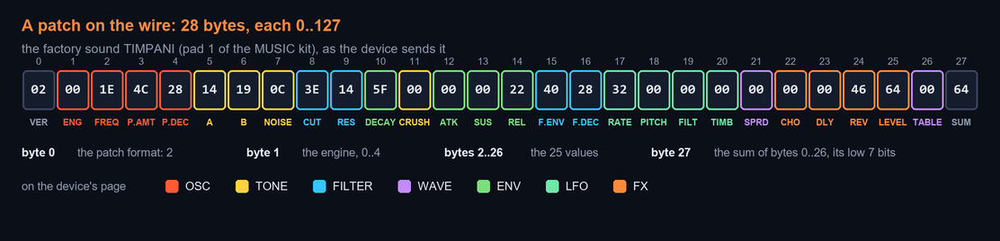

# Patch Format

This page gives you the exact bytes of a patch (one sound): what each of the 28 bytes is, what a reader must
refuse, and where patches travel. The current patch format is **2**.

## The 28 bytes



Every byte is 0 to 127, so a patch goes through MIDI SysEx as it is.

| Byte | What | Must be |
|---|---|---|
| 0 | the patch format (`SFX_PATCH_VERSION`) | 2 |
| 1 | the engine (`sfx_engine`) | 0 to 4 |
| 2 to 26 | the 25 values, in the order of the `SFX_P_*` list | each 0 to 127 |
| 27 | the checksum: the sum of bytes 0 to 26, its low 7 bits | equal to that sum `& 0x7F` |

The 25 values in wire order, with the short names the picture uses:

| Bytes | Values |
|---|---|
| 2, 3, 4 | base frequency (FREQ), pitch envelope amount (P.AMT), pitch envelope time (P.DEC) |
| 5, 6, 7 | A, B, noise mix (NOISE) |
| 8, 9 | filter cutoff (CUT), resonance (RES) |
| 10, 11 | amp decay (DECAY), bitcrush (CRUSH) |
| 12, 13, 14 | attack (ATK), sustain (SUS), release (REL) |
| 15, 16 | filter envelope amount (F.ENV), filter envelope time (F.DEC) |
| 17, 18, 19, 20 | LFO rate (RATE), LFO to pitch (PITCH), to filter (FILT), to timbre (TIMB) |
| 21 | spread (SPRD) |
| 22, 23, 24 | chorus (CHO), delay (DLY), reverb (REV) sends |
| 25, 26 | level (LEVEL), table (TABLE) |

What each value does: [Sound Engine](Sound-Engine#the-25-values).

## A worked example

The picture shows the factory sound TIMPANI, pad 1 of the MUSIC kit. These are the first 28 bytes of
`unity/Demo/Assets/SfxDemo/DemoSong.bytes`:

```text
02 00 1E 4C 28 14 19 0C 3E 14 5F 00 00 00 22 40 28 32 00 00 00 00 00 00 46 64 00 64
```

| Bytes | Hex | Read as |
|---|---|---|
| 0 | `02` | patch format 2 |
| 1 | `00` | engine 0: IMPACT |
| 2 | `1E` | base frequency 30 |
| 3 | `4C` | pitch envelope 76: above 64, so the pitch starts high and falls |
| 13 | `00` | sustain 0: a one-shot |
| 15 | `40` | filter envelope 64: none |
| 24 | `46` | reverb send 70 |
| 25 | `64` | level 100: as designed |
| 27 | `64` | the checksum: bytes 0 to 26 add up to 740, and `740 & 0x7F` is 100 (hex `64`) |

## Writing and reading

| | C (`core/sfx_core.h`) | C# (`Runtime/Core/SfxPatch.cs`) |
|---|---|---|
| write | `sfx_patch_pack(&patch, out)` | `patch.Pack()` or `patch.Pack(dst, offset)` |
| read | `sfx_patch_unpack(&patch, in)` returns 0, or -1 | `SfxPatch.TryUnpack(src, offset, out patch)` returns true, or false |
| checksum | `sfx_patch_checksum(b)` | `SfxPatch.Checksum(b, offset)` |

Packing brings values into range: the engine is taken modulo the count of engines, and each value keeps its low
7 bits.

```csharp
using CatSplat.SfxForge;

public static class PatchRoundTrip
{
    public static bool Run()
    {
        SfxPatch patch = SfxPatch.Create(SfxEngine.Impact);
        byte[] bytes = patch.Pack(); // 28 bytes
        return SfxPatch.TryUnpack(bytes, 0, out SfxPatch back) && back.Equals(patch);
    }
}
```

## What a reader refuses

`sfx_patch_unpack` returns -1 and leaves the patch untouched when any of these is true:

- byte 0 is not 2 (another format: older, or newer);
- byte 1 is 5 or more (an engine this version does not have);
- any byte is above 127;
- byte 27 is not the checksum of the 27 bytes before it.

The C# reader refuses the same, and also an array that is too short.

On the device, a patch message of the right length that does not unpack shows `BAD PATCH`. A patch message of
another length is ignored without a word. A higher format number is newer, not broken: in Unity the link raises
`NewerReceived` for it.

## Where a patch travels

| Place | Form |
|---|---|
| SysEx DUMP `01` and LOAD `02` | `F0 7D 56 42 <01 or 02> <slot> <28 bytes> F7`: 35 bytes ([Link Protocol](Link-Protocol)) |
| the device's store, `kits.bin` | 32 patches of 28 bytes (MUSIC's 16, then SFX's), then 32 bytes that say which named sound each pad holds |
| a song file such as `DemoSong.bytes` | 16 patches of 28 bytes, then the packed song ([Song Format](Song-Format)) |
| text | `SFXF1:` and the 28 bytes as 56 hex digits (`SfxPatchText` in the Unity package) |

## Why the format is hard to change

A patch has no spare byte. A 26th value would make a patch 29 bytes: patch format 3, every patch message one byte
longer, another size of `kits.bin`. It would also move the automation targets, which are counted from the number of
values and stored in every packed song, so it needs a new song format too. The cheaper way, when it fits, is to give
an existing value a meaning in an engine that ignores it today. The full list of places is in
[the maintainer's guide](../docs/MAINTAINING.md#add-a-parameter-to-a-sound).

## Next

- [Song Format](Song-Format): the bytes of a song.
- [Link Protocol](Link-Protocol): the messages that carry patches.
- [Sound Engine](Sound-Engine): what the values do to the sound.
- [Unity Presets And Patches](Unity-Presets-And-Patches): patches in a Unity project.

## Reference

- [core/sfx_core.h](../core/sfx_core.h), sections 2 and 6: the `SFX_P_*` list, `sfx_patch_pack`,
  `sfx_patch_unpack`
- [SfxPatch.cs](../unity/com.catsplat.sfxforge/Runtime/Core/SfxPatch.cs),
  [SfxPatchText.cs](../unity/com.catsplat.sfxforge/Runtime/Core/SfxPatchText.cs)
- [fw_store.h](../sfx-forge/fw_store.h): `kits.bin`
- [README, The link](../README.md#the-link-device--game-engine): "Patch bytes"
- [The maintainer's guide, Add a parameter to a sound](../docs/MAINTAINING.md#add-a-parameter-to-a-sound)
- The picture is drawn by [wiki/figures/in_figures.py](../wiki/figures/in_figures.py)
