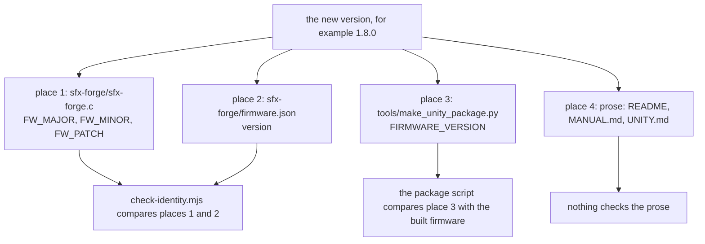

# Release Checklist

This page is the list to walk through when you give the firmware a new version number, and when you regenerate the
Unity package repository. Each step says what to change or run and what you must see.

Nothing here pushes anything. Publishing is the owner's step, after this list.

## The version is written in four places



The identity a device sends carries the version from the three defines, so if 1 and 2 differed the identity would
lie. That is why a check compares them.

## A new firmware version

**Change the number**

1. `sfx-forge/sfx-forge.c`: `FW_MAJOR`, `FW_MINOR`, `FW_PATCH`. They stay in this file:
   `tests/check-identity.mjs` reads them from it.
2. `sfx-forge/firmware.json`: `"version"`.
3. `tools/make_unity_package.py`: `FIRMWARE_VERSION`, and the texts in it that name the version.
4. The prose: README ("Status", "New in firmware ...", the identity table's "Today" column), `docs/MANUAL.md`
   ("This manual describes firmware ..."), `docs/UNITY.md`.

**Update the tests that hold the version's bytes**

5. `tests/check-identity.mjs`: the hex string of the whole identity names the version's three bytes. The same in
   `tests/dotnet/IdentityTests.cs`.

**Run everything**

6. `sh build.sh`. Look for three things:
   - the line `ok    the firmware's defines (1.8.0) and firmware.json ("1.8.0") say the same version`, with your
     number;
   - `vibe-check`'s line `Manifest    SFX FORGE 1.8.0`;
   - 24 lines that say `PASSED`.
7. Write down the new hash: `sha256sum build/sfx-forge.wasm`. It is another one with every version, because the
   version is in the code.
8. `sh native/build.sh` if `core/` or `native/` changed, then
   `dotnet run -c Release --project tests/dotnet -- .`. The last line is `PASSED`.
9. The Unity tests: EditMode on `tests/unity-inspectors`, then `Verify` and PlayMode on `unity/Demo`
   ([Running The Tests](Running-The-Tests)).

**Bring the pictures and videos up to date**

10. If pages or sound changed: the screenshots and figures (`node docs/shots.mjs`, `python docs/figures.py`) and
    the two device videos (`docs/video/make_videos.py`).
11. If a K key got another page: first walk through every script that counts presses of that key
    ([Firmware Add A Page Or Key](Firmware-Add-A-Page-Or-Key#the-traps)).

**Say what was run**

12. Say in the documents what was run with the new version and what was not. A test made with the version before
    (the link tests, the Unity runs) keeps its version in the documents until it is run again. Update
    [What Is Tested](What-Is-Tested) with the dates and the numbers.

## Did a format change?

A new firmware version does not need a new format. If the change touched one, there is more to do.

| You changed | Then also |
|---|---|
| the song's layout | a new song format: [the maintainer's guide](../docs/MAINTAINING.md#add-a-field-to-the-song-a-new-song-format). A format is only ever added; old songs must play the same samples |
| the number of a patch's values | a new patch format, and a new song format with it: [Patch Format](Patch-Format#why-the-format-is-hard-to-change) |
| a SysEx message or the identity | both sides: `fw_protocol.h` and `SfxProtocol.cs` ([Link Protocol](Link-Protocol)). Identity fields are only ever added at the end |
| the factory sounds or song | regenerate the song files (`tests/make-demo-song.mjs`); `check-song-export.mjs` compares them byte for byte |
| a function of the native library | raise `sfxn_abi` in `native/sfx_native.c` and `Abi` in `SfxNative.cs` together |

## Regenerate the package repository

The Unity package has its own version: `VERSION` and `RELEASED` in `tools/make_unity_package.py`. The
`package.json` in this repository (0.1.0) is the source's and is rewritten by the script.

1. Make sure `sh build.sh` ran: the script needs `build/sfx-forge.zip` with the version in `FIRMWARE_VERSION`.
2. Update the numbers in the script's front-page texts if a count changed (the .NET checks, the EditMode tests,
   the firmware's checks). They are prose in the script.
3. Run it:

   ```sh
   python tools/make_unity_package.py        # writes ../unity-sfx-forge
   ```

4. It stops with a named error when something is missing or a check fails, and then the target is as it was. The
   checks it makes itself: every file has a `.meta` and no two share a GUID; no e-mail address and no machine path
   in any file or zip; every relative link in every Markdown file resolves.
5. Nothing in the target is edited by hand. To change it, change the source here, or the script, and run again.

## Before you hand it over

- [ ] `git status` shows only what you meant to change. `sfxforge.dll` is there only if `core/` or `native/`
      changed.
- [ ] No machine path and no e-mail address in a tracked file. Nothing checks this repository's own files for
      you.
- [ ] No file that has a `.meta` was renamed or moved: scenes and assets name it by GUID.
- [ ] The header comments of the files you touched still say what is true.
- [ ] The formatters are clean ([the maintainer's guide](../docs/MAINTAINING.md#the-formatters)).

## Next

- [Running The Tests](Running-The-Tests): the commands behind steps 6 to 9.
- [What Is Tested](What-Is-Tested): where step 12 is written down.
- [Building From Source](Building-From-Source): the tools and the package script.
- [Editing This Wiki](Editing-This-Wiki): bring the wiki up to date too.

## Reference

- [The maintainer's guide, Release a new firmware version](../docs/MAINTAINING.md#release-a-new-firmware-version)
  and [Regenerate the package](../docs/MAINTAINING.md#regenerate-the-package)
- [The maintainer's guide, 6. Invariants](../docs/MAINTAINING.md#6-invariants)
- [sfx-forge.c](../sfx-forge/sfx-forge.c), [firmware.json](../sfx-forge/firmware.json),
  [tools/make_unity_package.py](../tools/make_unity_package.py),
  [tests/check-identity.mjs](../tests/check-identity.mjs)
