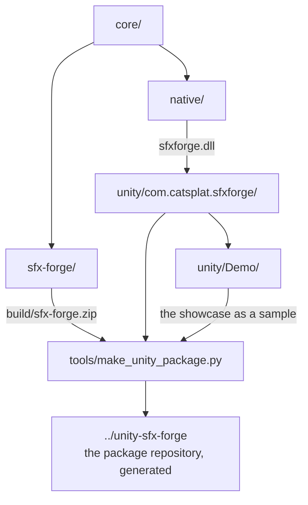

# Repository Map

This page tells you what every top-level folder is and which files matter in each. Use it to find the file for a
thing before you open the code.

## How the folders depend on each other



## The tree

```text
core/                      the engine: three C headers, no heap, no libc
  sfx_core.h               a sound: the patch, five engines, one voice
  sfx_wavetable.h          the six wavetables, computed at start
  sfx_song.h               a song, its packed form, the effects, the player

sfx-forge/                 the firmware for VIBE FM (one compilation unit)
  sfx-forge.c              the version, the includes, the host's entry points
  fw_*.h                   its 19 parts, included once, in a fixed order
  song_way.h               the song from the control flow to the audio flow
  firmware.json            the manifest (name, version, the stage's size)
  icon.png                 the icon

native/                    the same engine as a DLL for game engines
  sfx_native.c             thin doors to core/ (sfxn_... functions)
  build.sh                 builds sfxforge.dll into the Unity package

unity/
  com.catsplat.sfxforge/   the Unity package (source)
    Runtime/Core/          C# with no Unity in it: patch, protocol, link, MIDI, tools
    Runtime/               the components and assets (SfxPlayer, SfxMusicPlayer, SfxSong ...)
    Runtime/Plugins/x86_64/sfxforge.dll   the built native library, committed
    Editor/                inspectors and windows
    Editor/UI/             the kit they are drawn with (its README explains it)
  Demo/                    a Unity 6.3 project that uses the package
    Assets/SfxDemo/        the first demo
    Assets/Showcase/       the showcase game, with its own README and tests

tests/
  *.json + check*.mjs      scenes of key presses and their checks (run by build.sh)
  host.mjs                 a small host for checks that need SysEx, a store or the host's parameters
  song-read.mjs            reads a packed song in JavaScript (shared by the checks)
  make-grid-scenes.mjs     writes grid.json, regrid.json and take64.json
  make-demo-song.mjs       writes the demo song's files from what the firmware sends
  stress-song-way.c / .sh  two real threads over song_way.h
  emulator-link.mjs        the device's end of the link test (not part of any build)
  mix-report.mjs           measures the demo song's mix
  dotnet/                  the package's Runtime/Core tested without Unity
  unity-inspectors/        a Unity project that tests the editor UI (EditMode)
  data/                    a format-5 song kept as a fixture

docs/
  MANUAL.md                the device
  UNITY.md                 the Unity package
  MAINTAINING.md           the maintainer's guide
  img/                     the manuals' pictures
  shots.mjs, figures.py    draw the device's pictures from the firmware
  unity_figures.py         draws the Unity manual's figures
  video/                   the scripts that make the videos

tools/
  strip_wasm_debug.py      takes debug sections out of the built .wasm (called by build.sh)
  make_unity_package.py    writes the package repository from this one

videos/                    the five finished videos, committed, with a README
wiki/                      this wiki: pages, img/, figures/
build.sh                   builds the firmware and runs its checks
README.md                  the front page: build, the checks, the link

build/                     the built firmware (.wasm, .json, .zip). Git-ignored
out/                       everything tests and scripts write. Git-ignored, safe to delete
.tools/                    the VIBE FM SDK and Zig. Git-ignored. Not ours: never edit it
```

At the root there are also the formatters' settings: `.clang-format`, `.prettierrc`, `.prettierignore`,
`.csharpierrc`, `.editorconfig` and `pyproject.toml`.

## Which test covers which folder

| Folder | Tested by | Page |
|---|---|---|
| `sfx-forge/`, `core/` (as built into the `.wasm`) | `sh build.sh`: scene checks, host checks, `vibe-check`, the two-thread stress test | [Running The Tests](Running-The-Tests) |
| `Runtime/Core` and `sfxforge.dll` | `tests/dotnet` | [Running The Tests](Running-The-Tests) |
| the package's `Editor` code | `tests/unity-inspectors` (EditMode) | [Running The Tests](Running-The-Tests) |
| `unity/Demo` | the showcase's editor checks and PlayMode tests | [Running The Tests](Running-The-Tests) |

## Three rules about folders

- **`.tools/` is not ours.** `build.sh` copies `sfx-forge/` and `core/` into the SDK for the length of a build and
  takes them out again. Never edit the SDK.
- **The package repository is generated.** `tools/make_unity_package.py` writes it from nothing on every run.
  Nothing over there is edited by hand.
- **`tests/unity-inspectors` must stay apart from `unity/Demo`.** It holds copies of the demo song and ten presets
  with the same GUIDs.

## Next

- [Architecture Overview](Architecture-Overview): how these pieces work together.
- [Building From Source](Building-From-Source): the tools and the build commands.
- [Firmware Internals](Firmware-Internals): what each `fw_*.h` part holds.
- [Editing This Wiki](Editing-This-Wiki): how the pages in `wiki/` are written.

## Reference

- [The maintainer's guide, 1. The map](../docs/MAINTAINING.md#1-the-map) and
  [3. Reading order](../docs/MAINTAINING.md#3-reading-order)
- [README, Layout](../README.md#layout)
- [The editor kit's README](../unity/com.catsplat.sfxforge/Editor/UI/README.md),
  [the showcase's README](../unity/Demo/Assets/Showcase/README.md), [the videos' README](../videos/README.md)
