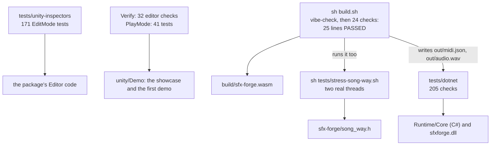
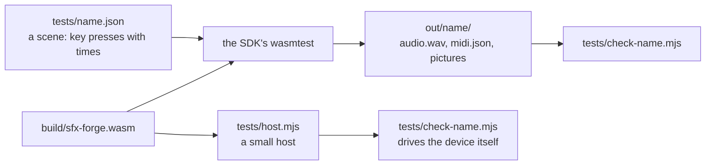

# Running The Tests

This page lists every test suite, the command that runs it, how long it takes and what a pass looks like. It also
shows how a firmware check is written, so you can add one.

All commands run from the repository's root, in Git Bash on Windows. The numbers are those of the last run the
reference documents record; what the suites do **not** cover is on [What Is Tested](What-Is-Tested).

## The suites at a glance



| Suite | Command | Time | A pass looks like |
|---|---|---|---|
| the firmware | `sh build.sh` | about 30 s | exit code 0; 25 lines say `PASSED`, the last is `store PASSED` |
| the two-thread test alone | `sh tests/stress-song-way.sh` | about 12 s | the last line is `song way stress PASSED` |
| the package's core, without Unity | `dotnet run -c Release --project tests/dotnet -- .` | about 30 s | 205 lines `  ok    ...`; the last line is `PASSED` |
| the editor UI (EditMode) | Unity on `tests/unity-inspectors`, below | not recorded | `total="171" passed="171" failed="0"` |
| the showcase's editor checks | Unity on `unity/Demo`, `ShowcaseBuilder.Verify`, below | 1 to 3 minutes | 32 lines `SHOWCASE: ok`, then `SHOWCASE: PASSED` |
| PlayMode | Unity on `unity/Demo`, below | 1 to 3 minutes | `total="41" passed="26" failed="0" skipped="15"` |

## Run everything, in order

Do this once on a fresh clone, before you change anything. A failure after your change is then yours.

1. `sh build.sh`. It builds the firmware and runs its checks. Wait for exit code 0 and `store PASSED` as the last
   line. It also writes `out/midi.json` and `out/audio.wav`, which step 3 reads.
2. Only after a change in `core/` or `native/`: `sh native/build.sh`. Step 3 loads the DLL that is in the package's
   folder, and an old one passes tests it should fail. On a fresh clone the committed DLL is the right one.
3. `dotnet run -c Release --project tests/dotnet -- .` The last line is `PASSED`.
4. The three Unity runs under [The Unity suites](#the-unity-suites), one after the other. Each needs the project
   it opens to be closed in the Unity editor.

Steps 1 to 3 need no Unity and take about a minute together. Which tools each step needs:
[Building From Source](Building-From-Source#what-must-be-installed). New words here (scene, check, EditMode,
PlayMode, shadow project): [Glossary](Glossary#code-and-files).

## The firmware: `sh build.sh`

It builds, then runs these in order. Each ends with a line `... PASSED`; the first that fails stops the run.

| # | Line | What it checks, in a few words |
|---|---|---|
| 1 | `vibe-check` | the SDK's own check of the firmware against its manifest |
| 2 | `tour` | a walk through the pages: the song in time, a cue on the bar line, SEND as 16 sounds and the song |
| 3 | `daw` | the sequencer follows a DAW's tempo and position |
| 4 | `guide` | the tour (MENU) plays what its captions say |
| 5 | `reset` | the factory reset |
| 6 | `metronome` | the click on the beats while REC is on |
| 7 to 10 | `loop`, `modes`, `take`, `edit` | LOOP and SONG, a take over several bars, the keys that ask twice, COPY, CLEAR |
| 11, 12 | `undo`, `retake` | what F2 takes back; takes with a knob turned or a pattern chosen |
| 13 to 15 | `grid`, `regrid`, `take64` | a pattern's grid of 16, 32 or 64 steps |
| 16 | `grid keys` | the question before a step is dropped; the windows of a short bar |
| 17 | `perform` | the PERFORM page |
| 18 | `meter` | the beat and the time signature |
| 19 | `mixer` | the mixer as the host's parameters: level, pan, mute, solo and the selected sound, both ways; what is not taken; the tour leaves every sound as it was |
| 20 | `atomic` | a pattern or song rewritten while it plays reaches the player whole |
| 21 | `song way stress` | the same hand-over between two real threads |
| 22 | `song export` | SEND gives, byte for byte, the Unity demo's song file |
| 23 | `identity` | the identity and the other messages; the two version numbers agree |
| 24 | `wire` | the song on the wire: both shapes, pieces out of order and doubled, the longest song |
| 25 | `store` | what the device stores: `song6.bin`, `song.bin`, a full store |

Count them:

```sh
sh build.sh | grep -c PASSED        # 25
sh build.sh | grep -c "  ok  "      # 266 in a whole run of firmware 1.7.1
```

Every check prints `  ok    ...` lines. A failure prints `  FAIL  ...`. What each check proves is written at its
top; the README's table under "Build" has a row for each.

## How a firmware check is written

There are two kinds.



**A scene and a check.** A scene is a JSON script of events with their times. `wasmtest` plays it into the built
firmware and writes the sound, the MIDI the firmware sent, and any pictures asked for. The check reads those files.

```json
{"seconds": 4, "float": true, "steps": [
  {"t": 0.1, "ev": [3, 14, 1]},
  {"t": 0.15, "ev": [3, 14, 0]},
  {"t": 1.2, "shot": "seq"}
]}
```

An event is `[type, id, down, value]` with the SDK's event types (`vibe.h`): 1 is a pad, 3 a button, 4 an encoder,
5 a raw MIDI message, 9 a note. This scene presses and lets go button 14 (K5), then takes a picture named
`seq.png`. The buttons' numbers are listed as `BUTTON` in `tests/host.mjs`. To run one scene and its check
alone:

```sh
node .tools/vibe-fm-sdk/tools/wasmtest.mjs build/sfx-forge.wasm tests/edit.json out/edit
node tests/check-edit.mjs out/edit        # ok lines, then: edit PASSED
```

**A check on the small host.** Eight checks have no scene: `check-identity`, `check-grid-keys`, `check-perform`,
`check-meter`, `check-mixer`, `check-atomic`, `check-wire` and `check-store`. They load the `.wasm` themselves
through `tests/host.mjs`, which can do what `wasmtest` cannot: send SysEx into the firmware, give it stored files,
and set and read the host's parameters. A device `d` has `button`, `shift`, `pad`, `turn`, `sysex`, `run`, `listen`,
`heard`, `take`, `screen` and `song`, and for the parameters `params`, `param`, `setParam` and `changed`.
[Firmware Add A Page Or Key](Firmware-Add-A-Page-Or-Key#how-to-test-it) has a complete small example.

```sh
node tests/check-perform.mjs build/sfx-forge.wasm     # ok lines, then: perform PASSED
```

Shared by the checks: `tests/song-read.mjs` reads a packed song (`stepList`, `tempo`, `chain`, `same` ...).

## The Unity suites

Two rules first.

1. **Only one Unity process may have a project open.** If the editor is open on `unity/Demo`, a headless run on
   that folder fails. Use a shadow project then: a second folder whose `Assets`, `Packages` and `ProjectSettings`
   are junctions to the real ones ([the maintainer's guide](../docs/MAINTAINING.md#unity) has the commands).
2. **`tests/unity-inspectors` must stay apart from `unity/Demo`.** It holds copies of the demo song and presets
   with the same GUIDs.

Set `UNITY` to your Unity 6000.3 editor's executable, then:

```sh
UNITY="/path/to/Unity"     # the Unity 6000.3 editor
OUT="$PWD/out"

# the editor UI (not -nographics: it renders pictures into out/inspector-shots/)
"$UNITY" -batchmode -projectPath "$PWD/tests/unity-inspectors" -runTests -testPlatform EditMode \
  -testResults "$OUT/inspectors.xml" -logFile "$OUT/inspectors.log"
grep -o '<test-run [^>]*' "$OUT/inspectors.xml"

# the showcase's editor checks. Verify writes nothing
PROJECT="$PWD/unity/Demo"
"$UNITY" -batchmode -quit -projectPath "$PROJECT" -executeMethod SfxShowcase.Editor.ShowcaseBuilder.Verify \
  -logFile "$OUT/unity-showcase.log"
grep "SHOWCASE:" "$OUT/unity-showcase.log"

# PlayMode: the showcase's and the first demo's tests
"$UNITY" -batchmode -projectPath "$PROJECT" -runTests -testPlatform PlayMode \
  -testResults "$OUT/unity-showcase-playmode.xml" -logFile "$OUT/unity-showcase-playmode.log"
grep -o '<test-run [^>]*' "$OUT/unity-showcase-playmode.xml"
```

Compile errors show in the log as `error CS`. The 15 skipped PlayMode tests record takes or need a device; they
run only when asked for by name. `ShowcaseBuilder.SelfTest` is not a check: it rebuilds the scene and rewrites
`Showcase.unity`.

## The link, end to end

Not part of any build. It needs the SDK's emulator in a Chrome, a virtual MIDI cable with two ports (loopMIDI) and
Unity. `tests/emulator-link.mjs` is the device's end; `Tests/LinkTakes.cs` in the showcase is the game's. The
steps are in [the showcase's README](../unity/Demo/Assets/Showcase/README.md#recording-the-link).

## Next

- [What Is Tested](What-Is-Tested): what these suites prove and what nobody has done.
- [Building From Source](Building-From-Source): the tools the suites need.
- [Release Checklist](Release-Checklist): the runs a new version needs.
- [Unity Testing Your Audio](Unity-Testing-Your-Audio): testing sound in your own game.

## Reference

- [The maintainer's guide, 2. Build and test](../docs/MAINTAINING.md#2-build-and-test):
  [The firmware and its checks](../docs/MAINTAINING.md#the-firmware-and-its-checks),
  [The package's core, without Unity](../docs/MAINTAINING.md#the-packages-core-without-unity),
  [The two-thread test alone](../docs/MAINTAINING.md#the-two-thread-test-alone),
  [Unity](../docs/MAINTAINING.md#unity)
- [README, Build](../README.md#build): the table of every check
- [build.sh](../build.sh), [tests/check.mjs](../tests/check.mjs), [tests/host.mjs](../tests/host.mjs),
  [tests/song-read.mjs](../tests/song-read.mjs), [tests/dotnet/Program.cs](../tests/dotnet/Program.cs)
- [The inspectors' test project](../tests/unity-inspectors/README.md),
  [the showcase's README](../unity/Demo/Assets/Showcase/README.md#check-it-test-it-rebuild-it)
- [The Unity manual, 9. Testing, limits, troubleshooting](../docs/UNITY.md#9-testing-limits-troubleshooting)
