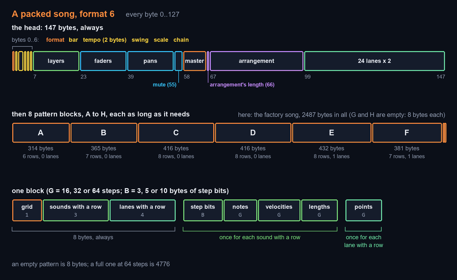

# Song Format

This page gives you the exact bytes of a packed song: the head, the pattern blocks, what a reader must refuse, and
the older formats that are still read. The current song format is **6**. It has no fixed size: 211 to 38355 bytes.

A packed song is what the device stores, what SysEx carries and what a game's asset holds. Every byte is 0 to 127.
A number that needs more than 7 bits is cut into groups of 7 bits, the **lowest group first**. The one exception
is the tempo.

## The head: 147 bytes

| Offset | Bytes | What | Must be |
|---|---|---|---|
| 0 | 1 | the format | 6 |
| 1 | 1 | the bar in sixteenths (`len`) | 1 to 16 |
| 2 | 2 | the tempo in BPM: byte 2 = `bpm >> 7`, byte 3 = `bpm & 127` | 40 to 240 |
| 4 | 1 | swing | 0 to 100 |
| 5 | 1 | scale: 0 chromatic, 1 major, 2 minor, 3 pentatonic | 0 to 3 |
| 6 | 1 | chain | 1 to 8 |
| 7 | 16 | the layers: a threshold for each sound (`level`) | |
| 23 | 16 | the faders (`vol`), 100 = as designed | |
| 39 | 16 | the pans (`pan`), 64 = the middle | |
| 55 | 3 | mute, bit t = sound t: bits 0 to 6, 7 to 13, 14 to 15 | |
| 58 | 8 | the master (`fx`): delay time, delay feedback, reverb size, reverb damping, drive, three spare | byte 58: 0 to 5 |
| 66 | 1 | the arrangement's length in bars (`arr_len`) | 0 to 32 |
| 67 | 32 | the arrangement: a pattern for each bar (`arr`) | each 0 to 7 |
| 99 | 48 | the 24 lanes, 2 bytes each: whose knob (0 = free, else sound + 1), then which knob | 0 to 16, then 0 to 32 |

"Which knob" is an automation target (`SFX_AT_*`): 0 none, 1 to 25 the sound's own values (the patch value's index
+ 1), 26 its fader, 27 its pan, 28 to 32 the master's five values.

Not in the song: solo, and the device's beat. See [Firmware Add A Setting](Firmware-Add-A-Setting) for why the beat
stayed out.

## The eight pattern blocks

Blocks A to H follow from offset 147, one after the other. Each block is as long as it needs to be. With G = the
steps of the pattern's grid (16, 32 or 64) and B = the bytes their bits need (3, 5 or 10):

| Offset in block | Bytes | What |
|---|---|---|
| +0 | 1 | the grid: 0, 1 or 2 (16, 32 or 64 steps) |
| +1 | 3 | the sounds that have a row: bit t, as 7 + 7 + 2 bits |
| +4 | 4 | the lanes that have a row: bit l, as 7 + 7 + 7 + 3 bits |
| then, for each sound with a row, ascending | B | the steps that are on: 7 bits a byte, step 0 = bit 0 of the first byte |
| | G | notes (0 = the sound as designed, else a MIDI note) |
| | G | velocities, 0 to 7 |
| | G | lengths, 0 to G - 1 (0 = by itself) |
| then, for each lane with a row, ascending | G | points: 0 = none, else the value + 1 |

A sound has a row when anything is kept for it in that pattern. A lane has a row when it has a point there. A sound
without a row has no step on, every note 0, every velocity 5 and every length 0. So a block is
`8 + rows * (B + 3 * G) + lanes * G` bytes: 8 when the pattern is empty, at most 4776.

## A worked example: the factory song

The factory song is 2487 bytes. Its head begins `06 10 00 78 14 02 06`:

| Bytes | Hex | Read as |
|---|---|---|
| 0 | `06` | format 6 |
| 1 | `10` | a bar of 16 sixteenths |
| 2, 3 | `00 78` | tempo: 0 x 128 + 120 = 120 BPM |
| 4 | `14` | swing 20 |
| 5 | `02` | the minor scale |
| 6 | `06` | chain 6: A to F in a row (the chain is used only when there is no arrangement; this song has one of 16 bars, at offset 66) |

Pattern A's block starts at offset 147 with `00 46 21 02 00 00 00 00`:

| Bytes | Hex | Read as |
|---|---|---|
| +0 | `00` | grid 0: G = 16 steps, B = 3 |
| +1 to +3 | `46 21 02` | rows for sounds 1, 2, 6 (from `46`), 7, 12 (from `21`) and 15 (from `02`), counted from 0: six rows |
| +4 to +7 | `00 00 00 00` | no lane has a row |

The first row, sound 1, begins with the step bits `10 20 00`: bit 4 of the first byte is step 4, and bit 5 of the
second byte is step 7 + 5 = 12. Counted from 0, so these are the device's steps 5 and 13. The block is
8 + 6 x (3 + 48) = 314 bytes, as the picture says.

## What a reader refuses

`sfx_song_unpack` returns -1, and has written nothing, for any of these:

- a byte above 127;
- a head value outside "must be";
- a grid above 2;
- bits above the 2 and the 3 of the two masks' last bytes;
- a step bit for a step from G on;
- a velocity above 7, or a length above G - 1;
- a block that ends past the bytes, or bytes left after block H.

It checks everything first and writes after. A song that starts with a number above 6 is newer, not broken: the
device says `NEWER SONG: UPDATE` and keeps what it has; a song of a known format with a value out of range says
`BAD SONG`.

`sfx_song_pack` brings most values into range as it writes. Six it writes as they are, and the reader refuses them
when they are out of range: the bar, the tempo, swing, scale, chain and the delay's time.

## The formats before

Read by `sfx_song_unpack`, never written. Each has one fixed size, and its patterns have 16 steps. **A format is
only ever added**: an old song must go on playing the same samples.

| Format | Bytes | What it holds |
|---|---|---|
| 1 | 2455 | bytes 0 to 6 as format 6, the 16 layers, a row of notes for every sound of every pattern. No mixer |
| 2 | 2498 | adds the mixer (the head up to the master, 66 bytes). No velocity, no length |
| 3 | 4546 | adds an accent byte a step: velocity and length |
| 4 | 6643 | adds one automation lane for each sound, and the arrangement |
| 5 | 7699 | the head of format 6, a row for every sound whatever is in it, then 24 lanes of 16 points for each pattern |

## Reading and writing

| | Where |
|---|---|
| C | `sfx_song_pack(&song, out)` returns the bytes written (`out` holds `SFX_SONG_MAX`); `sfx_song_unpack(&song, in, n)` |
| C# | `SfxPackedSong.Format(bytes)`, `IsValid`, `IsPlayable`, and the step readers `StepOn`, `StepNote`, `StepVelocity`, `StepLength`, `LanePoint` |
| C# through the DLL | `SfxNative.SongConvert` gives an older song as format 6 |
| JavaScript, for the tests | `tests/song-read.mjs` |

These are three readers of one layout, written by hand (a fourth is in `docs/video/make_unity_videos.py`). Change
one and you must change the others. Adding a field means a new format 7 and a long list of places:
[the maintainer's guide](../docs/MAINTAINING.md#add-a-field-to-the-song-a-new-song-format).

## Next

- [Patch Format](Patch-Format): the 16 sounds that travel with a song.
- [Link Protocol](Link-Protocol): how a song crosses MIDI in pieces of 240 bytes.
- [Firmware Add A Setting](Firmware-Add-A-Setting): a setting that stays out of the song.
- [Unity Song Inspector](Unity-Song-Inspector): the same bytes, shown in Unity.

## Reference

- [core/sfx_song.h](../core/sfx_song.h): section 1 (sizes), section 2 (`sfx_pattern`, `sfx_song`), section 4 (the
  byte layout, `sfx_song_pack`, `sfx__head_ok`, `sfx_song_unpack`)
- [SfxPackedSong.cs](../unity/com.catsplat.sfxforge/Runtime/Core/SfxPackedSong.cs),
  [tests/song-read.mjs](../tests/song-read.mjs)
- [The Unity manual, The song formats the package reads](../docs/UNITY.md#the-song-formats-the-package-reads)
- [The maintainer's guide, Add a field to the song](../docs/MAINTAINING.md#add-a-field-to-the-song-a-new-song-format)
  and [6. Invariants](../docs/MAINTAINING.md#6-invariants)
- The picture is drawn by [wiki/figures/in_figures.py](../wiki/figures/in_figures.py)
