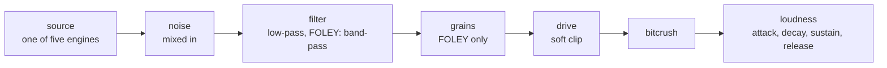
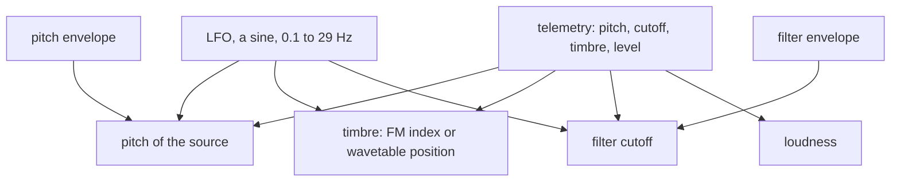
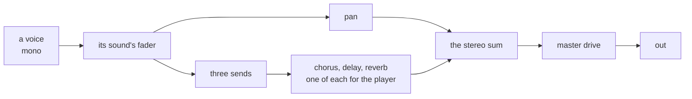

# Sound Engine

This page explains how one sound is made: the signal path of a voice, the five engines, the 25 values of a patch,
and how 16 voices share the player. All of it is in `core/sfx_core.h` and `core/sfx_song.h`, the code the firmware
and the Unity package both run. The synthesis words (FM, carrier, modulator, index, grain, drive, bitcrush, LFO)
are in the [Glossary](Glossary#a-sound).

## Where to read in sfx_core.h

The file's header lists ten numbered sections. Three of them are the engine:

| Section | Holds | Read it for |
|---|---|---|
| 2. The patch | `sfx_engine`, the `SFX_P_*` list, `sfx_patch` | what a sound is |
| 9. The control step | `sfx__control` | where the knobs become frequencies and coefficients |
| 10. The sample loop | `sfx_voice_render` | the signal chain, top to bottom |

The others: 1 maths without libc, 3 a voice's state (`sfx_voice`, `sfx_mods`), 4 small helpers, 5 making patches,
6 the patch on the wire, 7 MUTATE and RANDOM, 8 playing a voice (`sfx_voice_trigger`).

## The signal path of one voice

`sfx_voice_render` is this chain, top to bottom, once for every sample:

Every 16 samples (`SFX_CTL`) the control step `sfx__control` runs first. It moves the LFO and the two envelopes on
and works out the next 16 samples' pitch, timbre and filter coefficients from the patch and the telemetry.

Telemetry is what a game moves while a sound plays (`sfx_mods`): semitones added, octaves added to the filter,
timbre added, and a level from 0 to 1.

## The five engines

The engine is the source of the chain. Two of a patch's values, called **A** and **B** on the device, mean
something different in each engine.

| # | Engine | The source | A (`SFX_P_FM_RATIO`) | B (`SFX_P_FM_DEPTH`) |
|---|---|---|---|---|
| 0 | IMPACT | a sine with FM, driven hard | the modulator's ratio to the carrier | the FM index |
| 1 | UI BLIP | a square wave that steps up an arpeggio (four notes, then it stays on the last) | the interval, 0 to 24 semitones | the speed, 2 to 64 steps a second |
| 2 | SCI-FI FM | FM with feedback; the index falls with the pitch envelope | the modulator's ratio | the FM index (three times IMPACT's range) |
| 3 | FOLEY | noise through a band-pass, in grains; a quiet sine under it when NOISE is turned down | the grain rate, 2 to 256 a second | the grains' depth |
| 4 | WAVETABLE | one cycle read from a table, one oscillator or three detuned | the position in the table (8 frames) | warp: the cycle's first half squeezed |

Things that differ by engine in the rest of the chain:

- **Drive** is 2.2 for IMPACT, 1.0 for WAVETABLE and 1.3 for the others.
- **FOLEY**'s pitch envelope moves the filter's band, not a pitch.
- **WAVETABLE** reads two more values: TABLE (which of six tables: SAW-SQ, PULSE, PEAK, VOWEL, ORGAN, GLASS) and
  SPREAD (0 = one oscillator; above 0 three, detuned by up to 30 cents). Each frame exists four times with fewer and
  fewer harmonics, so a high note does not alias (`sfx_wt_frame`).

In both chains of `if`s over the engines, the last `else` is IMPACT and SCI-FI FM. An engine without a branch of
its own lands there. See [Firmware Add An Engine](Firmware-Add-An-Engine).

## The 25 values

Each value is one byte, 0 to 127. This is the wire order (`SFX_P_*`).

| # | Name in code | What it does |
|---|---|---|
| 0 | `BASE_FREQ` | 20 Hz to 14 kHz, logarithmic. A sound played as a note ignores it |
| 1 | `PITCH_ENV_AMT` | 64 = none. Above: the pitch starts up to 4 octaves above and falls. Below: it starts under and rises |
| 2 | `PITCH_ENV_DEC` | 5 ms to 2.5 s |
| 3, 4 | `FM_RATIO`, `FM_DEPTH` | A and B: the table above |
| 5 | `NOISE_MIX` | 0 = the source alone, 127 = noise alone |
| 6, 7 | `FILTER_CUTOFF`, `FILTER_RES` | 40 Hz to 15 kHz; resonance |
| 8 | `AMP_DECAY` | 10 ms to 3.9 s: to silence, or to the sustain level |
| 9 | `BITCRUSH` | 0 = clean. Above: fewer samples and fewer bits (16 down to 4) |
| 10 | `ATTACK` | 1.5 ms to 4 s |
| 11 | `SUSTAIN` | 0 = a one-shot: it plays to its end whatever the key does. Above: held while the key is |
| 12 | `RELEASE` | 5 ms to 3.9 s, for a sustained sound |
| 13, 14 | `FILTER_ENV`, `FILTER_ENV_DEC` | 64 = none; the filter opens or closes at the start, up to 5 octaves; 5 ms to 2.5 s |
| 15 | `LFO_RATE` | 0.1 to 29 Hz |
| 16, 17, 18 | `LFO_PITCH`, `LFO_FILTER`, `LFO_TIMBRE` | vibrato up to an octave; the filter up to 3 octaves; the FM index or the wavetable's position |
| 19 | `SPREAD` | WAVETABLE only |
| 20, 21, 22 | `CHORUS`, `DELAY`, `REVERB` | the three sends to the player's effects |
| 23 | `LEVEL` | 100 = as designed |
| 24 | `TABLE` | WAVETABLE only, 0 to 5 |

A new patch (`sfx_patch_init`) is a short one-shot with nothing modulated and no effects. MUTATE
(`sfx_patch_mutate`) moves every value by at most 15 % of its range and keeps the engine, the table, the level, and
whether the sound is a one-shot. RANDOM (`sfx_patch_random`) makes a new one-shot inside ranges that stay audible.

## The player: 16 voices, a mixer, three effects

A voice is mono and dry. `sfx_player` (`core/sfx_song.h`) holds 16 of them (`SFX_PLAYER_VOICES`) and mixes them.

- **Voice stealing.** `sfx_player_note_on` takes the first voice that is free. If all 16 play, it takes the one that
  started longest ago. A voice that still holds the same key is released first.
- **Slots.** Slot 0 to 15 is one of the song's sounds: it goes through that sound's fader, pan and mute. Slot 16 to
  31 is a sound beside the song (a game's sound effect, the device's SFX kit): it goes straight to the sum, with its
  sends, whatever the mixer says.
- **The sends** are taken after the fader and before the pan. A muted sound plays on, unheard.
- **The effects.** The chorus is two taps that drift at 0.6 Hz. The delay goes left, then right, then left; its
  time is 1, 2, 3, 4, 6 or 8 sixteenths of the tempo. The reverb is four damped combs and two all-passes a side.
- **Sizes.** An `sfx_song` is about 38 KB and an `sfx_player` about 600 KB (the delay line and the reverb are in
  it). A player belongs in static memory, never on a stack.

The firmware adds its own output stage after the player: the volume and a soft limit (`vibe_on_audio`, part 6).

## Next

- [Patch Format](Patch-Format): the 28 bytes these values travel in.
- [Firmware Add An Engine](Firmware-Add-An-Engine): add a sixth engine.
- [Device The Five Engines](Device-The-Five-Engines): the engines from the player's side.
- [Unity Concepts](Unity-Concepts): the same engine in a game.

## Reference

- [core/sfx_core.h](../core/sfx_core.h): the `SFX_P_*` list, `sfx__control`, `sfx_voice_render`
- [core/sfx_wavetable.h](../core/sfx_wavetable.h): `sfx__wt_harmonic` is the recipe of the tables
- [core/sfx_song.h](../core/sfx_song.h): `sfx_fx_process`, `sfx_player_note_on`, `sfx__render`
- [The manual, 6. How a sound is built](../docs/MANUAL.md#6-how-a-sound-is-built) and
  [7. The five engines](../docs/MANUAL.md#7-the-five-engines)
- [The maintainer's guide, 3. Reading order](../docs/MAINTAINING.md#3-reading-order)
