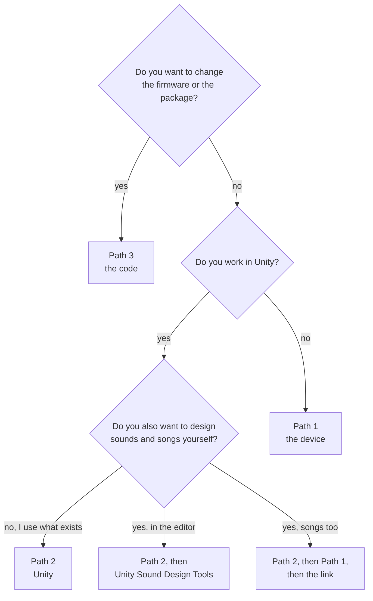
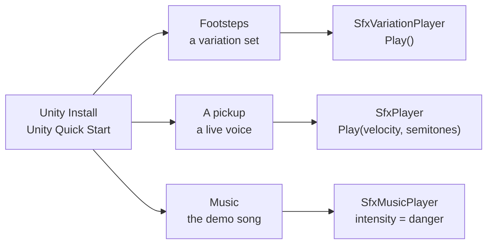

# Start Here

Three reading lists, one for each kind of reader. Pick yours with the chart, then read the pages in order. The
times are for reading and doing the steps once; they are estimates.

A song's notes are written on the device, not in Unity. Sounds can be made on either side.

In a hurry? Watch [the tour of the device](../videos/sfx-forge-tour.mp4) (2:23) or
[how it works in Unity](../videos/sfx-forge-unity-how-it-works.mp4) (4:06) first: [Videos](Videos).

## Path 1: the device

For a sound designer or a musician. You need a browser and the built firmware; no hardware
([Device Quick Start](Device-Quick-Start) says where the file comes from).

**The first hour**

| # | Page | You will | About |
|---|---|---|---|
| 1 | [Device Quick Start](Device-Quick-Start) | load it, play the kit, hear the demo song | 5 min |
| 2 | [Device Controls And Pages](Device-Controls-And-Pages) | know every control and the fourteen pages | 10 min |
| 3 | [Device Make A Sound](Device-Make-A-Sound) | make and keep a sound effect | 10 min |
| 4 | [Device The Five Engines](Device-The-Five-Engines) | pick the right engine for a sound | 10 min |
| 5 | [Device Make A Beat](Device-Make-A-Beat) | write a pattern step by step | 15 min |
| 6 | [Device Recording](Device-Recording) | play into a looping pattern | 10 min |

**Then, a song for a game**

| # | Page | You will | About |
|---|---|---|---|
| 7 | [Device Song And Arrangement](Device-Song-And-Arrangement) | put patterns in an order | 10 min |
| 8 | [Device Layers And Intensity](Device-Layers-And-Intensity) | make the band follow one number | 10 min |
| 9 | [Device Mixer And Effects](Device-Mixer-And-Effects) | balance it; delay and reverb | 10 min |
| 10 | [Device Saving And Reset](Device-Saving-And-Reset) | keep your work | 5 min |

**When you need them:** [Device Finer Grids](Device-Finer-Grids) (rolls and fast runs),
[Device Time Signatures](Device-Time-Signatures) (3/4, 6/8, 7/8), [Device Perform](Device-Perform) (the whole
pattern on one page), [Device Automation](Device-Automation) (knobs that move by themselves),
[Device The Stage](Device-The-Stage) (the mouse), [Device Cheat Sheet](Device-Cheat-Sheet).

**Into the game:** [what you press and what travels](Device-Saving-And-Reset#hand-it-to-the-programmer). The
programmer's side is [Unity Device Link Setup](Unity-Device-Link-Setup), then
[Unity Send And Receive](Unity-Send-And-Receive).

## Path 2: Unity

For a game developer. You need Unity 6.3 on Windows x64; no device.

**In one evening: footsteps, a pickup, and music that follows danger**

The three things most games want first. Do [Unity Install](Unity-Install) and [Unity Quick Start](Unity-Quick-Start),
then take one row of this table at a time.

| You want | The sound comes from | Your game calls | Page |
|---|---|---|---|
| footsteps that never repeat | a preset: **TOOLS > NEW > THUD** or **CLICK**, then **VARY > MAKE SET** and **BAKE** | `SfxVariationPlayer.Play()` at every step | [Unity Variations](Unity-Variations) |
| a pickup that rises with each one collected | a preset: **TOOLS > NEW > CHIME** | `SfxPlayer.Play(1f, semitones)` | [Unity Live Voices](Unity-Live-Voices) |
| music that grows with danger | the demo song, `DemoSong.asset` | `music.intensity`, from the script `DangerMusic` | [Unity Music First Song](Unity-Music-First-Song), then [Unity Adaptive Music](Unity-Adaptive-Music) |

Ready-made sounds: the Showcase sample ([Unity Install](Unity-Install#import-the-showcase-sample)) has its 19
sounds as presets in its folder `Generated/Presets`, among them `FootstepLeft`, `FootstepRight` and `Chime`.
Duplicate one into a folder of your own before you change it: **SFX Forge > Rebuild Showcase Scene** writes those
files again.

Two things to know before you plan the evening. The music is the demo song: a song of your own is written on the
device, which also runs in a browser ([Device Quick Start](Device-Quick-Start)). And if it stays silent, go to
[Unity Troubleshooting](Unity-Troubleshooting) first.

**The first hour**

| # | Page | You will | About |
|---|---|---|---|
| 1 | [Unity Install](Unity-Install) | have the package in your project | 5 min |
| 2 | [Unity Quick Start](Unity-Quick-Start) | trigger a sound from a script | 5 min |
| 3 | [Unity Concepts](Unity-Concepts) | know the eight nouns of the package | 10 min |
| 4 | [Unity Choosing A Route](Unity-Choosing-A-Route) | pick how each sound should play | 5 min |
| 5 | [Unity One Shots](Unity-One-Shots) | bake a sound into a clip | 10 min |
| 6 | [Unity Music First Song](Unity-Music-First-Song) | hear the demo song in your scene | 5 min |
| 7 | [Unity Adaptive Music](Unity-Adaptive-Music) | drive the music from a game value | 15 min |

**Then, by need**

| You want | Read |
|---|---|
| a sound that changes each time it plays | [Unity Live Voices](Unity-Live-Voices), [Unity Variations](Unity-Variations) |
| a sound that follows the game (an engine, wind) | [Unity Held Sounds](Unity-Held-Sounds) |
| to shape a sound by hand | [Unity Presets And Patches](Unity-Presets-And-Patches), [Unity Sound Design Tools](Unity-Sound-Design-Tools) |
| the music to change section, duck, or play a stinger | [Unity Cues And Patterns](Unity-Cues-And-Patterns), [Unity Music Mix And Notes](Unity-Music-Mix-And-Notes) |
| audio files instead of synthesis at runtime | [Unity Baking And WAV](Unity-Baking-And-WAV) |
| a script to copy | [Unity Recipes](Unity-Recipes) |
| a whole game to learn from | [Unity Showcase Walkthrough](Unity-Showcase-Walkthrough), [Unity Copy The Showcase Pattern](Unity-Copy-The-Showcase-Pattern) |
| to connect the device | [Unity Device Link Setup](Unity-Device-Link-Setup) |
| to know why it is silent | [Unity Troubleshooting](Unity-Troubleshooting) |
| every member of a class | [Unity API Overview](Unity-API-Overview) |

## Path 3: the code

For a maintainer or a contributor. You need the tools listed on [Building From Source](Building-From-Source).

| # | Page | You will | About |
|---|---|---|---|
| 1 | [Architecture Overview](Architecture-Overview) | see the whole thing in one picture | 10 min |
| 2 | [Repository Map](Repository-Map) | find the file for a thing | 10 min |
| 3 | [Building From Source](Building-From-Source) | build the firmware, the library, the package | 20 min |
| 4 | [Running The Tests](Running-The-Tests) | run every suite and read its output | 20 min |
| 5 | [What Is Tested](What-Is-Tested) | know what a pass does not prove | 10 min |
| 6 | [Sound Engine](Sound-Engine) | follow one voice from patch to samples | 15 min |

**Then, by what you change**

| You change | Read |
|---|---|
| the firmware | [Firmware Internals](Firmware-Internals), then [Firmware Add A Page Or Key](Firmware-Add-A-Page-Or-Key), [Firmware Add An Engine](Firmware-Add-An-Engine) or [Firmware Add A Setting](Firmware-Add-A-Setting) |
| a sound's or the song's bytes | [Patch Format](Patch-Format), [Song Format](Song-Format) |
| a message between device and game | [Link Protocol](Link-Protocol) |
| the Unity package | [Unity Architecture](Unity-Architecture), [Unity Extending](Unity-Extending) |
| the platforms it runs on | [Unity Porting The Native Library](Unity-Porting-The-Native-Library) |
| the version number | [Release Checklist](Release-Checklist) |
| these pages | [Editing This Wiki](Editing-This-Wiki) |

## Next

- [Glossary](Glossary): when a word is new.
- [FAQ](FAQ): hardware, platforms, licence.
- [Home](Home): the three doors again.

## Reference

- [The manual](../docs/MANUAL.md): the device, complete.
- [The Unity manual](../docs/UNITY.md): the package, complete.
- [The maintainer's guide](../docs/MAINTAINING.md): the code, complete.
