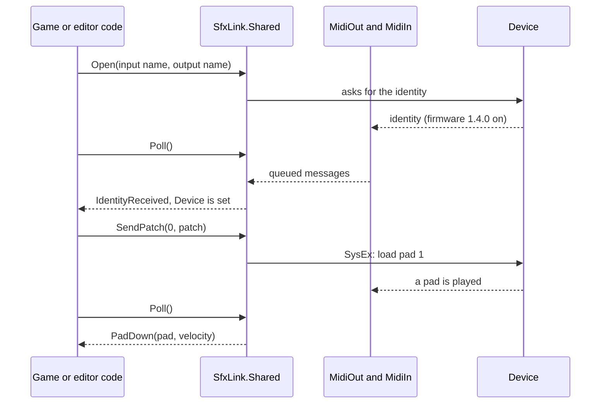

# Unity API Link

Every public member of the types that talk to the device over MIDI, with its exact signature. The link is optional:
nothing on [Unity API Sounds](Unity-API-Sounds) or [Unity API Music](Unity-API-Music) needs it. It exists for
Windows only; elsewhere the same calls are written to compile and do nothing (untried: [What Is Tested](What-Is-Tested)).

**Threads.** MIDI arrives on a system thread and waits in a queue. Nothing reaches your code until you call
`Poll()`: every event fires from inside `Poll`, on the thread that called it. `SfxForgeLink` calls `Poll` in its
`Update`; in the editor `SfxForgeEditorLink` calls it on `EditorApplication.update`. `SfxLink` has no locks of its own:
use it from one thread, the main one.

## SfxLink

The connection to the device over two MIDI ports. Use the shared one: `SfxLink.Shared`.
File: [SfxLink.cs](../unity/com.catsplat.sfxforge/Runtime/Core/SfxLink.cs).

**Open, close, poll**

| Member | What it is |
|---|---|
| `static readonly SfxLink Shared` | the one link the editor and the game share |
| `SfxLink()` | a link with no port open (for tests and tools of your own) |
| `static int Find(string[] names, string contains)` | the first port whose name contains the text (any case), -1: none |
| `bool Open(string inputContains, string outputContains)` | opens the ports whose names contain these texts (null or "": none). True if every port asked for is open. It asks the device for its identity |
| `void Close()` · `void Dispose()` | closes both ports and forgets the device and a song that was arriving |
| `void Poll()` | hands out what came in since the last call (at most 256 messages a call) |
| `string InputName` · `string OutputName` | the open ports' names (null: none) |
| `bool HasInput` · `bool HasOutput` · `bool IsOpen` | an input is open · an output is open · at least one is |

**Events** (all fire from `Poll`)

| Member | What it is |
|---|---|
| `event Action<int, SfxPatch> PatchReceived` | the device sent a patch (slot 0..15): EXPORT, or the answer to `RequestPatch` |
| `event Action<byte[], SfxPatch[]> SongReceived` | the device sent its song: the packed song and its 16 sounds (null if not all came) |
| `event Action<int, float> PadDown` · `event Action<int> PadUp` | a pad was played (slot 0..15, velocity 0..1) · let go |
| `event Action<int, float> EncoderChanged` | an encoder of the LINK page turned: index 0..5, value 0..1 |
| `event Action<SfxDeviceInfo> IdentityReceived` | the device said what it is |
| `event Action<string> NewerReceived` | the device sent a patch or song in a newer format; nothing of it was taken. The text says what came |
| `event Action<byte[]> MessageReceived` | everything that comes in, as it is |

**The device**

| Member | What it is |
|---|---|
| `SfxDeviceInfo? Device` | what the device said it is. Null until it answered |
| `const double IdentityAnswerSeconds = 1.0` · `bool IdentityUnanswered` | asked, and a second went by without an answer: a firmware before 1.4, or nothing listens |
| `bool RequestIdentity()` | asks again; `Device` is null until the new answer |
| `string LastRefusal` | why the last `SendPatch` or `SendSong` sent nothing: the device speaks another format. Null when it was not refused |
| `static string Refusal(SfxDeviceInfo? device, bool song)` | why a device is not sent a patch (`song` false) or a song. Null: nothing stands against it |
| `static string Refusal(SfxDeviceInfo? device, byte[] song)` | the same for this packed song |

**Sending.** Each returns false when no output is open or nothing was sent.

| Member | What it is |
|---|---|
| `bool SendPatch(int slot, SfxPatch patch)` | a patch into a pad of the device (it selects that pad) |
| `bool RequestPatch(int slot)` | asks for a pad's patch; the answer comes as `PatchReceived` |
| `bool SendSong(SfxPatch[] patches, byte[] song)` | 16 sounds and a packed song: they replace the device's song and the sounds of its MUSIC kit |
| `bool RequestSong()` | asks for the device's song and 16 sounds; the answer comes as `SongReceived` |
| `bool SendTelemetry(SfxTelemetry channel, float value01)` | a game value 0..1. Sent only when its 7-bit value changes, so calling it every frame is fine |
| `bool SendIntensity(float value01)` · `bool CuePattern(int pattern)` | the music on the device: intensity · this pattern (0..7) from the next bar line |
| `bool SendText(string text)` | text for the device's top line: 24 ASCII characters |
| `bool PlayPad(int slot, float velocity = 0.8f)` · `bool ReleasePad(int slot)` | a note on · a note off for a pad |
| `bool SendSysEx(byte[] message)` | one SysEx message as it is (F0 ... F7) |
| `static string Describe(byte[] m)` | a message's first 24 bytes as hex, for a log |

**`enum SfxTelemetry`**: `Pitch, Cutoff, FmDepth, Level, Intensity, Pattern, Aux3, Aux4` (CC 10..17 on channel 2).

## SfxForgeLink

A component: the link in a scene. It opens the ports, calls `Poll` every frame and turns pads and encoders into
UnityEvents. Menu: **Component > SFX Forge > SFX Forge Link**. Its execution order is -100, so it runs before your
scripts. File: [SfxForgeLink.cs](../unity/com.catsplat.sfxforge/Runtime/SfxForgeLink.cs).

| Member | What it is |
|---|---|
| `const string InputPref = "SfxForge.Input"` · `OutputPref = "SfxForge.Output"` | the PlayerPrefs keys of the ports chosen in **Window > SFX Forge** |
| `string inputPort = ""` · `string outputPort = ""` | part of a port's name. Empty: the port chosen in the window |
| `string textOnStart = ""` | shown on the device's top line when the game starts |
| `PadEvent onPad` | `UnityEvent<int, float>`: pad 0..15, velocity 0..1 |
| `EncoderEvent onEncoder` | `UnityEvent<int, float>`: encoder 0..5, value 0..1 |
| `static SfxLink Link` | `SfxLink.Shared` |
| `void SendText(string text)` | text for the device's top line |

It closes the ports on disable only if it opened them itself.

## SfxTelemetrySender

A component: streams one game value, every frame, to the device and to players in the scene. Menu:
**Component > SFX Forge > SFX Telemetry Sender**.
File: [SfxTelemetrySender.cs](../unity/com.catsplat.sfxforge/Runtime/SfxTelemetrySender.cs).

| Member | What it is |
|---|---|
| `SfxTelemetry channel = SfxTelemetry.Pitch` | what the value moves |
| `Source source = Source.RigidbodySpeed` | `enum Source { RigidbodySpeed, Rigidbody2DSpeed, AnimatorFloat, Manual }` |
| `string animatorParameter = "Speed"` · `float value` | for `AnimatorFloat` · for `Manual`: set it from your code |
| `float min = 0f` · `float max = 20f` · `AnimationCurve curve` | the source value that becomes 0 · that becomes 1 · shapes it in between |
| `SfxPlayer[] localPlayers` · `SfxMusicPlayer[] musicPlayers` | players that follow the same value, so the game sounds the same without the device |
| `float Normalized` | what was sent last, 0..1 |

On disable it sends the value back to rest (pitch and FM 0, cutoff the middle, level 1); `Intensity` and `Pattern` stay.

## SfxEncoderBinding

A component: one encoder of the device's LINK page as a control in Unity. It needs an `SfxForgeLink` in the scene to
poll. Menu: **Component > SFX Forge > SFX Encoder Binding**.
File: [SfxEncoderBinding.cs](../unity/com.catsplat.sfxforge/Runtime/SfxEncoderBinding.cs).

| Member | What it is |
|---|---|
| `Encoder encoder = Encoder.Encoder1` | `enum Encoder { Encoder1, Encoder2, Encoder3, Encoder4, A, B }` |
| `AudioMixer mixer` · `string exposedParameter = ""` | optional: a mixer and one of its exposed parameters |
| `float min = -80f` · `float max = 0f` | the value with the encoder at 0 and at 127 |
| `ValueEvent onValue` | `UnityEvent<float>`: the value between `min` and `max`, whenever the encoder turns |

## SfxDeviceInfo

A struct: what a device said it is. Declared with `SfxProfile` in
[SfxProfile.cs](../unity/com.catsplat.sfxforge/Runtime/Core/SfxProfile.cs).

| Member | What it is |
|---|---|
| `const int HardwareUnknown = 0` · `HardwareVibeFm = 1` | values of `hardware` |
| `const int FlagPads = 1` · `FlagEncoders = 2` · `FlagSongSounds = 4` · `FlagTelemetry = 8` | bits of `flags` |
| `int hardware` · `int major` · `int minor` · `int patch` · `SfxProfile profile` · `int flags` · `bool assumed` | the identity's fields. `assumed`: nothing answered, this is what is taken for granted |
| `bool HasPads` · `HasEncoders` · `TakesSongSounds` · `TakesTelemetry` | the flags, read |
| `bool IsAtLeast(int wantMajor, int wantMinor, int wantPatch)` | the firmware is this version or later. False for an assumed device |
| `static SfxDeviceInfo AssumedBefore14` | what a device that does not answer is taken for |
| `string HardwareName` · `string ToString()` | "VIBE FM", ... · "VIBE FM, firmware 1.4.0, profile 1" |
| `bool Equals(SfxDeviceInfo o)` · `Equals(object obj)` · `GetHashCode()` | value equality |

**`struct SfxProfile`** (the formats a device speaks and how much it holds): fields `int id`, `patchFormat`,
`songFormat`, `sounds`, `kits`, `patterns`, `steps`, `lanes`, `bars`, `voices`, `engines`, `wavetables`,
`patchValues`; `static SfxProfile VibeFm1` (song format 6, 64 steps) and `VibeFm15` (song format 5, 16 steps);
`bool Fits(SfxPatch patch)`; `bool Fits(byte[] song)`; `Equals`, `GetHashCode`, `==`, `!=`, `ToString()`.

## SfxProtocol

A static class: the messages, byte by byte. You rarely call it yourself; `SfxLink` does.
File: [SfxProtocol.cs](../unity/com.catsplat.sfxforge/Runtime/Core/SfxProtocol.cs).

| Member | What it is |
|---|---|
| `static bool IsOurs(byte[] m)` | a SysEx message of SFX FORGE: `F0 7D 56 42`, a command, `F7` |
| `static byte[] BuildLoad(int slot, SfxPatch patch)` · `BuildDump(int slot, SfxPatch patch)` | a patch into a pad · what the device sends on EXPORT |
| `static byte[] BuildLoadSongSound(int sound, SfxPatch patch)` | one of a song's 16 sounds (slot 16 + sound) |
| `static byte[] BuildRequest(int slot)` · `BuildRequestSong()` · `BuildRequestIdentity()` | the three requests |
| `static byte[] BuildText(string text)` | text for the top line |
| `static bool TryParsePatch(byte[] m, out int slot, out SfxPatch patch)` | a dump or a load with a valid patch |
| `static byte[][] BuildSongPieces(byte[] song)` | a song as the messages firmware 1.6.0 on takes (pieces of up to 240 bytes). Throws `ArgumentException` when the bytes are not a packed song |
| `static byte[][] BuildSong(byte[] song)` | a format-5 song (7699 bytes) as the 39 messages a firmware up to 1.5.0 takes. Throws `ArgumentException` for any other length |
| `static bool TryTakeSongChunk(byte[] m, byte[] song, ref ulong seen)` | marked `[Obsolete]`: one piece of the old song message into a buffer. True when it made the song whole. Use `SfxSongTransfer`, which takes both shapes |
| `static bool IsNewerSong(byte[] song)` · `static string NewerIn(byte[] m)` | a song of a higher format · what newer thing a message carries, or null |
| `static byte[] BuildIdentity(SfxDeviceInfo d)` · `static bool TryParseIdentity(byte[] m, out SfxDeviceInfo device)` | the identity message, both ways |
| `static float PatternValue(int pattern)` · `static byte ToCc(float value01)` | the telemetry value that cues a pattern · 0..1 as a controller value |
| `static void Apply(ref SfxMods mods, SfxTelemetry channel, byte cc)` | what a controller value does on the device, so a local player can do the same |

Constants, all `public const`:

| Group | Names and values |
|---|---|
| SysEx commands (`byte`) | `Dump = 0x01`, `Load = 0x02`, `Text = 0x03`, `Request = 0x04`, `SongChunk = 0x05`, `RequestSong = 0x06`, `RequestIdentity = 0x07`, `Identity = 0x08` |
| Notes and controllers | `PadNoteBase = 36`, `TelemetryCcBase = 10`, `EncoderCcBase = 20`, `EncoderCount = 6`, `TelemetryStatus = 0xB1`, `MaxText = 24`, `IdentityBytes = 18` |
| Sizes of a device | `Slots = 16`, `Kits = 2`, `Patterns = 8`, `Steps = 16`, `GridSteps = 64`, `Lanes = 24`, `Bars = 32`, `Voices = 16` |
| The song | `SongVersion = 6`, `SongHead = 147`, `SongBytesMin = 211`, `SongBytesMax = 38355`, `SongBytesV1 = 2455`, `SongBytesV2 = 2498`, `SongBytesV3 = 4546`, `SongBytesV4 = 6643`, `SongBytesV5 = 7699` |
| The song in pieces | `SongPieceBytes = 240`, `SongPiecesMax = 160`, `OldSongPieceBytes = 200`, `OldSongPieces = 39` |
| Marked `[Obsolete]` (the compiler warns) | `SongBytes = 7699`, `SongChunkBytes = 200`, `SongChunks = 39` |

## SfxSongTransfer

A class: collects a song that arrives piece by piece, in either shape of the song message. `SfxLink` has one inside.
File: [SfxSongTransfer.cs](../unity/com.catsplat.sfxforge/Runtime/Core/SfxSongTransfer.cs).

| Member | What it is |
|---|---|
| `bool Take(byte[] m)` | one message. True: it was a piece, and it made the song whole |
| `byte[] Song` | the whole song. Null until all its pieces are here |
| `void Reset()` | forgets what was collected |
| `static bool IsPiece(byte[] m)` | the message is a piece of a song this class collects |

## MidiPorts, MidiIn, MidiOut

The MIDI ports themselves (Windows `winmm`). On any other platform the same three types exist as stand-ins: the lists
are empty and nothing opens. File: [WinMidi.cs](../unity/com.catsplat.sfxforge/Runtime/Core/WinMidi.cs).

| Member | What it is |
|---|---|
| `static readonly bool MidiPorts.Supported` | true on Windows, false elsewhere |
| `static string[] MidiPorts.Inputs()` · `MidiPorts.Outputs()` | the ports' names; an index in the list is what `TryOpen` takes |
| `static MidiIn MidiIn.TryOpen(int index)` | opens an input. Null: no such port, or it would not open |
| `string MidiIn.Name` · `bool MidiIn.TryRead(out byte[] message)` · `void MidiIn.Dispose()` | the next message: three bytes or fewer, or a whole SysEx |
| `static MidiOut MidiOut.TryOpen(int index)` | opens an output |
| `string MidiOut.Name` · `bool MidiOut.Send(byte status, byte data1, byte data2)` · `bool MidiOut.SendSysEx(byte[] message)` · `void MidiOut.Dispose()` | a short message · a whole SysEx (it waits until the driver has taken it) |

## Next

- [Unity Device Link Setup](Unity-Device-Link-Setup): ports, the virtual cable, the window
- [Unity Send And Receive](Unity-Send-And-Receive) and [Unity Telemetry And Encoders](Unity-Telemetry-And-Encoders): these members in use
- [Link Protocol](Link-Protocol): the bytes on the wire, from both sides

## Reference

- [The Unity manual, section 10: SfxLink](../docs/UNITY.md#sfxlink-sfxlinkshared),
  [SfxDeviceInfo and SfxProfile](../docs/UNITY.md#sfxdeviceinfo-and-sfxprofile-structs) and the three components after them
- [The Unity manual, section 6: From the device to the game](../docs/UNITY.md#6-from-the-device-to-the-game)
- [README: The link](../README.md#the-link-device--game-engine)
- The device's side: [fw_protocol.h](../sfx-forge/fw_protocol.h), [fw_link.h](../sfx-forge/fw_link.h)
- Status of the link's tests: [What Is Tested](What-Is-Tested)
