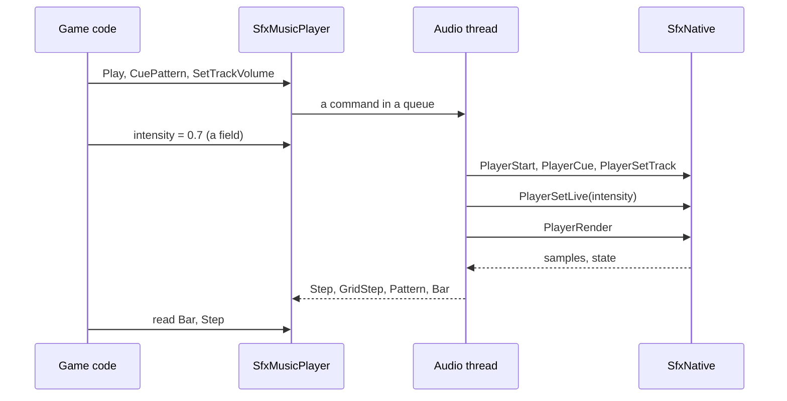

# Unity API Music

Every public member of the types that hold and play a song, with its exact signature. A song is made on the device;
in Unity you play it, read it and shape it while it runs. For the overall map see
[Unity API Overview](Unity-API-Overview).

**Threads.** Call `SfxMusicPlayer` and `SfxSong` from Unity's main thread. The player passes your calls to the audio
thread in a queue, so a call takes effect with the next audio block, not at once. `Step`, `GridStep`, `Pattern` and
`Bar` are written by the audio thread once a block and are safe to read from the main thread.

## SfxMusicPlayer

A component (needs an `AudioSource`, clip left empty): plays an `SfxSong` with the device's own player. Menu:
**Component > SFX Forge > SFX Music Player**. Not spatialized.
File: [SfxMusicPlayer.cs](../unity/com.catsplat.sfxforge/Runtime/SfxMusicPlayer.cs).

| Member | What it is |
|---|---|
| `SfxSong song` | the song it plays. Read when the player is enabled, by `Reload()`, and by `Play()` when another asset was assigned since |
| `float volume = 0.6f` | 0..1. Not smoothed: ramp it yourself |
| `bool playOnEnable = true` | start when the component is enabled |
| `int startPattern` | 0..7: the pattern `Play` starts on, 0 = A |
| `float intensity = 1f` | 0..1. A sound of the song plays only at or above its own threshold (LAYER on the device) |
| `bool loopPattern` | on: the pattern that plays repeats until `CuePattern` chooses another. Off: the song's arrangement or chain |
| `bool IsPlaying` | the sequencer runs |
| `int Step` | the sixteenth of the bar it is on, 0..15 (-1: not yet), whatever the pattern's grid |
| `int GridStep` | the step in the grid of the pattern that plays: 0..15, 0..31 or 0..63 (-1: not yet) |
| `int StepsPerSixteenth` | 1, 2 or 4: the grid of the pattern that plays |
| `int Pattern` | the pattern it is on, 0 = A |
| `int Bar` | bars since `Play` |
| `void Play()` | starts the song on `startPattern`. When another song asset was assigned to `song` since the player took its song, it takes that one first |
| `void Stop()` | stops the song |
| `void Reload()` | takes the song asset again (after it changed) without stopping. It puts the song's own mix back |
| `void CuePattern(int index)` | change to pattern 0..7 on the next bar line |
| `void PlaySound(int sound, float velocity = 1f, int midiNote = 0)` | one of the song's 16 sounds by hand, beside the music: an effect (`midiNote` 0) or a note |
| `void ReleaseSound(int sound, int midiNote = 0)` | lets go of a note `PlaySound` started: the same sound and `midiNote` |
| `void SetTrackVolume(int sound, float volume)` | a sound's fader: 1 = as designed, 0 = silent, up to 1.27 |
| `void SetTrackPan(int sound, float pan)` | -1 left .. 1 right |
| `void SetTrackMute(int sound, bool mute)` | mutes a sound of the song, or lets it be heard again |
| `void SetMaster(SfxMaster what, int value)` | a master effect: delay time 0..5, the others 0..127 |
| `void ApplyTelemetry(SfxTelemetry channel, float value01)` | `Intensity` sets `intensity`; `Pattern` cues a pattern. Other channels do nothing here |

Without the native library the component stays silent and warns once. A song from a newer SFX Forge does not play and
says so in the Console.

**`enum SfxMaster`**: `DelayTime, DelayFeedback, ReverbSize, ReverbDamping, Drive`. Delay time 0..5 stands for 1, 2,
3, 4, 6, 8 sixteenths.

## SfxSong

A `ScriptableObject`: 16 sounds and the packed song. Menu: **Assets > Create > SFX Forge > Song** (an empty one;
a real song comes from the device). Check `IsValid` before you read anything else from it.
File: [SfxSong.cs](../unity/com.catsplat.sfxforge/Runtime/SfxSong.cs).

**The asset**

| Member | What it is |
|---|---|
| `const int CurrentFormat = 2` | the highest *asset* format this version writes for a song (2: a packed song of format 6) |
| `int Format` · `bool IsFromNewerVersion` | the asset format of the file · a newer SFX Forge made it |
| `SfxPatch[] sounds` | the 16 sounds the song plays |
| `byte[] data` | the song as the device packs it |
| `bool IsValid` | 16 sounds, and a packed song this version reads |
| `bool IsNewer` | the packed song is in a format above 6: newer, not broken. It does not play |
| `int PackedFormat` | the packed song's format: 1..6, 0 when it is not a song |
| `void Set(SfxPatch[] newSounds, byte[] packedSong)` | takes a song as it came from the device (copies) |
| `const int MaxSteps` (16) · `Lanes` (24) · `MaxBars` (32) · `MaxGridSteps` (64) | the limits of a song |

**The head: tempo, bar, mix**

| Member | What it is |
|---|---|
| `int Bpm` · `int Swing` · `int Scale` | tempo · swing 0..100 · 0 chromatic, 1 major, 2 minor, 3 pentatonic |
| `int StepsPerPattern` | the bar in sixteenths, 1..16 |
| `int Chain` | how many patterns it walks through by itself (1: it stays on one) |
| `int ArrangementBars` · `int ArrangementPattern(int bar)` | bars arranged (0: it walks its chain) · the pattern of a bar |
| `float Layer(int sound)` · `int LayerRaw(int sound)` | from which intensity a sound plays: 0..1 · 0..127 |
| `bool HasMix` | it carries a mix (a song from firmware 0.6 on) |
| `float Volume(int sound)` · `int VolumeRaw(int sound)` | the fader: 1 = as designed · 0..127, 100 = as designed |
| `float Pan(int sound)` · `int PanRaw(int sound)` | -1..1 · 0..127, 64 = the middle |
| `bool Muted(int sound)` | the sound is muted in the song's mix |
| `int Master(SfxMaster what)` | a master effect as the song keeps it |

**The steps, in the pattern's own grid**

| Member | What it is |
|---|---|
| `int Grid(int pattern)` | the steps a full bar of this pattern has: 16, 32 or 64 |
| `int StepsPerSixteenth(int pattern)` | 1, 2 or 4 |
| `int GridSteps(int pattern)` | the steps this pattern plays: `StepsPerPattern * StepsPerSixteenth(pattern)` |
| `bool HasFinerGrid` | a pattern has a grid finer than sixteenths |
| `bool GridStepOn(int pattern, int sound, int step)` | the sound plays on this step |
| `int GridStepNote(int pattern, int sound, int step)` | 0 = the sound as designed, else a MIDI note |
| `int GridStepVelocity(int pattern, int sound, int step)` | 0..7, soft .. full |
| `int GridStepLength(int pattern, int sound, int step)` | steps it holds; 0 = by itself |
| `int GridLanePoint(int pattern, int lane, int step)` | a lane's point: -1 = none there, else 0..126 |

**The steps, counted in sixteenths** (they read the first step of each sixteenth)

| Member | What it is |
|---|---|
| `bool StepOn(int pattern, int sound, int step)` | the sound plays on this sixteenth, 0..15 |
| `int StepNote(int pattern, int sound, int step)` · `int StepVelocity(...)` · `int StepLength(...)` | as the `Grid...` ones; the length is rounded up to sixteenths |
| `int LanePoint(int pattern, int lane, int step)` | a lane's point on a sixteenth |

**Automation lanes**

| Member | What it is |
|---|---|
| `int AutomationLanes(int sound)` | how many of the song's 24 lanes move a knob of this sound |
| `int LaneSound(int lane)` | the sound a lane (0..23) belongs to, -1: the lane is free |
| `int LaneTarget(int lane)` | which knob it moves: see `SfxAutoTarget` |

**`static class SfxAutoTarget`** (constants): `None = 0`, `FirstParam = 1` (1..25 are `SfxParam + 1`), `Volume = 26`,
`Pan = 27`, `FirstMaster = 28` (28..32 are `FirstMaster + SfxMaster`), `Count = 33`.

## SfxPackedSong

A static class: reads the packed bytes of a song of any format this version knows, without an asset. `SfxSong`'s
readers call it. File: [SfxPackedSong.cs](../unity/com.catsplat.sfxforge/Runtime/Core/SfxPackedSong.cs).

| Member | What it is |
|---|---|
| `static int Format(byte[] song)` | 1..6 for a song this version reads, else 0 |
| `static bool IsValid(byte[] song)` | `Format` is not 0 |
| `static bool IsPlayable(byte[] song)` | valid, and every value in range: what the player and the device accept |
| `static int Div(byte[] song, int pattern)` · `static int Grid(byte[] song, int pattern)` | steps a sixteenth: 1, 2, 4 · steps a full bar: 16, 32, 64 |
| `static bool StepOn(byte[] song, int pattern, int sound, int step)` | the sound plays on this step of the pattern's grid |
| `static int StepNote(...)` · `static int StepVelocity(...)` · `static int StepLength(...)` | the same arguments; as `SfxSong.GridStep...` |
| `static int LanePoint(byte[] song, int pattern, int lane, int step)` | a lane's point: -1 or 0..126 |

## SfxNative: the player and the song tools

The low-level calls `SfxMusicPlayer` is built on. You need them only for a player of your own
([Unity Extending](Unity-Extending)). A player is `PlayerSize` bytes that you allocate.
File: [SfxNative.cs](../unity/com.catsplat.sfxforge/Runtime/Core/SfxNative.cs).

| Member | Audio thread? | What it is |
|---|---|---|
| `static int PlayerSize` | | bytes to allocate for a player (about 0.6 MB) |
| `static void PlayerInit(IntPtr player, float sampleRate)` | no | a silent, stopped player with an empty song. It clears all its memory |
| `static bool PlayerSetPatch(IntPtr player, int slot, byte[] patch)` | yes | sound slot 0..15 becomes the packed patch |
| `static bool PlayerSetSong(IntPtr player, byte[] song)` | | the packed song. False: not a song, the player keeps what it had |
| `static void PlayerStart(IntPtr player, int pattern)` | yes | start; -1: the pattern it is on |
| `static void PlayerStop(IntPtr player)` | yes | stops the sequencer |
| `static void PlayerCue(IntPtr player, int pattern)` | yes | change on the next bar line (at once while stopped) |
| `static bool PlayerSetLoop(IntPtr player, bool on)` | yes | the pattern that plays repeats. False: an older library without it |
| `static void PlayerSetLive(IntPtr player, ref SfxMods mods, float intensity)` | yes | the four live values and the intensity |
| `static void PlayerSetTrack(IntPtr player, int slot, int volume, int pan, int mute)` | yes | 0..127, 0..127, 0 / 1; -1 leaves a value |
| `static void PlayerSetMaster(IntPtr player, SfxMaster what, int value)` | yes | a master effect |
| `static void PlayerNoteOn(IntPtr player, int slot, int key, float velocity, int midiNote = 0, float semitones = 0f)` | yes | a sound by hand; `key` (0..199) names the note for `PlayerNoteOff` |
| `static void PlayerNoteOff(IntPtr player, int key)` | yes | lets go of that note |
| `static uint PlayerRender(IntPtr player, float[] left, float[] right, int n)` | yes | adds `n` stereo samples. Returns a bit per sound that plays; bit 31 while only effects ring; 0 = silence |
| `static void PlayerState(IntPtr player, int[] out4)` | yes | running, sixteenth of the bar, pattern, bar |
| `static void PlayerGrid(IntPtr player, int[] out2)` | yes | the step in the pattern's grid, and its steps a sixteenth |
| `static byte[] SongConvert(byte[] song)` | no | a packed song of any readable format as format 6. Null: not a song |
| `static byte[] SongRegrid(byte[] song, int pattern, int grid)` | no | the song with one pattern in grid 0, 1, 2 (16, 32, 64 steps) |
| `static int SongRegridLoss(byte[] song, int pattern, int grid)` | no | the steps and points `SongRegrid` would drop. -1: not a song |

"Yes" means the shipped players call it on the audio thread. "No" follows the source's own comments. Where the column
is empty the source does not say: `SfxMusicPlayer` calls `PlayerSetSong` on the main thread, holding the lock the
audio thread also takes.

## Next

- [Unity API Link](Unity-API-Link): sending a song to the device and fetching one
- [Unity Music First Song](Unity-Music-First-Song) and [Unity Adaptive Music](Unity-Adaptive-Music): these members in use
- [Song Format](Song-Format): what the bytes in `SfxSong.data` mean

## Reference

- [The Unity manual, section 10: SfxMusicPlayer](../docs/UNITY.md#sfxmusicplayer-component-needs-an-audiosource),
  [SfxSong](../docs/UNITY.md#sfxsong-scriptableobject),
  [SfxPackedSong and SfxSongTransfer](../docs/UNITY.md#sfxpackedsong-and-sfxsongtransfer),
  [SfxNative](../docs/UNITY.md#sfxnative-static)
- [The Unity manual, section 5: Music](../docs/UNITY.md#5-music)
- The C side of a song and its player: [core/sfx_song.h](../core/sfx_song.h)
