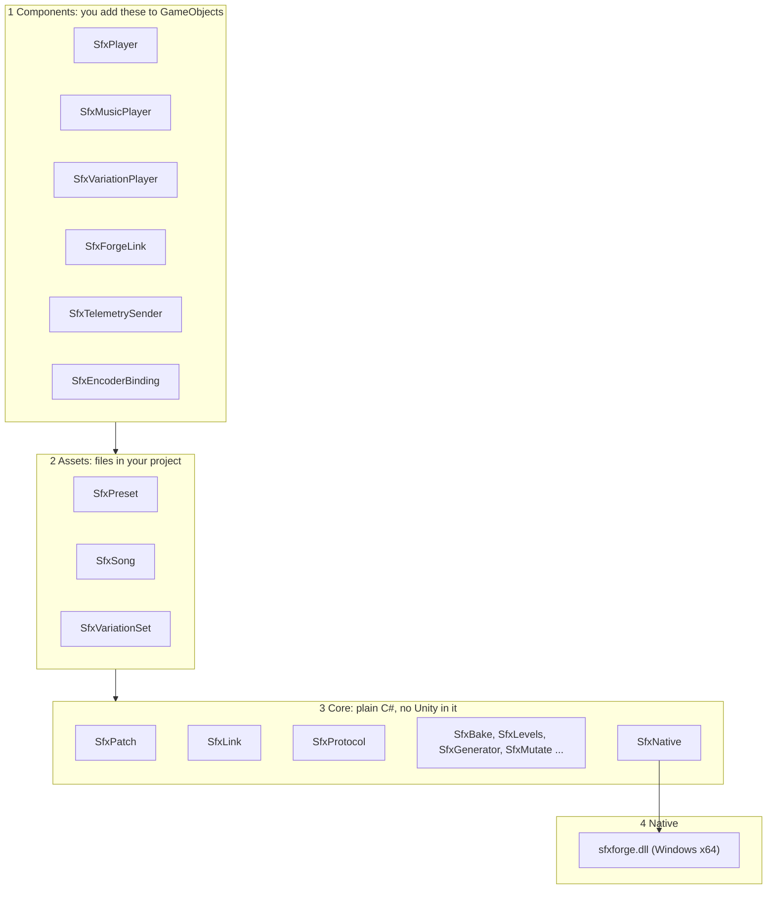
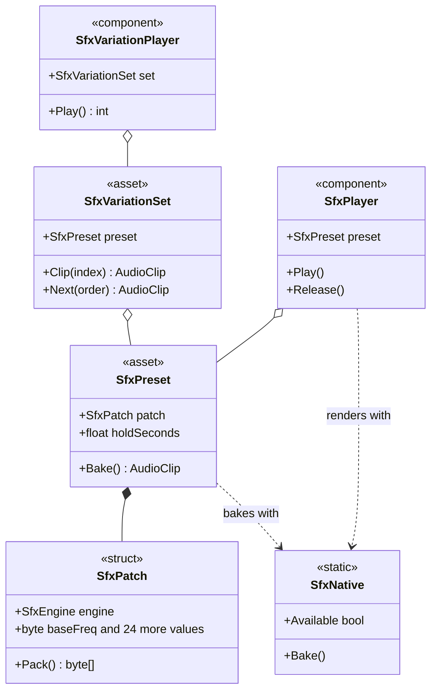
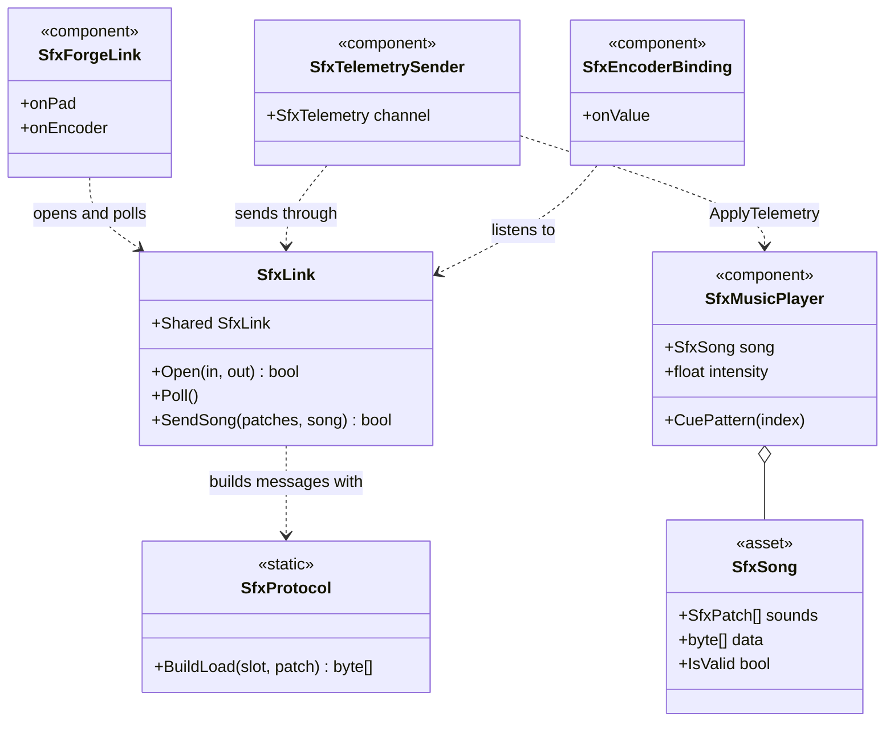

# Unity API Overview

This page is the map of the package's public types: which layer each one sits in, how they point at each other, and
which member to reach for when you want something done. The three pages after it list every public member.

Everything is in the namespace `CatSplat.SfxForge`. Editor code is in `CatSplat.SfxForge.Editor`.

```csharp
using CatSplat.SfxForge;
```

## The four layers



A layer only uses the layers under it. Layer 3 is the folder `Runtime/Core`: it compiles without Unity, which is how
the tests run it ([Unity Architecture](Unity-Architecture)).

## Sounds: who holds what



## Music and the link: who holds what



`SfxLink.Shared` is the one link object. The three link components all use it; none of them holds a link of its own.

## I want to ...

| I want to ... | Use | Listed on |
|---|---|---|
| make a sound in code | `SfxPatch.Create(SfxEngine engine, params byte[] first)` | [Sounds](Unity-API-Sounds#sfxpatch) |
| turn a sound into an `AudioClip` | `SfxPreset.Bake(...)` | [Sounds](Unity-API-Sounds#sfxpreset) |
| get raw samples instead of a clip | `SfxNative.Bake(...)` or `SfxBake.Render(...)` | [Sounds](Unity-API-Sounds#sfxbake-sfxbakeoptions-sfxbaked) |
| play a sound that is synthesized as it plays | `SfxPlayer.Play(...)` | [Sounds](Unity-API-Sounds#sfxplayer) |
| hold a sound and bend it | `SfxPlayer.Play()`, then set `pitchSemitones`, `cutoffOctaves`, `fm`, `level`; `Release()` | [Sounds](Unity-API-Sounds#sfxplayer) |
| play a footstep that differs every time | `SfxVariationPlayer.Play(...)` | [Sounds](Unity-API-Sounds#sfxvariationplayer) |
| know whether the engine is there | `SfxNative.Available` | [Sounds](Unity-API-Sounds#sfxnative-a-voice-and-a-bake) |
| write a `.wav` file | `SfxWav.Write(path, samples, sampleRate, channels)` | [Sounds](Unity-API-Sounds#sfxwav) |
| make a new sound of a kind from a seed | `SfxGenerator.Make(SfxCategory category, uint seed)` | [Sounds](Unity-API-Sounds#sfxgenerator) |
| paste a sound into a chat | `SfxPatchText.ToText(patch)` and `SfxPatchText.TryParse(text, out patch)` | [Sounds](Unity-API-Sounds#sfxpatchtext) |
| start and stop a song | `SfxMusicPlayer.Play()`, `Stop()` | [Music](Unity-API-Music#sfxmusicplayer) |
| bring layers in with danger | `SfxMusicPlayer.intensity` | [Music](Unity-API-Music#sfxmusicplayer) |
| change pattern on the next bar line | `SfxMusicPlayer.CuePattern(int index)` | [Music](Unity-API-Music#sfxmusicplayer) |
| hold one pattern until I say | `SfxMusicPlayer.loopPattern` | [Music](Unity-API-Music#sfxmusicplayer) |
| know which bar and step plays | `SfxMusicPlayer.Bar`, `Step`, `GridStep`, `Pattern` | [Music](Unity-API-Music#sfxmusicplayer) |
| duck or mute one sound of the song | `SfxMusicPlayer.SetTrackVolume`, `SetTrackMute` | [Music](Unity-API-Music#sfxmusicplayer) |
| read a song's steps | `SfxSong.GridStepOn(pattern, sound, step)` and its neighbours | [Music](Unity-API-Music#sfxsong) |
| connect to the device in a scene | add `SfxForgeLink` | [Link](Unity-API-Link#sfxforgelink) |
| send a sound to a pad | `SfxLink.Shared.SendPatch(int slot, SfxPatch patch)` | [Link](Unity-API-Link#sfxlink) |
| fetch the device's song | `SfxLink.Shared.RequestSong()`, then the event `SongReceived` | [Link](Unity-API-Link#sfxlink) |
| stream a game value to the device | add `SfxTelemetrySender`, or call `SfxLink.Shared.SendTelemetry(channel, value01)` | [Link](Unity-API-Link#sfxtelemetrysender) |
| let a knob of the device move a mixer value | add `SfxEncoderBinding` | [Link](Unity-API-Link#sfxencoderbinding) |
| know what the device is | `SfxLink.Shared.Device` (an `SfxDeviceInfo?`) | [Link](Unity-API-Link#sfxdeviceinfo) |

## What works where

| Part | Windows x64 | Anywhere else (by the code; untried) |
|---|---|---|
| `SfxPatch`, `SfxPreset` as data, the tools without sound (`SfxGenerator`, `SfxMutate`, `SfxPatchText`, `SfxLevels`) | yes | yes: plain C# |
| `SfxPlayer`, `SfxMusicPlayer`, `Bake`, `SfxBake.Render` | yes | silent or null: `SfxNative.Available` is false |
| a baked `SfxVariationSet` on `SfxVariationPlayer` | yes | yes: plain `AudioClip` playback |
| `SfxLink` and the three link components | yes | nothing opens: `MidiPorts.Supported` is false |

Only Windows x64 exists and was tried. See [Unity Porting The Native Library](Unity-Porting-The-Native-Library) and
[What Is Tested](What-Is-Tested).

## Next

- [Unity API Sounds](Unity-API-Sounds): every member for patches, presets, players and tools
- [Unity API Music](Unity-API-Music): every member for songs and the music player
- [Unity API Link](Unity-API-Link): every member for the device link
- [Unity Architecture](Unity-Architecture): how these layers are built and why

## Reference

- [The Unity manual, section 2: What is in the package](../docs/UNITY.md#2-what-is-in-the-package)
- [The Unity manual, section 10: API at a glance](../docs/UNITY.md#10-api-at-a-glance)
- [The Unity manual: Limits](../docs/UNITY.md#limits)
- Source: [Runtime](../unity/com.catsplat.sfxforge/Runtime), [Runtime/Core](../unity/com.catsplat.sfxforge/Runtime/Core)
