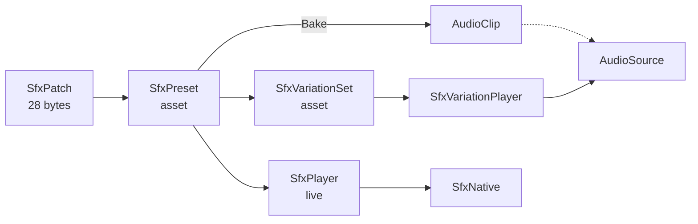

# Unity API Sounds

Every public member of the types that make, hold, play and measure a single sound, with its exact signature. The list
was taken from the source files; for what a type is *for*, start at [Unity API Overview](Unity-API-Overview).

**Threads.** Call everything on this page from Unity's main thread unless a row says otherwise. `SfxPlayer` passes
your calls to the audio thread itself. Of `SfxNative`, the rendering calls may run on an audio thread; `PlayerInit`,
`Bake` and the song tools may not (they clear or allocate memory).

## SfxPatch

A struct: one sound, the same 28 bytes the device keeps. Every value is 0..127. Start from `Create`: a
`new SfxPatch()` has level 0 and is silent. File: [SfxPatch.cs](../unity/com.catsplat.sfxforge/Runtime/Core/SfxPatch.cs).

| Member | What it is |
|---|---|
| `const int Version = 2` | the patch format: the first byte of a packed patch |
| `const int ParamCount = 25` | how many values a patch has |
| `const int Bytes = 3 + ParamCount` | a packed patch: format, engine, 25 values, checksum (28) |
| `const int EngineCount = 5` · `const int TableCount = 6` | engines · wavetables |
| `SfxEngine engine` | the engine that makes the sound |
| `byte baseFreq`, `pitchEnvAmount`, `pitchEnvDecay`, `fmRatio`, `fmDepth`, `noiseMix`, `filterCutoff`, `filterRes`, `ampDecay`, `bitcrush`, `attack`, `sustain`, `release`, `filterEnv`, `filterEnvDecay`, `lfoRate`, `lfoPitch`, `lfoFilter`, `lfoTimbre`, `spread`, `chorus`, `delay`, `reverb`, `level`, `table` | the 25 values, in wire order (the order of `SfxParam`). `sustain` 0 is a one-shot; `level` 100 is "as designed"; `pitchEnvAmount` and `filterEnv` 64 are "none" |
| `static SfxPatch Create(SfxEngine engine, params byte[] first)` | a plain patch of an engine, with the first values set from `first` in wire order |
| `static SfxPatch Default` | a laser |
| `bool IsSustained` | held while its note is held (`sustain` above 0) |
| `byte this[SfxParam p]` | a value by its place; setting above 127 sets 127 |
| `static readonly string[] EngineNames` · `TableNames` | "Impact", "UI Blip", "Sci-Fi FM", "Foley", "Wavetable" · the six wavetables' names |
| `static string Label(SfxParam p, SfxEngine engine)` | what a value is called for an engine |
| `static byte Checksum(byte[] b, int offset)` | the last byte of a packed patch |
| `void Pack(byte[] dst, int offset)` · `byte[] Pack()` | the patch as its 28 bytes |
| `static bool TryUnpack(byte[] src, int offset, out SfxPatch patch)` | false: not a valid patch |
| `static bool IsNewer(byte[] src, int offset)` | 28 bytes or more that begin with a higher format: a newer patch, not a broken one |
| `void Mutate(Random rng)` | every value moves by at most 15 % of its range; the kind of sound stays |
| `void Mutate(ref SfxRandom rng, int step, uint locked = 0)` | the same with the device's generator, an amount and locks (`SfxMutate.Bit`) |
| `static int StepOf(int percent)` | an amount in percent as the step `Mutate` takes (15 is 19) |
| `bool Equals(SfxPatch o)` · `Equals(object obj)` · `GetHashCode()` | two patches with the same values are equal |

**`enum SfxEngine : byte`**: `Impact, UiBlip, SciFiFm, Foley, Wavetable`.

**`enum SfxParam`** (wire order): `BaseFreq, PitchEnvAmount, PitchEnvDecay, FmRatio, FmDepth, NoiseMix, FilterCutoff,
FilterRes, AmpDecay, Bitcrush, Attack, Sustain, Release, FilterEnv, FilterEnvDecay, LfoRate, LfoPitch, LfoFilter,
LfoTimbre, Spread, Chorus, Delay, Reverb, Level, Table`.

**`struct SfxMods`** (what moves a sounding voice): `float pitchSemitones`, `cutoffOctaves`, `fm`, `level`;
`static SfxMods None` (all 0, level 1). It is declared in
[SfxProtocol.cs](../unity/com.catsplat.sfxforge/Runtime/Core/SfxProtocol.cs).

## SfxPreset

A `ScriptableObject`: one sound as an asset. Menu: **Assets > Create > SFX Forge > Preset**.
File: [SfxPreset.cs](../unity/com.catsplat.sfxforge/Runtime/SfxPreset.cs).

| Member | What it is |
|---|---|
| `const int CurrentFormat = SfxAssetFormat.Current` | the asset format this version writes |
| `SfxPatch patch = SfxPatch.Default` | the sound |
| `float holdSeconds = 1.5f` | for a sustained sound: how long a baked clip holds it |
| `int Format` · `bool IsFromNewerVersion` | the format the file was written in · a newer SFX Forge made it |
| `AudioClip Bake(int sampleRate = 48000, float semitones = 0f, float velocity = 1f, int midiNote = 0)` | the sound with its effects as a stereo clip. Null where the native library is missing |

**`static class SfxAssetFormat`**: `const int Current = 1`; `static string NewerText(int format)` and
`NewerText(int format, int current)` (the words said of a newer asset); `static void WarnIfNewer(Object asset, int format)`
and `WarnIfNewer(Object asset, int format, int current)` (one Console warning per asset).

## SfxPlayer

A component (needs an `AudioSource`, clip left empty): synthesizes its preset as it plays. Menu:
**Component > SFX Forge > SFX Player**. Not spatialized. File: [SfxPlayer.cs](../unity/com.catsplat.sfxforge/Runtime/SfxPlayer.cs).

| Member | What it is |
|---|---|
| `SfxPreset preset` | the sound it plays |
| `float volume = 0.8f` | 0..1. Not smoothed |
| `bool playOnEnable` | start when the component is enabled |
| `float pitchSemitones` (0..24) · `float cutoffOctaves` (-4..4) · `float fm` (0..1) · `float level = 1f` (0..1) | the four live values. Set them any time, every frame if you like: the audio thread glides to them over 30 ms |
| `bool IsPlaying` | it sounds, its echoes included |
| `void Play(float velocity = 1f, float semitones = 0f, int midiNote = 0)` | plays the preset; `midiNote` above 0 plays it as that note |
| `void Play(SfxPatch patch, float velocity = 1f, float semitones = 0f, int midiNote = 0)` | plays this patch instead. It also reshapes notes that still sound |
| `void Release()` | lets go of sustained sounds; one-shots finish |
| `void ApplyTelemetry(SfxTelemetry channel, float value01)` | moves a live value as the device would for that telemetry value |

Up to 16 notes sound at once. Without the native library the component stays silent and warns once.

## SfxVariationSet

A `ScriptableObject`: a preset and a seed give a fixed row of variants. Menu:
**Assets > Create > SFX Forge > Variation Set**. File: [SfxVariationSet.cs](../unity/com.catsplat.sfxforge/Runtime/SfxVariationSet.cs).

| Member | What it is |
|---|---|
| `const int CurrentFormat = SfxAssetFormat.Current` · `const int MaxCount = 16` | asset format · the most variants |
| `SfxPreset preset` · `int seed = 1` · `int count = 6` · `int amount = 10` · `int locked` | what the variants are made from. `locked`: a bit per `SfxParam` that stays |
| `float pitchCents = 50f` · `float volumeDb = 2f` · `int noRepeat = 2` · `bool mono` | how a play varies · clips as one channel |
| `int Format` · `bool IsFromNewerVersion` | as on `SfxPreset` |
| `int Count` · `int Amount` | `count` inside 1..16 · `amount` inside 0..100 |
| `SfxPatch VariantPatch(int index)` | variant `index` as a patch; 0 is the preset's own |
| `int Stamp` | a number for everything a bake would be made from; 0 without a preset |
| `bool IsBaked` · `int BakedCount` · `int PlayCount` · `bool IsStale` | clips were written and none is missing · how many · how many a play chooses from · baked, but changed since |
| `AudioClip Clip(int index)` | the baked clip, or one made now where the native library is |
| `bool Prepare()` | makes every clip now. False: nothing can play |
| `SfxShuffle NewOrder(uint seed = 0)` | a new order; seed 0 is another one every time |
| `int NextIndex(SfxShuffle order, out float pitch, out float volume)` | the next play without its clip |
| `AudioClip Next(SfxShuffle order, out float pitch, out float volume)` | the next play: clip, pitch and volume |
| `void ReleaseMadeClips()` | destroys the clips made here (not the baked ones) |

## SfxVariationPlayer

A component (needs an `AudioSource`): plays the next variant with `PlayOneShot`, so it works in 3D. Menu:
**Component > SFX Forge > SFX Variation Player**.
File: [SfxVariationPlayer.cs](../unity/com.catsplat.sfxforge/Runtime/SfxVariationPlayer.cs).

| Member | What it is |
|---|---|
| `SfxVariationSet set` · `float volume = 1f` · `bool prepareOnEnable = true` · `int orderSeed` | the set · volume of every play · make the clips on enable · 0: another order every run |
| `int Last` | the variant played last, -1: none yet |
| `int Play(float volumeScale = 1f)` | plays the next variant; returns which, -1: nothing played. It sets the `AudioSource`'s pitch |
| `void PlayNext()` | `Play()` for a UnityEvent or an animation event |
| `static int PlayOn(AudioSource source, SfxVariationSet set, SfxShuffle order, float volumeScale = 1f)` | the next variant of an order on any `AudioSource` |

**`sealed class SfxShuffle`** (a random order that never repeats the last few):
`SfxShuffle(int count, int noRepeat, uint seed)`, `int Count`, `int NoRepeat`, `int Last`, `int Next()`,
`float NextUnit()`.

## SfxNative: a voice and a bake

A static class: the device's engine as a native library. This table has its members for single sounds; the player and
song members are on [Unity API Music](Unity-API-Music#sfxnative-the-player-and-the-song-tools).
File: [SfxNative.cs](../unity/com.catsplat.sfxforge/Runtime/Core/SfxNative.cs).

| Member | What it is |
|---|---|
| `static bool Available` | false where the library is missing or has another interface number |
| `static int VoiceSize` | bytes to allocate for a voice (zeroed) |
| `static bool Trigger(IntPtr voice, byte[] patch, float velocity, float semitones, float sampleRate, uint seed)` | starts a dry, mono voice. False: not a valid patch |
| `static void Update(IntPtr voice, byte[] patch)` | new values for a voice that sounds |
| `static void Release(IntPtr voice)` · `static bool Active(IntPtr voice)` | let go · true while it sounds |
| `static bool Render(IntPtr voice, ref SfxMods mods, float[] buffer, int n)` | adds `n` mono samples. Audio thread allowed |
| `static bool Bake(SfxPatch patch, out float[] left, out float[] right, int sampleRate = 48000, float velocity = 1f, int midiNote = 0, float semitones = 0f, float holdSeconds = 1.5f, float maxSeconds = 12f)` | the whole sound with effects as stereo samples. Not for an audio thread |
| `static float[] BakeInterleaved(SfxPatch patch, int sampleRate = 48000, float velocity = 1f, int midiNote = 0, float semitones = 0f, float holdSeconds = 1.5f)` | as `Bake`, L R L R: what an `AudioClip` takes. Null on failure |

## SfxBake, SfxBakeOptions, SfxBaked

The one way every tool renders a patch to samples, with options.
File: [SfxBake.cs](../unity/com.catsplat.sfxforge/Runtime/Core/SfxBake.cs).

| Member | What it is |
|---|---|
| `SfxBake.MaxSeconds = 12f` · `SfxBake.EngineRate = 48000` | the longest bake · the rate every sound is rendered at |
| `static SfxBaked SfxBake.Render(SfxPatch patch, float holdSeconds, SfxBakeOptions options = null)` | bake, then resample, mono, normalise, trim, measure. Null: no library, options out of range, or no sound |
| `static int SfxBake.TrimEnd(float[] left, float[] right, int frames, float thresholdDb, int fadeFrames)` | cuts the quiet end; returns the new frame count |
| `static float[] SfxBake.Resample(float[] samples, int frames, int fromRate, int toRate)` | one channel at another rate |
| `SfxBakeOptions`: `int sampleRate = 48000`, `bool mono`, `float semitones`, `int midiNote`, `float velocity = 1f`, `float trimDb`, `float normaliseDb = float.NaN` | 8000..48000 · (L+R)/2 · -48..48 · 0 or 1..127 · 0.01..1 · 0 or -90..-20 · NaN (off) or -60..0 |
| `string SfxBakeOptions.Problem()` · `SfxBakeOptions Clone()` | null, or the first value out of range in words · a copy |
| `SfxBaked`: `float[] samples`, `int channels`, `int sampleRate`, `int frames`, `SfxLevelReading level`, `float gainDb`, `bool cutAtLimit`, `float Seconds` | the rendered sound and what is known of it |

## SfxLevels

Levels in dB, and what a patch's LEVEL does to them. File: [SfxLevels.cs](../unity/com.catsplat.sfxforge/Runtime/Core/SfxLevels.cs).

| Member | What it is |
|---|---|
| `const float Floor = -120f` · `const int MaxLevel = 127` | what silence reads · the highest LEVEL |
| `static float ToDb(float linear)` · `static float FromDb(float db)` | linear to dB and back |
| `static SfxLevelReading Measure(float[] left, float[] right, int frames = -1)` | peak, and RMS of the sound's body. `right` may be null |
| `static float LevelDb(int level)` | what a LEVEL does in dB: 40 · log10(level / 100) |
| `static int LevelFor(int level, float changeDb)` | the LEVEL that is louder by `changeDb` |
| `static float Match(int[] levels, SfxLevelReading[] readings, SfxLevelMeasure by, int[] newLevels, float wantedDb = float.NaN)` | a new LEVEL for every sound so that all read the same; returns that reading |

**`struct SfxLevelReading`**: `float peak`, `float rms`, `int frames`, `float PeakDb`, `float RmsDb`, `bool Clips`,
`bool Silent`. **`enum SfxLevelMeasure`**: `Rms, Peak`.

## SfxWav

`static void SfxWav.Write(string path, float[] samples, int sampleRate, int channels = 1)`: samples (-1..1; two
channels interleaved) as a 16-bit WAV file. File: [SfxWav.cs](../unity/com.catsplat.sfxforge/Runtime/Core/SfxWav.cs).

## SfxGenerator

A new sound of a kind, from a seed. The same category and seed give the same patch.
File: [SfxGenerator.cs](../unity/com.catsplat.sfxforge/Runtime/Core/SfxGenerator.cs).

| Member | What it is |
|---|---|
| `const int Count = 10` · `static readonly string[] Names` | how many kinds · their names as the tools write them |
| `static SfxPatch Make(SfxCategory category, uint seed)` | the sound of this category and seed |
| `static SfxPatch Make(SfxCategory category, ref SfxRandom rng)` | the next sound of a generator |
| `static bool IsSustained(SfxCategory category)` | true for `Alarm` and `Hum` |
| `static bool Fits(SfxCategory category, SfxPatch patch)` | the patch is one a recipe of this category can give |

**`enum SfxCategory`**: `Click, Chime, Leap, Rise, Zap, Thud, Blast, Door, Alarm, Hum`.

## SfxMutate and SfxRandom

| Member | What it is |
|---|---|
| `const uint SfxMutate.All` | every value locked |
| `static uint SfxMutate.Bit(SfxParam p)` | the bit of a value in a set of locks |
| `static SfxPatch SfxMutate.Variant(SfxPatch basePatch, uint seed, int index, int percent, uint locked = 0)` | variant `index` of a base; 0 is the base itself |
| `static int SfxMutate.Stamp(byte[] patch, int holdHundredths, uint seed, int count, int percent, uint locked, bool mono)` | a number for everything a set's clips are made from. Never 0 |
| `SfxRandom(uint seed)` | the device's generator (xorshift32); seed 0 is taken as 0x9E3779B9 |
| `uint Next()` · `int Range(int low, int high)` · `float Unit()` | any 32 bits but 0 · low..high inclusive · 0 <= x < 1 |
| `static uint SfxRandom.Mix(uint seed, uint index)` | a seed for stream `index` of a seed. Never 0 |

Files: [SfxMutate.cs](../unity/com.catsplat.sfxforge/Runtime/Core/SfxMutate.cs),
[SfxRandom.cs](../unity/com.catsplat.sfxforge/Runtime/Core/SfxRandom.cs),
[SfxShuffle.cs](../unity/com.catsplat.sfxforge/Runtime/Core/SfxShuffle.cs).

## SfxPatchText

A sound as 62 characters of text (`SFXF1:` and 56 hex digits), and as a `.syx` file.
File: [SfxPatchText.cs](../unity/com.catsplat.sfxforge/Runtime/Core/SfxPatchText.cs).

| Member | What it is |
|---|---|
| `const string Prefix = "SFXF1:"` · `const int Length` (62) · `const int MaxFile = 65536` | what a text begins with · its length · the largest file `ParseSyx` looks at |
| `static string ToText(SfxPatch patch)` | the patch as text |
| `static SfxTextResult Parse(string text, out SfxPatch patch)` | reads a text; the patch may stand inside a sentence |
| `static bool TryParse(string text, out SfxPatch patch)` | true when `Parse` gives `Ok` |
| `static string Message(SfxTextResult result)` | why a text or file was refused, in words. Null for `Ok` |
| `static byte[] ToSyx(SfxPatch patch, int pad = 0)` | the load message for a pad, 35 bytes |
| `static SfxTextResult ParseSyx(byte[] file, out SfxPatch patch, out int pad)` | reads a `.syx` file; the first message that is a patch is taken |

**`enum SfxTextResult`**: `Ok, Empty, NotOurs, NewerText, BadLength, BadCharacter, NewerPatch, BadPatch,
NoPatchInFile, TooLarge`.

## Next

- [Unity API Music](Unity-API-Music): songs and the music player
- [Unity One Shots](Unity-One-Shots), [Unity Live Voices](Unity-Live-Voices), [Unity Held Sounds](Unity-Held-Sounds): these members in use
- [Unity Sound Design Tools](Unity-Sound-Design-Tools): the tools these classes are the core of

## Reference

- [The Unity manual, section 10: SfxPatch](../docs/UNITY.md#sfxpatch-struct) and the entries after it
- [The Unity manual: The tools' core](../docs/UNITY.md#the-tools-core-static-no-unity-in-it)
- [The Unity manual, section 3: A sound](../docs/UNITY.md#3-a-sound-sfxpatch) and [section 4: three routes](../docs/UNITY.md#4-playing-sounds-three-routes)
- The C side of a patch: [core/sfx_core.h](../core/sfx_core.h)
