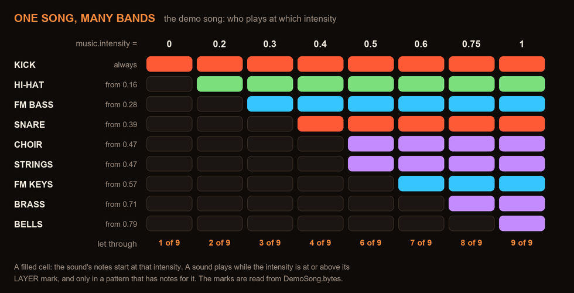
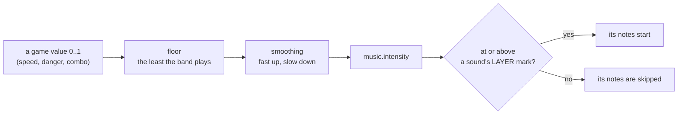
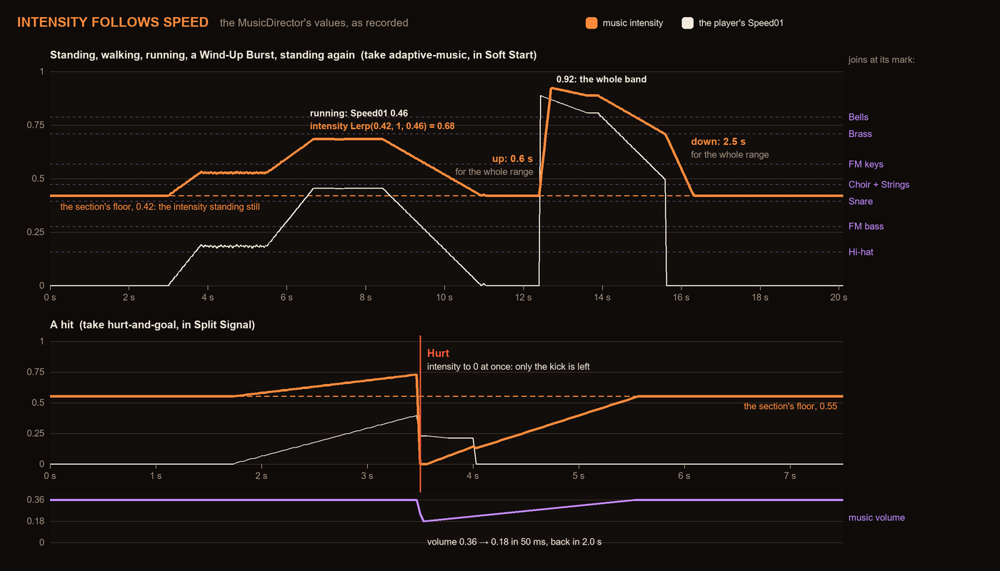
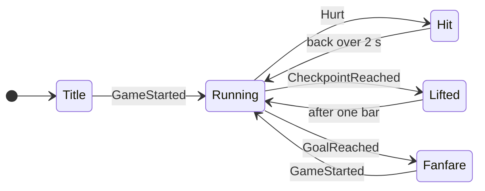
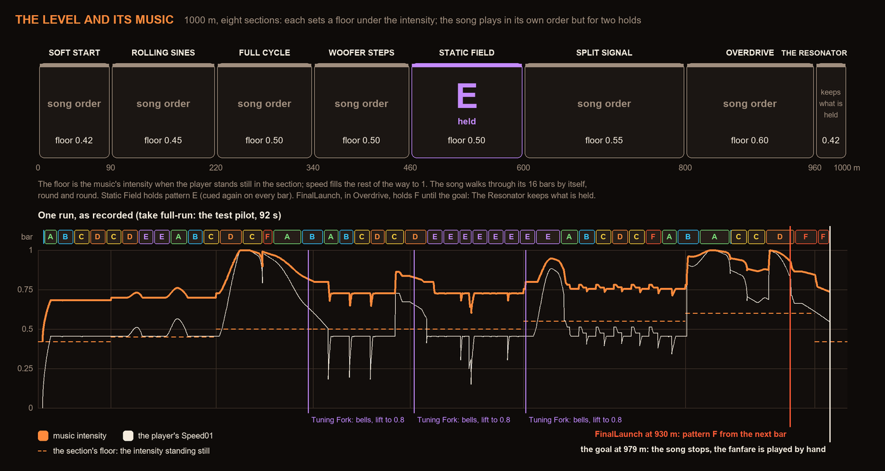

# Unity Adaptive Music

One song, and one number from your game that decides how much of the band plays it. This page shows the idea, the
ten lines of code that drive it, and how the showcase uses it over a whole level.



*The demo song. Each row is an instrument with its LAYER mark; each column is a value of `music.intensity`. At 0
only the kick is let through, at 0.5 six instruments, at 1 all nine. Which of them you hear in a bar also depends on
the pattern: not every pattern has notes for every instrument. The other seven sounds of the kit have no notes in
this song.*

## The rule

> **Every sound of the song has a LAYER mark. A sound plays only while `intensity` is at or above its mark.**

| Word | What it is |
|---|---|
| **LAYER mark** | a number for each of the song's 16 sounds, 0 to 1. It is set on the device and stored in the song. 0 = the sound always plays. Read it with `SfxSong.Layer(sound)` |
| **`intensity`** | a field of `SfxMusicPlayer`, 0 to 1. Your game sets it. It is not in the song |

Two details that save a surprise:

- A mark only lets a sound through. The sound still needs notes in the pattern that plays. In the demo song the
  choir is only in pattern E, bells are in C, D and E, brass is in B, C, D and F.
- Intensity decides which notes **start**. It is compared when a step begins, so a held note that already sounds is
  not cut when the intensity falls under its mark.

The demo song's marks, as the picture shows them:

| `intensity` at or above | joins |
|---|---|
| 0 | kick |
| 0.16 | hi-hat |
| 0.28 | FM bass |
| 0.39 | snare |
| 0.47 | strings, choir |
| 0.57 | FM keys |
| 0.71 | brass |
| 0.79 | bells |

## A game value becomes intensity



The player does not smooth `intensity`. If you write a jumpy value into it, instruments flicker in and out. Smooth it
yourself: up quickly, so the band arrives with the action, and down slowly, so it lingers.

```csharp
using CatSplat.SfxForge;
using UnityEngine;

public class DangerMusic : MonoBehaviour
{
    public SfxMusicPlayer music;                 // one that has a song, for example DemoSong.asset
    [Range(0f, 1f)] public float danger;         // set it from your game: 0 calm … 1 the enemy is on you
    public float floor = 0.15f;                  // the least the band ever plays
    public float riseSeconds = 0.6f, fallSeconds = 2.5f;
    float intensity;

    void Update()
    {
        float target = Mathf.Max(floor, danger);
        float seconds = target > intensity ? riseSeconds : fallSeconds;
        intensity = Mathf.MoveTowards(intensity, target, Time.deltaTime / seconds);
        music.intensity = intensity;
    }
}
```

Try it:

1. Get the demo song playing: the five steps of [Unity Music First Song](Unity-Music-First-Song).
2. Save the script as `DangerMusic.cs` and add it to any GameObject.
3. Drag the object with the **SFX Music Player** onto the script's **Music** field.
4. Press Play. You hear the kick alone: `danger` is 0, and the floor of 0.15 is under every other mark.
5. Drag **Danger** up in the Inspector. Hi-hat, bass, snare and the rest join within 0.6 seconds. Drag it down:
   they leave over 2.5 seconds.

Then let the game write `danger`. Any value from 0 to 1 will do; this one is the distance to an enemy:

```csharp
// in: DangerMusic dangerMusic, Transform enemy, Transform player
float distance = Vector3.Distance(enemy.position, player.position);
dangerMusic.danger = Mathf.InverseLerp(20f, 3f, distance);     // 0 at 20 m or more, 1 at 3 m or less
```

`riseSeconds` and `fallSeconds` are the time to cross the whole range from 0 to 1. Pick the floor from the table
above: 0.15 is under the hi-hat's mark, so at rest this script leaves the kick alone; 0.42 would keep kick, hi-hat,
FM bass and snare.

## A hit that drops the band



*Two recordings from the showcase. Above: the intensity (orange) follows the player's speed (white). Standing still it
rests on the section's floor, 0.42; speed lifts it towards 1, up in 0.6 s and down in 2.5 s for the whole range. The
names on the right show which sound joins at which height. Below: a hit sets the intensity to 0 at once, under the
floor, so only the kick is left; the music's volume dips from 0.36 to 0.18 in 50 ms. Both come back in 2 s.*

To drop the band, write 0 into your smoothed value and let the smoothing bring it back. The showcase's
`MusicDirector` does this, and also holds the target down for as long as the volume is dipped:

```csharp
// a fragment of MusicDirector.cs: intensity is its smoothed value, duckTarget starts the volume's dip
// in: float duckTarget, float intensity
void OnHurt()
{
    duckTarget = 1f;   // the volume dips (see Unity Music Mix And Notes)
    intensity = 0f;    // only the kick is left; Update brings it back
}
```

In the `DangerMusic` script above, the same is one line in a method of your own: `intensity = 0f;`.

## A whole level

The showcase is one level of eight sections. Each section puts a **floor** under the intensity: what plays while the
player stands still. Speed fills the rest of the way to 1.



| State | What the music does |
|---|---|
| Title | intensity held at 0.42: kick, hi-hat, FM bass, snare |
| Running | intensity towards `Mathf.Lerp(floor, 1f, player.Speed01)`: the section's floor standing still, 1 at top speed |
| Hit | intensity 0 at once, volume halved; both back over 2 s |
| Lifted | the target is at least 0.8 for one bar, which is above every mark of the song; three bell notes answer |
| Fanfare | the song is stopped; brass, bells, timpani and strings are played by hand |



*Above: the level to scale, with each section's floor and the pattern it holds, if any. Below: one recorded run. The
dashed line is the floor, the orange line the intensity, the white line the player's speed.*

| Section | Floor | Standing still you hear |
|---|---|---|
| Soft Start, The Resonator | 0.42 | kick, hi-hat, FM bass, snare |
| Rolling Sines | 0.45 | the same |
| Full Cycle, Woofer Steps, Static Field | 0.50 | and strings, choir |
| Split Signal | 0.55 | the same |
| Overdrive | 0.60 | and FM keys |

A floor is one line: `Mathf.Lerp(floor, 1f, speed01)` instead of `Mathf.Max(floor, danger)`. The showcase also holds
two patterns of the song in two places; that is the other half of adaptive music, on
[Unity Cues And Patterns](Unity-Cues-And-Patterns).

## The same value as telemetry

`SfxMusicPlayer.ApplyTelemetry(SfxTelemetry.Intensity, value01)` sets the intensity the way the device does when it
receives the same value over the link. See [Unity Telemetry And Encoders](Unity-Telemetry-And-Encoders).

## Where the marks come from

The marks are set on the device ([Device Layers And Intensity](Device-Layers-And-Intensity)). In Unity you can move
a sound's LAYER in the song's Inspector, and drag an INTENSITY strip there to see which rows go dim:
[Unity Song Inspector](Unity-Song-Inspector).

What of this was run, and what nobody has listened to: [What Is Tested](What-Is-Tested).

## Next

- [Unity Cues And Patterns](Unity-Cues-And-Patterns): change the pattern on the bar line.
- [Unity Music Mix And Notes](Unity-Music-Mix-And-Notes): duck the volume, play a stinger.
- [Unity Showcase Walkthrough](Unity-Showcase-Walkthrough): the level these pictures were recorded in.
- [Unity Recipes](Unity-Recipes): more scripts to paste.

## Reference

- [The Unity manual: Intensity and layers](../docs/UNITY.md#intensity-and-layers)
- [Recipe 6: Music that follows danger](../docs/UNITY.md#6-music-that-follows-danger)
- [The showcase's MusicDirector](../docs/UNITY.md#the-musicdirector)
- [The device's manual, section 11: Layers](../docs/MANUAL.md#11-layers-music-that-follows-the-game)
- [SfxMusicPlayer.cs](../unity/com.catsplat.sfxforge/Runtime/SfxMusicPlayer.cs) ·
  [MusicDirector.cs](../unity/Demo/Assets/Showcase/Scripts/Audio/MusicDirector.cs) ·
  [core/sfx_song.h](../core/sfx_song.h) (`sfx_player_render` compares the intensity with `level`)
- The first picture's script: [um_figures.py](../wiki/figures/um_figures.py)
