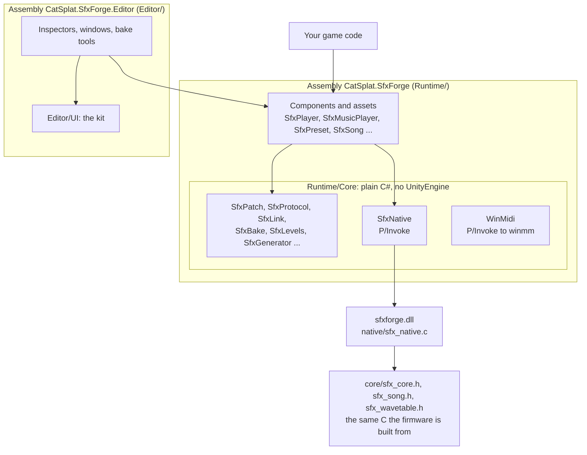
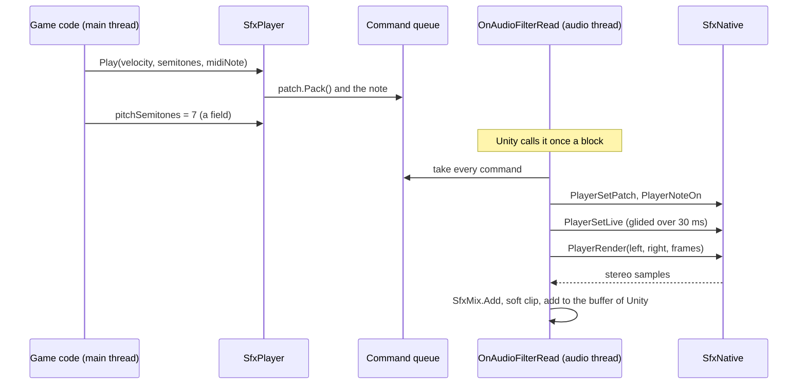
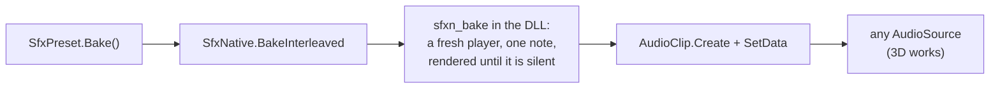
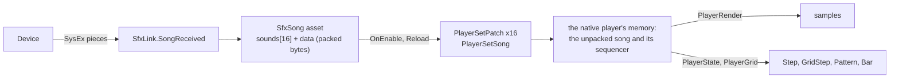
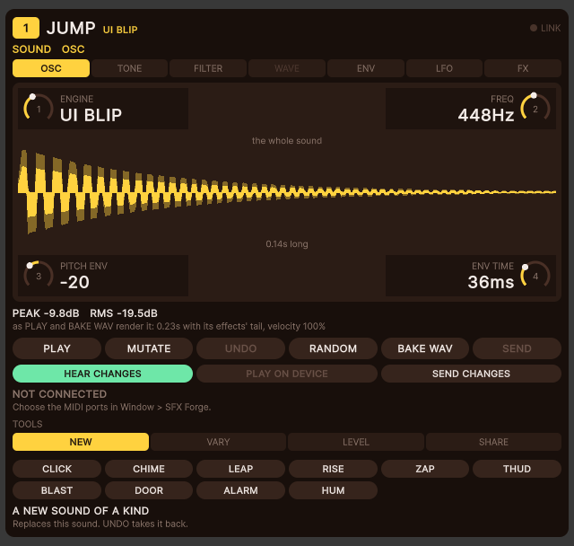
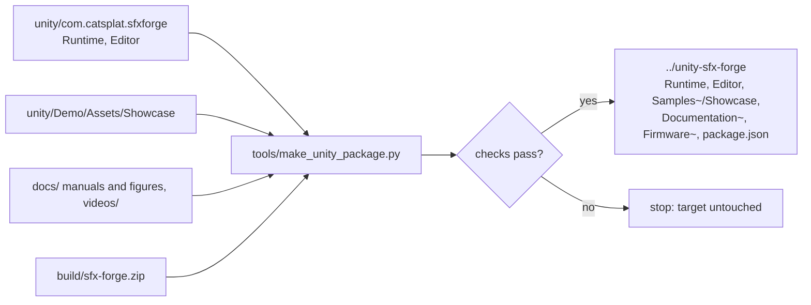

# Unity Architecture

How the Unity package is put together: two assemblies, four layers, one native library that is the device's own
engine, and a script that writes the package you install. Read this before you change or extend the package.
Assembly, assembly definition, P/Invoke, audio thread and `.meta` file are in the [Glossary](Glossary#unity).

## The layers



| Layer | Where | Rule it keeps |
|---|---|---|
| Components and assets | `Runtime/*.cs` | the only runtime code that uses `UnityEngine` |
| Core | `Runtime/Core/*.cs` | no `using UnityEngine`. The .NET tests compile this folder as it is, without Unity |
| Native binding | `Runtime/Core/SfxNative.cs` | the only file that calls the engine. Everything else goes through it |
| Native library | `Runtime/Plugins/x86_64/sfxforge.dll` | built from `native/sfx_native.c`, a thin wrapper that includes `core/sfx_song.h` |
| Engine | `core/*.h` | three C headers, no heap, no libc. The firmware includes the same files |

That last row is the point of the design: a patch or a song sounds in Unity as it does on the device because the same
C code renders both.

## The two assemblies

| Assembly | File | Notes |
|---|---|---|
| `CatSplat.SfxForge` | [CatSplat.SfxForge.asmdef](../unity/com.catsplat.sfxforge/Runtime/CatSplat.SfxForge.asmdef) | no references, `autoReferenced: true`: your scripts see it without doing anything |
| `CatSplat.SfxForge.Editor` | [CatSplat.SfxForge.Editor.asmdef](../unity/com.catsplat.sfxforge/Editor/CatSplat.SfxForge.Editor.asmdef) | Editor only, references the runtime, `autoReferenced: false`: an editor script of yours needs an assembly definition that references it by name |

Both name `CatSplat.SfxForge.Editor.Tests` in an `InternalsVisibleTo`
([Runtime/AssemblyInfo.cs](../unity/com.catsplat.sfxforge/Runtime/AssemblyInfo.cs)): the test project of the source
repository, which is not in the package.

## A sound, from Play() to the speaker

`SfxPlayer` and `SfxMusicPlayer` work the same way. Your call never touches the engine: it becomes a command in a
queue, and Unity's audio thread carries it out at the start of the next block.



The details, all in [SfxPlayer.cs](../unity/com.catsplat.sfxforge/Runtime/SfxPlayer.cs):

1. **`OnEnable`** allocates one native player (`Marshal.AllocHGlobal(SfxNative.PlayerSize)`, about 0.6 MB) and calls
   `SfxNative.PlayerInit` at `AudioSettings.outputSampleRate`. `OnDisable` frees it.
2. **`Update`** keeps the `AudioSource` playing. Unity only calls `OnAudioFilterRead` while the source plays, and it
   plays without a clip too. That is why you leave the clip empty.
3. **`Play`** packs the patch to 28 bytes and enqueues a command in a `ConcurrentQueue`. It returns at once.
4. **`OnAudioFilterRead`** takes a lock, drains the queue (`PlayerSetPatch` on slot 0, `PlayerNoteOn` with the next
   of 16 keys), moves the four live values towards the fields you set, and calls `PlayerRender`.
5. **`SfxMix.Add`** multiplies by `volume * 1.25`, soft-clips as the device does, and *adds* the block to the buffer
   Unity passed in. From there it is the `AudioSource`'s output: its mixer group, the listener, the speaker.

The lock is held by the audio thread for a whole block and by the main thread only in `OnEnable`, `OnDisable` and
`SfxMusicPlayer.Reload`. The live fields (`pitchSemitones`, `intensity` ...) are plain fields the audio thread reads
once a block.

The baked route has no audio thread in it:



`SfxBake.Render` is the same bake with options on top (sample rate, mono, trim, normalise); the tools and
`SfxVariationSet` use it.

## Where the song lives



- The **asset** keeps the song exactly as the device packs it (`SfxSong.data`) plus its 16 patches. Nothing in C#
  edits the steps. The song's Inspector writes five things straight into those bytes: tempo, swing, and each sound's
  layer, fader and pan.
- **`SfxPackedSong`** is a second reader of those bytes, in C#, for inspectors and tests. The native player has its
  own reader in C; `SfxMusicPlayer` only asks `SfxSong.IsValid` (which asks `SfxPackedSong`) before it loads a song.
- The **native player** unpacks the bytes once and runs the sequencer inside `PlayerRender`, on its own sample clock.
  `CuePattern`, the intensity and the track mix are applied to that copy; the asset is never changed by playing.

## The link

`SfxLink` is in Core, so it has no Unity in it. `WinMidi.cs` holds the real ports under
`#if UNITY_EDITOR_WIN || UNITY_STANDALONE_WIN || SFX_WINDOWS` and stand-ins that open nothing under `#else`. MIDI
arrives on a system thread into a queue; `SfxLink.Poll()` empties it on your thread and fires the events. Two things
call `Poll` for you: `SfxForgeLink.Update` in a scene, and `SfxForgeEditorLink` on `EditorApplication.update` in the
editor. See [Unity API Link](Unity-API-Link).

## The editor UI

The inspectors are UI Toolkit, drawn like the device's display.



*An `SfxPreset`'s Inspector, page OSC, as the tests render it: a header, page tabs, four value tiles in the corners
of the waveform, the level line, soft keys, and the tool tabs at the foot.*

| Idea | How the code does it |
|---|---|
| An inspector is one element | `SfxPresetEditor.Build(SerializedObject)` returns a `VisualElement` (an `SfxPresetPanel`). `CreateInspectorGUI` returns the same, so a test can build it without a window |
| A window is a view over a model | `SfxForgeWindow.Build(SfxForgeModel)` and `SfxBakeWindow.Build(SfxBakeModel)`. The view never touches MIDI or the AssetDatabase; the window fills the model |
| One kit | `Editor/UI`: `SfxUI.Panel()`, `ValueTile`, `Knob`, `SoftKeyRow`, `PageTabs`, `WaveformView`, `PadGrid` ... and the stylesheet `SfxForge.uss` |
| Values live in the asset | a control shows what it is given and reports what the mouse did. Changes go through the `SerializedObject`, so Undo and multi-selection work |
| The device's texts | `SfxUnits` writes every value as the display does (`448Hz`, `36ms`) |

The kit has its own guide: [Editor/UI/README.md](../unity/com.catsplat.sfxforge/Editor/UI/README.md).

## How the package is generated

The folder `unity/com.catsplat.sfxforge` in this repository is the *source*. The package people install is a separate
repository that a script writes from nothing:

```sh
python tools/make_unity_package.py        # default target: ../unity-sfx-forge
```

It needs Python 3 and ffmpeg, the videos in `videos/`, the figures in `docs/img`, the built firmware
(`build/sfx-forge.zip`) and the SDK and Zig in `.tools` (for their licence texts). When one is missing it stops.



| | Source folder | Generated package |
|---|---|---|
| Package name | `com.catsplat.sfxforge` | `com.catsplatstudios.sfxforge` |
| Version, display name | 0.1.0, "SFX Forge Bridge" | 1.0.0, "SFX Forge" |
| `"unity"` in `package.json` | 2022.3 | 6000.3 (the version it was tested with: 6000.3.8f1) |
| Showcase | a folder of the demo project | a sample, `Samples~/Showcase` |
| Manuals | `docs/` | `Documentation~` |

Why it is done this way: there is one place to edit (this repository), and the generated repository is never edited
by hand. The script builds in a folder beside the target, checks it (every file has a `.meta`, no two share a GUID,
the plugin's `.meta` pins it to the editor and Windows x64, no e-mail address and no machine path, every relative
link resolves) and
replaces the target only when all checks passed. It never starts Unity.

## Next

- [Unity Extending](Unity-Extending): recipes that build on this structure
- [Unity Porting The Native Library](Unity-Porting-The-Native-Library): the native layer on another platform
- [Architecture Overview](Architecture-Overview): the whole project, firmware included
- [Sound Engine](Sound-Engine): what `core/*.h` does with a patch

## Reference

- [The maintainer's guide, section 1: The map](../docs/MAINTAINING.md#1-the-map)
- [The maintainer's guide, section 4: The two flows](../docs/MAINTAINING.md#4-the-two-flows) (its last paragraph is Unity's audio thread)
- [The maintainer's guide: Regenerate the package](../docs/MAINTAINING.md#regenerate-the-package)
- [The Unity manual, section 2](../docs/UNITY.md#2-what-is-in-the-package) and [The inspectors look like the device](../docs/UNITY.md#the-inspectors-look-like-the-device)
- Source: [SfxPlayer.cs](../unity/com.catsplat.sfxforge/Runtime/SfxPlayer.cs),
  [SfxMusicPlayer.cs](../unity/com.catsplat.sfxforge/Runtime/SfxMusicPlayer.cs),
  [SfxNative.cs](../unity/com.catsplat.sfxforge/Runtime/Core/SfxNative.cs),
  [sfx_native.c](../native/sfx_native.c), [make_unity_package.py](../tools/make_unity_package.py)
