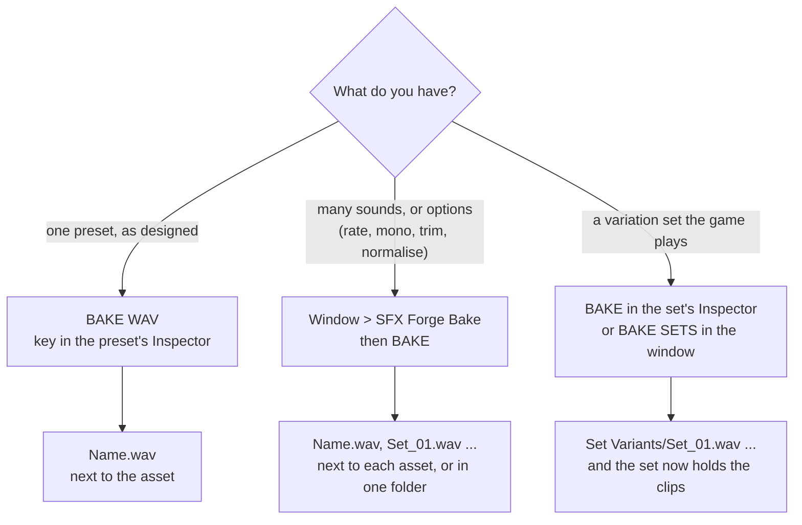
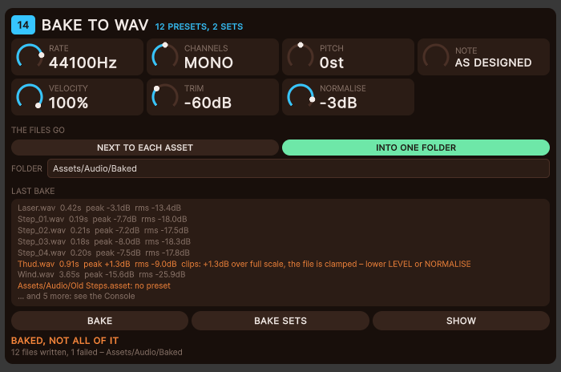

# Unity Baking And WAV

This page shows the three ways to turn sounds into `.wav` files in the editor, what each one writes, and where the
files go. **Baking** means rendering a sound once into samples; a baked file is an ordinary audio file that Unity
imports as an `AudioClip` and that plays on every platform.

## Which bake?



| | Writes | Where | Options |
|---|---|---|---|
| **BAKE WAV** (preset's Inspector) | `<name>.wav` | next to the preset | none: 48 kHz, stereo, 16 bit, as designed |
| **BAKE** (Bake window) | `<name>.wav` for a preset, `<name>_01.wav` … for a set | next to each asset, or into one folder | all of them |
| **BAKE** (set's Inspector) · **BAKE SETS** (Bake window) | `<name>_01.wav` … | `<the set's folder>/<name> Variants/` | none: 48 kHz, 16 bit, stereo or mono as the set says |

All three need the native library, so they run on Windows x64 only. The files they write play anywhere.

## One preset: BAKE WAV

1. Select a preset.
2. Press **BAKE WAV** in its Inspector.
3. `<name>.wav` appears next to the asset and Unity points at it.

With several presets selected, each gets its file. A held sound is held for the preset's HOLD time, then let go.
The key does nothing where the native library is missing.

## Many sounds, with options: the Bake window



*Window > SFX Forge Bake, rendered by its tests from a model they filled in: the files, levels and paths are the
test's, and no such run was made. An orange line failed or carries a note.*

1. In the Project window, select presets, variation sets or folders. Folders are searched with their subfolders.
2. Open **Window > SFX Forge Bake** (or **Assets > SFX Forge > Bake to WAV...**). The top line counts what is
   selected, for example `12 PRESETS, 2 SETS`.
3. Set the options (below) and choose where **THE FILES GO**.
4. Press **BAKE**. Under **LAST BAKE** you see the last eight lines of the run, such as
   `Laser.wav  0.42s  peak -3.1dB  rms -13.4dB`, and `… and 5 more: see the Console` when there are more. The
   whole report goes to the Console. The footer reads `BAKED`, `BAKED, NOT ALL OF IT` or `CANCELLED`.
5. **SHOW** points at the file written last.

| Tile | Values | |
|---|---|---|
| **RATE** | 22050, 24000, 32000, 44100, 48000 Hz | 48000 at first. Every sound is rendered at 48 kHz and resampled |
| **CHANNELS** | STEREO, MONO | mono is the mean of left and right |
| **PITCH** | −24 … +24 semitones | transposes every sound |
| **NOTE** | AS DESIGNED, or C1 … C7 | every sound played as that note |
| **VELOCITY** | 1 … 100 % | |
| **TRIM** | OFF, −60, −48, −36 dB | cuts the end after the last sample above that level, with a short fade |
| **NORMALISE** | OFF, or 0 … −24 dB | brings every file's peak to that level, before TRIM looks at it |

| THE FILES GO | |
|---|---|
| **NEXT TO EACH ASSET** | each file beside the preset or set it came from |
| **INTO ONE FOLDER** | all files into **FOLDER**: `Assets/SfxForge/Baked` at first. It must be inside `Assets` and is made if missing |

The options and the folder are remembered between sessions. From nine files on, a bake shows a progress bar and can
be cancelled.

**What a line can tell you:**

| Note on a line | Meaning |
|---|---|
| `cut at 12 s (the longest a bake renders)` | the sound still rang at 12 seconds and was cut |
| `clips: +1.3dB over full scale, the file is clamped – lower LEVEL or NORMALISE` | the file is distorted. Use NORMALISE, or LEVEL in [Unity Sound Design Tools](Unity-Sound-Design-Tools#level-how-loud-and-several-sounds-alike) |
| `silent` | nothing came out |
| `<path>: no preset` | a variation set without a sound |
| `<path>: not inside Assets – choose ONE FOLDER` | the asset has no folder of its own to write next to |
| `could not write: …` | the file could not be written; the run goes on with the next one |

## A variation set: its own BAKE

A variation set is one sound as several ([Unity Variations](Unity-Variations)). Its own BAKE does more than write
files: it puts the clips into the set, so the game plays them without the native library.

1. Select the set. Press **BAKE** in its Inspector.
2. The files appear in `<the set's folder>/<name> Variants/`: `<name>_01.wav`, `<name>_02.wav` … File 01 is the
   preset itself.
3. The footer reads, for example, `6 CLIPS BAKED` with the folder, the clips' kind and their size. **SHOW CLIPS**
   points at them.

It is all or nothing: every variant is rendered first, and if one does not render or one file cannot be written,
nothing is written and the set stays as it was. In the Bake window, **BAKE SETS** does this for every set in the
selection.

| The set's Inspector says | Meaning |
|---|---|
| `6 CLIPS BAKED` in the footer | it plays everywhere |
| `OUT OF DATE` | the preset's sound or HOLD, or the set's seed, COUNT, amount, locks or MONO changed since. It plays the old clips. BAKE again |
| `NOT BAKED` | it plays only where the native library is |
| `NO PRESET` | the set has no sound yet: choose one in PRESET |

**The window's BAKE on a set is not the set's BAKE.** BAKE in the window writes the variants as loose files with
the window's options and changes no asset. Only the set's own BAKE (or BAKE SETS) gives the set its clips.
**Bake every set before you ship**: nothing checks this when the game is built.

## What happens to existing files

- **Overwritten without a question, in place.** The file's GUID and import settings stay, so references to the
  clip hold. A `.wav` of the same name that did not come from a bake is overwritten too.
- **Nothing is deleted** by the window or BAKE WAV. A set's own BAKE deletes only clips the set had in its own
  folder with a number above the new COUNT.
- **No two assets of a run write the same file.** Where two would, the later one by path is numbered: `Step 2.wav`.
- **A bake is not an Undo step.** A set's BAKE also clears the set's undo history.
- **The same assets and options write the same bytes again**, so a re-bake shows no change in version control.

## From code

In an editor script, the window's run:

```csharp
using System.Collections.Generic;
using CatSplat.SfxForge;
using CatSplat.SfxForge.Editor;
using UnityEditor;
using UnityEngine;

public static class BakeForMobile
{
    [MenuItem("Assets/SFX Forge/Bake Selection for Mobile")]
    static void Bake()
    {
        var options = new SfxBakeOptions { sampleRate = 22050, mono = true, trimDb = -60f, normaliseDb = -3f };
        List<Object> assets = SfxBatchBake.Collect(Selection.objects);
        SfxBakeReport report = SfxBatchBake.Run(assets, options, SfxBakeTo.OneFolder, "Assets/Audio/Baked");
        report.ToConsole();
    }
}
```

| Call | Does |
|---|---|
| `SfxForgeEditorLink.BakeWav(preset)` | BAKE WAV: returns the imported `AudioClip` |
| `SfxForgeEditorLink.BakeWav(preset, options, path)` | one preset with options, to a path of your choice |
| `SfxBatchBake.Run(assets, options, to, folder, progress)` | the window's BAKE |
| `SfxBatchBake.BakeSets(assets)` | BAKE SETS |
| `SfxVariationBaker.Bake(set)` | a set's own BAKE |
| `SfxBake.Render(patch, holdSeconds, options)` | no file: the samples as an `SfxBaked` (runtime assembly; `null` without the native library) |
| `SfxWav.Write(path, samples, sampleRate, channels)` | writes a 16-bit WAV from samples |

Baking at run time into a clip, without a file, is the baked route of [Unity One Shots](Unity-One-Shots).

## Traps

- **A sound is at most 12 seconds.** Longer ones are cut and the line says so.
- **A run renders on the editor's main thread.** A large selection holds the editor until it is done.
- **16 bit only.** Compression and load type are Unity's import settings of the written files.
- **Not tried:** the real window, its progress bar and the menu items; nobody has listened to a resampled file.
  See [What Is Tested](What-Is-Tested).

## Next

- [Unity One Shots](Unity-One-Shots): play what you baked.
- [Unity Variations](Unity-Variations): play a baked set.
- [Unity Sound Design Tools](Unity-Sound-Design-Tools): match levels before a batch.

## Reference

- [The Bake window](../docs/UNITY.md#the-bake-window) and [Variation sets](../docs/UNITY.md#variation-sets) in the Unity manual
- [Route 1: baked](../docs/UNITY.md#route-1-baked) and [recipe 12, exporting a WAV in the editor](../docs/UNITY.md#12-exporting-a-wav-in-the-editor)
- Source: [SfxBakeWindow.cs](../unity/com.catsplat.sfxforge/Editor/SfxBakeWindow.cs),
  [SfxBakeView.cs](../unity/com.catsplat.sfxforge/Editor/SfxBakeView.cs),
  [SfxBatchBake.cs](../unity/com.catsplat.sfxforge/Editor/SfxBatchBake.cs),
  [SfxVariationBaker.cs](../unity/com.catsplat.sfxforge/Editor/SfxVariationBaker.cs),
  [SfxForgeEditorLink.cs](../unity/com.catsplat.sfxforge/Editor/SfxForgeEditorLink.cs),
  [SfxBake.cs](../unity/com.catsplat.sfxforge/Runtime/Core/SfxBake.cs),
  [SfxWav.cs](../unity/com.catsplat.sfxforge/Runtime/Core/SfxWav.cs)
