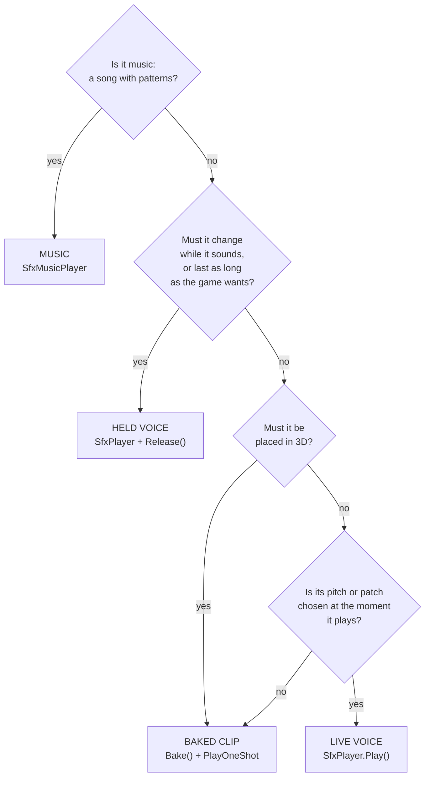
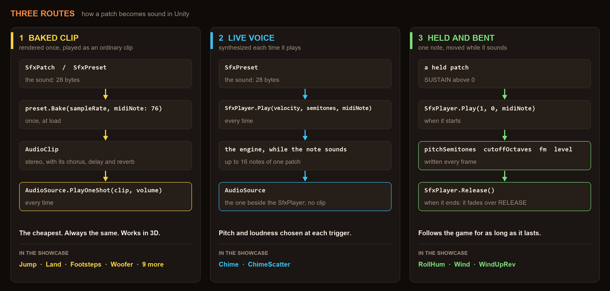

# Unity Choosing A Route

There are four ways a patch (one sound) becomes sound in your game: three for sound effects, and music. This page
helps you pick one for each sound, and tells you what each costs.

## Decide

A sound that fires often and should not be the same twice (a footstep) is a baked clip too, as a row of clips
played in a shuffled order: see [Unity Variations](Unity-Variations).

## The routes side by side

*Read each column from the top: what you start with, what you call, what plays. Yellow is baked, blue is a live
voice, green is held. The last line of each column names showcase sounds that use it: the showcase has 19 sounds,
14 baked (the two footsteps counted apart), 2 live and 3 held. Music, the fourth route, is not in the picture.*

Three words in the tables below: a *held* patch is one whose SUSTAIN is above 0, so it sounds until it is released;
the *live values* are four numbers of a player that bend a sound while it plays; an *audio block* is the run of
samples Unity asks for in one go. All are in the [Glossary](Glossary#playing-a-sound).

| Route | You call | Use it for | Page |
|---|---|---|---|
| **Baked clip** | `preset.Bake(…)` once, then `AudioSource.PlayOneShot(clip)` | short sounds that fire often and are always the same: jump, footstep, UI click | [Unity One Shots](Unity-One-Shots) |
| **Live voice** | `SfxPlayer.Play(velocity, semitones, midiNote)` | a sound decided when it plays: a pickup that climbs a scale | [Unity Live Voices](Unity-Live-Voices) |
| **Held voice** | `Play` on a held patch, write the live values every frame, then `Release()` | a sound that follows the game: an engine, wind, a charge | [Unity Held Sounds](Unity-Held-Sounds) |
| **Music** | `SfxMusicPlayer` with an `SfxSong`; set `intensity`, call `CuePattern` | a song whose layers follow the game | [Unity Music First Song](Unity-Music-First-Song) |

## What each costs

| | Baked clip | Live voice | Held voice | Music |
|---|---|---|---|---|
| **CPU while it plays** | the least: Unity plays an ordinary clip | the engine runs on the audio thread while the player sounds | the same, for as long as it is held | the engine runs the whole song |
| **CPU up front** | the bake: it renders on the calling thread, so do it at load | none | none | none |
| **Memory** | the clip's samples | the player's own engine with its effects, about 0.6 MB a player | the same | the same |
| **When a trigger is heard** | as any `PlayOneShot` | at the next audio block: `Play` queues a command that the audio thread takes when Unity next asks for samples | the same; live values glide over 30 ms | a cue takes effect at the next bar line |
| **Flexibility** | fixed when baked. Volume per play; the AudioSource's pitch changes the length too | pitch and velocity per trigger. Another patch too, but it reshapes notes of that player that still sound | pitch, filter, timbre and level while it sounds | intensity, cues, mix while it plays |
| **3D** | yes | no | no | no |
| **Needs the native library to play** | no, only to bake | yes | yes | yes |

## The same questions, answered per route

| Question | Baked | Live voice | Held voice |
|---|---|---|---|
| Can each trigger have its own pitch? | only by the AudioSource's pitch | **yes**, by semitones or MIDI note | yes, and while it sounds |
| Can it change while it sounds? | no | the four live values, for all notes of that player | **yes** |
| Can it sustain as long as the game wants? | no: a held patch is held for `holdSeconds`, then let go | yes | **yes** |
| Can many overlap? | yes (`PlayOneShot`) | up to 16 notes of **one** patch per player | one sound per player |

## Rules of thumb

- **Start baked.** Most game sounds are short and always the same. Move a sound to a live voice only when you need
  what baking cannot give.
- **Count your players.** Every `SfxPlayer` runs an engine of its own. A few are fine; one per bullet is not what
  it is for. The showcase bakes 14 of its 19 sounds, and has a small pool of players for its two live ones.
- **3D means baked.** A player adds its sound to a 2D mix.
- **A pitched sound that must be in tune with the music** is played as a MIDI note (`midiNote`), on any route.

## Next

- [Unity One Shots](Unity-One-Shots): the baked route, step by step
- [Unity Live Voices](Unity-Live-Voices): a voice per trigger
- [Unity Held Sounds](Unity-Held-Sounds): hold it and bend it
- [Unity Music First Song](Unity-Music-First-Song): the fourth route

## Reference

- [The Unity manual, section 4: Playing sounds: three routes](../docs/UNITY.md#4-playing-sounds-three-routes)
- [The Unity manual, "Which one?"](../docs/UNITY.md#which-one)
- [The Unity manual, "Limits"](../docs/UNITY.md#limits)
- [The Unity manual, "What uses which route" (the showcase)](../docs/UNITY.md#what-uses-which-route)
- [SfxPlayer.cs](../unity/com.catsplat.sfxforge/Runtime/SfxPlayer.cs),
  [SfxPreset.cs](../unity/com.catsplat.sfxforge/Runtime/SfxPreset.cs),
  [LiveVoicePool.cs](../unity/Demo/Assets/Showcase/Scripts/Audio/LiveVoicePool.cs)
