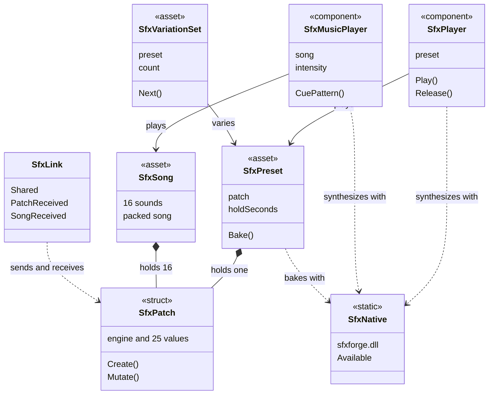
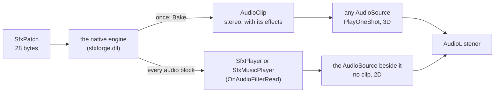

# Unity Concepts

The package has eight nouns worth knowing. This page shows how they relate and when you touch each one, so the
other pages read easily.

## The pieces

Everything is in the namespace `CatSplat.SfxForge`.

| Noun | Kind | What it is | When you touch it |
|---|---|---|---|
| `SfxPatch` | struct | one sound: an engine and 25 values, each 0 to 127. Packed, it is the same 28 bytes the device keeps | when you write a sound in code, or change a value from a script |
| `SfxPreset` | asset | a patch you can select, hear and tune in the Inspector. `Bake` turns it into an `AudioClip` | whenever a sound should be an asset: most of the time |
| `SfxPlayer` | component | synthesizes one patch while it sounds, and bends it with four live values (pitch, filter, timbre, level) | for a sound decided when it plays, or one that follows the game |
| `SfxVariationSet` | asset | one preset as several variants, played in a shuffled order. `SfxVariationPlayer` is the component that plays it | for a sound that fires often and must not repeat itself: footsteps, hits |
| `SfxSong` | asset | a piece of music: 16 sounds and the packed song (patterns, arrangement, layers, mix, automation). It is made on the device | when you play music; you do not edit its notes in Unity |
| `SfxMusicPlayer` | component | plays an `SfxSong`. The game sets `intensity`, cues patterns and moves the mix | for adaptive music |
| `SfxLink` | class | the MIDI connection to the device, as `SfxLink.Shared`. Windows only | only when a device (or its emulator) is connected, to fetch or send sounds and songs |
| the native library | `sfxforge.dll` | the device's own engine, compiled for Windows x64. `SfxNative` is the C# door to it | rarely by hand: `SfxNative.Available` tells you whether it is there, `SfxNative.Bake` renders a patch without an asset |

If a word here is new, [the Glossary](Glossary) has it.

## Where the sound comes from

There are no audio files. Every sound starts as a patch and is turned into samples by the native engine. The only
question is *when*: once, ahead of time (a baked clip), or while it plays (a player).

| | Baked clip | A player |
|---|---|---|
| The engine runs | once, when you call `Bake` | all the time the sound plays |
| What Unity sees | an ordinary `AudioClip` | an `AudioSource` with no clip whose samples the player fills in |
| Needs the native library when it plays | no | yes |
| Can change while it sounds | no | yes |
| Can be placed in 3D | yes | no: a player is not spatialized |

A player's `AudioSource` has no clip. The player keeps the source running and adds its samples in Unity's audio
callback (`OnAudioFilterRead`), on the audio thread. Each `SfxPlayer` and each `SfxMusicPlayer` holds its own
engine, with its own chorus, delay and reverb: about 0.6 MB each.

## Three rules that follow from this

1. **One `SfxPlayer`, one patch.** It overlaps up to 16 notes of that patch. Give it another patch and what still
   sounds is reshaped. For several different live sounds, use several players.
2. **`sustain` decides the kind of sound.** At 0 the sound is a one-shot and ends by itself. Above 0 it is held,
   and you must call `Release()`. See [Unity Presets And Patches](Unity-Presets-And-Patches#one-shot-or-held).
3. **No library, no synthesis.** Off Windows x64, `SfxNative.Available` is false, `Bake` returns null and the
   players stay silent. Clips that were baked into files in the editor (a baked variation set, a WAV) are
   ordinary clips and need no library. That they play on another platform follows from this; it was not tried
   ([What Is Tested](What-Is-Tested)).

## The editor side

| Thing | What it is |
|---|---|
| The Inspector of an `SfxPreset` | the device's sound page: seven pages of value tiles, PLAY, MUTATE, BAKE WAV and four tools |
| The Inspector of an `SfxSong` | a viewer of the song. Five numbers can be changed: TEMPO, SWING, and a sound's LAYER, VOLUME and PAN |
| The Inspector of an `SfxVariationSet` | the variants as tiles, PLAY NEXT and BAKE |
| **Window > SFX Forge** | the link to the device: ports, pads, the patches that arrived |
| **Window > SFX Forge Bake** | many presets to `.wav` files at once |

## Next

- [Unity Choosing A Route](Unity-Choosing-A-Route): which of the ways to play fits your sound
- [Unity Presets And Patches](Unity-Presets-And-Patches): the 25 values and the five engines
- [Unity Music First Song](Unity-Music-First-Song): `SfxSong` and `SfxMusicPlayer` in use
- [Unity Architecture](Unity-Architecture): the same picture one level deeper, threads included

## Reference

- [The Unity manual, section 2: What is in the package](../docs/UNITY.md#2-what-is-in-the-package)
- [The Unity manual, section 10: API at a glance](../docs/UNITY.md#10-api-at-a-glance)
- [The Unity manual, "Limits"](../docs/UNITY.md#limits)
- Source: [SfxPatch.cs](../unity/com.catsplat.sfxforge/Runtime/Core/SfxPatch.cs),
  [SfxPreset.cs](../unity/com.catsplat.sfxforge/Runtime/SfxPreset.cs),
  [SfxPlayer.cs](../unity/com.catsplat.sfxforge/Runtime/SfxPlayer.cs),
  [SfxVariationSet.cs](../unity/com.catsplat.sfxforge/Runtime/SfxVariationSet.cs),
  [SfxSong.cs](../unity/com.catsplat.sfxforge/Runtime/SfxSong.cs),
  [SfxMusicPlayer.cs](../unity/com.catsplat.sfxforge/Runtime/SfxMusicPlayer.cs),
  [SfxLink.cs](../unity/com.catsplat.sfxforge/Runtime/Core/SfxLink.cs),
  [SfxNative.cs](../unity/com.catsplat.sfxforge/Runtime/Core/SfxNative.cs)
