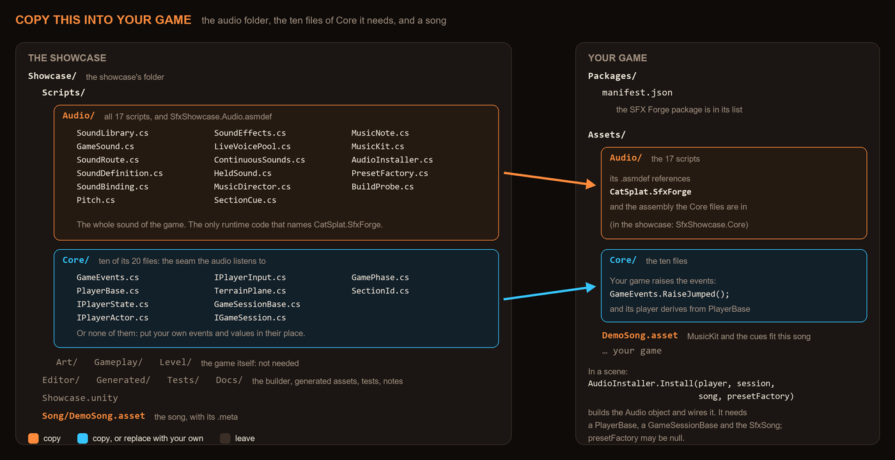
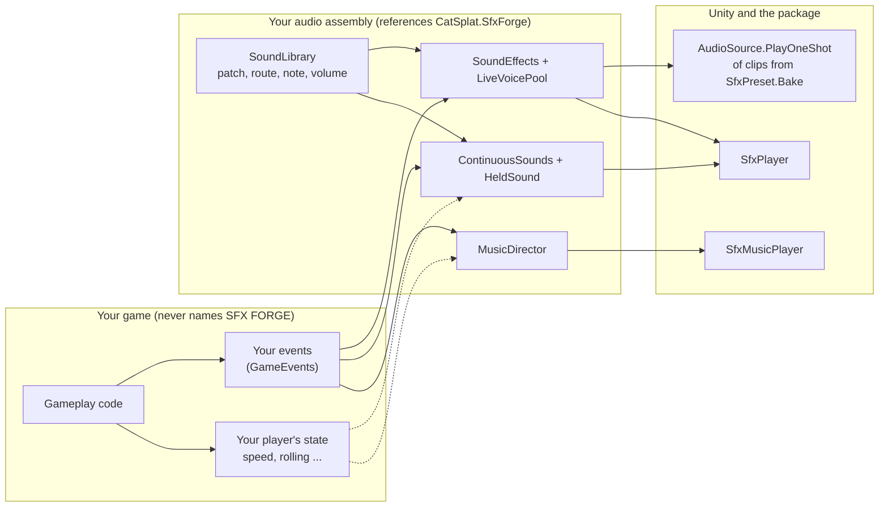

# Unity Copy The Showcase Pattern

How to give your own game the showcase's audio structure: one seam of events, one table of sounds, three small
scripts and one music script. You can take the showcase's folder and rename, or build the same shape from nothing.
Read [Unity Showcase Walkthrough](Unity-Showcase-Walkthrough) first if you have not seen the structure.



*Left: the showcase's folder. Orange is copied, blue is copied or replaced with your own, grey is left. Right: where
it lands in your game.*

## The shape you are building



## What you will change

| File | Path A: take the folder | Path B: build your own |
|---|---|---|
| `Packages/manifest.json` | add the package ([Unity Install](Unity-Install)) | the same |
| `Scripts/Audio` (17 scripts and `SfxShowcase.Audio.asmdef`) | copy all of it | read it; write your own four scripts |
| ten files of `Scripts/Core` | copy them | none: use your own events and values |
| `Song/DemoSong.asset` with its `.meta` | copy it | your own `SfxSong` |
| `SoundLibrary.cs`, `GameSound.cs` | replace the 19 sounds with yours | your own table |
| `MusicKit.cs`, the cues in `MusicDirector.cs` | change when you change the song | your own |

The ten Core files are `GameEvents`, `PlayerBase`, `IPlayerState`, `IPlayerActor`, `IPlayerInput`, `TerrainPlane`,
`GameSessionBase`, `IGameSession`, `GamePhase` and `SectionId`.

## Path A: take the folder

1. Add the package and check that the Console shows no warning about the native library
   ([Unity Install](Unity-Install)).
2. Copy `Scripts/Audio` into your project. One of its scripts, `BuildProbe.cs`, is the showcase's self-check of a
   built game. It does nothing unless the game is started with `-sfxforge-probe`; you may delete it.
3. Copy the ten Core files into an assembly of your game. Open the copied `SfxShowcase.Audio.asmdef`: it references
   the assembly `SfxShowcase.Core` by name. Change that name to the assembly the ten files are now in. Keep the
   reference to `CatSplat.SfxForge`. The showcase's assembly definitions say `"autoReferenced": false`: code
   outside them sees them only from an assembly definition that references them, or after you set that to `true`.
4. Copy `Song/DemoSong.asset` together with `DemoSong.asset.meta`.
5. Make your player class derive from `PlayerBase` and your run or level manager from `GameSessionBase`. Both are
   abstract: implement their members. The audio itself reads only six values (next table). `PlayerBase` works out
   `Speed01` itself, from your `GroundSpeed`, `Velocity`, `IsGrounded` and `TopSpeed`.
6. Raise the events from your gameplay code, for example `GameEvents.RaiseJumped();` where the player jumps.
7. Build the audio once, from a script in your scene:

```csharp
using CatSplat.SfxForge;
using SfxShowcase.Audio;
using SfxShowcase.Core;
using UnityEngine;

public class InstallAudio : MonoBehaviour
{
    public PlayerBase player;
    public GameSessionBase session;
    public SfxSong song;                     // DemoSong.asset

    void Awake() => AudioInstaller.Install(player, session, song, null);
}
```

8. Press Play. An object `Audio` appears in the Hierarchy with the children `Music`, `Effects` and `Continuous`,
   and the song starts. Raise an event: you hear its sound.

`Install` throws an `ArgumentNullException` without a player or a session. Without a song there is no music. The
last argument is a factory that turns each patch into an `SfxPreset`; with `null` the presets are made in memory.
This script was written for this page; it was compiled against the showcase's `Core` and `Audio` scripts and not
run. The showcase itself calls `Install` from its scene builder,
[`ShowcaseAudio.cs`](../unity/Demo/Assets/Showcase/Editor/ShowcaseAudio.cs).

**What the audio reads from your game.** Everything else comes through events.

| Read | By | For |
|---|---|---|
| `player.Speed01` | `ContinuousSounds`, `MusicDirector` | the roll hum, the wind, the music's intensity |
| `player.IsRolling`, `IsGrounded` | `ContinuousSounds` | whether the roll hum is held (not while charging) |
| `player.IsCharging`, `Charge01` | `ContinuousSounds` | the Wind-Up rev |
| `session.Phase` | `MusicDirector` | the fixed intensity on the title card (`GamePhase.Title`) |

## Path B: build your own

Seven steps, each with the file to read. The showcase's files are short and commented for this.

| | Do this | Read |
|---|---|---|
| **1** | Add the package. Reference `CatSplat.SfxForge` from the assembly your audio code lives in, and from no other | [`SfxShowcase.Audio.asmdef`](../unity/Demo/Assets/Showcase/Scripts/Audio/SfxShowcase.Audio.asmdef) |
| **2** | Make the seam: a static class of C# events with a `Raise…` method each. Gameplay raises, audio listens. What lasts (speed, rolling) is read, not raised | [`GameEvents.cs`](../unity/Demo/Assets/Showcase/Scripts/Core/GameEvents.cs) |
| **3** | Write your sounds as patches in one file, with a table: sound, patch, route, MIDI note, volume | [`SoundLibrary.cs`](../unity/Demo/Assets/Showcase/Scripts/Audio/SoundLibrary.cs) |
| **4** | One-shots: bake what is always the same in `Awake`; play live what the game decides at that moment | [`SoundEffects.cs`](../unity/Demo/Assets/Showcase/Scripts/Audio/SoundEffects.cs), [`LiveVoicePool.cs`](../unity/Demo/Assets/Showcase/Scripts/Audio/LiveVoicePool.cs) |
| **5** | Held sounds: one `SfxPlayer` each, started with its note, bent every frame, released | [`ContinuousSounds.cs`](../unity/Demo/Assets/Showcase/Scripts/Audio/ContinuousSounds.cs), [`HeldSound.cs`](../unity/Demo/Assets/Showcase/Scripts/Audio/HeldSound.cs) |
| **6** | Music: one `SfxMusicPlayer` with a song, and a script that sets `intensity` every frame from a floor and a game value | [`MusicDirector.cs`](../unity/Demo/Assets/Showcase/Scripts/Audio/MusicDirector.cs) |
| **7** | Put it in the scene: the objects of the table below, in code or by hand in the Inspector | [`AudioInstaller.cs`](../unity/Demo/Assets/Showcase/Scripts/Audio/AudioInstaller.cs) |

The pattern of every audio script is the same few lines. This is a fragment, shortened from `SoundEffects.cs`, not
a whole script:

```csharp
// not compiled: three lines shortened from SoundEffects.cs; PlayBaked is that class's own method
void OnEnable() => GameEvents.Jumped += OnJumped;
void OnDisable() => GameEvents.Jumped -= OnJumped;
void OnJumped() => PlayBaked(GameSound.Jump);
```

**The scene objects** for step 7:

| Object | Components | Set |
|---|---|---|
| `Audio/Music` | `AudioSource`, `SfxMusicPlayer`, your music script | the `SfxSong`; `playOnEnable` on. In code, set the song before the component is enabled (the installer builds `Audio` inactive), or call `Reload()` and `Play()` after you set it |
| `Audio/Effects` | `AudioSource`, your one-shot script | the presets to bake |
| `Audio/Effects/Live Voice 1 … 3` | `AudioSource`, `SfxPlayer` | no preset: the pool assigns one per play |
| `Audio/Continuous` | your script that bends the held sounds | the players below, and the MIDI note of each |
| `Audio/Continuous/<sound>` | `AudioSource`, `SfxPlayer` | the held sound's preset; `playOnEnable` off |

Every `AudioSource` is 2D, has no clip and has `playOnAwake` off.

## Test it

1. Press Play and watch the Console: no warning about SFX Forge ([Unity Troubleshooting](Unity-Troubleshooting#the-console-says) lists them).
2. Trigger each event once and listen.
3. Write one Play mode test per route, as the showcase does: [Unity Testing Your Audio](Unity-Testing-Your-Audio)
   has a sample. It asserts that a baked clip comes out of its `AudioSource`, that a live voice starts on its
   `SfxPlayer`, and that the music's `Bar` moves on. For a held sound, assert that the player's `pitchSemitones`
   follows your game, as the showcase's `TheWindUpRevAndTheRollHumFollowThePlayer` does.

## Traps

| Trap | What to do |
|---|---|
| **The song belongs to the folder.** `MusicKit.cs` names the demo song's instruments by index (bells 13, brass 5, strings 15, timpani 0). `MusicDirector` holds its patterns E and F, and its section floors sit between that song's layer marks | with your own song, change `MusicKit.cs`, `sectionCues`, `finalLaunchPattern`, `checkpointAnswer` and `fanfare` |
| **The volumes fit this game only.** They were set by measuring recorded takes of the showcase, not by ear | measure your own mix, or listen: [Unity Testing Your Audio](Unity-Testing-Your-Audio#the-mix-is-measured) |
| **`new SfxPatch()` is silent.** Its level is 0 | start every patch from `SfxPatch.Create`, as `SoundLibrary.Make` does |
| **One `SfxPlayer` holds one patch.** A second patch on it reshapes what still sounds | a player per held sound; a pool for live one-shots |
| **A pitched held sound out of tune** | start it with its MIDI note: `Play(1f, 0f, midiNote)`. A bare `Play()` sounds at the patch's own FREQ |
| **`SectionId` is the showcase's level.** `GameEvents` and the `sectionCues` table of `MusicDirector` use its eight section names | raise `SectionEntered` with those values for your own areas, or change the enum and every place that names an entry together |
| **Windows x64 only.** Elsewhere the players stay silent and `Bake` returns null | [What Is Tested](What-Is-Tested) |

## Next

- [Unity Testing Your Audio](Unity-Testing-Your-Audio): prove the structure works, without ears
- [Unity Recipes](Unity-Recipes): single scripts when you need less than the whole structure
- [Unity Presets And Patches](Unity-Presets-And-Patches): writing the sounds for your table
- [Unity Troubleshooting](Unity-Troubleshooting): when it stays silent

## Reference

- [The Unity manual: Copy this into your game](../docs/UNITY.md#copy-this-into-your-game)
- [The Unity manual: The event seam](../docs/UNITY.md#the-event-seam) and
  [The three routes, file by file](../docs/UNITY.md#the-three-routes-file-by-file)
- [The showcase's README: Use SFX FORGE in your own Unity game](../unity/Demo/Assets/Showcase/README.md#use-sfx-forge-in-your-own-unity-game)
- [`Scripts/Audio`](../unity/Demo/Assets/Showcase/Scripts/Audio) and
  [`Scripts/Core`](../unity/Demo/Assets/Showcase/Scripts/Core) of the showcase
