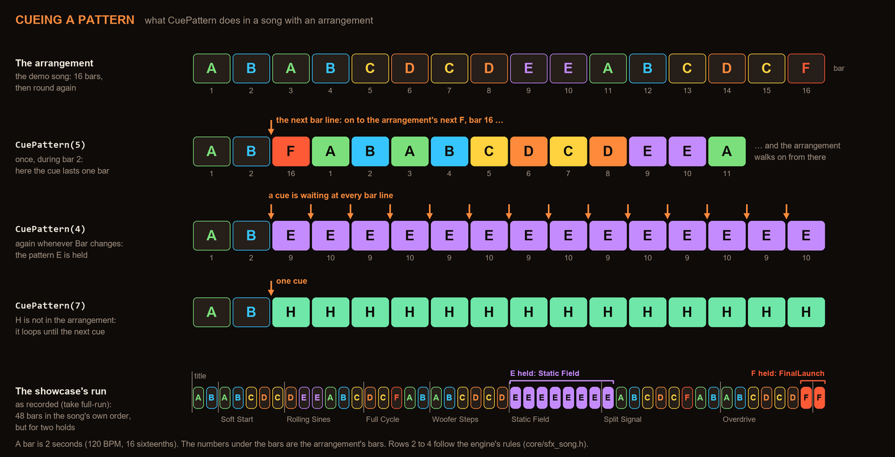
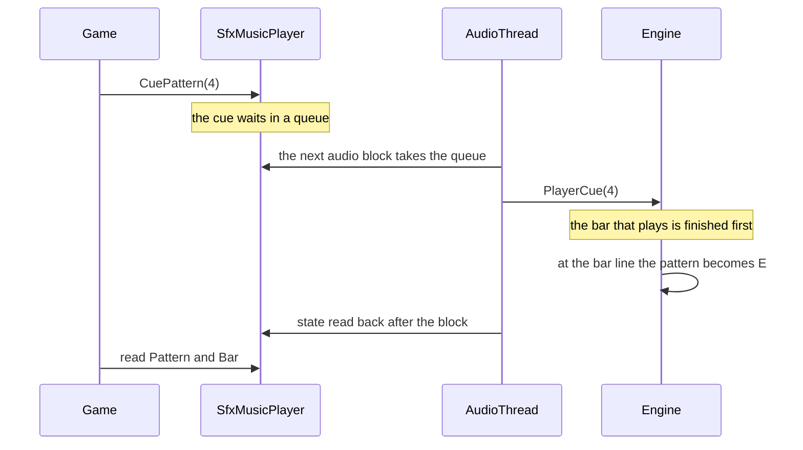
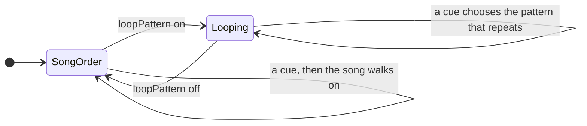

# Unity Cues And Patterns

A song has eight patterns. This page shows how your game changes from one to another on the bar line, how to stay on
one, and which of the three ways to use when.



*From the top: the demo song's arrangement of 16 bars; one `CuePattern(5)`, which lasts one bar because the
arrangement walks on to A; `CuePattern(4)` again on every bar, which holds E; `CuePattern(7)`, a pattern that is not
in the arrangement and so stays by itself. The last row is a whole run of the showcase as recorded: 48 bars in the
song's own order, except E held in Static Field and F held after the last launch.*

## Four words

| Word | What it is |
|---|---|
| **pattern** | one bar for all 16 sounds. A song has eight, A to H. In code they are 0 to 7: `CuePattern(0)` is A |
| **arrangement** | a list of up to 32 bars, each naming a pattern. If the song has one, the player walks it and starts again from the top. The demo song's is A B A B C D C D E E A B C D C F |
| **chain** | used only when the song has no arrangement: how many patterns, counted from A, play in turn. A chain of 1 loops pattern A |
| **bar line** | the moment one bar ends and the next begins. A cue takes effect there, never in the middle of a bar |

Patterns, the arrangement and the chain are made on the device
([Device Song And Arrangement](Device-Song-And-Arrangement)). In Unity you read them:
`SfxSong.ArrangementBars` (0 = none), `ArrangementPattern(bar)` and `Chain`.

## What a cue does



`CuePattern(n)` returns at once; an `n` outside 0 to 7 is brought into that range. The pattern changes on the next
bar line; at 120 BPM with a bar of 16 sixteenths that is at most 2 seconds away. A second cue before the bar line
replaces the first. While the song is stopped, the cue sets the pattern at once, and a later `Play()`
starts on `startPattern`. `Pattern` and `Bar` are read back from the audio thread a moment after the fact: good for
a light or a decision, not for timing a sound to the sample.

What happens **after** the cued bar depends on the song, while `loopPattern` is off:

| The song has … | and the cued pattern is … | After the cue |
|---|---|---|
| an arrangement | **in** it | the song jumps to the arrangement's next bar with that pattern, then walks on from there. Often the cue lasts one bar |
| an arrangement | **not in** it | that pattern loops until the next cue |
| no arrangement, a chain of 1 | any | that pattern loops until the next cue |
| no arrangement, a chain of 2 or more | any | one bar of that pattern, then the chain walks on from it |

## Staying on a pattern: loopPattern

Switch `loopPattern` on and the pattern that plays repeats, whatever the song's order is. A cue then chooses which
pattern repeats.

```csharp
using CatSplat.SfxForge;
using UnityEngine;

public class AreaMusic : MonoBehaviour
{
    public SfxMusicPlayer music;

    /// <summary>0 = A … 7 = H, from the next bar line, and it stays. -1: let the song run by itself again.</summary>
    public void EnterArea(int pattern)
    {
        music.loopPattern = pattern >= 0;
        if (pattern >= 0) music.CuePattern(pattern);
    }
}
```



| `loopPattern` | What plays |
|---|---|
| **on** | the pattern that plays repeats until `CuePattern` chooses another; that one takes over on the bar line and repeats in its turn. Intensity, the mix and notes by hand work as always, and `Bar` goes on counting |
| **off** (as at first) | the song's arrangement, or its chain: the table above |
| **switched off while it plays** | with an arrangement, the song goes on from the arrangement's first bar that has the pattern that plays: the bar after it comes next. If no bar has it, the arrangement starts from the top. Without an arrangement, the chain goes on from the pattern that plays |

It is a public field, so you can also tick **Loop Pattern** on the component. With `playOnEnable` and `loopPattern`
both on, the song starts on `startPattern` and stays there. `Play()`, `Stop()` and `Reload()` leave the switch as it
is. The switch is this player's: it is not sent to a device, which has its own LOOP or SONG key.

> **A trap.** With a native library from before the switch, `loopPattern` does nothing and says nothing. The
> package's `sfxforge.dll` has it. If you updated the package while the editor was open, restart the editor: Unity
> keeps a native library loaded until it closes.

## The older way: cue again on every bar

The showcase was written before the switch. It holds a pattern by cueing it again whenever `Bar` changes, so a cue is
always waiting at the next bar line. This works with any library.

```csharp
using CatSplat.SfxForge;
using UnityEngine;

public class HeldPattern : MonoBehaviour
{
    public SfxMusicPlayer music;
    public int heldPattern = -1;       // 0 = A … 7 = H. Below 0: nothing is held
    int lastBar = -1;

    void Update()
    {
        int bar = music.Bar;
        if (bar == lastBar) return;
        lastBar = bar;
        if (heldPattern >= 0) music.CuePattern(heldPattern);
    }
}
```

To end the hold, stop cueing: set `heldPattern` below 0. The arrangement then walks on from the bar it is on. A cue
that was already waiting still takes its bar.

## Which one?

| You want | Use | Why |
|---|---|---|
| the song as it was arranged, and only the band changes | nothing: let it play, drive `intensity` | [Unity Adaptive Music](Unity-Adaptive-Music) |
| a pattern for an area, a room, a menu, for as long as the player is there | `loopPattern = true`, then `CuePattern(n)` | one call on entering, works for every song |
| a short change that returns by itself: a turnaround, a one-bar fill | one `CuePattern(n)` of a pattern that is **in** the arrangement | the arrangement walks on from there |
| a theme kept aside: a boss, a title screen | write it in a pattern you leave **out** of the arrangement, then one `CuePattern(n)` | it loops until the next cue, without `loopPattern` |
| to hold a pattern with a library from before the switch | cue again whenever `Bar` changes | the showcase's way |

The demo song's patterns G and H are empty: cueing them plays silence. A boss theme needs a song that has one.

`SfxMusicPlayer.ApplyTelemetry(SfxTelemetry.Pattern, value01)` cues a pattern the way the device does on the same
message: see [Unity Telemetry And Encoders](Unity-Telemetry-And-Encoders).

What of this was run, and what nobody has listened to: [What Is Tested](What-Is-Tested).

## Next

- [Unity Music Mix And Notes](Unity-Music-Mix-And-Notes): a stinger that lands on the bar line.
- [Unity Adaptive Music](Unity-Adaptive-Music): the other half, intensity.
- [Unity Song Inspector](Unity-Song-Inspector): see a song's patterns and arrangement.
- [Unity Showcase Walkthrough](Unity-Showcase-Walkthrough): the level that holds E and F.

## Reference

- [The Unity manual: Cueing patterns](../docs/UNITY.md#cueing-patterns) ·
  [Holding a pattern: loopPattern](../docs/UNITY.md#holding-a-pattern-looppattern) ·
  [The older way](../docs/UNITY.md#the-older-way-cue-it-again-on-every-bar)
- [Recipe 8: A pattern per area, held](../docs/UNITY.md#8-a-pattern-per-area-held) ·
  [Recipe 10: A boss theme](../docs/UNITY.md#10-a-boss-theme)
- [The device's manual: What PLAY plays: LOOP or SONG](../docs/MANUAL.md#what-play-plays-loop-or-song) ·
  [Cues and the arrangement](../docs/MANUAL.md#cues-and-the-arrangement)
- [SfxMusicPlayer.cs](../unity/com.catsplat.sfxforge/Runtime/SfxMusicPlayer.cs) (`CuePattern`, `loopPattern`,
  `OnAudioFilterRead`) · [core/sfx_song.h](../core/sfx_song.h) (`sfx_player_cue`, `sfx_player_set_loop`, the bar
  line in `sfx_player_render`) ·
  [MusicDirector.cs](../unity/Demo/Assets/Showcase/Scripts/Audio/MusicDirector.cs) (`HoldPattern`) ·
  [SectionCue.cs](../unity/Demo/Assets/Showcase/Scripts/Audio/SectionCue.cs)
