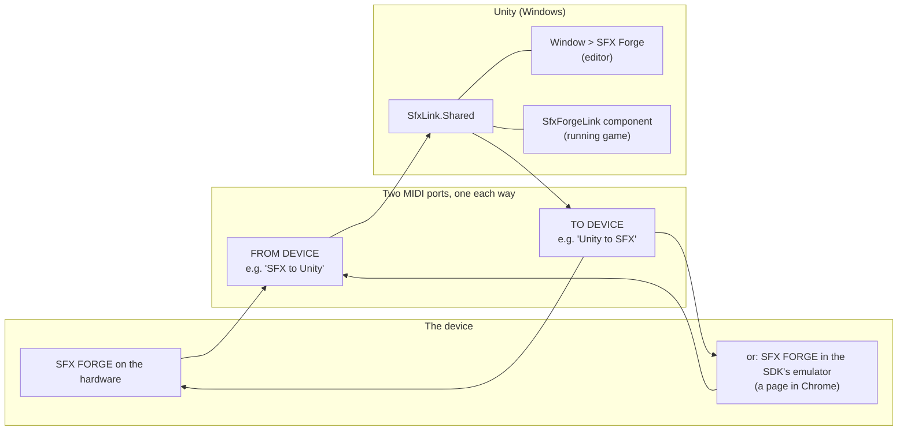
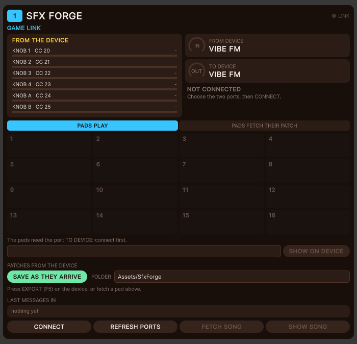
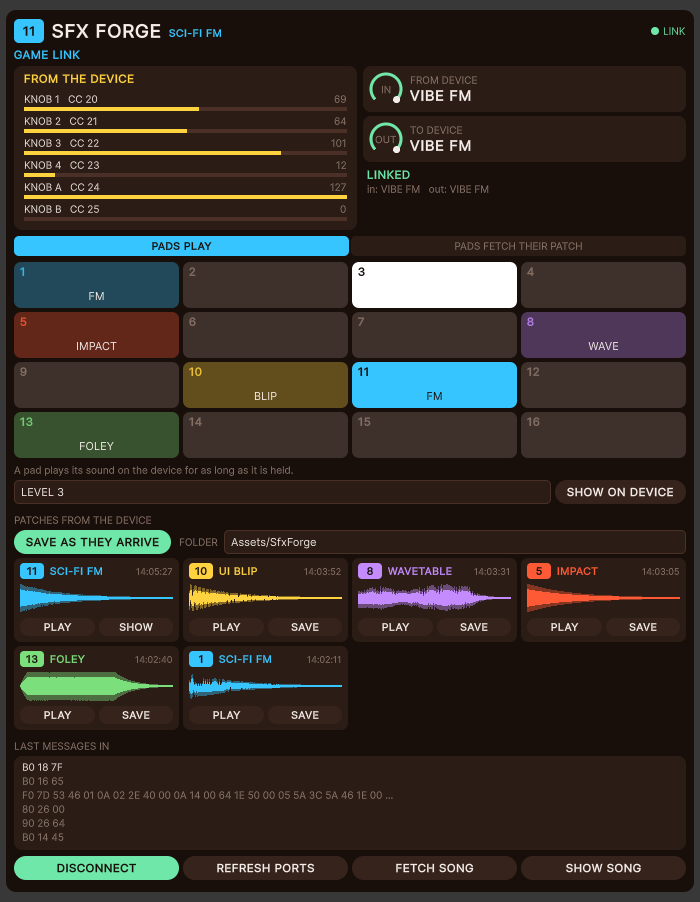
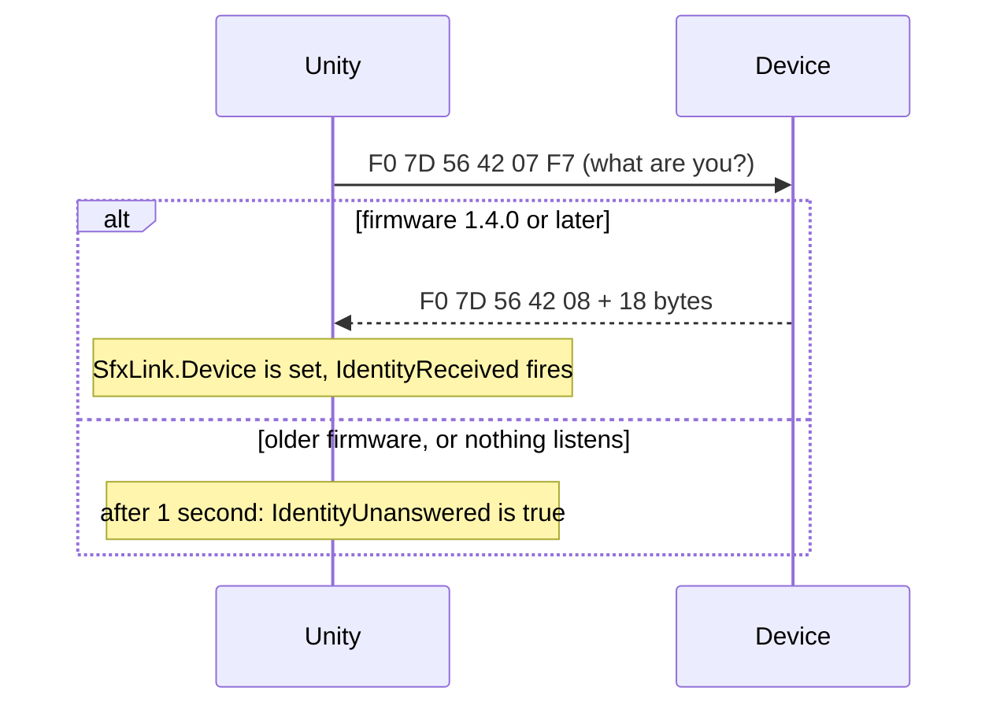

# Unity Device Link Setup

This page connects SFX FORGE (the device) to the Unity editor over MIDI, so that sounds and songs made on the
device arrive in your project as assets. It ends when the SFX Forge window says **LINKED** and names the device.

You do not need the link to use the package. Presets, players and baking work without it. The link is for
designing on the device and for tuning while the game runs.

## What talks to what



- **One link for the editor and the game.** `SfxLink.Shared` is the single connection. The window opens it in the
  editor; an `SfxForgeLink` component opens it in a running game if nobody has yet.
- **Two ports.** One carries what the device sends, the other what Unity sends. On the hardware they are the
  device's own MIDI in and out. Without hardware you make two virtual ports with a virtual MIDI cable such as
  loopMIDI.
- **Windows only.** MIDI is implemented with winmm. On another system the window says `NO MIDI HERE`.

## What you need

- The package, installed: [Unity Install](Unity-Install).
- A device: the hardware, or the emulator of the VIBE FM SDK running the built firmware
  ([Building From Source](Building-From-Source)).
- For the emulator: Chrome (it needs Web MIDI), loopMIDI, Python and Node 22.

The emulator is not the Playground of [Device Quick Start](Device-Quick-Start). Both run the firmware in a browser;
the emulator is a page the SDK serves from your own machine, and it is the one the link was tried with. The
Playground was not tried with the link.

## The tested way: the emulator over loopMIDI

This is the only setup that was run end to end. See [What Is Tested](What-Is-Tested).

1. **Make two ports.** Start loopMIDI and add two ports named `SFX to Unity` and `Unity to SFX`. loopMIDI must
   stay running: the ports exist only while it does.
2. **Start the emulator's server.** From the repository root:

   ```sh
   python .tools/vibe-fm-sdk/tools/emulator.py 8766
   ```

3. **Start the device's end.** In a second terminal:

   ```sh
   node tests/emulator-link.mjs
   ```

   The script opens the emulator in a Chrome of its own, allows that page MIDI, chooses the firmware `sfx-forge`,
   switches it on and puts its MIDI out on `SFX to Unity`. When it is ready it prints a line that begins
   `EMULATOR: ready: firmware`. The emulator listens on every MIDI input, so `Unity to SFX` needs no choosing.
4. **Open the window in Unity.** **Window > SFX Forge**.
5. **Choose the ports.** Click the tile **FROM DEVICE** and pick `SFX to Unity`. Click **TO DEVICE** and pick
   `Unity to SFX`. If the ports are missing, press **REFRESH PORTS**.
6. **Press CONNECT.** The status under the tiles changes to `LINKED` with the two port names. When the device
   answers, one more line appears: `VIBE FM, firmware 1.7.1, profile 1`. That line is the
   [identity](#how-you-know-it-is-connected).

The script accepts key names on its standard input while it runs: type `K5` or `F5` and ENTER to press that key of
the device, `quit` to end. It ends by itself after 600 seconds unless you pass `--seconds`.

> The window was only ever shown a model by its tests. Its keys were not pressed against the emulator: the
> end-to-end runs drove `SfxLink` from test code
> ([LinkTakes.cs](../unity/Demo/Assets/Showcase/Tests/LinkTakes.cs)). Steps 4 to 6 follow what the window's code
> does.

## The hardware

**Not tried.** Nothing here was run on the hardware or in the VIBE FM plugin. By the code, the steps are the same
from step 4 on: connect the device so that Windows shows its MIDI input and output, press **REFRESH PORTS**, pick
the device's port on **FROM DEVICE** and on **TO DEVICE**, and **CONNECT**.

The protocol is plain MIDI, so nothing in the package is specific to the emulator. The emulator does two things the
hardware's path does not: it delivers every message twice, and it hears its own output. Both ends are written to
live with that.

## The SFX Forge window



*Before CONNECT. This picture is rendered by the window's tests from a model with two ports named VIBE FM; it is
not a photograph of the editor. What needs the device is dark.*



*Linked, with six patches fetched. Also rendered from a test's model: here the model holds no identity, so the line
that names the device is absent under LINKED.*

| Part | What it is for |
|---|---|
| **FROM THE DEVICE** | six bars: what the device's knobs sent last (CC 20 – 25), `-` until one has sent. See [Unity Telemetry And Encoders](Unity-Telemetry-And-Encoders) |
| **FROM DEVICE** · **TO DEVICE** | the two ports. Click to choose (not while connected). The choice is remembered |
| **PADS PLAY** | a tab. Hold a pad tile with the mouse: the pad plays on the device |
| **PADS FETCH THEIR PATCH** | the other tab. Click a pad tile: the device sends that pad's sound |
| the text field · **SHOW ON DEVICE** | sends up to 24 characters to the device, which shows them on its LINK page under LINKED (see the note below) |
| **PATCHES FROM THE DEVICE** | what arrived, newest first (the last 32), with **PLAY** and **SAVE** (**SHOW** once saved) |
| **LAST MESSAGES IN** | the last six MIDI messages, the first 24 bytes of each as hex. The quickest check that anything arrives |
| **CONNECT** / **DISCONNECT** · **REFRESH PORTS** | open or close the ports · read the port list again |
| **FETCH SONG** · **SHOW SONG** | ask for the song · point at the song fetched last |

The pads, SHOW ON DEVICE and FETCH SONG need the port TO DEVICE and are dark without it.

> **Where the text shows.** The firmware draws the text in one place only: on its LINK page (K6), in the bottom
> line, under LINKED (`draw_link` in [fw_draw_pages.h](../sfx-forge/fw_draw_pages.h)). On any other page you do
> not see it.

What arrives and where it is saved is on [Unity Send And Receive](Unity-Send-And-Receive).

## How you know it is connected

`LINKED` only says that Unity opened the ports. The **identity** says that SFX FORGE answered.



| The window shows | It means |
|---|---|
| `VIBE FM, firmware 1.7.1, profile 1` | the device answered. Everything works |
| `no identity: firmware before 1.4, or nothing answers` | the request went out and nothing answered within a second. Either the firmware is older than 1.4.0, or the output port leads nowhere, or no input is open for the answer. The link cannot tell these apart |
| `LINKED` and no line under it for longer than a second | no output port is open, so nothing was asked |
| `NOT CONNECTED` | the ports are closed. Choose the two ports, then CONNECT |
| `NO MIDI PORTS` | Windows has no MIDI port at all. Start loopMIDI or connect the device, then REFRESH PORTS |
| `NO MIDI HERE` | not Windows |

In code:

```csharp
using CatSplat.SfxForge;
using UnityEngine;

public class SayWhatIsLinked : MonoBehaviour
{
    void OnEnable() => SfxLink.Shared.IdentityReceived += Say;
    void OnDisable() => SfxLink.Shared.IdentityReceived -= Say;

    void Say(SfxDeviceInfo device) => Debug.Log(device);      // "VIBE FM, firmware 1.7.1, profile 1"
}
```

`SfxLink.Shared.Device` holds the answer afterwards. It is `null` until the device answered, and again after a
`RequestIdentity()` that went out or after the ports close. `Open` asks by itself.

## In a running game

Put one **SFX Forge Link** component in the scene (**Component > SFX Forge > SFX Forge Link**). If the link is not
open yet, it opens the ports; it polls the link every frame, and it closes the ports again if it opened them.

| Field | |
|---|---|
| `inputPort`, `outputPort` | part of a port's name. Empty: the port chosen in the window |
| `textOnStart` | sent as text to the device when the component is enabled (up to 24 characters; shown on its LINK page) |
| `onPad`, `onEncoder` | events: a pad was played (pad 0 … 15, velocity 0 … 1), an encoder turned (0 … 5, value 0 … 1) |

The window's choice is stored in PlayerPrefs under `SfxForge.Input` and `SfxForge.Output`. In a built player, name
the ports in `inputPort` and `outputPort`.

In the editor the package also polls the link on every editor update
([SfxForgeEditorLink.cs](../unity/com.catsplat.sfxforge/Editor/SfxForgeEditorLink.cs)), so events can fire there
without the component. A built player has only the component.

## Traps

- **A port does not open.** CONNECT then warns in the Console: "could not open every MIDI port ... Is another
  program holding it?"
- **A covered browser window may be slowed down.** The script starts Chrome with flags that keep a covered or
  background page running at full speed (`--disable-backgrounding-occluded-windows` and two more). If you open the
  emulator by hand, keep its window visible.
- **The editor reconnects by itself** after scripts reload, if it was connected before.

## Next

- [Unity Send And Receive](Unity-Send-And-Receive): fetch a sound and a song, and send them back.
- [Unity Telemetry And Encoders](Unity-Telemetry-And-Encoders): drive the device from the game, and the game from the device.
- [Link Protocol](Link-Protocol): every message, byte by byte.

## Reference

- [The Unity manual, section 6: From the device to the game](../docs/UNITY.md#6-from-the-device-to-the-game)
- [The SFX Forge window](../docs/UNITY.md#the-sfx-forge-window) and [the identity](../docs/UNITY.md#what-the-device-is-the-identity)
- [The showcase's README, "Recording the link"](../unity/Demo/Assets/Showcase/README.md#recording-the-link)
- [The maintainer's guide, "The link, end to end"](../docs/MAINTAINING.md#the-link-end-to-end)
- Source: [SfxLink.cs](../unity/com.catsplat.sfxforge/Runtime/Core/SfxLink.cs),
  [WinMidi.cs](../unity/com.catsplat.sfxforge/Runtime/Core/WinMidi.cs),
  [SfxForgeLink.cs](../unity/com.catsplat.sfxforge/Runtime/SfxForgeLink.cs),
  [SfxForgeWindow.cs](../unity/com.catsplat.sfxforge/Editor/SfxForgeWindow.cs),
  [SfxForgeEditorLink.cs](../unity/com.catsplat.sfxforge/Editor/SfxForgeEditorLink.cs),
  [tests/emulator-link.mjs](../tests/emulator-link.mjs)
