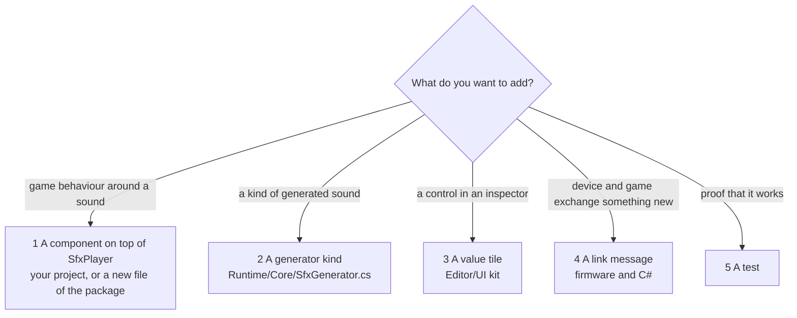
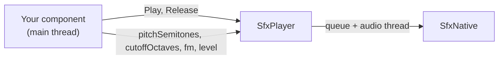
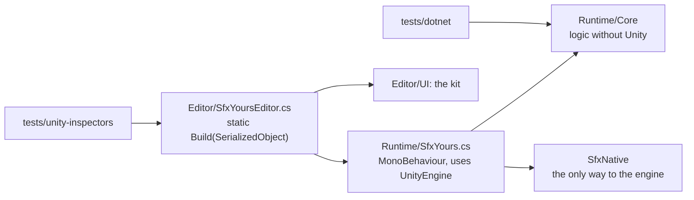
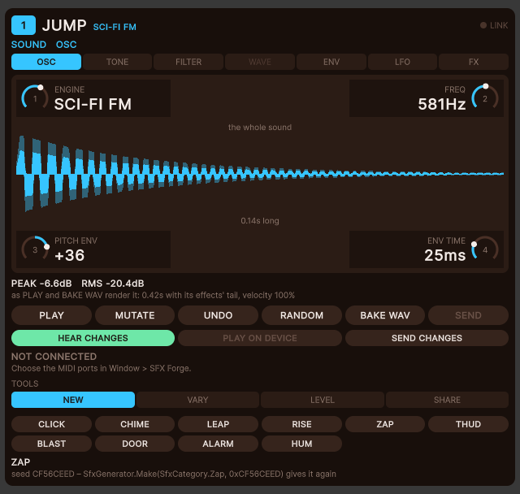
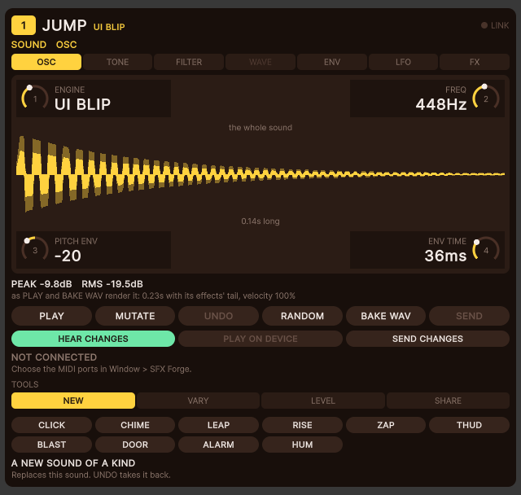
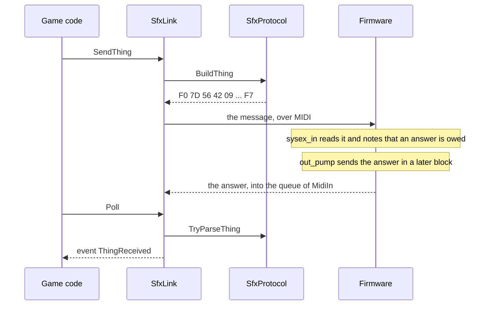

# Unity Extending

Five recipes for adding to the Unity side: a component (in your project, or in the package), a new kind for the NEW
generator, a tile in an inspector, a message on the link, and a test. Each says which files change, the steps, how
to test it and where it goes wrong. Read [Unity Architecture](Unity-Architecture) first: the recipes lean on its
layers. Words such as assembly definition, `.meta` file, EditMode and audio thread are in the
[Glossary](Glossary#unity).



Recipes 2 and 4, and the second half of recipe 1, change the package's source, in this repository under
`unity/com.catsplat.sfxforge`. Never edit the generated package repository: it is rewritten from here
([Unity Architecture](Unity-Architecture#how-the-package-is-generated)).

## 1. A component on top of SfxPlayer

**What you will change:** one new script in your own project. Nothing in the package.

`SfxPlayer` is the model for the pattern: let it own the engine and the audio thread, and drive it from a small
component through its public members.



```csharp
using CatSplat.SfxForge;
using UnityEngine;

/// A held hum that rises with a speed you feed it.
[RequireComponent(typeof(SfxPlayer))]
public class SpeedHum : MonoBehaviour
{
    public float topSpeed = 20f;
    SfxPlayer player;

    void Start()
    {
        player = GetComponent<SfxPlayer>();
        player.Play();                     // the preset must be a held sound: sustain above 0
    }

    public void SetSpeed(float speed)
    {
        float t = Mathf.Clamp01(speed / topSpeed);
        player.pitchSemitones = 12f * t;   // 0..24
        player.cutoffOctaves = 2f * t;     // -4..4
    }

    void OnDisable()
    {
        if (player != null) player.Release();
    }
}
```

1. Add an **SFX Player** to a GameObject and give it a preset whose `sustain` is above 0.
2. Add `SpeedHum` to the same object. Call `SetSpeed` from your movement code.
3. Press Play. You hear the hum start; it rises as the speed does.

**Traps**

- Call `Play` from `Start`, not from your own `OnEnable`. `SfxPlayer` allocates its engine in *its* `OnEnable`, and
  `Play` before that returns without a sound.
- The live values may be written every frame: the audio thread glides to them over 30 ms. `volume` is not glided.
- One player holds one patch. `Play(SfxPatch ...)` with another patch reshapes the notes that still sound.
- Where `SfxNative.Available` is false the player is silent. Decide what your component does then.

### The same, as a new component of the package

**What you will change:** a new `Runtime/Sfx....cs` and its `.meta`; an inspector in `Editor/` if it needs one; a
test; the README's table under "Unity" and `docs/UNITY.md`.



1. Write `unity/com.catsplat.sfxforge/Runtime/Sfx....cs` in the namespace `CatSplat.SfxForge`, with
   `[AddComponentMenu("SFX Forge/...")]` as the six components there have.
   [SfxVariationPlayer.cs](../unity/com.catsplat.sfxforge/Runtime/SfxVariationPlayer.cs) is a short model.
2. Give it a `.meta`. Open `tests/unity-inspectors` in Unity once and Unity writes it; by hand it is two lines,
   `fileFormatVersion: 2` and `guid:` with 32 fresh hex digits. Commit it, and never rename or move the file after:
   scenes and assets name it by that GUID.
3. Put logic that needs no Unity into `Runtime/Core`. `tests/dotnet` compiles that folder and can test it.
4. Reach the engine through `SfxNative` only, and ask `SfxNative.Available` first.
5. If it makes sound in `OnAudioFilterRead`: that is the audio thread. No allocation, no Unity API, no lock that the
   main thread holds for long. [SfxPlayer.cs](../unity/com.catsplat.sfxforge/Runtime/SfxPlayer.cs) is the model.
6. For an inspector, add `Editor/Sfx...Editor.cs` that returns one element from a static `Build(SerializedObject)`,
   as in recipe 3.
7. Test it (recipe 5): an EditMode test in `tests/unity-inspectors/Assets/Harness/Editor`, and a PlayMode test in
   the showcase if it must be heard.

**Trap:** `tools/make_unity_package.py` copies `Runtime` and `Editor` whole and stops when a file has no `.meta`.

The source of these steps: [the maintainer's guide: Add a Unity component](../docs/MAINTAINING.md#add-a-unity-component).

## 2. A generator kind (NEW)

The NEW tab of a sound's Inspector has one key for each kind of sound. A kind is two *recipes*; a recipe is an engine
and a range for each value it names.



*A sound's Inspector after ZAP was pressed. At its foot the tools, with NEW chosen: ten keys in two rows (six and
four), and under them the seed and the call that gives the same sound again.*

**What you will change**

- [Runtime/Core/SfxGenerator.cs](../unity/com.catsplat.sfxforge/Runtime/Core/SfxGenerator.cs): the kind itself
- [Editor/SfxPresetPanel.cs](../unity/com.catsplat.sfxforge/Editor/SfxPresetPanel.cs): the row of keys
- [docs/UNITY.md, "NEW: a sound of a kind"](../docs/UNITY.md#new-a-sound-of-a-kind): its table

**Steps**

1. In `SfxGenerator.cs`, add a member at the **end** of `enum SfxCategory`, for example `Laser`.
2. Raise `SfxGenerator.Count` to 11 and add `"LASER"` at the end of `Names`.
3. Add an entry at the end of `Recipes` with exactly two recipes. Each is
   `Make(engine, value, low, high, value, low, high ...)`:

   ```csharp
   // not compiled: an entry of SfxGenerator's private Recipes array, written with its private constants
   // LASER: a fast fall
   new[]
   {
       Make(SfxEngine.SciFiFm, Freq, 70, 100, PitchEnv, 90, 120, EnvTime, 20, 50, Decay, 30, 60),
       Make(SfxEngine.UiBlip, Freq, 80, 100, PitchEnv, 90, 110, Decay, 20, 45, Delay | OrOff, 0, 30),
   },
   ```

   `Freq`, `PitchEnv`, `Decay` ... are the private constants at the top of the class. `| OrOff` makes a value 0 half
   the time. What a recipe does not name keeps the plain patch's value (`SfxPatch.Create`), so LEVEL stays 100. (The
   numbers above only show the form; choose ranges by ear.)
4. If the kind is a held sound, give `Sustain` a range above 0 in both recipes and add it to `IsSustained`.
5. In `SfxPresetPanel.cs`, find the comment that begins `(ten keys: twelve places make rows of six, four or three`. The loop
   adds a key for every kind by itself; the two `kinds.AddBlank()` after it fill the row to twelve. With eleven keys
   keep one.

**Test it**

```sh
sh build.sh                                              # the .NET tests read files it writes
dotnet run -c Release --project tests/dotnet -- .
```

The section `Generators` in [tests/dotnet/ToolsTests.cs](../tests/dotnet/ToolsTests.cs) runs 300 seeds of every
category. When it is right you see these lines, and `PASSED` at the end:

```
  ok    every category: 300 seeds give a valid patch inside its ranges
  ok    both recipes of every category come up
```

Then run the inspectors' tests (recipe 5): they check that every kind has a key, press some of them and render the tab.

**Traps**

- The two recipes must use **two different engines**: the test "both recipes of every category come up" counts engines.
- `SfxGenerator.Make` draws `rng.Range(0, 1)` to pick a recipe. With one recipe half the seeds throw; a third
  recipe is never drawn.
- A kind's seeds must keep giving the same sounds. Adding at the end changes no existing kind; reordering, or
  editing a recipe's ranges, changes the sounds people saved a seed for.
- The first test line also checks `Names.Length`, the enum's length and `Count` against each other.

## 3. A value tile in an inspector

A value on the device is a tile: a ring, a dim name, the value in large letters. The kit in `Editor/UI` gives you the
same tile for an inspector of your own.



*The four tiles ENGINE, FREQ, PITCH ENV and ENV TIME sit in the corners of the picture (`ValueTile.Look.Corner`).
A tile on its own row uses `ValueTile.Look.Row`.*

**What you will change:** in your project, a component, an editor script, and an assembly definition for each.

- The package's editor assembly is not auto-referenced, so a script in a plain `Editor` folder cannot see the kit.
  The `.asmdef` of your editor folder must list `CatSplat.SfxForge` and `CatSplat.SfxForge.Editor` under
  `references`, and `"includePlatforms": [ "Editor" ]`.
- An assembly definition cannot reference Unity's default `Assembly-CSharp`. So the component the inspector is for
  must sit in a folder with an `.asmdef` of its own, and the editor's `.asmdef` must list that one too.
  [SfxDemo.Editor.asmdef](../unity/Demo/Assets/SfxDemo/Editor/SfxDemo.Editor.asmdef) is a model with all three.

The component:

```csharp
using UnityEngine;

public class Jukebox : MonoBehaviour
{
    [Range(0f, 1f)]
    public float gain = 0.5f;
}
```

Its inspector:

```csharp
using CatSplat.SfxForge.Editor;
using UnityEditor;
using UnityEngine;
using UnityEngine.UIElements;

[CustomEditor(typeof(Jukebox))]
public class JukeboxEditor : UnityEditor.Editor
{
    public static VisualElement Build(SerializedObject so)
    {
        var root = SfxUI.Panel();                               // the dark panel; it carries the stylesheet
        var row = SfxUI.Box("sfx-song-values");
        var tile = new ValueTile(1, false, ValueTile.Look.Row); // encoder number 1, dial on the left
        SerializedProperty gain = so.FindProperty("gain");

        void Show()
        {
            so.Update();
            tile.Show("GAIN", Mathf.RoundToInt(gain.floatValue * 100f) + "%", gain.floatValue, false, SfxColors.Ember);
        }

        tile.nudged += steps =>                                 // a drag, the wheel or an arrow key
        {
            so.Update();
            gain.floatValue = Mathf.Clamp01(gain.floatValue + steps * 0.01f);
            so.ApplyModifiedProperties();                       // Undo and multi-selection come with it
            Show();
        };

        row.Add(tile);
        root.Add(row);
        Show();
        return root;
    }

    public override VisualElement CreateInspectorGUI() => Build(serializedObject);
}
```

The tile keeps no value. It shows what you give it (`Show(name, text, bar, centre, accent)`, `bar` 0..1) and reports
what the mouse did: `nudged` (steps), `typed` (the text of a double-click entry), `resetRequested` (a double-click on
the ring), `chosen` (a pick from `Choices`), `dragStarted` and `dragEnded`.

**Traps**

- Change values through the `SerializedObject` only. That is what makes Undo work.
- A whole drag should be one undo step: on `dragStarted` call `Undo.IncrementCurrentGroup`, and after each change
  `Undo.CollapseUndoOperations`. `SfxVariationSetPanel` shows how.
- Keep the static `Build(SerializedObject)`: a test can then build your inspector without a window.
- The sample follows [SfxVariationSetPanel.cs](../unity/com.catsplat.sfxforge/Editor/SfxVariationSetPanel.cs), which
  puts its tiles in a box of the class `sfx-song-values`. It was written from the kit's source and compiled against the
  package, but nobody has looked at the Inspector it makes: treat it as a starting point.

A new tile in the package's *own* sound Inspector is a different job: its pages hold the engine and the 25 values of
a patch, each once, so a new tile means a new value in the patch. That starts in the engine and the firmware:
[the maintainer's guide: Add a parameter to a sound](../docs/MAINTAINING.md#add-a-parameter-to-a-sound) and
[Patch Format](Patch-Format).

## 4. A message on the link

A new SysEx message has two ends that are written by hand and must agree.

`SendThing`, `BuildThing`, `TryParseThing`, `ThingReceived` and `SX_THING` are the names you would add; they do not
exist today.



**What you will change**

| Side | File | What goes in |
|---|---|---|
| Device | [sfx-forge/fw_protocol.h](../sfx-forge/fw_protocol.h) | the next free number (`0x09`) as `SX_...`, and its line in the table comment |
| Device | [sfx-forge/fw_link.h](../sfx-forge/fw_link.h) | a branch in `sysex_in`; anything sent back goes out through `out_pump` |
| Unity | [Runtime/Core/SfxProtocol.cs](../unity/com.catsplat.sfxforge/Runtime/Core/SfxProtocol.cs) | the constant, `Build...` and `TryParse...` |
| Unity | [Runtime/Core/SfxLink.cs](../unity/com.catsplat.sfxforge/Runtime/Core/SfxLink.cs) | a branch in `Take`, and an event or a `Send...` method |
| Both | [README.md, "The link"](../README.md#the-link-device--game-engine) | a row in the table (the package's `LINK-PROTOCOL.md` is copied from this section) |

**Steps, Unity side**

1. In `SfxProtocol.cs` add `public const byte Thing = 0x09;` beside the other commands, and a builder that returns
   `{ 0xF0, 0x7D, 0x56, 0x42, Thing, ..., 0xF7 }`. Every byte between `F0` and `F7` must be 0..127; a larger number
   goes as 7-bit groups, lowest first.
2. If the device answers, add `TryParseThing(byte[] m, out ...)`. Start with `IsOurs(m)` and check `m[4]`.
3. In `SfxLink.cs`, method `Take`, add your branch inside `if (m[0] == 0xF0)`. Raise an event there. `Take` is
   `internal` so that tests can feed it a message without a port.
4. Add `public bool SendThing(...) => output != null && output.SendSysEx(SfxProtocol.BuildThing(...));`.
5. If a game must know whether a device takes the message: a new `Flag...` bit in `SfxDeviceInfo`
   ([SfxProfile.cs](../unity/com.catsplat.sfxforge/Runtime/Core/SfxProfile.cs)) to match the firmware's `ID_FLAGS`.

For the device's side, step by step, see
[the maintainer's guide: Add a SysEx message](../docs/MAINTAINING.md#add-a-sysex-message), steps 1 to 6.
[Firmware Internals](Firmware-Internals) shows where `sysex_in` and `out_pump` sit, and
[Link Protocol](Link-Protocol) lists the messages that exist.

**Test it**

- C#: add checks to [tests/dotnet/ProtocolTests.cs](../tests/dotnet/ProtocolTests.cs) (build the message, parse it
  back, feed it to `SfxLink.Take`).
- Firmware: [tests/check-identity.mjs](../tests/check-identity.mjs) checks the identity and that the other messages
  still work beside it. Add yours there; `sh build.sh` runs it, and its own last line is `identity PASSED`.
- Both run as in recipe 5.

**Traps**

- Expect every message twice, and expect your own back: the emulator delivers every message twice, and a virtual
  MIDI cable can hand a sender its own output. A message must be harmless when doubled.
- A message the other side does not know is ignored without a word. Keep it so, and check lengths exactly.
- The host takes one SysEx from the device in a block and refuses a second. So do not send where the message is
  asked for: note what is owed and send it from `out_pump`, as `ident_pump` does.
- Nothing checks at compile time that the two copies of the numbers agree. Only the tests do.

## 5. A test

Three places, by what the test needs.

| The code under test | Where the test goes | Run it | Right when |
|---|---|---|---|
| `Runtime/Core` (no Unity) | a `Tests` section in [tests/dotnet](../tests/dotnet); call it from `Main` in `Program.cs` | `dotnet run -c Release --project tests/dotnet -- .` (after `sh build.sh`) | every line starts `  ok`, the last line is `PASSED` |
| Inspectors, windows, editor tools | an NUnit class in `tests/unity-inspectors/Assets/Harness/Editor` | Unity, `-runTests -testPlatform EditMode` on `tests/unity-inspectors` | the result file's `failed="0"` |
| Something that must sound in a running game | the showcase's tests, `unity/Demo/Assets/Showcase/Tests` | Unity, `-runTests -testPlatform PlayMode` on `unity/Demo` | the result file's `failed="0"` |

A .NET check is one call:

```csharp
// not compiled: it goes into a file of tests/dotnet, inside static partial class Tests, and uses its Ok
static void MyThing()
{
    SfxPatch p = SfxGenerator.Make(SfxCategory.Zap, 7);
    Ok(SfxPatch.TryUnpack(p.Pack(), 0, out var back) && back.Equals(p), "a zap survives packing");
}
```

Add `MyThing();` to `Main` in [Program.cs](../tests/dotnet/Program.cs). Sections above the line
`Ok(SfxNative.Available, "sfxforge.dll loads")` need no engine; those below it do.

**Traps**

- The .NET tests load the **committed** DLL. After a change in `core/` or `native/`, rebuild it
  (`sh native/build.sh`) or an old DLL passes tests it should fail.
- Only one Unity process may have a project open. Close the editor on that project, or the headless run fails.
- An EditMode test builds an inspector with `Sfx...Editor.Build(new SerializedObject(asset))`: no window needed.

The exact Unity commands and today's counts are on [Running The Tests](Running-The-Tests).

## Next

- [Unity Porting The Native Library](Unity-Porting-The-Native-Library): the one extension that needs a compiler
- [Firmware Add An Engine](Firmware-Add-An-Engine) and [Firmware Add A Page Or Key](Firmware-Add-A-Page-Or-Key): the device's side
- [Running The Tests](Running-The-Tests): every command, every expected line
- [Editing This Wiki](Editing-This-Wiki): write up what you added

## Reference

- [The maintainer's guide, section 5: Recipes](../docs/MAINTAINING.md#5-recipes), in particular
  [Add a Unity component](../docs/MAINTAINING.md#add-a-unity-component),
  [Add a SysEx message](../docs/MAINTAINING.md#add-a-sysex-message) and
  [Change the identity](../docs/MAINTAINING.md#change-the-identity)
- [The maintainer's guide: The package's core, without Unity](../docs/MAINTAINING.md#the-packages-core-without-unity) and [Unity](../docs/MAINTAINING.md#unity)
- [The kit's guide: Editor/UI/README.md](../unity/com.catsplat.sfxforge/Editor/UI/README.md)
- [The Unity manual: Editor API](../docs/UNITY.md#editor-catsplatsfxforgeeditor)
- A worked component on top of `SfxPlayer`: [HeldSound.cs](../unity/Demo/Assets/Showcase/Scripts/Audio/HeldSound.cs) in the showcase
